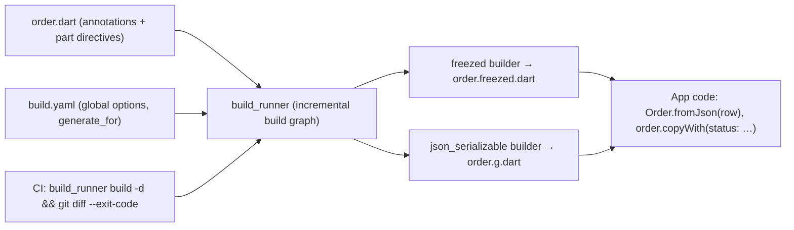

# Dart - Code Generation with build_runner, freezed & json_serializable

> [!info] Deep dive of [[Dart]]

> [!abstract] TL;DR
> Since **Dart macros were cancelled (Jan 2025)**, `build_runner` code generation remains the way to get immutable models, unions, `copyWith`, value equality and JSON mapping.
> - **`freezed` 3** requires `abstract`/`sealed` classes and dropped `when`/`map`, so use Dart 3 **pattern matching**. Pair it with **`json_serializable`** configured once in `build.yaml` (snake_case for Supabase).
> - Run `dart run build_runner watch -d` while developing, and check in CI that generated files are up to date.
> - For simple DTOs, **records or hand-written classes** may be enough. Not every class needs codegen.

## Concept
| Tool | Generates | Use for |
|---|---|---|
| `build_runner` | Runs builders, writes `*.g.dart` / `*.freezed.dart` | The engine for everything below |
| `freezed` | Immutable classes, `copyWith`, `==`/`hashCode`, `toString`, sealed unions | Domain models, UI state, events |
| `json_serializable` | `fromJson`/`toJson` | API/DB DTOs |
| `riverpod_generator` | Providers from annotated functions/classes | Riverpod state ([[Flutter - State Management]]) |
| `drift_dev` | Type-safe SQLite queries | Offline storage ([[Flutter - Offline Storage & Sync]]) |
| Alternatives | `dart_mappable` (one package for both), records + manual JSON, `built_value` (legacy) | Smaller projects, fewer builders |

**freezed 2 → 3 changes**:

| freezed 2 | freezed 3 |
|---|---|
| `class User with _$User` | `abstract class User with _$User` (single) / `sealed class Result with _$Result` (union) |
| `result.when(ok: …, err: …)` | `switch (result) { Ok(:final value) => …, Err(:final error) => … }` |
| `.map/.maybeWhen` generated | Removed. Use Dart 3 patterns |

## How It Works


## Practical Usage
**Model with freezed 3 + json_serializable**:
```dart
import 'package:freezed_annotation/freezed_annotation.dart';
part 'order.freezed.dart';
part 'order.g.dart';

enum OrderStatus {
  @JsonValue('pending') pending,
  @JsonValue('paid') paid,
  @JsonValue('cancelled') cancelled,
  unknown,
}

@freezed
abstract class Order with _$Order {
  const factory Order({
    required String id,
    required String tenantId,
    @JsonKey(unknownEnumValue: OrderStatus.unknown) required OrderStatus status,
    required int totalCents,                       // money as integer sen, never double
    required DateTime createdAt,
    @Default(<OrderItem>[]) List<OrderItem> items,
  }) = _Order;

  factory Order.fromJson(Map<String, dynamic> json) => _$OrderFromJson(json);
}
```
**Sealed union for UI state + pattern matching**:
```dart
@freezed
sealed class CheckoutState with _$CheckoutState {
  const factory CheckoutState.idle() = CheckoutIdle;
  const factory CheckoutState.submitting() = CheckoutSubmitting;
  const factory CheckoutState.failed(String code) = CheckoutFailed;
  const factory CheckoutState.done(Order order) = CheckoutDone;
}

Widget build(BuildContext context) => switch (state) {
  CheckoutIdle() => const PayButton(),
  CheckoutSubmitting() => const CircularProgressIndicator(),
  CheckoutFailed(:final code) => ErrorText(t.checkoutError(code)),
  CheckoutDone(:final order) => ReceiptView(order: order),
};                                                    // exhaustive: adding a state breaks the build until handled
```
**Global options in `build.yaml`** (Supabase snake_case, nested toJson):
```yaml
targets:
  $default:
    builders:
      json_serializable:
        generate_for: ["lib/**/models/**.dart"]     # scope builders → faster builds
        options:
          field_rename: snake                        # tenantId ↔ tenant_id
          explicit_to_json: true                     # nested objects serialized properly
          include_if_null: false
          checked: true                              # better error messages on bad payloads
      freezed:
        generate_for: ["lib/**/models/**.dart", "lib/**/state/**.dart"]
```
**Commands and CI check**:
```bash
dart run build_runner watch -d                     # dev (-d = --delete-conflicting-outputs)
dart run build_runner build -d                     # one-off / CI
git diff --exit-code -- '*.g.dart' '*.freezed.dart'   # fail CI if generated files are stale (when committed)
```
**No-codegen alternative for small DTOs** (Dart 3 records + patterns):
```dart
typedef Tenant = ({String id, String name});
Tenant tenantFromJson(Map<String, dynamic> j) => switch (j) {
  {'id': String id, 'name': String name} => (id: id, name: name),
  _ => throw FormatException('bad tenant: $j'),
};
```
**Wrong way**:
```dart
@freezed
class User with _$User { … }           // ❌ freezed 3: must be abstract or sealed → build error / missing methods
state.when(idle: …, done: …);          // ❌ removed in freezed 3; use switch patterns
final double total;                    // ❌ money as double → RM 0.1 + 0.2 errors
```

## Patterns & Anti-patterns
| Pattern | When | Anti-pattern to avoid |
|---|---|---|
| Separate DTOs (JSON shape) from domain models when shapes differ | Supabase/REST data | One class mirroring the DB used everywhere |
| `build.yaml` global options + `generate_for` scoping | Every project | Per-class `@JsonSerializable(fieldRename: …)` drift |
| `unknownEnumValue` for server enums | Statuses that may grow | App crashes when the backend adds a status |
| Sealed unions + exhaustive `switch` | UI states, results, events | Nullable flags (`isLoading`, `error`, `data` all optional) |
| Integer cents/sen for money, UTC `DateTime` | Payments, orders | Doubles and local-time strings |
| Commit generated files *or* generate in CI, consistently | Teams/CI | Half the team committing, half not |
| Records/hand-written classes for tiny types | Simple DTOs | Codegen for every 2-field class |

## Performance & Trade-offs
- **Build time** grows with files and builders. Scope with `generate_for`, split large apps into packages, and use `watch` instead of repeated `build`. Big apps can still take tens of seconds for a full build.
- **Generated code size** adds to the app binary (minor) and to PR diffs (noisy). Mark generated files as such in `.gitattributes` (`linguist-generated=true`) if committed.
- **Dependency coupling**: builders depend on `analyzer` versions, so freezed, json_serializable, riverpod_generator and drift must agree. Upgrades sometimes wait on the slowest package.
- **`dart_mappable`** reduces builder count (one package for data classes + JSON), but with a smaller ecosystem than freezed + json_serializable.

## Tips & Reminders
> [!tip] In ZP's stack
> - **Supabase models**: generate TS types for the web and write Dart models with `field_rename: snake`, keeping them in a shared `packages/models` package for Flutter apps ([[Supabase]]).
> - **Money**: store `total_cents int` in Postgres and `int totalCents` in Dart. Format to `RM` only in the UI ([[Flutter - Internationalization & Localization]]).
> - **Monorepo with melos**: run `build_runner` per package in CI. A root-level build across all packages is slow and fragile.

- Add `*.g.dart` and `*.freezed.dart` to analyzer `exclude` for lints, but not for type checking.
- Pin builder versions together in `pubspec.yaml`, and upgrade them as a set.
- Use `checked: true` in development to get readable `CheckedFromJsonException` messages for bad payloads.
- For API boundaries, validate unknown fields/types early, the same way Zod does in TypeScript ([[TypeScript - Runtime Validation with Zod & Type-Safe APIs]]).

## Version Notes
| Date / version | Change |
|---|---|
| Dart 3.0 (2023) | Records, patterns, sealed classes, which reduce the need for some codegen |
| 2025-01 | Dart macros cancelled. Focus on build_runner performance and augmentations |
| freezed 3.0 (2025) | `abstract`/`sealed` required. `when`/`map` removed in favour of pattern matching |
| 2026-08 (reported) | freezed 3.2.5 caps `analyzer` < 11, conflicting with build_runner 2.16 (needs analyzer ≥ 13.3), so build_runner is held at 2.15.x |
| Dart 3.13 (2026-08) | Current stable at re-check ([[Dart]]) |

> [!warning] Unverified — check before relying on this
> The freezed/analyzer/build_runner version conflict comes from a single article (Aug 2026). Check pub.dev for current freezed and build_runner releases and their analyzer constraints before upgrading.

## Critical Issues & Gotchas
> [!danger] freezed 3 upgrade breaks every model and every `when` call
> Upgrading freezed 2 → 3 turns every plain `class X with _$X` into a build error, and every `.when/.map` call site into a compile error. On a large app that's hundreds of edits. Plan the migration as one change (convert to `abstract`/`sealed`, replace `when` with `switch`), or pin freezed 2 until you can.

> [!danger] Silent JSON drift between backend and app
> Generated `fromJson` trusts the shape it was written for. A renamed DB column or a new enum value can crash parsing at runtime in released app versions you can't patch instantly. Use `unknownEnumValue`, nullable/default fields for new data, backward-compatible API changes, and contract tests against real Supabase responses ([[Supabase - Migrations, Branching & Local Development]]).

- **`part` directive names** must match the file name exactly (`order.dart` → `part 'order.freezed.dart'`).
- **`-d` deletes conflicting outputs**, including hand-edited generated files. Never edit generated code.
- **Nested `toJson`** without `explicit_to_json: true` emits `Instance of 'OrderItem'` instead of maps.
- **DateTime parsing**: Supabase returns ISO strings with offsets. Keep values UTC internally and convert for display only.

## Related
- [[Dart]]
- [[Dart - Type System, Null Safety & Mixins]] — sealed classes, patterns, records
- [[Flutter - State Management]] — immutable state with value equality
- [[Flutter - Offline Storage & Sync]] — drift codegen for local databases
- [[Supabase]] — snake_case schemas and generated types
- [[TypeScript - Runtime Validation with Zod & Type-Safe APIs]] — the web-side equivalent of typed boundaries

## References
- https://pub.dev/packages/freezed/changelog
- https://pub.dev/packages/json_serializable
- https://pub.dev/packages/build_runner
- https://dart.dev/language/patterns
- https://www.issoh.co.jp/md/tech/16733
