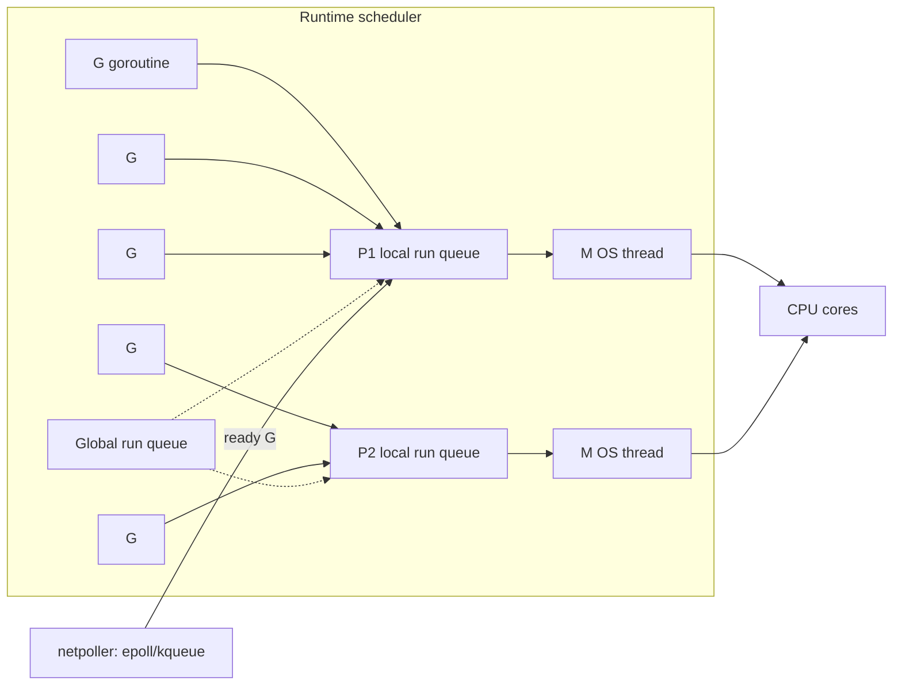

# Go - Concurrency

> [!info] Deep dive of [[Go]]

> [!abstract] TL;DR
> Go gives you cheap **goroutines** (~2 KB starting stacks, multiplexed onto OS threads by the runtime's M:N scheduler), **channels** for communication, and `sync`/`atomic` for shared memory. **`context.Context`** carries cancellation and deadlines.
> - Write synchronous-looking code and let goroutines + the scheduler handle concurrency.
> - Every goroutine you start needs a clear way to **stop** (context, closed channel, or finishing its work), otherwise you leak memory.
> - Run tests with `-race`.

## Concept

### Primitives
| Primitive | Use | Notes |
|---|---|---|
| `go f()` | Start a goroutine | No return value. Communicate via channels or shared state |
| Unbuffered `chan T` | Synchronous handoff (sender waits for receiver) | Strong coordination point |
| Buffered `make(chan T, n)` | Queue with capacity n | Decouples bursts. Not a replacement for backpressure design |
| `select` | Wait on multiple channel ops, timeouts, cancellation | `default` makes it non-blocking |
| `close(ch)` | Signal "no more values" | Only the sender closes. Receivers get the zero value + `ok=false` |
| `sync.Mutex` / `RWMutex` | Protect shared state | Keep critical sections small. Never copy a mutex |
| `sync.WaitGroup` | Wait for N goroutines | `wg.Go(func(){…})` (1.25) does Add/Done for you |
| `sync.Once` / `OnceFunc` / `OnceValue` | Lazy one-time init | `OnceValue` (1.21) returns cached results |
| `sync/atomic` (`atomic.Int64`, `atomic.Pointer[T]`) | Lock-free counters, flags, config swaps | Typed atomics since 1.19 |
| `context.Context` | Cancellation, deadlines, request-scoped values | First parameter by convention: `ctx context.Context` |
| `golang.org/x/sync/errgroup` | Run tasks, cancel all on first error, bounded concurrency (`SetLimit`) | The go-to for fan-out with errors |
| `semaphore.Weighted` | Limit concurrent access to a resource | Rate-limits DB/API calls |

**Rule of thumb**: "Don't communicate by sharing memory; share memory by communicating." Use a mutex for simple shared state, and channels for ownership transfer and pipelines.

## How It Works

- **GMP model**: G (goroutine), M (OS thread), P (processor: scheduling context, count = `GOMAXPROCS`). Each P has a local run queue. Idle Ps **steal work** from others.
- **Blocking I/O**: network I/O parks the goroutine on the **netpoller** (epoll/kqueue), so the thread keeps running other goroutines. Blocking syscalls/cgo hand the P to another M.
- **Preemption**: asynchronous preemption (Go 1.14+, signal-based) prevents tight loops from starving others.
- **Growing stacks**: goroutine stacks start small and grow/shrink by copying, so millions of goroutines are feasible (memory-bound).
- **GOMAXPROCS in containers**: since Go 1.25, the default respects **cgroup CPU limits** ([[Kubernetes]]/[[Docker]] quotas), avoiding throttling from oversubscription. On older versions, use `go.uber.org/automaxprocs`.
- **Memory model**: happens-before is established by channel ops, mutex unlock→lock, `sync.Once`, atomics and `WaitGroup`. Unsynchronized concurrent read+write is a **data race** (undefined behaviour), and maps panic on concurrent writes.

## Practical Usage

### Bounded fan-out with errgroup + context
```go
func FetchAll(ctx context.Context, ids []string) ([]Order, error) {
    g, ctx := errgroup.WithContext(ctx)      // ctx cancelled on first error
    g.SetLimit(8)                             // at most 8 concurrent calls (respect API rate limits)
    out := make([]Order, len(ids))
    for i, id := range ids {                  // Go 1.22+: loop vars are per-iteration (safe to capture)
        g.Go(func() error {
            o, err := client.GetOrder(ctx, id)
            if err != nil { return fmt.Errorf("order %s: %w", id, err) }
            out[i] = o                        // distinct index per goroutine: no race
            return nil
        })
    }
    return out, g.Wait()
}
```

### Worker pool with graceful shutdown
```go
func RunWorkers(ctx context.Context, jobs <-chan Job, n int) {
    var wg sync.WaitGroup
    for range n {                             // range over int (1.22+)
        wg.Go(func() {                        // 1.25+
            for {
                select {
                case <-ctx.Done():
                    return
                case j, ok := <-jobs:
                    if !ok { return }         // producer closed the channel
                    process(ctx, j)
                }
            }
        })
    }
    wg.Wait()
}
// main: ctx, stop := signal.NotifyContext(context.Background(), os.Interrupt, syscall.SIGTERM); defer stop()
```

### Timeouts and cancellation propagate
```go
ctx, cancel := context.WithTimeout(r.Context(), 3*time.Second)   // inherit request cancellation
defer cancel()                                                   // always call cancel (vet checks this)
row := db.QueryRowContext(ctx, `select status from orders where id=$1`, id)
```

### Wrong way: leaking goroutine
```go
func first(urls []string) string {
    ch := make(chan string)                   // unbuffered
    for _, u := range urls { go func() { ch <- fetch(u) }() }
    return <-ch                               // other senders block forever → goroutine leak
}
// Fix: make(chan string, len(urls)) or pass ctx and select on ctx.Done() in senders.
```

### Testing concurrency
```bash
go test -race ./...                          # run in CI; ~2–10× slower, catches data races at runtime
go test -run TestX -count=100 -race          # shake out flaky interleavings
```
```go
// testing/synctest (GA in 1.25): deterministic tests of time/goroutine-based code with a fake clock
synctest.Test(t, func(t *testing.T) { /* time.Sleep advances instantly when all goroutines are blocked */ })
```

## Patterns & Anti-patterns
| Pattern | When | Anti-pattern to avoid |
|---|---|---|
| `errgroup` + `SetLimit` | Fan-out with errors and bounds | Unbounded `go` per item (10k goroutines hammering a DB) |
| Context as first arg, honoured everywhere | Any I/O or long work | `context.Background()` deep in call stacks (loses cancellation) |
| Owner goroutine closes the channel | Pipelines | Receivers closing channels (panics on send to closed channel) |
| Mutex around a small struct | Shared counters/caches | Channels as glorified mutexes for simple state |
| `atomic.Pointer` for hot config reloads | Read-heavy shared config | `RWMutex` around every read in hot paths |
| Pipelines (stage goroutines + channels) | Streaming transforms | Unbuffered pipelines without cancellation → leaks |

## Performance & Trade-offs
- Goroutines are cheap, but not free: each one is ~2–8 KB+ of stack, and scheduling and GC scanning scale with count. Millions are possible, but bounded pools are usually better for I/O-heavy work.
- Channels cost ~tens to hundreds of ns per op with contention. For high-throughput counters use atomics, and for shared maps use sharded mutexes or `sync.Map` (only for read-mostly, disjoint-key workloads).
- `sync.Pool` reduces allocation churn for short-lived buffers, but objects may be dropped at any GC.
- Lock contention shows up in `pprof` mutex/block profiles (`runtime.SetMutexProfileFraction`). Goroutine dumps (`/debug/pprof/goroutine?debug=2`) reveal leaks.

## Tips & Reminders
> [!tip]
> - Every `go` statement: ask "how does this goroutine end?" and "who waits for it?".
> - Pass `ctx` through all I/O (HTTP, DB, gRPC). Use `http.Server.Shutdown(ctx)` and drain workers on `SIGTERM` for zero-downtime deploys.
> - Prefer `errgroup` over hand-rolled `WaitGroup` + error channels.
> - Always run the race detector in CI. Production data races are non-deterministic heisenbugs.
> - Monitor `runtime.NumGoroutine()` (expose via Prometheus `go_goroutines`). Steady growth means a leak.
> - **In ZP's stack**: Go fits high-concurrency sidecars (webhook fan-in, WhatsApp media processing, proxies) next to Node services. Bound concurrency to Meta/LLM rate limits with `errgroup.SetLimit` or `semaphore`, and set CPU limits in [[Coolify]]/Docker so container-aware GOMAXPROCS matches.

## Version Notes
| Version | Change |
|---|---|
| 1.14 (2020) | Asynchronous preemption |
| 1.19 (2022) | Typed atomics (`atomic.Int64`, `atomic.Pointer[T]`), revised memory model doc |
| 1.21 (2023) | `sync.OnceFunc`/`OnceValue`, `context.WithoutCancel`/`AfterFunc` |
| **1.22** (2024) | **Per-iteration loop variables** (fixes the classic closure capture bug), range over int |
| 1.23–1.24 | Iterators (`iter.Seq`), timer/ticker GC and unbuffered-channel semantics fixes, `testing/synctest` experiment |
| **1.25** (2025-08) | **Container-aware GOMAXPROCS**, `sync.WaitGroup.Go`, `testing/synctest` GA, Green Tea GC experiment |
| 1.26 / 1.27 (2026) | Runtime/GC improvements (Green Tea GC progressing towards default) |

> [!warning] Unverified — check before relying on this
> Concurrency-relevant changes in Go 1.26/1.27 weren't confirmed this run. Check https://go.dev/doc/devel/release.

## Critical Issues & Gotchas
> [!danger] Goroutine leaks are memory leaks
> Goroutines blocked forever on channel sends/receives, missing `ctx.Done()` cases, or un-cancelled `time.After` loops accumulate until the service OOMs. They're invisible in normal metrics until it's late. Track goroutine counts, use `goleak` in tests (`go.uber.org/goleak`), and design every goroutine with an exit path.

> [!danger] Data races corrupt state silently
> Concurrent map writes crash with `fatal error: concurrent map writes` (unrecoverable, takes down the process). Racy reads/writes on structs or slices produce torn values without any error. Interfaces and slices are multi-word, so races can even cause memory-unsafe behaviour. Run `-race` in CI and protect shared state.

> [!warning] Gotchas
> - Sending on a closed channel panics. Closing a closed channel panics. A nil channel blocks forever (useful to disable `select` cases deliberately).
> - `time.After` in a hot `select` loop allocates a timer per iteration. Use a `time.Ticker`/`Timer` with reset (improved in 1.23, but still wasteful).
> - Unrecovered panics in any goroutine crash the whole program. `recover` only works in the same goroutine (add recovery in worker loops).
> - `WaitGroup.Add` must happen before `go`, not inside the goroutine (or use `wg.Go`).
> - Holding a mutex while doing I/O serializes the system. Copy the data out, unlock, then do the I/O.

## Related
- [[Go]]
- [[JavaScript - Event Loop & Async]] — contrast: single-threaded event loop
- [[Rust - Ownership & Borrowing]] — compile-time data-race prevention
- [[Python - Async & Concurrency]] — asyncio vs goroutines
- [[System Design]] — backpressure, timeouts, bounded concurrency
- [[Kubernetes]] — CPU limits and GOMAXPROCS

## References
- Effective Go, concurrency: https://go.dev/doc/effective_go#concurrency
- Go memory model: https://go.dev/ref/mem
- Go blog, pipelines and cancellation: https://go.dev/blog/pipelines
- errgroup: https://pkg.go.dev/golang.org/x/sync/errgroup
- Container-aware GOMAXPROCS (Go 1.25): https://go.dev/blog/container-aware-gomaxprocs
- testing/synctest: https://pkg.go.dev/testing/synctest
