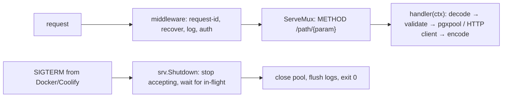

# Go - HTTP Services & Ops Tooling

> [!info] Deep dive of [[Go]]

> [!abstract] TL;DR
> For small, durable services and ops tools, the standard library is enough:
> - `net/http` with method + path patterns (1.22+);
> - `log/slog` for structured logs;
> - `context` everywhere;
> - explicit server and client **timeouts**, plus graceful shutdown on SIGTERM;
> - `pgx` for Postgres.
>
> Ship as a **static binary** in a `distroless`/`scratch` image (~10–20 MB, ~10–30 MB RAM), with `GOMEMLIMIT` set below the container limit. Go shines for webhook relays, backup verifiers, health checkers and CLIs that must run for years without dependency churn.

## Concept
| Concern | Stdlib / go-to package | Notes |
|---|---|---|
| Routing | `http.ServeMux` patterns: `"GET /orders/{id}"` | Path params via `r.PathValue("id")`. Method matching. 405 handled |
| Middleware | `func(http.Handler) http.Handler` | Logging, recovery, auth, request ID |
| JSON | `encoding/json` + `http.MaxBytesReader` + `DisallowUnknownFields` | Validate after decode |
| Logging | `log/slog` (JSON handler) | Structured, leveled, context attrs |
| Postgres | `github.com/jackc/pgx/v5/pgxpool` | Pooling, `pgx.CollectRows`, `COPY` |
| Config | `os.Getenv` + a small validated struct | Fail fast at boot |
| Graceful shutdown | `signal.NotifyContext` + `srv.Shutdown(ctx)` | Drain in-flight requests before exit |
| Profiling | `net/http/pprof` on an internal port | Never on the public mux |
| CLIs | `flag` (stdlib) or `cobra` | Single binary, cross-compiled |

## How It Works


## Practical Usage
**Service skeleton** (timeouts, routing, graceful shutdown):
```go
package main

import (
	"context"
	"encoding/json"
	"errors"
	"log/slog"
	"net/http"
	"os"
	"os/signal"
	"syscall"
	"time"

	"github.com/jackc/pgx/v5/pgxpool"
	_ "time/tzdata" // embed zoneinfo: scratch images have none (Asia/Kuching)
)

func main() {
	log := slog.New(slog.NewJSONHandler(os.Stdout, nil))
	ctx, stop := signal.NotifyContext(context.Background(), syscall.SIGINT, syscall.SIGTERM)
	defer stop()

	pool, err := pgxpool.New(ctx, os.Getenv("DATABASE_URL"))
	if err != nil { log.Error("db", "err", err); os.Exit(1) }
	defer pool.Close()

	mux := http.NewServeMux()
	mux.HandleFunc("GET /healthz", func(w http.ResponseWriter, r *http.Request) {
		if err := pool.Ping(r.Context()); err != nil { http.Error(w, "db", http.StatusServiceUnavailable); return }
		w.Write([]byte("ok"))
	})
	mux.HandleFunc("GET /orders/{id}", getOrder(pool))

	srv := &http.Server{
		Addr:              ":8080",
		Handler:           withRequestLog(log, mux),
		ReadHeaderTimeout: 5 * time.Second,  // slowloris
		ReadTimeout:       15 * time.Second,
		WriteTimeout:      30 * time.Second,
		IdleTimeout:       95 * time.Second,  // > Traefik idle pool timeout
	}
	go func() {
		if err := srv.ListenAndServe(); err != nil && !errors.Is(err, http.ErrServerClosed) { log.Error("listen", "err", err); stop() }
	}()
	<-ctx.Done()
	shutdownCtx, cancel := context.WithTimeout(context.Background(), 20*time.Second)
	defer cancel()
	_ = srv.Shutdown(shutdownCtx)
}

func getOrder(pool *pgxpool.Pool) http.HandlerFunc {
	return func(w http.ResponseWriter, r *http.Request) {
		var o struct{ ID, Status string; TotalSen int64 }
		err := pool.QueryRow(r.Context(), `select id, status, total_sen from orders where id = $1`, r.PathValue("id")).
			Scan(&o.ID, &o.Status, &o.TotalSen)
		if err != nil { http.Error(w, "not found", http.StatusNotFound); return }
		w.Header().Set("Content-Type", "application/json")
		json.NewEncoder(w).Encode(o)
	}
}
```
**Outbound HTTP client with timeouts** (the default client has **none**):
```go
var api = &http.Client{
	Timeout: 10 * time.Second,
	Transport: &http.Transport{MaxIdleConnsPerHost: 32, IdleConnTimeout: 90 * time.Second},
}
```
**Static image**:
```dockerfile
FROM golang:1.27 AS build
WORKDIR /src
COPY go.mod go.sum ./
RUN --mount=type=cache,target=/go/pkg/mod go mod download
COPY . .
RUN --mount=type=cache,target=/root/.cache/go-build CGO_ENABLED=0 go build -trimpath -ldflags="-s -w" -o /out/svc ./cmd/svc

FROM gcr.io/distroless/static-debian12:nonroot      # CA certs included, no shell
COPY --from=build /out/svc /svc
ENV GOMEMLIMIT=200MiB
USER nonroot
ENTRYPOINT ["/svc"]
```
**Ops CLI** (e.g. verify that last night's backup exists and is recent):
```go
// go run ./cmd/backupcheck -bucket pg-backups -max-age 26h
max := flag.Duration("max-age", 26*time.Hour, "max allowed backup age")
flag.Parse()
age := time.Since(latestObjectTime(ctx, *bucket))
if age > *max { fmt.Fprintf(os.Stderr, "backup too old: %s\n", age); os.Exit(2) }   // non-zero exit → systemd OnFailure alert
```
Cross-compile for the VPS or a client's Windows box: `GOOS=linux GOARCH=amd64 go build`, `GOOS=windows go build`.

**Wrong way**:
```go
http.ListenAndServe(":8080", nil)          // ❌ no timeouts; DefaultServeMux also exposes anything registered globally (e.g. pprof)
resp, _ := http.Get(url)                   // ❌ default client: no timeout; ignoring err; body never closed
```

## Patterns & Anti-patterns
| Pattern | When | Anti-pattern to avoid |
|---|---|---|
| Explicit `http.Server` with all timeouts | Every service | `http.ListenAndServe(addr, nil)` |
| `context` from request → DB/HTTP calls | All I/O | `context.Background()` deep in handlers (no cancellation) |
| `defer resp.Body.Close()` + drain | Outbound calls | Leaked connections exhausting the pool |
| `slog` JSON with request ID | Production logs | `fmt.Println` debugging left in |
| pprof on a separate internal listener | Diagnostics | `import _ "net/http/pprof"` on the public mux |
| `GOMEMLIMIT` ≈ 80–90% of container memory | Docker/Coolify | OOM kills because the GC didn't know the limit |

## Performance & Trade-offs
- **Footprint**: a typical Go HTTP service idles at ~10–30 MB RSS versus ~60–150 MB for Node. That matters when packing many small services onto a 4–8 GB KVM.
- **Concurrency**: a goroutine per request scales to thousands of concurrent connections without tuning. Since 1.25, `GOMAXPROCS` respects container CPU limits.
- **GC**: Green Tea (default in 1.26) reduces GC CPU on many workloads. `GOGC`/`GOMEMLIMIT` remain the knobs.
- **Go vs Node/TS in this stack**: TS wins on sharing code and types with Next.js and team familiarity. Go wins for long-lived infra utilities, high-concurrency relays and CLIs that must not break on dependency churn. Don't split the core product into two languages without a reason.

## Tips & Reminders
> [!tip] In ZP's stack
> **Good Go candidates**:
> - a self-hosted webhook relay (an alternative to the Cloudflare Worker gateway, [[Cloudflare - Workers for Webhooks & Edge APIs]]);
> - backup and certificate-expiry checkers run by systemd timers ([[Linux Essentials - systemd, Logs & Troubleshooting]]);
> - log/metrics shippers;
> - small per-client integration services on Coolify.
>
> Keep the main SaaS backend in TypeScript.

- Set `IdleTimeout` above Traefik's idle pool timeout, or set `idleConnTimeout` shorter on Traefik, to avoid the keep-alive 502 race ([[HTTP & HTTPS - HTTP-2, HTTP-3 & Connection Management]]).
- Use `go vet`, `staticcheck` and `govulncheck` in CI. `govulncheck` reports only vulnerabilities your code actually calls.
- `go fix` (1.26) applies modernizers. Run it after toolchain upgrades.
- Embed migrations and static assets with `embed.FS` for single-binary deploys.

## Version Notes
| Version | Released | Key changes | Breaking / migration notes |
|---|---|---|---|
| 1.21 | 2023-08 | `log/slog`, `min`/`max`, toolchain directive | — |
| 1.22 | 2024-02 | **ServeMux method + wildcard patterns**, per-iteration loop variables | Pattern precedence rules differ from old prefix matching |
| 1.24 | 2025-02 | Swiss-table maps, `tool` directives in `go.mod`, `os.Root` | — |
| 1.25 | 2025-08 | Container-aware `GOMAXPROCS`, Green Tea GC experiment, `testing/synctest` | — |
| 1.26 | 2026-02 | Green Tea GC enabled, `new(expr)`, rebuilt `go fix` modernizers, `errors.AsType` | Historical `go fix` fixers removed |
| 1.27 | 2026-08 | Current (see [[Go]]) | — |

## Critical Issues & Gotchas
> [!danger] Default HTTP client and server have no timeouts
> `http.Get` / `http.DefaultClient` can hang forever on a stalled upstream, accumulating goroutines and file descriptors until the service dies. A server without `ReadHeaderTimeout` is slowloris-able. Always construct clients and servers with explicit timeouts.

> [!danger] Exposed pprof / expvar
> Importing `net/http/pprof` registers handlers on `http.DefaultServeMux`. If that mux is public, anyone can pull heap profiles (containing secrets in memory) and CPU profiles. Serve pprof on a separate localhost listener.

- **`scratch` images lack CA certs and tzdata**: TLS calls fail (`x509: certificate signed by unknown authority`) and `time.LoadLocation("Asia/Kuching")` errors. Use `distroless/static` (has certs) and `import _ "time/tzdata"`.
- **Goroutine leaks**: goroutines blocked on channels or requests without a context never exit. Watch `runtime.NumGoroutine()` in metrics.
- **Writing to a nil map panics**, and a panic in a goroutine (not the handler) crashes the whole process. Recover inside spawned goroutines.
- **`encoding/json` silently ignores unknown fields** by default, so typos in client payloads pass. Use `DisallowUnknownFields` on write endpoints.

## Related
- [[Go]]
- [[Go - Concurrency]] — goroutines, channels, errgroup, context
- [[Docker - Dockerfile & Image Best Practices]] — static, distroless images
- [[HTTP & HTTPS - HTTP-2, HTTP-3 & Connection Management]] — timeouts and keep-alive alignment
- [[PostgreSQL]] — pgx usage, pooling
- [[Linux Essentials - systemd, Logs & Troubleshooting]] — running Go ops tools as timers/services

## References
- https://go.dev/doc/go1.26
- https://pkg.go.dev/net/http#ServeMux
- https://pkg.go.dev/log/slog
- https://github.com/jackc/pgx
- https://go.dev/blog/routing-enhancements
