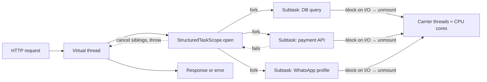

# Java - Virtual Threads & Structured Concurrency

> [!info] Deep dive of [[Java]]

> [!abstract] TL;DR
> - **Virtual threads** (JDK 21): cheap JVM-managed threads, so plain blocking code scales to tens of thousands of concurrent I/O tasks. Don't pool them. Bound concurrency with semaphores and connection pools instead.
> - **Pinning**: `synchronized` pinning was mostly removed in JDK 24 (JEP 491).
> - **Scoped values** (final in 25): an immutable, inheritable alternative to `ThreadLocal`.
> - **Structured concurrency** (`StructuredTaskScope`, still **preview** in 26/27): gives fork/join with automatic cancellation and error propagation.
> - **Use virtual threads for I/O-bound work only.** CPU-bound work still belongs on platform threads or ForkJoin.

## Concept

### Platform vs virtual threads
| | Platform thread | Virtual thread |
|---|---|---|
| Backed by | 1:1 OS thread (~1 MB stack reserved) | Heap-allocated continuation mounted on a carrier (ForkJoinPool) |
| Creation cost | ~µs–ms, limited to thousands | ~1 µs, millions possible |
| Blocking I/O | Blocks the OS thread | **Unmounts**. Carrier serves other virtual threads |
| Scheduling | OS | JVM (carrier pool ≈ CPU cores) |
| Best for | CPU-bound work, native-heavy code | I/O-bound request handling, fan-out calls |
| Pooling | Yes (bounded pools) | **No**: create per task |

### Pinning (when a virtual thread can't unmount)
| Cause | Status | Mitigation |
|---|---|---|
| `synchronized` blocks/methods | **Fixed in JDK 24** (JEP 491) for most cases | Upgrade to 24+. On 21, use `ReentrantLock` |
| Native frames (JNI, some drivers) | Still pins | Isolate native-heavy work on platform threads |
| `Object.wait()` | Improved with JEP 491 | Prefer `java.util.concurrent` primitives |
| Class initialisers, some file I/O on certain OS | May pin or compensate with extra carriers | Measure with JFR |

### Scoped values vs ThreadLocal
| | `ThreadLocal` | `ScopedValue` (final, JDK 25) |
|---|---|---|
| Mutability | Mutable (`set`) | Immutable binding for a dynamic scope |
| Lifetime | Until removed (leaks in pools) | Exactly the `run`/`call` scope |
| Inheritance | Copy to children (costly with millions of threads) | Cheap sharing with `StructuredTaskScope` children |
| Use | Legacy frameworks | Request context (tenant, user, trace ID) |

## How It Works

- When a virtual thread blocks on supported I/O (sockets, `Thread.sleep`, `java.util.concurrent` locks), its stack frames are copied to the heap and the carrier picks another runnable virtual thread. Resuming remounts it on any carrier.
- **Structured concurrency**: subtasks forked in a scope can't outlive it. `join()` waits per the chosen **Joiner** policy. A failure (or timeout) cancels sibling subtasks via interruption, and the scope closes with no leaked threads.

## Practical Usage

### Virtual threads in practice
```java
// Per-task executor: one virtual thread per task, never pooled
try (var executor = Executors.newVirtualThreadPerTaskExecutor()) {
    List<Future<Invoice>> fs = orderIds.stream()
        .map(id -> executor.submit(() -> invoiceClient.fetch(id)))   // blocking HTTP call is fine
        .toList();
    for (var f : fs) process(f.get());
}

// Bound concurrency to protect downstreams (DB pool size, API rate limit)
var permits = new Semaphore(20);
Thread.ofVirtual().name("sync-", 0).start(() -> {
    permits.acquireUninterruptibly();
    try { syncCustomer(); } finally { permits.release(); }
});
```
```yaml
# Spring Boot 3.2+/4: Tomcat request threads + @Async + scheduling on virtual threads
spring:
  threads:
    virtual:
      enabled: true
```

### Structured concurrency (JDK 26 preview API, `--enable-preview`)
```java
record Dashboard(Orders orders, Balance balance, Profile profile) {}

Dashboard load(String tenantId) throws InterruptedException {
    try (var scope = StructuredTaskScope.open(
            StructuredTaskScope.Joiner.<Object>awaitAllSuccessfulOrThrow(),
            cfg -> cfg.withTimeout(Duration.ofSeconds(2)))) {
        var orders  = scope.fork(() -> ordersRepo.recent(tenantId));
        var balance = scope.fork(() -> paymentsApi.balance(tenantId));
        var profile = scope.fork(() -> crm.profile(tenantId));
        scope.join();                                   // throws if any failed or timeout hit; others cancelled
        return new Dashboard(orders.get(), balance.get(), profile.get());
    }
}
```
- Other joiners include "first success wins" (`anySuccessfulOrThrow()` in 26, renamed from `anySuccessfulResultOrThrow()`) for hedged requests to replicas, and `allSuccessfulOrThrow()` returning a list (26).
- **Preview APIs change between releases.** Wrap them behind a small internal helper so upgrades touch one file.

### Scoped values for request context
```java
static final ScopedValue<RequestCtx> CTX = ScopedValue.newInstance();

void handle(HttpRequest req) {
    var ctx = new RequestCtx(req.tenantId(), req.userId(), req.traceId());
    ScopedValue.where(CTX, ctx).run(() -> service.process());   // visible to callees and scope subtasks
}
// anywhere below: CTX.get().tenantId()
```

### Diagnosing
```bash
# JFR events for pinning and submit failures
java -XX:StartFlightRecording=duration=60s,filename=vt.jfr -jar app.jar
jfr print --events jdk.VirtualThreadPinned vt.jfr

# Thread dump including virtual threads (JSON groups them by container/scope)
jcmd <pid> Thread.dump_to_file -format=json /tmp/threads.json
```

## Patterns & Anti-patterns
| Pattern | When | Anti-pattern to avoid |
|---|---|---|
| Virtual thread per request/task | I/O-bound servers, fan-out | Pooling virtual threads in a fixed `ThreadPoolExecutor` |
| Semaphore / connection pool as the concurrency limit | Calls to DB, rate-limited APIs | 10,000 virtual threads hammering a 20-connection Hikari pool → timeouts |
| `StructuredTaskScope` for related subtasks | Aggregating several backends | Ad hoc `CompletableFuture` chains with leaked tasks on failure |
| `ScopedValue` for context | Tenant/trace propagation | Big mutable `ThreadLocal` caches per thread (memory × millions) |
| Platform threads / ForkJoin for CPU work | Image processing, crypto, heavy parsing | CPU-bound loops on virtual threads (starve carriers) |
| Upgrade to JDK 24+ before adopting at scale | Existing `synchronized`-heavy code | Running Loom on 21 with pinned JDBC drivers and wondering why throughput is flat |

## Performance & Trade-offs
- **Throughput, not latency**: virtual threads don't make a single call faster. They let you have many concurrent waits. If the DB is the bottleneck, more threads only queue at the pool.
- **Virtual threads vs reactive (WebFlux/Reactor)**:
  - **Virtual threads**: similar scalability for I/O, with plain imperative code, readable stack traces and normal debugging.
  - **Reactive**: still wins for backpressure-heavy streaming and existing reactive stacks.
- **Memory**: each virtual thread's stack grows on the heap as needed (KBs). A million idle threads cost GBs if each holds deep stacks or big ThreadLocals, so keep per-request state small.
- **vs Kotlin coroutines**:
  - **Coroutines**: Flow, cancellation semantics and structured concurrency today ([[Kotlin - Coroutines & Flow]]).
  - **Virtual threads**: let blocking Java libraries scale without suspend rewrites.
  - **Both combine**: coroutine dispatchers can run on virtual threads.

## Tips & Reminders
> [!tip]
> - **Check libraries**: JDBC drivers, HTTP clients and SDKs that use `synchronized` around I/O pinned on JDK 21. Re-test on 24/25 with JFR before declaring victory.
> - **Keep Hikari `maximumPoolSize` realistic** (DB max_connections / instances). Virtual threads make it easy to exceed DB capacity ([[PostgreSQL]]).
> - **Timeouts everywhere**: HTTP clients, JDBC `queryTimeout`, scope `withTimeout`. Cheap threads make hung calls pile up silently.
> - **In ZP's stack**: mostly Node/Dart. For inherited Spring Boot services, enable virtual threads on JDK 25 LTS, measure with JFR, and keep `StructuredTaskScope` behind a helper until it's final ([[Spring Boot]]).

## Version Notes
| JDK | Change |
|---|---|
| 19–20 | Virtual threads & structured concurrency previews/incubators |
| **21 LTS** (2023-09) | **Virtual threads final** (JEP 444) |
| 21–25 | Structured concurrency previews (JEP 453, 462, 480, 499, 505). Scoped values previews |
| 24 (2025-03) | **JEP 491**: virtual threads synchronize without pinning |
| **25 LTS** (2025-09) | **Scoped values final** (JEP 506). Structured concurrency 5th preview with new `StructuredTaskScope.open(...)` + Joiner API (JEP 505) |
| 26 (2026-03-17) | Structured concurrency **6th preview** (JEP 525): `Joiner.onTimeout()`, `anySuccessfulOrThrow()` rename, `allSuccessfulOrThrow()` returns list |
| 27 (2026-09) | Parent note reports another preview. Check JEP status before relying on finalisation |

> [!warning] Unverified — check before relying on this
> JDK 27's structured-concurrency status (7th preview vs final) wasn't confirmed by search. Exact Joiner method names differ between 25, 26 and 27. Check openjdk.org/jeps for your target JDK.

## Critical Issues & Gotchas
> [!danger] Unbounded concurrency overwhelms downstreams
> Switching a request handler to virtual threads removes the implicit limit that a 200-thread pool used to provide. A traffic spike now opens thousands of concurrent DB queries or API calls. Pools time out, rate limits trip, and payment or Meta APIs start returning 429/5xx. Put explicit limits (semaphores, pool sizes, rate limiters) at every downstream boundary.

> [!danger] Pinning and ThreadLocal leaks on JDK 21
> On JDK 21, `synchronized` around blocking I/O pins the carrier. With few carriers (≈ cores), a handful of pinned threads stall the whole app. Legacy code also caching large objects in `ThreadLocal`s multiplies memory by the number of threads. Upgrade to 24+/25 LTS, replace hot `synchronized` with `ReentrantLock` if staying on 21, and audit `ThreadLocal` usage.

> [!warning] Gotchas
> - `Thread.currentThread().getName()` is empty for unnamed virtual threads. Name them via `Thread.ofVirtual().name(...)` for logs.
> - Thread priorities and daemon flags are fixed (virtual threads are always daemon). Don't rely on them.
> - Preview APIs need `--enable-preview` at compile *and* run time, and class files built with preview features only run on that exact JDK version.
> - Monitoring tools that sample platform threads under-report virtual thread activity. Use JFR/JSON thread dumps.
> - `ExecutorService.close()` (JDK 19+) waits for tasks. A hung task hangs shutdown, so pair it with timeouts.

## Related
- [[Java]]
- [[Spring Boot]] — `spring.threads.virtual.enabled`, Tomcat on virtual threads
- [[Kotlin - Coroutines & Flow]] — structured concurrency on the JVM, today
- [[Go - Concurrency]] — goroutines comparison
- [[PostgreSQL]] — connection limits as the real ceiling
- [[Node.js - Performance & Diagnostics]] — event-loop model comparison

## References
- JEP 444 (virtual threads): https://openjdk.org/jeps/444
- JEP 491 (synchronize without pinning): https://openjdk.org/jeps/491
- JEP 506 (scoped values): https://openjdk.org/jeps/506
- JEP 525 (structured concurrency, 6th preview): https://openjdk.org/jeps/525
- InfoQ, timeout joiner refinements (2026-01): https://www.infoq.com/news/2026/01/timeout-joiner-refinements
