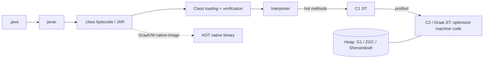

# Java

> [!abstract] TL;DR
> Java is a statically typed, object-oriented (increasingly data-oriented) language on the **JVM**, the most battle-tested managed runtime in enterprise software: banks, telcos, e-commerce, Android's original language, big data ([[Kafka]], Spark, Elasticsearch).
> - **Modern Java is not 2010 Java**: records, sealed types, pattern matching and **virtual threads** (21) make it concise and massively concurrent.
> - **Releases**: every 6 months. **LTS every 2 years**: 21 (2023), **25 (2025-09)**, next 29 (2027).
> - **Use OpenJDK builds** (Temurin, Corretto, Zulu), not Oracle JDK, unless you've budgeted Oracle's per-employee licensing.

## Introduction
- **Origin**: James Gosling at Sun Microsystems, 1.0 in 1996 ("write once, run anywhere"). Oracle acquired Sun in 2010. Development happens in the open via **OpenJDK** (JEPs), with vendors shipping builds (Oracle, Eclipse Adoptium/Temurin, Amazon Corretto, Azul, Microsoft, Red Hat).
- **Problem**: portable, memory-safe, garbage-collected code for large teams and long-lived systems, with a strong standard library and tooling.
- **Where it sits**: enterprise backends ([[Spring Boot]], Quarkus, Micronaut), streaming/data infra ([[Kafka]], Flink, Spark, Cassandra), Android (now [[Kotlin]]-first), and banking/core systems in Malaysia (bank integrations, payment switches, government systems).

## Core Concepts

### Modern language features
```java
// Records: immutable data carriers with equals/hashCode/toString
public record Money(long sen, String currency) {
  public Money { if (sen < 0) throw new IllegalArgumentException("negative"); }   // compact constructor
}

// Sealed hierarchy + exhaustive pattern matching (Java 21)
public sealed interface Payment permits Fpx, Card, EWallet {}
public record Fpx(String bank) implements Payment {}
public record Card(String last4) implements Payment {}
public record EWallet(String provider, String phone) implements Payment {}

static String describe(Payment p) {
  return switch (p) {
    case Fpx(var bank) -> "FPX via " + bank;
    case Card(var last4) -> "Card ****" + last4;
    case EWallet(var provider, var phone) when provider.equals("TNG") -> "Touch 'n Go " + phone;
    case EWallet e -> e.provider();
  };   // compiler errors if a permitted subtype is unhandled
}
```
| Feature | Since | Notes |
|---|---|---|
| `var` local inference | 10 | Locals only |
| Text blocks `"""` | 15 | Multi-line strings |
| Records, `instanceof` patterns | 16 | — |
| Sealed classes | 17 | — |
| **Virtual threads**, record patterns, switch patterns, sequenced collections | **21 LTS** | Loom: millions of cheap threads |
| FFM API (Panama: replaces JNI) | 22 | Native interop without C glue |
| Unnamed variables `_`, stream gatherers | 22 / 24 | — |
| Compact source files + instance `main`, module imports, flexible constructor bodies, scoped values | **25 LTS** | `void main() { IO.println("hi"); }` scripts |
| Structured concurrency | Preview (7th in 27) | `StructuredTaskScope` |

### Virtual threads
```java
try (var executor = Executors.newVirtualThreadPerTaskExecutor()) {
  List<Future<Order>> futures = ids.stream().map(id -> executor.submit(() -> orderClient.fetch(id))).toList();  // 10k blocking HTTP calls, cheap
  for (var f : futures) process(f.get());
}
```
- Blocking I/O becomes cheap: the JVM unmounts the virtual thread from its carrier OS thread while it waits. That gives you the throughput of reactive code with plain synchronous style.
- Java 24 (JEP 491) removed most **pinning** on `synchronized`. Still avoid long CPU-bound work and native calls on virtual threads.

## Architecture / How It Works

- **JIT tiers**: interpret → C1 (fast compile) → C2 (aggressive, profile-guided). Warm-up time matters for short-lived processes and serverless. Mitigations: CDS/AppCDS, **AOT cache (Project Leyden, JDK 24–25)**, CRaC, GraalVM native image.
- **GC options**:

| GC | Pause profile | Default / when |
|---|---|---|
| **G1** | Low-ms pauses, balanced throughput | Default (server-class machines). Default everywhere from JDK 27 |
| **ZGC (generational)** | Sub-ms pauses, heaps up to TBs | Latency-sensitive services (`-XX:+UseZGC`) |
| Shenandoah | Concurrent compaction, low pause | Red Hat builds, latency-sensitive |
| Parallel / Serial | Throughput / tiny heaps | Batch jobs / small containers |

- **Containers**: the JVM is container-aware (cgroup v2). Set `-XX:MaxRAMPercentage=75` instead of a fixed `-Xmx`, and remember metaspace/threads/direct buffers live outside the heap.
- **Compact object headers** (JEP 450/519) shrink headers from 12 → 8 bytes. Product feature in 25, and reported on by default in 27, for 10–20% heap savings.
- **Modules (JPMS, Java 9)** give strong encapsulation of JDK internals. Most apps still run on the classpath.

## Project Structure
```text
orders-service/
├── pom.xml                # or build.gradle.kts
├── mvnw / gradlew         # wrapper: pinned build tool version
├── src/main/java/my/rarticle/orders/
│   ├── OrdersApplication.java
│   ├── api/OrderController.java
│   ├── domain/Order.java  # records, sealed types
│   └── infra/OrderRepository.java
├── src/main/resources/application.yml
├── src/test/java/...      # JUnit 5, AssertJ, Testcontainers
└── Dockerfile             # eclipse-temurin:25-jre, non-root
```
```bash
sdk install java 25-tem              # SDKMAN: manage JDKs
./mvnw verify                        # compile + test + package
java -XX:MaxRAMPercentage=75 -XX:+UseZGC -jar target/orders.jar
jcmd <pid> Thread.dump_to_file -format=json threads.json   # incl. virtual threads
jfr start / JDK Mission Control      # low-overhead production profiling
```

## Use Cases
| Use case | Why it fits |
|---|---|
| Enterprise and banking backends | Mature ecosystem, long LTS, strong typing, auditability |
| High-throughput services with blocking I/O | Virtual threads + JIT performance |
| Data/streaming platforms | [[Kafka]], Flink, Spark, Elasticsearch are JVM-based |
| Integration with Malaysian banks/government/legacy systems | SOAP/ISO 8583/ISO 20022 libraries, vendor SDKs often Java |
| Android (legacy) | Now [[Kotlin]]-first, Java still supported |
| Small SME web apps by a solo dev | **Weaker fit**. Heavier than [[TypeScript]]/Node or [[Go]] for small teams |

## Pros & Cons
| Pros | Cons |
|---|---|
| Huge, mature ecosystem and talent pool | Verbose compared to Kotlin/TS (improving) |
| Excellent runtime performance after warm-up, world-class GCs | Startup time and memory footprint (unless native image/Leyden) |
| Backward compatibility, predictable 6-month cadence, LTS | Oracle JDK licensing traps |
| Virtual threads simplify concurrency | Framework "magic" (annotations, reflection) hides complexity |
| Best-in-class tooling (IntelliJ, JFR, async-profiler) | Dependency trees and CVEs in transitive libraries |
| Strong typing + modern data-oriented features | Null still exists (no null-safe types, unlike Kotlin) |

## Alternatives & Peers
| Alternative | Strength vs Java | Weakness vs Java | Pick it when… |
|---|---|---|---|
| [[Kotlin]] | Null safety, concise syntax, coroutines, full Java interop | Compiler speed, smaller talent pool in some markets | New JVM projects, Android |
| [[Go]] | Fast startup, tiny static binaries, simple | Less expressive, smaller enterprise ecosystem | Cloud-native services, infra tooling |
| C# / .NET | Similar maturity, great tooling, LINQ | Microsoft ecosystem | Windows/Azure-heavy shops |
| [[TypeScript]] / Node | Same language as frontend, fast iteration | Single-threaded, weaker for CPU work | Startups, SME apps (ZP's default) |
| Scala | Powerful FP, Spark | Complexity, smaller community | Data engineering with Spark |

## Tips & Reminders
> [!tip]
> - Target the latest LTS (**25**) for new services, with Temurin or Corretto images. Upgrade non-LTS only if you can follow the 6-month cadence.
> - Prefer records + sealed types + pattern matching for domain models. Use `Optional` for return values only, not fields/params.
> - Use virtual threads (`spring.threads.virtual.enabled=true` in [[Spring Boot]]) for I/O-bound services before reaching for reactive frameworks.
> - Testcontainers for integration tests against real [[PostgreSQL]]/[[Kafka]]. Use JFR in production for profiling with ~1% overhead.
> - Run dependency scanning (OWASP Dependency-Check, Snyk, `mvn versions:display-dependency-updates`).
> - **In ZP's stack**: Java appears mainly when integrating with enterprise/bank systems or maintaining client Spring apps. For new Rarticle services, prefer TypeScript or [[Go]]. If a client mandates JVM, choose [[Kotlin]] + Spring Boot on Java 25, packaged as a container on [[Coolify]] with `MaxRAMPercentage`.

## Versions & Breaking Changes
| Version | Released | Key changes | Breaking / migration notes |
|---|---|---|---|
| 8 LTS | 2014-03 | Lambdas, streams, `java.time` | Still widespread. Vendor support until ~2030 |
| 11 LTS | 2018-09 | HTTP client, `var` in lambdas. Java EE modules removed | `javax.xml.bind`, CORBA removed. Add dependencies |
| 17 LTS | 2021-09 | Sealed, records, strong encapsulation of internals | `--add-opens` needed for reflective hacks. Spring Boot 3 baseline |
| **21 LTS** | 2023-09 | Virtual threads, pattern matching for switch, record patterns, generational ZGC | — |
| 24 | 2025-03 | Virtual threads without `synchronized` pinning, AOT class loading cache, stream gatherers. **Security Manager permanently disabled** | Code relying on SecurityManager breaks |
| **25 LTS** | 2025-09 | Compact source files, module imports, scoped values, compact object headers, AOT method profiling | Current LTS |
| 26 | 2026-03 | Non-LTS | 6-month support |
| 27 | 2026-09 | G1 default everywhere, compact object headers on by default, structured concurrency (7th preview) | Non-LTS. Next LTS: 29 (2027-09) |

> [!warning] Unverified — check before relying on this
> JDK 27 GA date and final feature list were only confirmed up to the release-candidate stage. Check https://openjdk.org/projects/jdk/27/.

## Critical Issues & Gotchas
> [!danger] Log4Shell (CVE-2021-44228) and transitive dependency risk
> A JNDI lookup feature in Log4j 2 allowed remote code execution from any logged string (`${jndi:ldap://…}`). CVSS 10, mass-exploited within hours, and present in countless products. Spring4Shell (CVE-2022-22965) followed. Lesson: inventory dependencies (SBOM), patch fast, and restrict outbound network from app containers.

> [!danger] Oracle Java licensing
> Since 2023, Oracle's Java SE Universal Subscription is priced **per employee** (whole company headcount, not per server), and Oracle actively audits companies running Oracle JDK binaries commercially. Use OpenJDK distributions (Temurin, Corretto, Zulu, Microsoft) and inventory any Oracle JDK installs on client machines.

> [!warning] Gotchas
> - Containers: a fixed `-Xmx` near the container limit leads to OOM kills from off-heap memory. Use `MaxRAMPercentage` and leave headroom.
> - `ThreadLocal`-heavy libraries with virtual threads → memory bloat. Prefer scoped values.
> - Java serialization (`ObjectInputStream`) of untrusted data enables deserialization RCE gadget chains. Use JSON with explicit types.
> - `equals`/`hashCode` mismatches break `HashMap`/`HashSet`. Records solve this for data classes.
> - Time zones: use `java.time` (`Instant`, `ZonedDateTime` with `Asia/Kuala_Lumpur`), never `java.util.Date`/`Calendar`.
> - `BigDecimal` for money, constructed from strings or `long` sen, never from `double`.

## Deep Dives
- [[Java - Virtual Threads & Structured Concurrency]]

Candidates: JVM memory & GC tuning.

## Related
- [[Kotlin]] — modern JVM language, full interop
- [[Spring Boot]] — dominant Java backend framework
- [[Go]] — cloud-native alternative
- [[Kafka]] — JVM-based streaming platform
- [[Docker]] · [[Kubernetes]] — container memory settings, deployment
- [[PostgreSQL]] — JDBC/Hibernate persistence

## References
- OpenJDK JEPs: https://openjdk.org/jeps/0
- JDK 25: https://openjdk.org/projects/jdk/25/
- JDK 27: https://openjdk.org/projects/jdk/27/
- Java release cadence / LTS: https://www.oracle.com/java/technologies/java-se-support-roadmap.html
- Adoptium Temurin: https://adoptium.net/
- Inside Java (news): https://inside.java/
