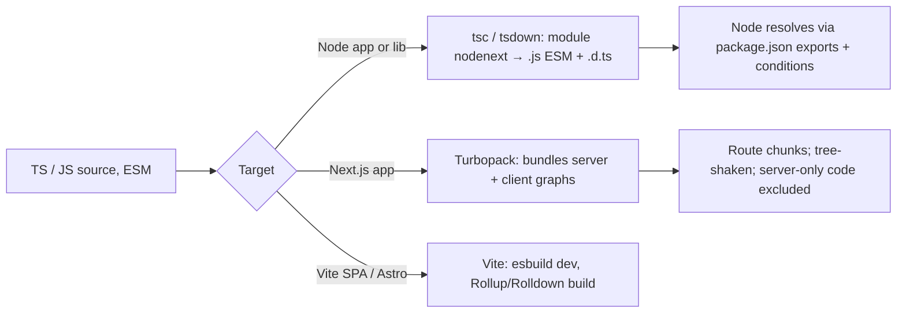

# JavaScript - Modules, ESM-CJS Interop & Bundling

> [!info] Deep dive of [[JavaScript]]

> [!abstract] TL;DR
> In 2026, write **ESM everywhere** (`"type": "module"`, `import`/`export`).
> - Node can now `require()` ESM synchronously (**`require(esm)` is stable**), except graphs with top-level await. That makes ESM-only packages practical and removes most reasons for dual CJS+ESM builds.
> - Control your package surface with the `exports` field.
> - Use TS `module: nodenext` for Node code and `moduleResolution: bundler` for Next.js/Vite apps.
> - Avoid barrel files and side-effectful modules: they defeat tree-shaking and slow dev servers.

## Concept
| | ESM | CommonJS |
|---|---|---|
| Syntax | `import x from 'y'`, `export const` | `require('y')`, `module.exports` |
| Loading | Static graph, async, top-level `await` allowed | Synchronous, dynamic |
| Bindings | Live, read-only | Copied values (object reference) |
| File detection | `.mjs`, or `.js` with `"type": "module"`; Node also detects ESM syntax in ambiguous `.js` | `.cjs`, or `.js` without `"type": "module"` |
| Paths | `import.meta.url`, `import.meta.dirname` / `filename` | `__dirname`, `__filename` |
| Specifiers | Full relative paths **with extension** (`./util.js`) | Extension optional |

**Interop rules (Node)**:
- **ESM → CJS**: `import pkg from 'cjs-lib'` gives `module.exports` as the default. Named imports work only if Node's static analysis (cjs-module-lexer) detects them.
- **CJS → ESM**: `require('esm-lib')` works synchronously (stable in Node 25.4 and backported to 24.x), **unless** the ESM graph uses top-level await (`ERR_REQUIRE_ASYNC_MODULE`). Then use `await import()`.
- **`exports` field** defines the public entry points and conditions (`types`, `import`, `require`, `default`, `node`, `browser`). Anything not listed is unreachable (`ERR_PACKAGE_PATH_NOT_EXPORTED`).

## How It Works

Bundlers resolve the same `exports` conditions, but pick `browser`/`import` for client graphs and `node`/`react-server` for server graphs. A package that mis-declares conditions can ship server code to the browser, or the reverse.

## Practical Usage
**ESM-only internal package** (monorepo `packages/schemas/package.json`):
```json
{
  "name": "@acme/schemas",
  "type": "module",
  "exports": {
    ".": { "types": "./dist/index.d.ts", "default": "./dist/index.js" },
    "./order": { "types": "./dist/order.d.ts", "default": "./dist/order.js" }
  },
  "imports": { "#internal/*": "./dist/internal/*.js" },
  "sideEffects": false,
  "files": ["dist"]
}
```
**tsconfig by target**:
```jsonc
// Node services, workers, CLI, libraries (run by Node directly)
{ "compilerOptions": { "module": "nodenext", "target": "es2023", "verbatimModuleSyntax": true, "rewriteRelativeImportExtensions": true } }
// Next.js / Vite apps (a bundler resolves imports)
{ "compilerOptions": { "module": "esnext", "moduleResolution": "bundler", "verbatimModuleSyntax": true, "noEmit": true } }
```
**ESM equivalents of CJS idioms**:
```js
import { readFile } from 'node:fs/promises';
import config from './config.json' with { type: 'json' };     // import attributes
const here = import.meta.dirname;                              // replaces __dirname (Node 20.11+)
const tpl = await readFile(new URL('./template.html', import.meta.url), 'utf8');
const { default: heavy } = await import('./heavy.js');         // lazy-load at runtime
```
**Legacy CJS code consuming an ESM-only dependency**:
```js
// works on Node 24+/25 if the dependency has no top-level await
const { nanoid } = require('nanoid');
// otherwise
async function main() { const { nanoid } = await import('nanoid'); }
```
**Next.js: kill barrel-file cost**:
```js
// next.config.mjs
export default { experimental: { optimizePackageImports: ['@acme/ui', 'lucide-react'] } };
```
```ts
import { Button } from '@acme/ui/button';     // ✅ deep, specific entry (exported in package.json)
import { Button } from '@acme/ui';            // ❌ barrel: dev server parses every component
```
**Wrong way**:
```js
import { helper } from './utils';              // ❌ ESM in Node needs './utils.js'
const pkg = require('./package.json');         // ❌ in ESM: no require; use import attributes or createRequire
export * from './everything';                  // ❌ giant barrels + side effects = no tree-shaking
```

## Patterns & Anti-patterns
| Pattern | When | Anti-pattern to avoid |
|---|---|---|
| ESM-only packages with `exports` + `types` first | New libraries/internal packages (2026) | Dual CJS+ESM builds without need (dual package hazard) |
| `"sideEffects": false` (or a list) | Libraries | Top-level code that registers globals on import |
| Deep, explicit entry points | UI kits, icon sets | Root barrels re-exporting hundreds of modules |
| `module: nodenext` for code Node runs | Workers, scripts, servers | `moduleResolution: node` (legacy node10) silently allowing broken ESM paths |
| `import 'server-only'` in server modules | Next.js | Secrets-holding modules importable from client components |
| Vitest (native ESM) | Testing ESM code | Fighting Jest's ESM transform config |

## Performance & Trade-offs
- **Dual packages**: shipping both CJS and ESM doubles build outputs and risks two module instances at runtime (two copies of a singleton, `instanceof` failures). With `require(esm)` stable, **ESM-only** is the simpler default unless you must support Node ≤ 20.
- **Tree-shaking** needs static ESM, no side effects, and no dynamic property access on namespaces. CJS is mostly un-shakeable, so prefer ESM builds of dependencies (`lodash-es` over `lodash`).
- **Dev-server speed**: barrels force bundlers to parse whole libraries per import. `optimizePackageImports` or direct paths cut Next.js dev compile times substantially on icon/UI libraries.
- **Cold start**: in serverless or Edge Functions, fewer and smaller modules mean faster boot. Lazy `await import()` rarely used paths.

## Tips & Reminders
> [!tip] In ZP's stack
> - **Monorepo**: pnpm + Turborepo, all internal packages ESM-only with `exports` (schemas, UI, API client). Next.js consumes the TS sources via `transpilePackages`, or the built `dist`.
> - **Supabase Edge Functions** (Deno): ESM only, with `npm:` / `jsr:` specifiers and import maps. Keep shared code free of Node-only APIs, or guard them.
> - **n8n Code nodes**: use `require()` for allowed modules (`NODE_FUNCTION_ALLOW_EXTERNAL`). ESM-only packages work there only on n8n builds running a Node version with `require(esm)`, so test after upgrades.

- Run `node --experimental-detect-module` checks only on old Node. Modern Node detects ESM syntax automatically, but explicit `"type"` is clearer.
- `npx publint` and `npx @arethetypeswrong/cli` validate `exports` and type resolution before publishing a package.
- Put `"types"` **first** in each `exports` condition object, because TypeScript picks the first matching condition.
- For scripts, `node --env-file=.env script.ts` (Node with type stripping) runs TS directly. Keep to erasable syntax ([[TypeScript]]).

## Version Notes
| Version / tool | Change relevant here |
|---|---|
| Node 12–14 | ESM unflagged, `exports` field |
| Node 20.11 / 21.2 | `import.meta.dirname` / `filename` |
| Node 22.12 | `require(esm)` enabled by default (experimental warning) |
| Node 25.4 (2026-01) → 24.15 (2026-04) | `require(esm)` marked **stable** and backported (per secondary sources) |
| TS 5.7–5.8 | `rewriteRelativeImportExtensions`, `--erasableSyntaxOnly`. `nodenext` models `require(esm)` |
| Next.js 16 (2025-10) | Turbopack default bundler for dev and build |

> [!warning] Unverified — check before relying on this
> The require(esm) stabilization versions/dates come from secondary blogs, and the bundler details (Turbopack defaults, Vite's Rolldown migration) weren't re-checked this run. See the Node.js changelog and each bundler's release notes.

## Critical Issues & Gotchas
> [!danger] Dual package hazard
> When a package ships CJS and ESM entry points, one app can load **both** (one dependency `require`s it, another `import`s it). State is split: two Zod instances (schema checks fail), two React copies (invalid hook call), two DB pools. Prefer ESM-only, or make the CJS entry a thin wrapper around the ESM build.

> [!danger] Server code in client bundles
> A shared module that imports `node:crypto`, a DB client or reads `process.env.SECRET` and is imported by a client component either breaks the build or, worse, inlines secrets. Mark server modules with `import 'server-only'`, and keep secrets out of `NEXT_PUBLIC_*`.

- **`ERR_PACKAGE_PATH_NOT_EXPORTED`** after a dependency upgrade means it added an `exports` map and deep imports are now blocked. Import from documented entries.
- **`ERR_REQUIRE_ASYNC_MODULE`**: the ESM dependency (or one of its imports) uses top-level await. Switch to `await import()` or remove the TLA.
- **Default-import confusion**: `import x from 'cjs-lib'` gives `module.exports`, while transpiled-ESM CJS libs need `x.default`. Check `esModuleInterop` and what the runtime actually returns.
- **Circular imports** behave differently: in ESM, accessing a binding before its module finishes evaluating throws (TDZ), where CJS returns a partial object. Break cycles by moving shared types and constants into leaf modules.

## Related
- [[JavaScript]]
- [[JavaScript - Event Loop & Async]] — top-level await and module evaluation
- [[TypeScript]] — module/moduleResolution settings, erasable syntax
- [[Node.js]] — runtime resolution, type stripping
- [[Next.js]] — Turbopack, server/client graphs
- [[Astro]] — Vite-based builds and islands

## References
- https://nodejs.org/api/esm.html
- https://nodejs.org/api/modules.html#loading-ecmascript-modules-using-require
- https://nodejs.org/api/packages.html#package-entry-points
- https://www.typescriptlang.org/docs/handbook/modules/reference.html
- https://blog.openreplay.com/end-dual-cjs-esm-builds-nodejs/
