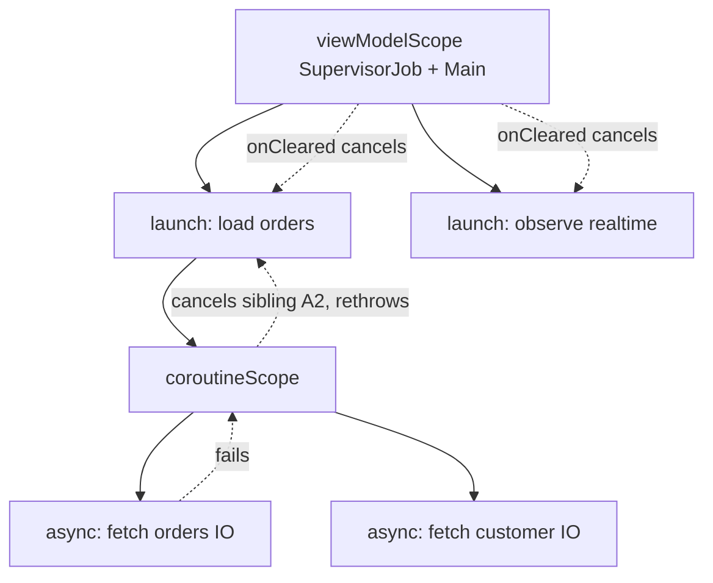

# Kotlin - Coroutines & Flow

> [!info] Deep dive of [[Kotlin]]

> [!abstract] TL;DR
> Coroutines are cheap, suspendable computations organised by **structured concurrency**: every coroutine lives in a `CoroutineScope`, and cancelling the scope cancels all children.
> - **Dispatchers**: choose threads (`Main`, `IO`, `Default`), and use `withContext` to switch.
> - **Flow** is a **cold** async stream. **StateFlow**/**SharedFlow** are **hot** (state, events). Expose state with `stateIn(scope, WhileSubscribed(5_000), initial)` and collect lifecycle-aware on Android.
> - **The classic bugs**: swallowing `CancellationException`, `GlobalScope` leaks, and blocking calls on `Default`/`Main`.

## Concept

### Building blocks
| Concept | What it is | Key rule |
|---|---|---|
| `suspend fun` | Function that can pause without blocking a thread (compiled to a state machine) | Only callable from coroutines or other suspend functions |
| `CoroutineScope` | Owner of coroutines (`viewModelScope`, `lifecycleScope`, request scope in Ktor/Spring) | Never `GlobalScope` in app code |
| `Job` / `SupervisorJob` | Lifecycle handle. Parent waits for children. Failure cancels siblings (unless supervisor) | Use `supervisorScope` when children are independent |
| `launch` / `async` | Fire-and-forget vs deferred result (`await()`) | `async` exceptions surface on `await` (and still cancel the parent) |
| `coroutineScope { }` | Suspends until all children finish. Fails if any child fails | Parallel decomposition inside suspend functions |
| `withContext(Dispatchers.IO)` | Switch dispatcher for a block | Main-safe functions: callers needn't know |
| `withTimeout` / `withTimeoutOrNull` | Cancel after a duration | Timeouts are cancellations: clean up in `finally` |

### Dispatchers
| Dispatcher | Threads | Use for |
|---|---|---|
| `Dispatchers.Main` | UI thread (Android/Compose, Swing, JS) | UI updates only |
| `Dispatchers.Default` | = CPU cores | CPU work (parsing, sorting, crypto) |
| `Dispatchers.IO` | Elastic, up to 64 (or more via `limitedParallelism`) | Blocking I/O (JDBC, files, legacy SDKs) |
| `dispatcher.limitedParallelism(n)` | View with at most n concurrent tasks | Bulkheads (e.g. max 4 concurrent DB calls) |
| `Dispatchers.Unconfined` | Caller thread until first suspension | Tests/special cases. Avoid |

### Flow family
| Type | Hot/cold | Holds value | Use |
|---|---|---|---|
| `Flow<T>` | Cold (runs per collector) | No | Repository queries, transformations, streams from DB/network |
| `StateFlow<T>` | Hot | Always one current value (conflated, distinct) | UI state (`uiState`) |
| `SharedFlow<T>` | Hot | Configurable `replay` | Events, broadcasts (one-off UI effects need care) |
| `Channel<T>` | Hot, point-to-point | Buffered queue | Producer/consumer, actors, fan-out work |
| `callbackFlow { }` | Cold builder over callbacks | — | Wrap listener APIs (Supabase Realtime, location, sensors) |

## How It Works

- **Cancellation is cooperative**: suspension points (`delay`, `yield`, I/O suspend calls, `ensureActive()`) check for it. A tight CPU loop must call `ensureActive()`/`yield()` or it can't be cancelled.
- **Exception propagation**: a failed child cancels its parent and siblings (regular `Job`). `CoroutineExceptionHandler` only handles **uncaught** exceptions in root `launch` coroutines.
- **Flows are sequential by default**: `buffer()`, `conflate()`, `flowOn(dispatcher)` and `flatMapMerge` introduce concurrency explicitly.

## Practical Usage

### Main-safe repository + parallel decomposition
```kotlin
class OrderRepository(private val api: OrdersApi, private val db: OrderDao) {
    suspend fun orderDetails(id: String): OrderDetails = coroutineScope {
        val order = async(Dispatchers.IO) { api.order(id) }
        val customer = async(Dispatchers.IO) { api.customerForOrder(id) }
        OrderDetails(order.await(), customer.await())           // one fails → both cancelled
    }

    fun observeOrders(tenantId: String): Flow<List<Order>> =
        db.observeOrders(tenantId)                               // Room returns a cold Flow
            .map { rows -> rows.map(OrderEntity::toDomain) }
            .flowOn(Dispatchers.Default)                         // mapping off the main thread
}
```

### ViewModel state with `stateIn` and lifecycle-aware collection
```kotlin
class OrdersViewModel(repo: OrderRepository, tenantId: String) : ViewModel() {
    private val query = MutableStateFlow("")

    val uiState: StateFlow<OrdersUiState> = query
        .debounce(300)
        .flatMapLatest { q -> repo.observeOrders(tenantId).map { all -> all.filter { it.matches(q) } } }
        .map<List<Order>, OrdersUiState> { OrdersUiState.Loaded(it) }
        .catch { emit(OrdersUiState.Error(it.message ?: "error")) }
        .stateIn(viewModelScope, SharingStarted.WhileSubscribed(5_000), OrdersUiState.Loading)

    fun onQuery(q: String) { query.value = q }
}

// Compose: stops collecting when the UI is in the background
val state by viewModel.uiState.collectAsStateWithLifecycle()
```

### Wrapping a callback API (`callbackFlow`)
```kotlin
fun realtimeOrders(channel: RealtimeChannel): Flow<OrderChange> = callbackFlow {
    val sub = channel.onChange { change -> trySend(change) }      // non-suspending send from callback
    channel.subscribe()
    awaitClose { sub.unsubscribe(); channel.unsubscribe() }       // runs on cancellation → no leaks
}.buffer(Channel.BUFFERED)
```

### Cancellation-safe error handling
```kotlin
// ❌ runCatching swallows CancellationException → coroutine keeps running after scope is cancelled
val r = runCatching { api.sync() }

// ✅ rethrow cancellation, handle the rest
try {
    api.sync()
} catch (e: CancellationException) {
    throw e
} catch (e: IOException) {
    log.warn("sync failed", e)
}
```

### Testing with virtual time
```kotlin
@Test fun `debounces queries`() = runTest {
    val vm = OrdersViewModel(FakeRepo(), "t1")
    vm.uiState.test {                                             // Turbine
        assertEquals(OrdersUiState.Loading, awaitItem())
        vm.onQuery("kopi")
        advanceTimeBy(301)
        assertIs<OrdersUiState.Loaded>(awaitItem())
    }
}
```
- Inject dispatchers (`ioDispatcher: CoroutineDispatcher`) so tests can pass `StandardTestDispatcher(testScheduler)`. Use `Dispatchers.setMain(...)` for `Main` in unit tests.

## Patterns & Anti-patterns
| Pattern | When | Anti-pattern to avoid |
|---|---|---|
| Scope owned by a lifecycle (`viewModelScope`, request scope) | Always | `GlobalScope.launch` (leaks, no cancellation, untestable) |
| Main-safe suspend functions using `withContext` internally | Repositories, data sources | Callers sprinkling `withContext(IO)` everywhere |
| `stateIn(WhileSubscribed(5_000))` for UI state | Android/Compose | `launch { flow.collect { _state.value = it } }` collecting forever |
| `supervisorScope` for independent child jobs | Batch processing, multiple listeners | One failing child killing unrelated work |
| `limitedParallelism` as bulkhead | Rate-limited APIs, DB pools | Unbounded `async` over 10,000 items |
| Rethrow `CancellationException` | All catch blocks | `catch (e: Exception)` swallowing cancellation |

## Performance & Trade-offs
- **Coroutines vs threads**: coroutines cost ~hundreds of bytes and can number in the millions, whereas threads cost MBs of stack. Blocking calls inside coroutines still block a thread, so use suspend-native clients (Ktor client, R2DBC, Room) or `Dispatchers.IO`.
- **JVM virtual threads** (Java 21+): make blocking code scale without coroutines, but don't provide structured concurrency, Flow or cancellation semantics. Backends can mix them, e.g. Spring Boot with virtual threads plus coroutines where structured concurrency matters ([[Spring Boot]]).
- **StateFlow conflation**: fast emitters drop intermediate values (by design for UI state). For events that must not be lost, use `SharedFlow` with buffer, or `Channel`.
- **`flowOn` vs `withContext` in flows**: `flowOn` changes the upstream context. Calling `withContext` inside `flow {}` emission violates context preservation and throws.

## Tips & Reminders
> [!tip]
> - **One-off UI events** (navigate, show snackbar): model them as state (`message: String?` consumed and cleared), or use a `Channel` received in a lifecycle-aware collector. `SharedFlow(replay=0)` loses events emitted while no one collects.
> - **Name coroutines** (`CoroutineName("sync-orders")`) and enable debug mode (`-Dkotlinx.coroutines.debug`) to get readable stack traces.
> - **KMP**: share repositories and Flows across Android/iOS. On iOS, expose them via SKIE or KMP-NativeCoroutines for Swift async/await interop.
> - **In ZP's stack**:
>   - **Mainly Flutter** ([[Dart - Async, Streams & Isolates]] is the analogue).
>   - **Kotlin appears in** native Android modules, inherited Android apps and KMP experiments. Wrap Supabase/WhatsApp SDK listeners with `callbackFlow`, and use `stateIn` for UI state.

## Version Notes
| Version | Change |
|---|---|
| kotlinx.coroutines 1.0 (2018) | Structured concurrency stable |
| 1.4–1.6 (2020–22) | `StateFlow`/`SharedFlow`, new test API (`runTest`) |
| 1.7–1.9 (2023–24) | `limitedParallelism` improvements, test dispatcher refinements, Wasm targets |
| 1.10 (2025) | Kotlin 2.1 alignment, Flow API polish |
| **1.11.0** (2026-05-09) | Wasm/JS Promise-related breaking move to a new web target, changed uncaught-exception reporting on JS/Wasm, `CoroutineDispatcher` as context key deprecated (use `ContinuationInterceptor`) |
| Kotlin 2.4.0 (2026-07) | K2-only compiler (K1 removed per parent note). Coroutines builds against 2.2.x+ |

> [!warning] Unverified — check before relying on this
> The 1.11.0 change list comes from release notes quoted in dependency-bump PRs, and the Kotlin 2.4.0 date from package listings. Confirm in the kotlinx.coroutines GitHub releases and the Kotlin blog.

## Critical Issues & Gotchas
> [!danger] Swallowed cancellation = zombie work
> `catch (e: Exception)`, `runCatching`, or Java-style catch-all around suspend calls swallow `CancellationException`. The coroutine keeps running after its screen or request is gone: it writes to closed DBs, sends duplicate requests or burns battery. Always rethrow `CancellationException`, or use helpers that do.

> [!danger] Blocking the wrong dispatcher
> Calling blocking JDBC, file I/O or `Thread.sleep` on `Dispatchers.Default` or `Main` starves CPU threads or freezes the UI (ANRs on Android). Wrap blocking code in `withContext(Dispatchers.IO)`, or use suspend-native libraries. `runBlocking` in production request paths or UI is almost always a bug.

> [!warning] Gotchas
> - `async` without `await` still propagates failures to the parent, which is surprising when results are ignored.
> - `withTimeout` throws `TimeoutCancellationException` (a cancellation). Inside `launch` it silently cancels, so use `withTimeoutOrNull` for explicit handling.
> - Collecting a `Flow` in `lifecycleScope.launch` without `repeatOnLifecycle` keeps collecting in the background.
> - `MutableStateFlow` equality-based conflation: emitting an equal (`==`) data class doesn't notify collectors.
> - `GlobalScope` and custom scopes without `SupervisorJob` make one failure cancel everything in that scope.

## Related
- [[Kotlin]]
- [[Dart - Async, Streams & Isolates]] — Flutter equivalent (Futures, Streams, isolates)
- [[JavaScript - Event Loop & Async]] — promises/async comparison
- [[Go - Concurrency]] — goroutines/channels comparison
- [[Spring Boot]] — coroutines vs virtual threads on the JVM
- [[Flutter - State Management]] — state exposure patterns

## References
- Kotlin coroutines guide: https://kotlinlang.org/docs/coroutines-guide.html
- Kotlin Flow docs: https://kotlinlang.org/docs/flow.html
- Android: Kotlin coroutines best practices: https://developer.android.com/kotlin/coroutines/coroutines-best-practices
- kotlinx.coroutines releases: https://github.com/Kotlin/kotlinx.coroutines/releases
- Turbine (Flow testing): https://github.com/cashapp/turbine
