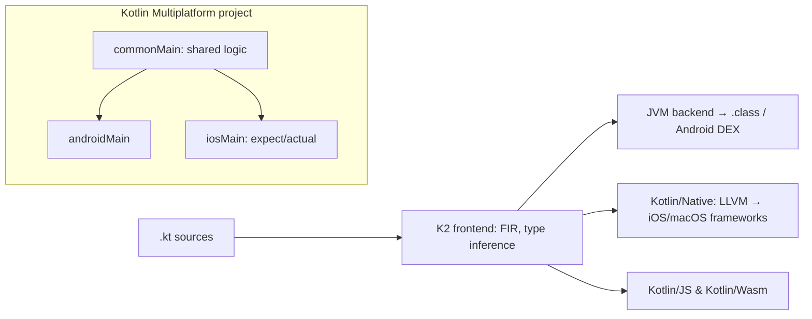

# Kotlin

> [!abstract] TL;DR
> Kotlin is JetBrains' statically typed language for the JVM, Android, native and web, with **null safety in the type system**, concise syntax, coroutines and full [[Java]] interop.
> - **Android**: Google's preferred language since 2019, with Jetpack Compose.
> - **Server side**: [[Spring Boot]], Ktor.
> - **Cross-platform**: **Kotlin Multiplatform (KMP)** shares business logic across Android/iOS/desktop/web. **Compose Multiplatform** shares UI, and is stable on iOS since 2025.
> - **Compiler**: K2 (2.0, 2024) replaced the old frontend, and 2.4 (2026-06) removed K1 entirely.
> - **Peer**: [[Flutter]]/[[Dart]]. KMP keeps native UIs (or Compose) with more native integration, while Flutter gives one renderer and faster solo delivery.

## Introduction
- **Origin**: JetBrains (2011), 1.0 in 2016-02. Google announced Android support (2017) and **Kotlin-first** Android (2019). Governed by JetBrains + the Kotlin Foundation (JetBrains, Google, and others). Apache 2.0.
- **Problem**: Java's verbosity and `NullPointerException`s, without leaving the JVM ecosystem or rewriting existing code.
- **Where it sits**: Android apps (the majority of top Play apps), JVM backends (Spring, Ktor), shared mobile logic (KMP: Netflix, McDonald's, Cash App, Duolingo), Gradle build scripts (`build.gradle.kts`).

## Core Concepts

### Language essentials
```kotlin
data class Order(val id: String, val totalSen: Long, val customer: Customer?)    // equals/hashCode/copy generated

fun label(o: Order): String {
    val name = o.customer?.name ?: "Walk-in"            // safe call + Elvis
    return "${o.id}: RM ${"%.2f".format(o.totalSen / 100.0)} ($name)"
}

sealed interface PayResult {
    data class Ok(val receiptUrl: String) : PayResult
    data class Declined(val reason: String) : PayResult
    data object Timeout : PayResult
}

fun render(r: PayResult) = when (r) {                   // exhaustive: no else needed
    is PayResult.Ok -> "Paid: ${r.receiptUrl}"           // smart cast
    is PayResult.Declined if r.reason == "insufficient" -> "Top up first"   // guard condition (2.2+)
    is PayResult.Declined -> "Declined: ${r.reason}"
    PayResult.Timeout -> "Try again"
}

fun String.isMalaysianMobile() = matches(Regex("^\\+?601[0-9]{8,9}$"))   // extension function
```
| Feature | Notes |
|---|---|
| Null safety | `T` vs `T?`, `?.`, `?:`, `!!` (avoid), smart casts. Java types become "platform types" (`T!`) |
| `val` / `var` | Immutable vs mutable references. Read-only collections by default (`List` vs `MutableList`) |
| Data / sealed / value classes | `@JvmInline value class OrderId(val v: String)`: zero-cost wrappers |
| Extension functions & properties | Add APIs to existing types (static dispatch) |
| Higher-order functions, lambdas, `inline` | Scope functions `let`, `apply`, `also`, `run`, `with` |
| Delegation | `by lazy`, `by Delegates.observable`, interface delegation |
| Context parameters | `context(logger: Logger)`: implicit dependencies (preview → stabilizing in 2.x) |
| DSL builders | Gradle Kotlin DSL, Ktor routing, Compose UI |

### Coroutines and Flow
```kotlin
class OrdersViewModel(private val repo: OrderRepository) : ViewModel() {
    val orders: StateFlow<List<Order>> = repo.observeOrders()           // cold Flow from Room/Supabase realtime
        .catch { emit(emptyList()) }
        .stateIn(viewModelScope, SharingStarted.WhileSubscribed(5_000), emptyList())

    fun pay(id: String) = viewModelScope.launch {                        // cancelled automatically with the ViewModel
        val result = withContext(Dispatchers.IO) { repo.pay(id) }       // main-safe suspension
        _events.emit(result)
    }
}
```
- **Structured concurrency**: coroutines live in a `CoroutineScope`. Cancelling the scope cancels its children, so tasks can't leak (compare unmanaged Dart stream subscriptions in [[Dart - Async, Streams & Isolates]]).
- `suspend` functions compile to state machines (continuation-passing). They're cheap: millions of coroutines.
- **Flow** = cold async stream (like Rx/Dart streams). `StateFlow`/`SharedFlow` are hot.

## Architecture / How It Works

- **K2 compiler** (unified frontend, FIR): roughly 2× faster compilation, and one frontend for all targets, so compiler plugins must be K2-compatible.
- **Kotlin/JVM** emits standard bytecode and runs anywhere Java runs, interoperating both ways.
- **Kotlin/Native** compiles via LLVM to native binaries/frameworks, with its own memory manager (tracing GC since 1.7.20, no more freezing). iOS interop goes through Objective-C headers, or **Swift export** (alpha in 2.4) for direct Swift APIs.
- **KMP**: `commonMain` code + `expect`/`actual` declarations for platform specifics. Libraries: Ktor client, kotlinx.serialization, SQLDelight/Room KMP, Koin, kotlinx.datetime.

## Project Structure
```text
shop-kmp/
├── settings.gradle.kts
├── gradle/libs.versions.toml        # version catalog
├── composeApp/                      # Compose Multiplatform UI
│   └── src/{commonMain,androidMain,iosMain}/kotlin/
├── shared/                          # business logic, networking, persistence
│   └── src/commonMain/kotlin/my/rarticle/shop/{data,domain}/
├── iosApp/                          # Xcode project consuming the shared framework
└── server/                          # optional Ktor backend sharing models
```
```kotlin
// shared/build.gradle.kts (abridged)
kotlin {
    androidTarget()
    listOf(iosArm64(), iosSimulatorArm64()).forEach { it.binaries.framework { baseName = "Shared" } }
    sourceSets.commonMain.dependencies {
        implementation(libs.ktor.client.core)
        implementation(libs.kotlinx.serialization.json)
        implementation(libs.kotlinx.coroutines.core)
    }
}
```

## Use Cases
| Use case | Why it fits |
|---|---|
| Native Android apps | Official language, Jetpack Compose, coroutines |
| Shared mobile business logic (KMP) | One codebase for networking/persistence/validation, native UIs stay native |
| Cross-platform UI (Compose Multiplatform) | Android + iOS + desktop from Compose. iOS stable since 2025 |
| JVM backends | Null safety + coroutines with [[Spring Boot]] or Ktor |
| Gradle build logic | Typed Kotlin DSL instead of Groovy |
| Solo founder shipping one app to both stores fast | **Usually [[Flutter]]**: more mature single-codebase UI, hot reload, larger plugin set |

## Pros & Cons
| Pros | Cons |
|---|---|
| Null safety and concise, expressive syntax | Compile times still slower than Java/Go in big projects |
| 100% Java interop: reuse the whole JVM ecosystem | Platform types from Java leak nulls |
| Coroutines + Flow: structured concurrency | KMP iOS tooling/debugging less polished than Xcode-native |
| One language for Android, backend, shared mobile logic | Smaller iOS community. Hiring iOS devs who know KMP is harder |
| JetBrains tooling (IntelliJ, Android Studio) | Tied to JetBrains' roadmap and Gradle complexity |
| Compose Multiplatform now stable on iOS | Compose iOS: larger binaries, and native look/feel requires effort |

## Alternatives & Peers
| Alternative | Strength vs Kotlin | Weakness vs Kotlin | Pick it when… |
|---|---|---|---|
| [[Java]] | Larger talent pool, simpler toolchain | Verbose, no null safety | Existing Java teams/codebases |
| [[Flutter]] / [[Dart]] | One UI codebase, hot reload, fast delivery | Less native integration, own renderer | SME mobile apps (ZP's default) |
| [[React Native]] | JS/TS skills, web sharing | Bridge/native module complexity | Teams with React expertise |
| [[Swift]] | Best iOS-native experience | Apple platforms only | iOS-only apps or deep Apple integration |
| Scala | Advanced FP | Complexity | Data/FP-heavy JVM teams |

## Tips & Reminders
> [!tip]
> - Avoid `!!`. Model absence with `T?` and handle it at boundaries. Annotate Java APIs (JSpecify) so Kotlin sees real nullability.
> - Use `viewModelScope`/`lifecycleScope`/structured scopes. Never `GlobalScope`. Inject dispatchers for testability (`kotlinx-coroutines-test`).
> - Version catalogs (`libs.versions.toml`) + the Gradle configuration cache keep builds fast and consistent.
> - Use kotlinx.serialization for KMP and Moshi/kotlinx for Android. Avoid reflection-based Gson (null-safety holes).
> - **In ZP's stack**: [[Flutter]] stays the default for client mobile apps (one codebase, faster solo delivery). Kotlin shows up for native Android modules (platform channels/Pigeon, see [[Flutter - Platform Channels & FFI]]), Android-only enterprise apps, or JVM backends with [[Spring Boot]]. Consider KMP only when a client demands native UIs on both platforms with shared logic.

## Versions & Breaking Changes
| Version | Released | Key changes | Breaking / migration notes |
|---|---|---|---|
| 1.0 | 2016-02 | Stable JVM + Android | — |
| 1.3 | 2018-10 | Coroutines stable | — |
| 1.7.20 / 1.9 | 2022 / 2023 | New Kotlin/Native memory manager. KMP stable (1.9.20, 2023-11) | Old "freezing" model removed |
| **2.0** | 2024-05 | **K2 compiler stable**, Compose compiler moved into the Kotlin repo | Compiler plugins must support K2. Some smart-cast/inference changes |
| 2.1 | 2024-11 | Guard conditions (preview), non-local break/continue, multi-dollar interpolation | — |
| 2.2 | 2025-06 | Context parameters (preview), guard conditions + nested type aliases stabilizing | Context receivers deprecated in favour of context parameters |
| 2.3 | 2025-12 | Language/tooling improvements. Spring Boot 4.1 baseline | — |
| **2.4** | 2026-06 | **K1 frontend removed**. Swift export alpha. Compose `StrongSkipping`/`IntrinsicRemember` flags removed | Builds forcing `languageVersion = 1.9` fail. Delete obsolete Compose compiler flags |

> [!warning] Unverified — check before relying on this
> Kotlin 2.3/2.4 details come from secondary sources. Check https://kotlinlang.org/docs/whatsnew24.html and the Compose Multiplatform release notes.

## Critical Issues & Gotchas
> [!danger] Gradle and plugin supply chain
> Kotlin projects pull large Gradle plugin/dependency graphs. Build scripts run arbitrary code at configuration time, compromised Gradle plugins or Maven artifacts execute on dev machines and CI, and dependency-confusion attacks against internal artifact names have hit JVM ecosystems. Use dependency verification (`gradle/verification-metadata.xml`), pin versions via catalogs, and restrict repositories (`mavenCentral()`, `google()`).

> [!danger] Coroutine cancellation and exception handling
> Swallowing `CancellationException` (e.g. `catch (e: Exception)` inside a coroutine) breaks structured cancellation: work continues after a screen closes or a request times out, causing leaks and duplicate side effects (double payments). Rethrow `CancellationException`, or use `runCatching` carefully. Use `SupervisorJob` where child failures shouldn't cancel siblings.

> [!warning] Gotchas
> - `data class` with mutable `var` properties used as `HashMap` keys breaks lookups after mutation.
> - `lateinit` access before initialization throws at runtime. Prefer constructor injection or `by lazy`.
> - JPA/Spring proxies need open classes and no-arg constructors (`kotlin-spring`, `kotlin-jpa` plugins).
> - KMP: iOS framework size and Xcode build times grow quickly. Monitor binary size and use static frameworks.
> - Kotlin/Native and Swift interop: generics, sealed classes and suspend functions map imperfectly through Objective-C. Use SKIE or Swift export.

## Deep Dives
N/A — no deep dives planned yet. Candidates: coroutines & Flow, Kotlin Multiplatform architecture.

## Related
- [[Java]] — JVM foundation and interop
- [[Spring Boot]] — Kotlin backend framework
- [[Swift]] — iOS counterpart, KMP interop
- [[Flutter]] · [[Dart]] — cross-platform alternative in ZP's stack
- [[React Native]] — cross-platform peer
- [[Flutter - Platform Channels & FFI]] — Kotlin on the Android side of Flutter plugins

## References
- Kotlin docs: https://kotlinlang.org/docs/home.html
- What's new in Kotlin: https://kotlinlang.org/docs/whatsnew24.html
- Kotlin Multiplatform: https://www.jetbrains.com/kotlin-multiplatform/
- Coroutines guide: https://kotlinlang.org/docs/coroutines-guide.html
- KMP roadmap (JetBrains blog): https://blog.jetbrains.com/kotlin/2024/10/kotlin-multiplatform-development-roadmap-for-2025/
- State of Kotlin 2026: https://devnewsletter.com/p/state-of-kotlin-2026/
