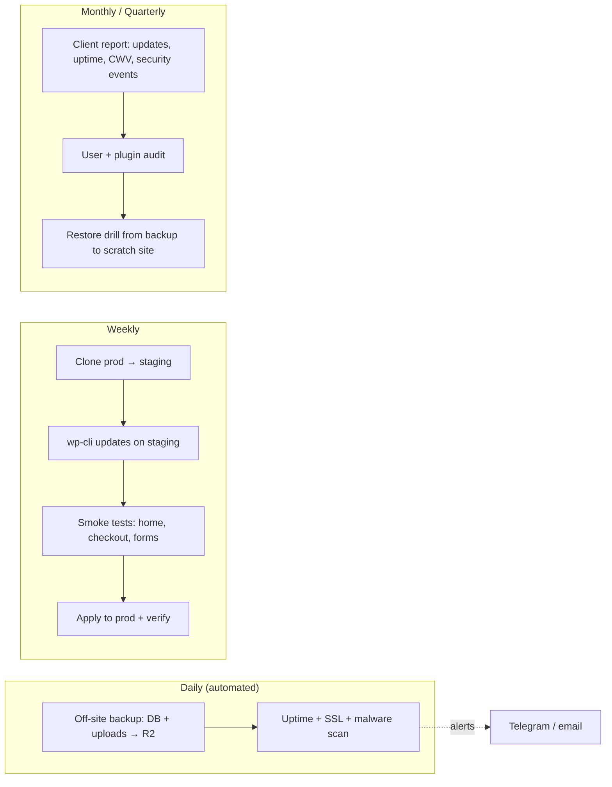

# PHP - WordPress Hardening & Maintenance SOP

> [!info] Deep dive of [[PHP]]

> [!abstract] TL;DR
> WordPress core is rarely the breach: **plugins and themes are**, at thousands of vulnerabilities a year. A care plan that actually protects clients (and you) has three parts:
> - **Hardening**: minimal plugins, `DISALLOW_FILE_EDIT`, 2FA, no PHP execution in uploads, plus a WAF/rate limits at Cloudflare.
> - **Rhythm**: daily off-site backups and monitoring, weekly updates through staging, a monthly report, quarterly restore drills.
> - **Scope**: a written contract that defines responsibility, so a hacked plugin isn't silently your liability.

## Concept

### Where WordPress compromises come from
| Vector | Share / example | Control |
|---|---|---|
| **Vulnerable plugins/themes** | The vast majority. E.g. Patchstack-tracked weekly reports of 100+ new plugin/theme vulns, many unpatched (abandoned plugins) | Minimal set, reputable vendors, auto-update security fixes, virtual patching (WAF), remove abandoned plugins |
| Nulled/pirated premium plugins | Backdoors pre-installed | Only licensed sources. Audit on onboarding |
| Weak/reused admin passwords | Credential stuffing on `wp-login.php`, `xmlrpc.php` | 2FA/passkeys, rate limits, unique admin usernames, block XML-RPC |
| Outdated PHP / server | EOL PHP, shared-host neighbours | PHP 8.3+, isolated hosting per client |
| Core chains (rare, severe) | 2026 core vulnerability chain fixed in 7.0.2 and exploited after disclosure | Auto minor/security updates on immediately |
| Over-privileged users | Ex-staff admins, agency accounts never removed | Quarterly user audit, least-privilege roles |

### Responsibility split (put it in the contract)
| Item | Agency (you) | Client | Host |
|---|---|---|---|
| Core/plugin/theme updates | ✅ per schedule | Approves major changes | — |
| Backups + restore | ✅ (off-site, tested) | — | Optional extra |
| Content, users they create, uploaded files | — | ✅ | — |
| Server/OS patching | If you host (VPS) | — | If shared/managed |
| Plugin vendor vulnerabilities with no patch | Mitigate (WAF/disable), notify | Decides on replacement cost | — |
| Incident response | Included up to X hours/month | Pays beyond scope | — |

## How It Works


## Practical Usage

### `wp-config.php` hardening
```php
define('DISALLOW_FILE_EDIT', true);          // no theme/plugin editor in wp-admin
// define('DISALLOW_FILE_MODS', true);       // also blocks installs/updates from wp-admin (use only if all updates go via WP-CLI/CI)
define('FORCE_SSL_ADMIN', true);
define('WP_AUTO_UPDATE_CORE', 'minor');      // security/minor releases automatically
define('WP_DEBUG', false);
define('WP_DEBUG_DISPLAY', false);
define('WP_POST_REVISIONS', 20);
define('WP_ENVIRONMENT_TYPE', 'production');
// Unique salts from https://api.wordpress.org/secret-key/1.1/salt/ — rotate after any incident (logs everyone out)
```
- Permissions: files `644`, folders `755`, `wp-config.php` `640`/`600` and owned by the PHP-FPM user group. Never `777`.
- Use a dedicated DB user per site with privileges only on its database ([[MySQL]]).

### Web-server rules (Nginx)
```nginx
location ~* /wp-content/uploads/.*\.php$ { deny all; }          # no PHP execution in uploads
location = /xmlrpc.php { deny all; }                             # unless Jetpack/app needs it
location ~ /\.(?!well-known) { deny all; }                        # .git, .env, .htaccess
location ~* /(wp-config\.php|readme\.html|license\.txt)$ { deny all; }
```
- On Apache/shared hosting, use the `.htaccess` equivalents. With LiteSpeed, use its built-in WAF settings ([[Nginx]]).

### Cloudflare in front of every site
- WAF managed rules on, with a rate limit on `/wp-login.php` and `/wp-admin/admin-ajax.php` POSTs (e.g. 10/min/IP), and Bot Fight Mode where it doesn't break payments.
- APO or cache rules for anonymous HTML, which gives big LCP wins ([[Browser & Web Fundamentals - Core Web Vitals Optimization]]).
- Restrict `/wp-admin` by country or via Cloudflare Access for agency-only admin sites ([[Cloudflare]]).

### Weekly update routine with WP-CLI
```bash
# On staging (clone of prod)
wp core verify-checksums && wp plugin verify-checksums --all     # detect tampered core/plugin files
wp plugin list --update=available --fields=name,version,update_version
wp core update && wp core update-db
wp plugin update --all --exclude=woocommerce                      # majors for WooCommerce reviewed separately
wp theme update --all
wp language core update && wp language plugin update --all
# Smoke test: home, product page, add-to-cart, checkout (test mode), contact form, login
# Then the same on prod, after a fresh backup:
wp db export /backups/pre-update-$(date +%F).sql
```

### Backups that actually restore
```bash
# Daily (cron/systemd timer on VPS hosting)
wp db export - | gzip > /tmp/db.sql.gz
tar czf /tmp/uploads.tgz -C /var/www/site/wp-content uploads
aws s3 cp /tmp/db.sql.gz "s3://rarticle-backups/$SITE/$(date +%F)/" --endpoint-url "$R2_ENDPOINT"
aws s3 cp /tmp/uploads.tgz "s3://rarticle-backups/$SITE/$(date +%F)/" --endpoint-url "$R2_ENDPOINT"
```
- Keep 30 daily + 12 monthly copies, off the hosting provider. Restore quarterly to a scratch subdomain, and record the time it took (that's your RTO).

### Monthly audit checklist
- **Users**: `wp user list --role=administrator`. Remove ex-staff and agency leftovers, enforce 2FA.
- **Plugins**: inactive plugins get deleted, plugins with no update in > 12 months get replaced, and every plugin must have a clear owner/purpose.
- **Security log review**: failed logins, file changes, WAF events.
- **PHP version**: still supported? Plan upgrades before EOL ([[PHP]]).
- **Report** to the client: updates applied, uptime %, backup status, CWV, incidents, recommendations.

### Incident response (hacked site)
1. **Contain**: maintenance mode or Cloudflare "Under Attack". Take a snapshot for forensics.
2. **Rotate**: all admin passwords, DB password, salts, API keys in `wp-config` and plugins, plus hosting/FTP/SSH credentials.
3. **Clean**:
   - Reinstall core: `wp core download --force --skip-content`.
   - Reinstall plugins/themes from clean sources.
   - Diff `uploads/` for `.php` files.
   - Check `wp_options` (siteurl, active_plugins), `wp_users` for rogue admins, and cron events (`wp cron event list`).
4. **Find the entry point**: access logs around file-change timestamps, plus the vulnerable plugin version. Patch or remove it.
5. **Restore** from the last clean backup if cleaning is uncertain. Request a Google Search Console review if the site was flagged, and notify the client in writing (PDPA if personal data was exposed).

## Patterns & Anti-patterns
| Pattern | When | Anti-pattern to avoid |
|---|---|---|
| ≤ 20 well-maintained plugins, each with a purpose | Every site | 60 plugins, half inactive, three page builders |
| Staging → prod updates weekly, security fixes same day | Care plans | "Update all" on prod on Friday evening |
| Off-site backups + quarterly restore drills | Always | Host's backup only, never tested |
| Isolated hosting per client (container/VPS/account) | Agency hosting | 30 client sites under one cPanel user (one hack = all) |
| 2FA/passkeys for all admins, unique usernames | Always | `admin` / shared agency password in a spreadsheet |
| Written care-plan scope + incident pricing | Every client | Implicit "you look after the website" with unlimited liability |

## Performance & Trade-offs
- **Auto-updating plugins** reduces exposure windows but risks breaking checkouts unattended. Auto-update security-critical, low-risk plugins, and stage WooCommerce, page builders and payment gateways.
- **Security plugins** (Wordfence, Solid Security) add a WAF and scanning but cost PHP CPU on every request. Edge WAF (Cloudflare) plus a lightweight scanner is often better on small VPSs.
- **Managed WordPress hosting** (Kinsta, WP Engine, Rocket.net) offloads server ops but costs more per site. Self-hosting on Coolify/VPS is cheaper but you own patching, isolation and backups ([[Linux Essentials - VPS Hardening Runbook]]).
- **Care-plan pricing**: time per site per month is ~1–2 h with automation, versus 4–6 h without. Automate with WP-CLI scripts or MainWP/ManageWP to keep margins.

## Tips & Reminders
> [!tip]
> - **Onboarding audit** for inherited sites: list plugins and versions, check for nulled plugins, scan with Wordfence CLI/WPScan, and record the baseline in the client file before you accept responsibility.
> - **WooCommerce**: keep payment gateways (Billplz, iPay88, Stripe, ToyyibPay) on the latest versions. Never store card data. Test checkout after every update.
> - **Vulnerability alerts**: subscribe to Patchstack/Wordfence feeds for the plugins you deploy, so you hear about a disclosure the day it lands.
> - **Remove `readme.html`**, hide version strings, and disable user enumeration (`/?author=1`, REST `/wp/v2/users` for anonymous users).
> - **In ZP's stack**:
>   - **Hosting**: client WordPress sites on Coolify or a dedicated VPS per client (Docker WordPress + MariaDB), behind Cloudflare APO/WAF, with nightly WP-CLI backups to R2 and Uptime Kuma alerts.
>   - **Offering**: sell a tiered care plan (RM/month) with a defined update window, response times and incident hours.

## Version Notes
| Item | Note |
|---|---|
| WordPress 6.x (2022–2025) | Site editor/FSE, Application Passwords (5.6+), auto-updates for plugins/themes (5.5+) |
| WordPress 7.0 (2026) | Collaboration/real-time co-editing phase. 7.0.2 fixed an exploited core vulnerability chain. 7.0.3 security release (Aug 2026, 12 fixes) |
| PHP support | Run PHP 8.3+. Check WordPress's PHP compatibility page before 8.5 on plugin-heavy sites |

> [!warning] Unverified — check before relying on this
> WordPress 7.0 release dates, the 7.0.2/7.0.3 security details and the 2026 "wp2shell" CVE chain (CVE-2026-63030, CVE-2026-60137) come from third-party/hosting sources. Confirm in the WordPress.org release announcements and security advisories.

## Critical Issues & Gotchas
> [!danger] Abandoned and unpatched plugins
> Weekly reports in 2026 list hundreds of plugin/theme vulnerabilities, with a large share **unpatched** because vendors abandoned the code. Some popular plugins, such as caching plugins, have had critical code-execution issues with no fix available at disclosure. Mitigate:
> - track the plugins on every client site against vulnerability feeds
> - virtual-patch via WAF (Patchstack/Cloudflare rules)
> - replace abandoned plugins proactively
> - bill the replacement as a change request

> [!danger] Liability without a contract
> If you "maintain" a site informally and it's hacked through a plugin you didn't update (or the client refused to pay to replace), you may be blamed for the data loss and downtime. Use a written care-plan SOW that states update cadence, backup retention, excluded items (content, third-party plugin defects, client-installed plugins), incident response hours and liability caps.

> [!warning] Gotchas
> - Page-builder and theme updates can break layouts silently. Visual regression checks (screenshots before/after) on key pages catch it.
> - `DISALLOW_FILE_MODS` also blocks automatic security updates from wp-admin. Use it only with an external update pipeline.
> - Caching plugins plus Cloudflare APO plus host cache cause stale carts and logged-in pages cached publicly. Exclude cart/checkout/my-account and cookies.
> - Shared hosting `wp-cron` only runs on visits. Use a real cron (`wp cron event run --due-now`) for scheduled posts, WooCommerce emails and backups.
> - Migrating domains needs `wp search-replace` (serialised data-safe). Never run raw SQL `REPLACE` on serialised options.

## Related
- [[PHP]]
- [[MySQL]] — per-site DB users, backups
- [[Nginx]] — server rules, PHP-FPM
- [[Cloudflare]] — WAF, rate limits, APO
- [[Linux Essentials - VPS Hardening Runbook]] — when you host the sites yourself
- [[OWASP Top 10]] — vulnerability classes behind plugin CVEs

## References
- WordPress hardening guide: https://developer.wordpress.org/advanced-administration/security/hardening/
- WP-CLI commands: https://developer.wordpress.org/cli/commands/
- Patchstack vulnerability database: https://patchstack.com/database/
- Wordfence threat intelligence: https://www.wordfence.com/threat-intel/
- WordPress releases & security announcements: https://wordpress.org/news/category/security/
