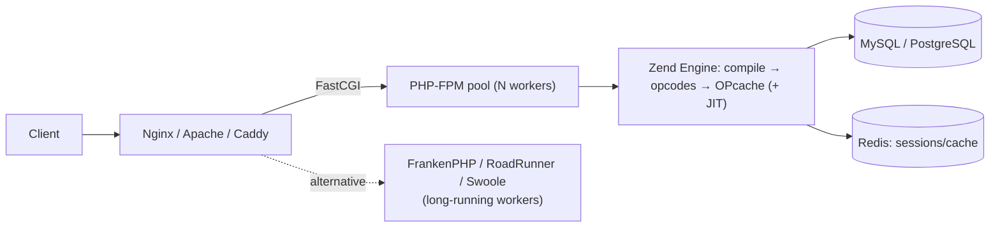

# PHP

> [!abstract] TL;DR
> PHP is the server-side scripting language behind **~70% of websites with a known backend**, mostly through WordPress, plus Laravel/Symfony apps, WooCommerce stores, Drupal and countless Malaysian SME systems on shared hosting.
> - **Modern PHP** (8.x) has JIT, enums, readonly classes, property hooks, the pipe operator, strict typing and Composer packaging. It's a reasonable language today.
> - **Run**: **8.4 or 8.5** (8.5 released 2025-11-20). 8.1 reached EOL at the end of 2025.
> - **For ZP**: you'll mostly maintain and integrate client WordPress/WooCommerce/Laravel systems, so security hygiene and upgrades matter more than greenfield PHP.

## Introduction
- **Origin**: Rasmus Lerdorf's "Personal Home Page" tools (1994–95), then Zend Engine (PHP 4, 2000), OOP (PHP 5, 2004), performance leap (PHP 7, 2015), JIT and types (PHP 8, 2020). Governed by the RFC process, with core work funded by **The PHP Foundation** (since 2021).
- **Problem**: easy, request-scoped server-side HTML generation with a "share-nothing" model: every request starts clean, so crashes and leaks don't accumulate.
- **Where it sits**: shared hosting (cPanel), WordPress/WooCommerce, Laravel SaaS, e-commerce (Magento/Adobe Commerce, PrestaShop), Moodle (common in Malaysian education), and legacy custom systems talking to [[MySQL]].

## Core Concepts

### Modern PHP syntax
```php
<?php
declare(strict_types=1);

enum OrderStatus: string { case Pending = 'pending'; case Paid = 'paid'; case Cancelled = 'cancelled'; }

final readonly class Money {
    public function __construct(public int $sen, public string $currency = 'MYR') {
        if ($sen < 0) throw new InvalidArgumentException('negative');
    }
    public function add(Money $o): static { return clone($this, ['sen' => $this->sen + $o->sen]); }   // 8.5 clone-with
}

class Order {
    public string $reference {                                   // 8.4 property hooks
        set(string $v) { $this->reference = strtoupper(trim($v)); }
    }
    public function __construct(public OrderStatus $status = OrderStatus::Pending) {}
}

$label = match ($order->status) {                               // match expression, strict comparison
    OrderStatus::Paid => 'Paid',
    OrderStatus::Pending, OrderStatus::Cancelled => 'Not paid',
};

$slug = $title |> trim(...) |> strtolower(...) |> (fn($s) => preg_replace('/\W+/', '-', $s));   // 8.5 pipe operator
```
| Feature | Since |
|---|---|
| Scalar/return types, `??`, spaceship | 7.0 |
| Typed properties, arrow functions | 7.4 |
| Named args, `match`, nullsafe `?->`, attributes, union types, **JIT** | 8.0 |
| Enums, readonly properties, fibers, first-class callables `f(...)` | 8.1 |
| Readonly classes, DNF types | 8.2 |
| Typed class constants, `#[\Override]`, `json_validate()` | 8.3 |
| **Property hooks**, asymmetric visibility, `new` without parentheses, `array_find()` | 8.4 |
| **Pipe operator `\|>`**, clone-with, URI extension, `#[\NoDiscard]`, `array_first()`/`array_last()` | 8.5 |

### Ecosystem
- **Composer** + **Packagist**: dependency management, PSR-4 autoloading.
- **Frameworks**:
  - **Laravel**: batteries-included (Eloquent, queues, Horizon, Octane, Livewire, Inertia).
  - **Symfony**: components, enterprise.
  - Slim/Mezzio: micro.
- **Quality tooling**: PHPStan/Psalm (static analysis), PHP-CS-Fixer/Pint, Pest/PHPUnit, Rector (automated upgrades).

## Architecture / How It Works

- **Share-nothing request model**: each request boots the app, runs, and frees everything. It's simple and robust, but bootstrap cost repeats every time, which **OPcache** (cached compiled opcodes) and preloading mitigate.
- **PHP-FPM**: process pool (`pm = dynamic|static|ondemand`, `pm.max_children`). Concurrency = number of workers, and each blocking request holds one worker.
- **Worker mode** (FrankenPHP, Laravel Octane, RoadRunner, Swoole) keeps the app in memory across requests: 2–10× throughput, but you must avoid global state leaks between requests.
- **JIT** (8.0+) helps CPU-bound code. Typical web apps are I/O-bound and gain little.
- Memory is refcounted with a cycle collector, and resets per request in FPM mode.

## Project Structure
```text
laravel-app/
├── composer.json / composer.lock    # commit the lock
├── app/{Http/Controllers,Models,Jobs,Services}/
├── routes/{web.php,api.php}
├── database/migrations/
├── config/
├── resources/views/                 # Blade
├── tests/                           # Pest / PHPUnit
├── public/index.php                 # only web-exposed directory
├── .env                             # never in web root, never committed
└── docker/                          # php-fpm + nginx, or FrankenPHP image
```
```bash
composer create-project laravel/laravel shop
php artisan migrate && php artisan queue:work      # queues via Redis/DB
vendor/bin/phpstan analyse --level=8
vendor/bin/rector process --dry-run                # automated PHP/framework upgrades
composer audit                                     # known-vulnerable dependencies
```

## Use Cases
| Use case | Why it fits |
|---|---|
| WordPress / WooCommerce sites for SMEs | Huge plugin/theme ecosystem, non-technical editing |
| Laravel SaaS / admin systems | Fast CRUD, auth, queues, billing (Cashier) |
| Shared-hosting-constrained clients | Runs on any cPanel host |
| E-commerce (WooCommerce, Magento, PrestaShop) | Mature payment-gateway plugins (incl. Malaysian gateways: Billplz, iPay88, Toyyibpay, Stripe) |
| LMS (Moodle) | Standard in Malaysian education/training |
| Realtime-heavy, CPU-heavy or AI-heavy backends | **Weaker fit**. [[Node.js]]/[[Python]]/[[Go]] |

## Pros & Cons
| Pros | Cons |
|---|---|
| Runs everywhere, cheapest hosting | Legacy reputation and legacy codebases full of insecure patterns |
| Share-nothing model is robust and simple to scale horizontally | Per-request bootstrap overhead (unless worker mode) |
| Laravel/Symfony are productive and mature | Plugin ecosystems (WordPress) are a major security liability |
| Modern type system, static analysis (PHPStan) | Inconsistent stdlib naming/argument order |
| Large talent pool, especially in SEA agencies | Async/realtime is not native (needs Swoole/ReactPHP/Reverb) |
| Predictable yearly releases with 4-year support | Many clients run EOL PHP versions on shared hosting |

## Alternatives & Peers
| Alternative | Strength vs PHP | Weakness vs PHP | Pick it when… |
|---|---|---|---|
| [[Node.js]] / [[TypeScript]] | One language with frontend, realtime, Next.js | More moving parts, npm supply-chain risk | ZP's default for new apps |
| [[Python]] (Django/FastAPI) | AI/data ecosystem | Hosting slightly more involved | AI-heavy backends |
| Ruby on Rails | Similar productivity, conventions | Smaller SEA talent pool | Rails teams |
| [[Go]] | Performance, single binary | More code for CRUD | High-throughput services |
| Headless CMS + [[Next.js]]/[[Astro]] | Modern stack, better security posture | Higher build cost than WordPress | Marketing sites where WP plugins are a liability |

## Tips & Reminders
> [!tip]
> - `declare(strict_types=1)` everywhere, PHPStan level ≥ 6 in CI, Rector for version upgrades.
> - Use PDO/Eloquent prepared statements. Never concatenate SQL. Escape output (`htmlspecialchars`, Blade `{{ }}`).
> - Keep only `public/` web-accessible. Store `.env` outside the web root and disable `display_errors` in production.
> - Tune OPcache (`opcache.validate_timestamps=0` in immutable containers) and size PHP-FPM `pm.max_children` to RAM / per-worker memory.
> - WordPress hardening: auto-update minor core, minimal reputable plugins, disable XML-RPC if unused, `DISALLOW_FILE_EDIT`, WAF ([[Cloudflare]]), off-site backups.
> - **In ZP's stack**: run client WordPress/Laravel in containers (FrankenPHP or php-fpm + [[Nginx]]) on [[Coolify]] with [[MySQL]] 8.4 on an internal network. Offer a paid "maintenance retainer" (updates, backups, uptime) as recurring revenue. Integrate WooCommerce/Laravel events into [[n8n]] via webhooks rather than custom PHP plugins.

## Versions & Breaking Changes
| Version | Released | Key changes | Breaking / migration notes |
|---|---|---|---|
| 7.4 | 2019-11 | Typed properties, preloading | EOL 2022-11. Still common on shared hosts |
| 8.0 | 2020-11 | JIT, `match`, named args, union types | Stricter comparisons (`0 == "a"` now false), many warnings → errors |
| 8.1 | 2021-11 | Enums, readonly, fibers | **EOL 2025-12-31** |
| 8.2 | 2022-12 | Readonly classes. Dynamic properties deprecated | Security fixes until 2026-12-31 |
| 8.3 | 2023-11 | Typed class constants, `#[\Override]` | Security until 2027-12 |
| **8.4** | 2024-11 | Property hooks, asymmetric visibility, lazy objects | Implicit nullable types deprecated |
| **8.5** | 2025-11-20 | Pipe operator, clone-with, URI extension, `#[\NoDiscard]` | Backtick shell operator, non-canonical casts (`(integer)`), `null` array offsets deprecated |

> [!warning] Unverified — check before relying on this
> Exact support end dates and whether PHP 8.6/9.0 is scheduled weren't confirmed. Check https://www.php.net/supported-versions.php.

## Critical Issues & Gotchas
> [!danger] CVE-2024-4577: PHP-CGI argument injection (mass-exploited)
> On Windows with certain locales, a "best-fit" character conversion let attackers inject PHP-CGI arguments, leading to unauthenticated **RCE** (CVSS 9.8). It was exploited by ransomware groups within days (2024-06), notably on XAMPP installs. Lesson: never expose dev stacks (XAMPP/WAMP) to the internet, and patch PHP promptly.

> [!danger] WordPress plugin ecosystem = the main attack surface
> Most WordPress compromises come from vulnerable or abandoned plugins/themes (file upload bypasses, SQLi, privilege escalation, sometimes supply-chain backdoors injected into popular plugins). Thousands of plugin CVEs are published each year. Keep an inventory, auto-update, remove unused plugins, use a WAF, and monitor file integrity.

> [!warning] Gotchas
> - `==` loose comparison and type juggling bugs (`"0e123" == "0e456"` is true). Use `===` and `hash_equals()` for secrets.
> - `unserialize()` on user input enables object-injection gadget chains (POP chains). Use JSON.
> - File uploads: validate MIME/extension server-side, store outside web root, never execute uploaded files.
> - Worker mode (Octane/FrankenPHP): static properties and singletons persist between requests, which can leak user data across requests.
> - Shared hosting `max_execution_time`/`memory_limit` kill long jobs. Move work to queues or [[n8n]].
> - Timezone: set `date.timezone = Asia/Kuala_Lumpur` (or store UTC) explicitly.

## Deep Dives
N/A — no deep dives planned yet. Candidates: WordPress hardening & maintenance SOP, Laravel architecture.

## Related
- [[MySQL]] — classic PHP datastore
- [[Nginx]] — php-fpm reverse proxy
- [[Node.js]] · [[TypeScript]] — ZP's default backend alternative
- [[Docker]] · [[Coolify]] — containerized PHP hosting
- [[OWASP Top 10]] — common PHP app vulnerabilities
- [[n8n]] — integrating WooCommerce/Laravel events

## References
- PHP manual: https://www.php.net/manual/en/
- PHP 8.5 release: https://www.php.net/releases/8.5/en.php
- Supported versions: https://www.php.net/supported-versions.php
- The PHP Foundation: https://thephp.foundation/
- PHP 8.5 features (Zend): https://www.zend.com/blog/php-8-5-features
- WordPress hardening: https://developer.wordpress.org/advanced-administration/security/hardening/
