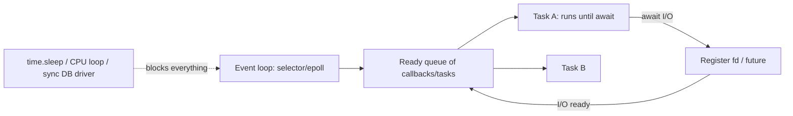

# Python - Async & Concurrency

> [!info] Deep dive of [[Python]]

> [!abstract] TL;DR
> Python has three concurrency tools:
> - **asyncio**: single-threaded cooperative coroutines. Best for many concurrent I/O tasks such as LLM/HTTP calls, websockets and DB queries.
> - **threads**: preemptive. Historically limited by the **GIL** for CPU work, and fine for blocking I/O.
> - **processes**: true CPU parallelism, at the cost of serialization.
>
> Since **3.14 the free-threaded (no-GIL) build is officially supported** (PEP 779), and subinterpreters are in the stdlib (`concurrent.interpreters`, PEP 734).
>
> Practical rules: use `asyncio.TaskGroup` + `asyncio.timeout` for structured concurrency, never block the event loop, and bound concurrency with semaphores to respect API rate limits.

## Concept

### Choosing a model
| Workload | Use | Why |
|---|---|---|
| Many concurrent I/O calls (HTTP, LLM APIs, DB, websockets) | **asyncio** (`httpx.AsyncClient`, `asyncpg`, FastAPI) | Thousands of tasks on one thread, low overhead |
| Blocking I/O libraries without async support | **Threads** (`ThreadPoolExecutor`, `asyncio.to_thread`) | GIL is released during I/O |
| CPU-bound work (parsing, image processing, pandas transforms) | **Processes** (`ProcessPoolExecutor`, multiprocessing) or free-threaded 3.14+, or native extensions (NumPy, Polars, Rust/PyO3) | Bypass the GIL |
| Isolation with parallelism inside one process | **Subinterpreters** (`concurrent.interpreters`, 3.14) | Per-interpreter GIL, cheaper than processes |
| Distributed background jobs | Task queues (Celery, RQ, Dramatiq, arq) on [[Redis]] | Durability, retries, scaling across machines |

### The GIL and free-threading
- The **Global Interpreter Lock** lets only one thread execute Python bytecode at a time in standard CPython. C extensions (NumPy, I/O) release it.
- **Free-threaded build** (`python3.14t`): no GIL, real thread parallelism. It costs ~5–10% single-thread overhead in 3.14, and C extensions must declare compatibility (otherwise the GIL is re-enabled at import). Ecosystem support is growing but isn't universal.

### asyncio essentials
```python
import asyncio, httpx

async def classify(client: httpx.AsyncClient, msg: str, sem: asyncio.Semaphore) -> dict:
    async with sem:                                        # bound concurrency (rate limits)
        async with asyncio.timeout(20):                    # 3.11+: cancels the block on expiry
            r = await client.post("https://api.example.my/classify", json={"text": msg})
            r.raise_for_status()
            return r.json()

async def main(messages: list[str]) -> list[dict]:
    sem = asyncio.Semaphore(10)
    async with httpx.AsyncClient(http2=True) as client:
        async with asyncio.TaskGroup() as tg:              # 3.11+: structured concurrency
            tasks = [tg.create_task(classify(client, m, sem)) for m in messages]
    return [t.result() for t in tasks]                     # if any task fails, the others are cancelled → ExceptionGroup

results = asyncio.run(main(["Bila order sampai?", "Nak refund"]))
```
| API | Purpose |
|---|---|
| `asyncio.run(main())` | Entry point: creates and closes the loop |
| `TaskGroup` | Structured concurrency, cancels siblings on failure, raises `ExceptionGroup` (`except*`) |
| `asyncio.timeout()` / `wait_for` | Deadlines |
| `asyncio.Semaphore` / `Queue` | Bounding concurrency, producer/consumer |
| `asyncio.to_thread(fn, …)` | Run blocking code without freezing the loop |
| `loop.run_in_executor(ProcessPool…)` | CPU work from async code |
| `asyncio.gather(*aws, return_exceptions=True)` | Older fan-out. Prefer `TaskGroup` for new code |

## How It Works

- A **coroutine** is a resumable function. A **Task** wraps it and schedules it on the loop. `await` yields control until the awaited future completes.
- **Cooperative**: nothing runs in parallel within one loop, so a CPU-heavy or blocking call stalls *every* task. That's the asyncio equivalent of blocking the [[JavaScript - Event Loop & Async|JS event loop]].
- **Cancellation**: `task.cancel()` raises `CancelledError` at the next await. Code must let it propagate (clean up in `finally`, don't swallow it).
- **Eager tasks** (3.12 `eager_task_factory`) start running synchronously until the first await, which lowers overhead for cache-hit-heavy code.
- **uvloop** (libuv-based loop) gives 2–4× faster loop overhead for servers. **AnyIO/Trio** offer structured-concurrency-first APIs.

## Practical Usage

### Blocking code inside async apps (FastAPI)
```python
from fastapi import FastAPI
import asyncio

app = FastAPI()

@app.post("/invoice/pdf")
async def make_pdf(order_id: str):
    order = await repo.get_order(order_id)                       # async DB driver (asyncpg / SQLAlchemy async)
    pdf = await asyncio.to_thread(render_pdf_sync, order)        # blocking lib → worker thread
    return {"url": await storage.upload(pdf)}

# Wrong: calling requests.get() or time.sleep() directly here blocks the whole server
```

### CPU-bound fan-out
```python
from concurrent.futures import ProcessPoolExecutor

def parse_statement(path: str) -> list[dict]: ...      # CPU-heavy, pure function (picklable)

with ProcessPoolExecutor(max_workers=4) as pool:
    results = list(pool.map(parse_statement, paths, chunksize=8))
```

### Producer/consumer with a bounded queue
```python
async def worker(q: asyncio.Queue):
    while True:
        job = await q.get()
        try:
            await handle(job)
        finally:
            q.task_done()

async def run(jobs):
    q: asyncio.Queue = asyncio.Queue(maxsize=100)      # backpressure
    async with asyncio.TaskGroup() as tg:
        workers = [tg.create_task(worker(q)) for _ in range(8)]
        for j in jobs:
            await q.put(j)
        await q.join()
        for w in workers:
            w.cancel()
```

## Patterns & Anti-patterns
| Pattern | When | Anti-pattern to avoid |
|---|---|---|
| `TaskGroup` + `timeout` | Fan-out of I/O calls | Fire-and-forget `create_task` without keeping a reference (tasks can be garbage-collected) |
| Semaphore per external API | LLM/WhatsApp/payment calls | Unbounded `gather` over 10k items (rate-limit bans) |
| One shared `AsyncClient`/connection pool | HTTP/DB access | Creating a new client per request (no connection reuse) |
| `to_thread` for blocking libraries | Legacy SDKs, file I/O | Blocking calls in coroutines |
| Process pools / native libs for CPU work | Parsing, image ops | Threads for CPU-bound pure Python (GIL build) |
| Let `CancelledError` propagate | All coroutines | `except Exception:` swallowing cancellation (3.8+ it's a `BaseException`, but bare `except:` still catches it) |

## Performance & Trade-offs
- asyncio task overhead is ~microseconds. Thousands of concurrent tasks are cheap, but Python-level CPU work per task still bottlenecks one core.
- Threads: OS-level (~8 MB virtual stack each), so use pools of tens to hundreds. With the GIL, there's no CPU speedup.
- Processes: high startup cost (spawn on macOS/Windows, and the default start method on Linux moved away from `fork` in 3.14), plus pickling overhead. Batch work with `chunksize`.
- Free-threaded 3.14: real parallel threads, but shared mutable state now needs locks (as in [[Go - Concurrency]]), and some extensions aren't ready.

## Tips & Reminders
> [!tip]
> - Enable asyncio debug mode in development (`PYTHONASYNCIODEBUG=1` or `asyncio.run(main(), debug=True)`) to log slow callbacks and never-awaited coroutines.
> - Inspect running tasks with `python -m asyncio ps <pid>` / `pstree` (3.14).
> - Use async-native libraries end to end: `httpx`/`aiohttp`, `asyncpg`/SQLAlchemy async, `redis.asyncio`, and the async clients of LLM SDKs ([[LLM APIs & SDKs]]).
> - Keep references to background tasks (a set + `add_done_callback(set.discard)`), or use a TaskGroup.
> - **In ZP's stack**: Python services (AI/RAG pipelines, document parsing) use asyncio for LLM fan-out with semaphores matching provider rate limits, process pools for PDF/OCR work, and a queue ([[Redis]]/arq or Celery) for durable background jobs, deployed as containers on [[Coolify]] next to Node services.

## Version Notes
| Version | Change |
|---|---|
| 3.4–3.7 | asyncio introduced (3.4), `async`/`await` (3.5), `asyncio.run` (3.7) |
| 3.8 | `CancelledError` becomes `BaseException` |
| **3.11** | `TaskGroup`, `asyncio.timeout`, `ExceptionGroup`/`except*`. ~25% faster CPython |
| 3.12 | Eager task factory. Per-interpreter GIL (C API) |
| 3.13 | Experimental free-threaded build (`python3.13t`), experimental JIT |
| **3.14** (2025-10) | **Free-threaded build officially supported** (PEP 779), `concurrent.interpreters` (PEP 734), asyncio introspection CLI, default multiprocessing start method changes on Linux (`forkserver`) |
| 3.15 (2026-10) | Further free-threading/JIT work |

> [!warning] Unverified — check before relying on this
> 3.15 concurrency changes weren't confirmed this run. Check https://docs.python.org/3.15/whatsnew/3.15.html.

## Critical Issues & Gotchas
> [!danger] Blocking the event loop stalls the whole service
> One synchronous call (`requests`, a sync DB driver, `time.sleep`, heavy JSON/regex/pandas work) inside an async endpoint freezes every concurrent request, so health checks time out and the container gets restarted. Audit dependencies for sync I/O, use `to_thread`/process pools, and monitor event-loop lag.

> [!danger] Unbounded concurrency gets you rate-limited or banned
> `asyncio.gather(*[call(x) for x in 50_000_items])` fires everything at once: LLM providers return 429s, payment and WhatsApp APIs may suspend the account, and memory spikes. Always bound with semaphores/queues and implement retries with backoff + jitter.

> [!warning] Gotchas
> - Forgetting `await` creates a coroutine that never runs (`RuntimeWarning: coroutine was never awaited`).
> - Mixing loops: calling `asyncio.run` inside an already-running loop (Jupyter, some frameworks) fails. Use `await` or `nest_asyncio` only as a last resort.
> - `fork` with threads running can deadlock child processes. Prefer `spawn`/`forkserver` start methods.
> - Thread-safety assumptions that relied on the GIL (e.g. `list.append` races) become real bugs under free-threading.
> - Sync and async SQLAlchemy sessions aren't interchangeable. Lazy loading in async code raises `MissingGreenlet` errors.

## Related
- [[Python]]
- [[Python - Packaging & Tooling with uv]] — project setup, locking and container builds for async services
- [[Go - Concurrency]] — goroutines vs coroutines
- [[JavaScript - Event Loop & Async]] — same cooperative event-loop model
- [[Rust - Ownership & Borrowing]] — compile-time thread safety
- [[LLM APIs & SDKs]] — async SDK clients, rate limits
- [[System Design]] — backpressure, timeouts

## References
- asyncio docs: https://docs.python.org/3/library/asyncio.html
- PEP 703 (no-GIL) / PEP 779 (supported status): https://peps.python.org/pep-0779/
- PEP 734 (subinterpreters in stdlib): https://peps.python.org/pep-0734/
- What's new in Python 3.14: https://docs.python.org/3/whatsnew/3.14.html
- Free-threading compatibility tracker: https://py-free-threading.github.io/
- AnyIO: https://anyio.readthedocs.io/
