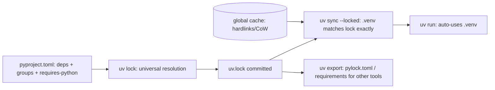

# Python - Packaging & Tooling with uv

> [!info] Deep dive of [[Python]]

> [!abstract] TL;DR
> **uv** (Astral, Rust) replaces pip, pip-tools, virtualenv, pyenv, pipx and most of Poetry, and it's 10–100× faster.
> - One `pyproject.toml` with PEP 735 dependency groups, plus a committed, cross-platform **`uv.lock`**.
> - `uv sync --locked` in CI and Docker, and `uv run` for everything.
> - **ruff** for lint and format.
>
> uv is still **0.x**: minor releases can change behaviour (0.12 tightened `pylock.toml` handling and made `uv init` projects packaged by default). Pin the uv version in CI and Docker.

## Concept
| Job | uv command | Replaces |
|---|---|---|
| Install/manage Python versions | `uv python install 3.14`, `.python-version` | pyenv |
| Create project / add deps | `uv init`, `uv add fastapi`, `uv add --dev pytest` | Poetry/PDM, `pip install` |
| Lock (universal, all platforms) | `uv lock` → `uv.lock` | pip-tools, `poetry.lock` |
| Install exactly the lock | `uv sync --locked` (`--no-dev`, `--group`) | `pip install -r requirements.txt` |
| Run in the project env | `uv run pytest`, `uv run python -m app` | `source .venv/bin/activate` |
| One-off tools | `uvx ruff check`, `uv tool install` | pipx |
| Single-file scripts with deps | PEP 723 inline metadata + `uv run script.py` | ad-hoc venvs |
| Legacy pip workflow | `uv pip compile` / `uv pip sync` | pip-tools |
| Standard lock export | `uv export --format pylock.toml` (PEP 751) | `requirements.txt` hashes |
| Monorepo | Workspaces (`[tool.uv.workspace] members = ["packages/*"]`) | Path deps + scripts |

- **Universal lockfile**: `uv.lock` resolves for all platforms and Python versions declared by `requires-python`, so macOS laptops, Linux CI and Docker share one lock.
- **Dependency groups (PEP 735)**: `[dependency-groups]` for `dev`, `test`, `docs`. These are not published as extras, so they're cleaner than `optional-dependencies` for tooling.

## How It Works

uv installs from a global content-addressed cache using hardlinks or copy-on-write. That's why a warm `uv sync` takes milliseconds and why Docker builds should mount the cache.

## Practical Usage
**`pyproject.toml`** for a worker (e.g. a Docling ingestion service):
```toml
[project]
name = "ingest-worker"
version = "0.4.0"
requires-python = ">=3.13,<3.15"
dependencies = [
  "docling>=2.40",
  "psycopg[binary,pool]>=3.2",
  "pydantic>=2.9",
  "httpx>=0.28",
]

[dependency-groups]
dev = ["pytest>=8", "pytest-asyncio>=0.24", "ruff>=0.13", "pyright>=1.1.400"]

[tool.uv]
index = [{ name = "pytorch-cpu", url = "https://download.pytorch.org/whl/cpu", explicit = true }]

[tool.uv.sources]
torch = { index = "pytorch-cpu" }        # CPU wheels on the VPS: avoids a multi-GB CUDA download

[tool.ruff]
line-length = 110
target-version = "py313"
[tool.ruff.lint]
select = ["E", "F", "I", "UP", "B", "ASYNC", "S"]
```
**Daily commands**:
```bash
uv add "openai>=2" && uv add --dev mypy          # edits pyproject + lock + env in one step
uv lock --upgrade-package docling                # targeted upgrade
uv lock --check                                  # CI: fail if the lock is stale
uv run --frozen pytest -q                        # don't re-resolve during tests
uvx ruff format . && uvx ruff check --fix .
```
**PEP 723 script** (one-off ops task, no project needed):
```python
# /// script
# requires-python = ">=3.13"
# dependencies = ["httpx", "rich"]
# ///
import httpx, rich
rich.print(httpx.get("https://api.example.my/api/health").json())
```
```bash
uv run scripts/check_health.py      # creates a cached ephemeral env with those deps
```
**Docker** (multi-stage, cache mount, deps layer before source):
```dockerfile
FROM python:3.13-slim AS build
COPY --from=ghcr.io/astral-sh/uv:0.12.1 /uv /uvx /bin/
ENV UV_COMPILE_BYTECODE=1 UV_LINK_MODE=copy UV_PYTHON_DOWNLOADS=never
WORKDIR /app
RUN --mount=type=cache,target=/root/.cache/uv \
    --mount=type=bind,source=uv.lock,target=uv.lock \
    --mount=type=bind,source=pyproject.toml,target=pyproject.toml \
    uv sync --locked --no-install-project --no-dev
COPY . .
RUN --mount=type=cache,target=/root/.cache/uv uv sync --locked --no-dev

FROM python:3.13-slim
RUN useradd -r -u 10001 app
COPY --from=build --chown=app /app /app
ENV PATH="/app/.venv/bin:$PATH"
USER app
CMD ["python", "-m", "ingest_worker"]
```
**GitHub Actions**:
```yaml
- uses: astral-sh/setup-uv@v6
  with: { version: "0.12.1", enable-cache: true }
- run: uv sync --locked
- run: uv run ruff check . && uv run pyright && uv run pytest -q
```
**Wrong way**:
```bash
pip install -r requirements.txt     # ❌ unpinned transitive deps → "works on my machine"
sudo pip install somepkg            # ❌ breaks the system Python (PEP 668 now blocks this on Debian/Ubuntu)
uv run app.py                        # ❌ in prod: may re-sync/resolve at start; use the built .venv + --frozen
```

## Patterns & Anti-patterns
| Pattern | When | Anti-pattern to avoid |
|---|---|---|
| Commit `uv.lock`, `uv sync --locked` in CI/Docker | Every app | Lock ignored in CI, so CI tests different versions than prod |
| Pin the uv version (Docker image tag, setup-uv `version`) | 0.x tool | `uv:latest`, picking up behaviour changes mid-sprint |
| Explicit index for torch CPU/CUDA wheels | ML deps on CPU servers | Default PyPI torch pulling CUDA (~2–3 GB) onto a VPS |
| `requires-python` upper bound matching what you test | Apps | Open-ended `>=3.10` letting the resolver choose untested combinations |
| PEP 723 scripts for ops tasks | One-off tooling | Global pip installs on servers |
| Workspaces for multiple services sharing code | Python monorepos | Copy-pasted shared modules |

## Performance & Trade-offs
- **Speed**: cold resolves and installs are typically 10–100× faster than pip/Poetry. Warm syncs are near-instant thanks to the shared cache, which cuts CI minutes and Docker rebuilds.
- **Alternatives**:

| Tool | Pick it when… |
|---|---|
| uv | Default for apps, services, scripts and libraries (2026) |
| Poetry 2 | Existing Poetry projects with plugins you rely on |
| pixi / conda | Heavy non-Python native deps (GDAL, CUDA toolchains) via conda-forge |
| pip + venv | Minimal environments where only stdlib tooling is allowed |

- **Managed Python builds** (python-build-standalone) are fast to install and consistent, but differ slightly from distro Pythons (bundled OpenSSL/Tcl). In Docker, use the official `python:*` image and `UV_PYTHON_DOWNLOADS=never`.
- **Vendor concentration**: uv, ruff and the `ty` type checker all come from one VC-backed company (Astral). They're permissively licensed (MIT/Apache-2.0) and forkable, and `uv export` to standard formats keeps an exit path.

## Tips & Reminders
> [!tip] In ZP's stack
> - **Python services**: Python is for AI/RAG workers (Docling ingestion, embedding jobs, fine-tuning scripts) beside the Node/Next.js core. Same pattern each time: uv project → multi-stage Dockerfile → GHCR → Coolify.
> - **CPU torch**: on Hostinger KVMs, pin the CPU index to keep images small.
> - **Unsloth / fine-tuning**: run on GPU boxes with the CUDA index instead ([[Fine-tuning LLMs - LoRA & QLoRA with Unsloth]]).

- `uv tree --outdated` shows what's upgradable. `uv lock --upgrade` does everything (review the diff).
- Add `uv lock --check` and `ruff format --check` to pre-commit and CI.
- `UV_FROZEN=1` or `--frozen` in production entrypoints guarantees no resolution at runtime.
- For n8n Python Code nodes or other hosts that only accept `requirements.txt`, generate it with `uv export --no-hashes --format requirements-txt`.

## Version Notes
| Version | Released | Key changes | Breaking / migration notes |
|---|---|---|---|
| 0.1–0.4 | 2024 | pip-compatible interface, then projects, `uv.lock`, workspaces, `uv python`, `uvx` | — |
| 0.5–0.8 | 2024–25 | PEP 735 groups, `uv_build` backend, PEP 751 `pylock.toml` export/install | Lockfile format revisions: re-lock after upgrades |
| 0.11.x | 2026 | pylock install improvements (`--require-hashes`, local artifacts preferred) | — |
| 0.12.0 | 2026-07-28 | Stricter `pylock.toml` names/validation. `uv init` declares a build system and packages by default | Malformed pylock files must be regenerated. Check `uv init` templates |
| 0.12.1 | 2026-07-31 | `--prerelease-package` per-package pre-release policy | — |

> [!warning] Unverified — check before relying on this
> The release details come from mirrored release notes (newreleases.io, dependency bots), not the official changelog. See https://github.com/astral-sh/uv/blob/main/CHANGELOG.md before upgrading.

## Critical Issues & Gotchas
> [!danger] Supply-chain risk is unchanged by faster tools
> uv installs whatever PyPI serves. Typosquats and compromised packages (recurring PyPI malware waves) still land. Lock with hashes, review new dependencies, prefer `--locked` installs, and consider `uv lock` with exclude-newer windows to avoid same-day malicious releases.

> [!danger] `uv run` re-syncing in production
> By default `uv run` checks and syncs the environment against the lock and project, which can mean network access and a changed env at container start. In images, run the venv's `python` directly, or use `--frozen`/`UV_FROZEN=1`.

- **0.x semver**: minor bumps (0.11 → 0.12) carry breaking changes. Read release notes and pin.
- **Platform markers**: a lock that resolves on macOS ARM may pick wheels unavailable on Alpine/musl. Use Debian-slim images, or declare the target environments (`[tool.uv] environments = [...]`).
- **Mixed tools**: running `pip install` inside a uv-managed `.venv` causes drift the lock doesn't know about. Always `uv add` / `uv sync`.
- **Large ML wheels** (torch, docling models) bloat images and layers. Separate the dependency layer from source so code changes don't re-download gigabytes.

## Related
- [[Python]]
- [[Python - Async & Concurrency]] — runtime side of Python services
- [[Docker - Dockerfile & Image Best Practices]] — multi-stage builds and cache mounts
- [[CI-CD]] — locked installs and caching in pipelines
- [[RAG - Document Ingestion & PDF Parsing Pipelines]] — a typical uv-managed worker
- [[JavaScript - Modules, ESM-CJS Interop & Bundling]] — the JS-side packaging counterpart

## References
- https://docs.astral.sh/uv/
- https://docs.astral.sh/uv/guides/integration/docker/
- https://peps.python.org/pep-0751/
- https://peps.python.org/pep-0735/
- https://newreleases.io/project/github/astral-sh/uv/release/0.12.0
