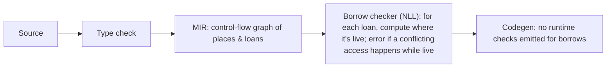

# Rust - Ownership & Borrowing

> [!info] Deep dive of [[Rust]]

> [!abstract] TL;DR
> Rust's memory safety comes from three compile-time rules:
> 1. Every value has **one owner**, and it's dropped when the owner goes out of scope.
> 2. You can have **many shared borrows (`&T`) or one exclusive borrow (`&mut T`)**, never both at once.
> 3. **References can't outlive** what they point to (lifetimes).
>
> The borrow checker enforces these with no runtime cost. When it rejects code, it's usually pointing at a real aliasing or lifetime bug. Fix it by restructuring ownership (owned data, indices, scoped borrows), and only reach for `Rc<RefCell<…>>`/`Arc<Mutex<…>>` when sharing is genuinely needed.

## Concept

### Moves, copies, clones
```rust
let a = String::from("INV-0042");
let b = a;                 // move: ownership transferred, `a` is now invalid
// println!("{a}");        // E0382: borrow of moved value: `a`

let x = 42u32;
let y = x;                 // Copy type (ints, bool, char, &T, small Copy structs): both usable

let c = b.clone();         // explicit deep copy: costs an allocation
fn consume(s: String) {}   // takes ownership: caller can't use the value afterwards
fn inspect(s: &str) {}     // borrows: caller keeps ownership
```
- **Move** = bitwise copy of the stack representation + the source becomes inaccessible. Heap data is not copied.
- `Drop` runs exactly once, at the end of the owner's scope (RAII): files close, locks release, memory frees deterministically.

### Borrowing rules in practice
```rust
let mut orders = vec![1, 2, 3];
let first = &orders[0];          // shared borrow
// orders.push(4);               // E0502: cannot borrow as mutable because it's also borrowed as immutable
println!("{first}");             // last use of `first` → borrow ends here (non-lexical lifetimes)
orders.push(4);                  // OK now
```
The `push` could reallocate the vector and leave `first` dangling. This is exactly the bug class (iterator invalidation) that C++ allows and Rust rejects.

### Lifetimes
```rust
// The returned reference lives as long as the shorter of the inputs
fn longest<'a>(a: &'a str, b: &'a str) -> &'a str { if a.len() >= b.len() { a } else { b } }

// Structs holding references must declare lifetimes
struct Parser<'src> { input: &'src str, pos: usize }
impl<'src> Parser<'src> {
    fn next_token(&mut self) -> &'src str { let input = self.input; &input[self.pos..] }   // tied to 'src, not to &mut self
}
```
- **Elision rules** cover most functions: each input reference gets its own lifetime. With exactly one input lifetime, it's assigned to outputs. With `&self`/`&mut self`, self's lifetime is assigned to outputs.
- `'static` means "can live for the whole program" (string literals, owned data with no borrows). `T: 'static` doesn't mean "lives forever", it means "contains no non-static borrows".

### Interior mutability and shared ownership
| Type | Thread-safe | Checks | Use |
|---|---|---|---|
| `Cell<T>` | No | None (Copy get/set) | Small counters/flags inside `&self` |
| `RefCell<T>` | No | **Runtime** borrow checks (panics on violation) | Single-threaded shared mutation (graphs, caches) |
| `Rc<T>` | No | Refcount | Shared ownership in one thread |
| `Arc<T>` | Yes | Atomic refcount | Shared ownership across threads/tasks |
| `Mutex<T>` / `RwLock<T>` | Yes | Runtime locking | Shared mutable state across threads |
| `OnceLock<T>` / `LazyLock<T>` | Yes | One-time init | Global config, lazily computed statics |

**`Send`** = safe to move to another thread. **`Sync`** = safe to share `&T` across threads. `Rc`/`RefCell` are neither, so the compiler stops you from sending them into `tokio::spawn` or `std::thread::spawn`.

## How It Works

- **Non-lexical lifetimes (NLL, 2018)**: a borrow lasts until its **last use**, not the end of the block. Most "obviously fine" code compiles.
- **Two-phase borrows** allow `vec.push(vec.len())`.
- **Polonius** (the next-generation borrow checker, in development) accepts more correct patterns, e.g. conditional returns of borrows ("NLL problem case #3").
- **Drop check** ensures values aren't used after their destructors run, which is why some self-referential structs are impossible without `Pin`/unsafe.

## Practical Usage

### Common errors and idiomatic fixes
| Error | Typical cause | Fix |
|---|---|---|
| E0382 use of moved value | Passing an owned value into a function/closure, then using it again | Borrow (`&x`), clone if cheap, or restructure so the callee returns it |
| E0499 two mutable borrows | Calling `&mut self` methods while holding `&mut` to a field | Split borrows (borrow disjoint fields separately), use indices, shorten scopes |
| E0502 mutable + immutable | Holding a reference into a collection while mutating it | Copy out the value/index first, then mutate |
| E0597 does not live long enough | Returning/storing a reference to a local | Return owned data (`String`, `Vec`), or take the buffer from the caller |
| E0106 missing lifetime | Struct/function returning a reference with ambiguous source | Add explicit lifetimes, or return owned data |
| E0373 closure may outlive function | Spawning a thread/task that borrows locals | `move` closure + owned/`Arc` data, or `std::thread::scope` |

### Split borrows and indices instead of references
```rust
struct Cart { items: Vec<Item>, total_sen: u64 }

impl Cart {
    fn apply_discount(&mut self, sku: &str, pct: u64) {
        // Borrow two fields independently: allowed (disjoint fields)
        let Cart { items, total_sen } = self;
        if let Some(item) = items.iter_mut().find(|i| i.sku == sku) {
            let cut = item.price_sen * pct / 100;
            item.price_sen -= cut;
            *total_sen -= cut;
        }
    }
}

// Graphs: store nodes in a Vec and refer by index, not &Node (no lifetime webs, no Rc cycles)
struct Graph { nodes: Vec<Node>, edges: Vec<(usize, usize)> }
```

### Sharing across async tasks
```rust
use std::sync::Arc;
use tokio::sync::Mutex;

let state = Arc::new(Mutex::new(Stats::default()));
for _ in 0..8 {
    let state = Arc::clone(&state);                 // cheap refcount bump
    tokio::spawn(async move {
        let mut s = state.lock().await;             // tokio Mutex is safe to hold across .await
        s.processed += 1;
    });
}
```

### Borrowing threads with scopes (no Arc needed)
```rust
let data = vec![1, 2, 3, 4];
std::thread::scope(|s| {
    let (left, right) = data.split_at(2);
    s.spawn(|| sum(left));
    s.spawn(|| sum(right));
});                                                 // all scoped threads joined here; borrows are safe
```

## Patterns & Anti-patterns
| Pattern | When | Anti-pattern to avoid |
|---|---|---|
| Functions take `&str`/`&[T]`, return owned values | APIs | Taking `String`/`Vec<T>` by value when only reading |
| Indices/IDs into arenas (`Vec`, `slotmap`) | Graphs, trees, ECS | `Rc<RefCell<Node>>` webs everywhere |
| `Cow<'a, str>` | Sometimes borrowed, sometimes owned | Always cloning "just in case" |
| `Arc<T>` for immutable shared data, `Arc<Mutex<T>>` only for mutable | Multi-threaded services | Global `static mut` / `unsafe` to dodge the borrow checker |
| Scoped threads/tasks for temporary parallelism | Data-parallel loops | `'static` bounds forcing needless `Arc`/clones |
| Clone small data freely | `u64`, short strings, IDs | Premature lifetime gymnastics to avoid cheap clones |

## Performance & Trade-offs
- Borrows are plain pointers at runtime: zero overhead. The cost is design time and compile errors.
- `clone()` on `String`/`Vec` allocates and copies. On `Arc`/`Rc` it's a refcount increment (atomic for `Arc`).
- `RefCell`/`Mutex` move checks to runtime (borrow flags/locks). `Mutex` contention can dominate hot paths. Prefer message passing or sharding.
- Lifetimes in public APIs leak complexity to callers. Owned types are easier to use, borrowed types are faster. Choose deliberately at module boundaries.

## Tips & Reminders
> [!tip]
> - Read the full compiler error. Rust's diagnostics usually suggest the exact fix (`&`, `.clone()`, `move`, lifetime annotation).
> - When fighting the borrow checker, ask "who owns this data?" and restructure, rather than adding lifetimes everywhere.
> - Start with owned data in structs (`String`, `Vec`). Introduce borrowed (`&'a str`) structs only for proven hot paths like parsers.
> - Never hold a `std::sync::Mutex` guard across `.await`. Use `tokio::sync::Mutex` or drop the guard first.
> - Use `cargo clippy` lints (`needless_clone`, `redundant_clone` is in `nursery`) to find unnecessary copies.
> - **In ZP's stack**: Rust shows up as performance cores (file/PDF/image processing workers, FFI libraries for Flutter). Keep the boundary simple: owned byte buffers or strings in, owned results out. That avoids lifetime-bound FFI APIs ([[Flutter - Platform Channels & FFI]]).

## Version Notes
| Version | Change |
|---|---|
| 1.0 (2015) | Lexical borrow checker |
| 2018 edition (1.31) | **NLL** (non-lexical lifetimes) |
| 1.63 (2022) | `std::thread::scope` (scoped threads) |
| 1.70 / 1.80 | `OnceLock` / `LazyLock` in std |
| **2024 edition** (1.85, 2025-02) | `impl Trait` in return position captures all in-scope lifetimes by default (`use<..>` bounds to opt out), `if let` temporaries dropped before `else`, tail-expression temporary scope changes. Run `cargo fix --edition` and review drop-order-sensitive code (locks in `if let`) |
| Polonius (in development) | Next-generation borrow checker accepting more valid programs |

## Critical Issues & Gotchas
> [!danger] `unsafe` breaks the guarantees for everyone
> The borrow checker trusts `unsafe` blocks. Creating two `&mut` to the same data, extending lifetimes with `transmute`, or wrong `Send`/`Sync` impls cause undefined behaviour that can corrupt memory far from the bug. Keep `unsafe` minimal and documented (`// SAFETY:` comments), and test with **Miri** (`cargo +nightly miri test`).

> [!danger] Memory leaks are "safe"
> Rust prevents use-after-free and data races, **not** leaks. `Rc`/`Arc` reference cycles never drop, `std::mem::forget` and `Box::leak` are safe, and long-lived caches grow forever. Use `Weak` for back-references and bound caches.

> [!warning] Gotchas
> - `RefCell` double-borrow panics at runtime (`already borrowed: BorrowMutError`). It's the borrow checker's error moved to production.
> - Locks in `if let`/`match` scrutinees live until the end of the statement or block (edition-dependent), which can deadlock when re-locking inside. Bind the guard explicitly and drop it early.
> - Closures capture by the least restrictive mode needed. Add `move` for threads/tasks, and remember that captured values are then owned by the closure.
> - Self-referential structs (a field borrowing another field) aren't expressible safely. Use indices, `ouroboros`, or `Pin` patterns.
> - Returning references from functions that create the data ("dangling reference") is always rejected. Return owned values.

## Related
- [[Rust]]
- [[Go - Concurrency]] — runtime race detection vs compile-time prevention
- [[Swift]] — ARC + exclusivity enforcement, a similar ownership direction
- [[Dart - VM, Compilation & Garbage Collection]] — the GC-based contrast
- [[Data Structures]] — arenas, indices, graph representations

## References
- The Rust Book, ch. 4 (Ownership) and ch. 10 (Lifetimes): https://doc.rust-lang.org/book/
- Rustonomicon (unsafe, variance, drop check): https://doc.rust-lang.org/nomicon/
- Rust 2024 edition guide: https://doc.rust-lang.org/edition-guide/rust-2024/
- Common Rust lifetime misconceptions: https://github.com/pretzelhammer/rust-blog/blob/master/posts/common-rust-lifetime-misconceptions.md
- Polonius: https://rust-lang.github.io/polonius/
- Miri: https://github.com/rust-lang/miri
