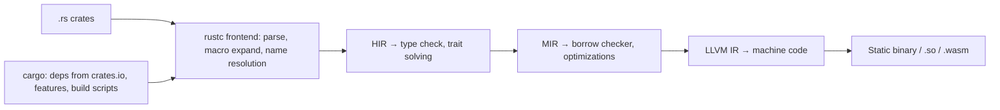

# Rust

> [!abstract] TL;DR
> Rust is a compiled systems language that gives C/C++-level performance with **memory safety and data-race freedom enforced at compile time**, via ownership, borrowing and lifetimes, with no garbage collector.
> - **Tooling**: `cargo`, `clippy`, `rustfmt`, `rust-analyzer`. Stable releases every 6 weeks.
> - **Where it dominates**: CLIs and dev tooling (ruff, uv, Biome, Turbopack, SWC), infra (proxies, databases, Cloudflare's FL2/Pingora), WebAssembly, embedded, Linux/Windows kernels, blockchain (Solana, Reth).
> - **The trade-off**: a steep learning curve and slower compile times. Reach for it when performance, safety or a single small binary matter more than iteration speed.

## Introduction
- **Origin**: Graydon Hoare's side project (2006), sponsored by Mozilla from 2009, 1.0 in **2015-05**. Since 2021 it has been stewarded by the **Rust Foundation** (AWS, Google, Microsoft, Huawei, Meta…), with governance by Rust Project teams.
- **Problem**: ~70% of serious security bugs in large C/C++ codebases (Microsoft, Chromium) are memory-safety bugs. Rust eliminates most of those classes in safe code.
- **Where it sits**: under much of the modern JS/Python toolchain, in cloud infra and edge runtimes, in Android/Windows/Linux kernel components, and as a "fast core" called from other languages via FFI ([[Python]] via PyO3, Node via napi-rs, [[Dart]] via flutter_rust_bridge).

## Core Concepts

### Ownership, borrowing, lifetimes
```rust
fn main() {
    let s = String::from("order-42");      // s owns the heap buffer
    let t = s;                             // move: s is no longer usable
    // println!("{s}");                    // compile error: borrow of moved value
    let len = length(&t);                  // shared borrow (&T): many readers
    let mut v = vec![1, 2, 3];
    push_twice(&mut v);                    // exclusive borrow (&mut T): one writer, no readers
    println!("{t} {len} {v:?}");
}                                          // t and v dropped here (RAII, deterministic)

fn length(s: &str) -> usize { s.len() }
fn push_twice(v: &mut Vec<i32>) { v.push(4); v.push(5); }

fn longest<'a>(a: &'a str, b: &'a str) -> &'a str { if a.len() > b.len() { a } else { b } }  // lifetime ties output to inputs
```
- **Rules**: each value has one owner. You get either many `&T` **or** one `&mut T`, never both. References can't outlive their data. That's the core of safety, and it's covered in [[Rust - Ownership & Borrowing]].
- `Clone` = explicit deep copy. `Copy` = implicit bitwise copy for small types (ints, `bool`).
- Smart pointers: `Box<T>` (heap), `Rc<T>`/`Arc<T>` (shared ownership, single/multi-thread), `RefCell<T>`/`Mutex<T>` (interior mutability, checked at runtime).

### Types, traits, errors
| Feature | Notes |
|---|---|
| `struct`, `enum` (algebraic, with data) | `enum Payment { Fpx { bank: String }, Card(String), Cash }` + exhaustive `match` |
| `Option<T>` / `Result<T, E>` | No null, no exceptions. `?` propagates errors |
| Traits | Interfaces + generics with static dispatch (monomorphization) or `dyn Trait` (vtables) |
| Generics + trait bounds | `fn total<T: Into<f64>>(xs: &[T])`, `impl Trait` |
| Iterators | Zero-cost adapters (`map`, `filter`, `fold`), compiled to loops |
| Macros | `macro_rules!` and procedural macros (`#[derive(Serialize)]`) |
| Modules / crates | Crate = compilation unit. Workspaces for multi-crate repos |

```rust
use anyhow::{Context, Result};
use serde::Deserialize;

#[derive(Debug, Deserialize)]
struct Order { id: String, total_sen: u64 }

fn load(path: &str) -> Result<Vec<Order>> {
    let raw = std::fs::read_to_string(path).with_context(|| format!("reading {path}"))?;
    Ok(serde_json::from_str(&raw)?)
}
```
Libraries usually define typed errors with `thiserror`. Applications use `anyhow`.

### Concurrency and async
- **Fearless concurrency**: `Send` (safe to move across threads) and `Sync` (safe to share) are compiler-checked marker traits. Data races are compile errors.
- **Async**: `async fn` compiles to state machines. You need a runtime: **tokio** (de facto standard), smol, embassy (embedded). Async closures and `async fn` in traits are stable (1.75 / 1.85).
- Web stack: **axum** (tokio + tower), actix-web. DB: **sqlx** (compile-time checked SQL), Diesel, SeaORM.

## Architecture / How It Works

- **Borrow checking** runs on MIR (non-lexical lifetimes). It's a static analysis with zero runtime cost.
- **Monomorphization**: generics are duplicated per concrete type. That makes them fast, but grows binaries and compile times.
- **No GC, no runtime**: memory is freed at scope end (`Drop`). There's a minimal std runtime, and `#![no_std]` for embedded/kernels.
- **`unsafe`** unlocks raw pointers, FFI and unchecked operations. The safety guarantees then depend on the programmer maintaining invariants. Audit `unsafe` blocks and test them under Miri.
- **Editions** (2015, 2018, 2021, **2024**) allow opt-in syntax changes without breaking older crates. All editions interoperate.

## Project Structure
```text
svc/
├── Cargo.toml            # [package], [dependencies], [features], [profile.release]
├── Cargo.lock            # commit for binaries
├── rust-toolchain.toml   # pin channel/version + components (clippy, rustfmt)
├── src/
│   ├── main.rs           # binary entry (#[tokio::main])
│   ├── lib.rs            # library code (testable)
│   └── routes/orders.rs
├── tests/                # integration tests
├── benches/              # criterion benchmarks
└── migrations/           # sqlx migrations
```
```toml
[package]
name = "svc"
edition = "2024"
rust-version = "1.85"

[dependencies]
axum = "0.8"
tokio = { version = "1", features = ["full"] }
sqlx = { version = "0.8", features = ["runtime-tokio", "postgres", "macros"] }
serde = { version = "1", features = ["derive"] }

[profile.release]
lto = "thin"
codegen-units = 1
strip = true
```
```bash
cargo new svc && cargo add axum tokio -F tokio/full
cargo clippy -- -D warnings && cargo fmt --check && cargo test
cargo build --release --target x86_64-unknown-linux-musl     # fully static binary → FROM scratch image
cargo audit && cargo deny check                               # vulns, licenses, banned crates
```

## Use Cases
| Use case | Why it fits |
|---|---|
| CLIs and developer tooling | Fast startup, single binary, cross-compilation |
| High-performance network services, proxies | Predictable latency (no GC pauses), low memory |
| WebAssembly modules | Small, fast `.wasm` (wasm-bindgen, wasm-pack) |
| Native extensions for Python/Node/Flutter | PyO3/maturin, napi-rs, flutter_rust_bridge |
| Embedded / IoT / kernels | `no_std`, embassy, Rust-for-Linux |
| Blockchain clients, contracts (Solana), ZK provers | Performance + safety for value-bearing code |
| CRUD SaaS backends with fast-changing requirements | **Weaker fit**. [[TypeScript]]/[[Go]] iterate faster |

## Pros & Cons
| Pros | Cons |
|---|---|
| Memory safety and data-race freedom without GC | Steep learning curve (borrow checker, lifetimes, async pinning) |
| C/C++-level performance, predictable latency | Slow compile times (monomorphization, LLVM) |
| Excellent tooling: cargo, clippy, rustfmt, rust-analyzer, docs.rs | Async ecosystem complexity (`Send` bounds, runtimes, cancellation) |
| Expressive types (enums, pattern matching, traits) | Smaller hiring pool. Slower prototyping |
| Single static binaries, great cross-compilation | Large dependency trees per project (supply-chain surface) |
| Stability guarantees + editions | `unsafe` and FFI still need expertise |

## Alternatives & Peers
| Alternative | Strength vs Rust | Weakness vs Rust | Pick it when… |
|---|---|---|---|
| [[Go]] | Much simpler, fast compiles, great for network services | GC pauses, less expressive types, nil pointers | Backend services/infra tooling with a team |
| C++ | Huge legacy ecosystem, game engines | Memory-unsafe by default, complex build systems | Existing C++ codebases, Unreal |
| Zig | Simple, C interop, comptime | Pre-1.0, smaller ecosystem | Low-level tools wanting C-like control |
| [[TypeScript]] / Node | Fastest iteration, shared with frontend | Slower runtime, GC, single-threaded | Business apps, APIs (ZP's default) |
| [[Python]] + Rust extension | Python productivity + Rust hot paths | Two languages | Data/AI pipelines needing speed |

## Tips & Reminders
> [!tip]
> - Learn with the Rust Book + Rustlings. Fight the borrow checker by restructuring ownership (pass IDs/indices, clone small data) rather than reaching for `Rc<RefCell<>>` everywhere.
> - Treat clippy warnings as errors in CI. Pin the toolchain with `rust-toolchain.toml`.
> - Use `cargo deny` (licenses, duplicate versions, advisories) and `cargo audit`. Minimize dependencies and check crate download counts and maintainers.
> - Speed up builds: `sccache`, `mold`/`lld` linker, split crates in a workspace, and use `cargo check` in the inner loop.
> - **In ZP's stack**: Rust is a niche tool, not a default. Use it for a CPU-heavy worker (image/PDF processing, crypto, parsing large exports) as a static binary in a `FROM scratch` [[Docker]] image on [[Coolify]], or a Flutter native core via FFI ([[Flutter - Platform Channels & FFI]]). Keep business APIs in TypeScript.

## Versions & Breaking Changes
| Version | Released | Key changes | Breaking / migration notes |
|---|---|---|---|
| 1.0 | 2015-05 | Stability guarantee | — |
| 1.39 | 2019-11 | `async`/`.await` | — |
| 2021 edition (1.56) | 2021-10 | Disjoint closure captures, `IntoIterator` for arrays | `cargo fix --edition` |
| 1.65 / 1.75 | 2022-11 / 2023-12 | GATs, let-else / `async fn` and RPITIT in traits | — |
| **2024 edition (1.85)** | 2025-02 | Async closures, RPIT lifetime capture rules, `unsafe extern`, `gen` keyword reserved, `if let` temporaries scope, edition-aware rustfmt | `cargo fix --edition`. Review `unsafe` attributes (`#[unsafe(no_mangle)]`) |
| 1.96.0 / 1.96.1 | 2026-05-28 / 2026-06-30 | 1.96.1 fixes libssh2 CVEs bundled in Cargo | Update toolchains |
| 1.9x (later 2026) | every 6 weeks | Ongoing stabilizations | `rustup update stable` |

> [!warning] Unverified — check before relying on this
> Releases after 1.96.1 (expected ~1.97–1.99 by October 2026) weren't confirmed. Check https://blog.rust-lang.org/releases/.

## Critical Issues & Gotchas
> [!danger] crates.io supply-chain attacks
> Typosquatted and malicious crates (e.g. 2025 crates impersonating logging libraries that exfiltrated private keys/crypto wallets) have been published and removed after downloads. `build.rs` scripts and proc macros run arbitrary code at **compile time** on dev machines and CI. Pin with `Cargo.lock`, review new dependencies, use `cargo vet`/`cargo deny`, and run CI builds without long-lived secrets.

> [!danger] "BatBadBut" (CVE-2024-24576): std command injection on Windows
> `std::process::Command` didn't properly escape arguments when invoking `.bat`/`.cmd` files on Windows, allowing command injection (CVSS 10.0). Fixed in 1.77.2. Lesson: even memory-safe std libraries have logic vulnerabilities. Keep toolchains updated and validate inputs to subprocesses.

> [!warning] Gotchas
> - `unwrap()`/`expect()` panics in production code crash threads/tasks. Propagate errors with `?`, and only `expect` on proven invariants.
> - Blocking calls (std I/O, heavy CPU) inside tokio tasks stall the executor. Use `spawn_blocking` or async I/O.
> - Holding a `std::sync::Mutex` guard across `.await` makes futures `!Send` (and risks deadlocks). Use `tokio::sync::Mutex` or restructure.
> - Integer overflow panics in debug but **wraps in release** (unless `overflow-checks = true`). Use `checked_*`/`saturating_*` for money math.
> - Debug builds are 10–100× slower than release. Benchmark with `--release` (and criterion).
> - `Rc` cycles leak memory (no cycle collector). Use `Weak` for back-references.

## Deep Dives
- (planned) [[Rust - Ownership & Borrowing]]

## Related
- [[Go]] — systems/backend peer
- [[TypeScript]] · [[Python]] — languages Rust tooling accelerates (SWC, ruff, uv)
- [[Flutter - Platform Channels & FFI]] — Rust cores via FFI
- [[WebGL]] — Rust → WebAssembly/WebGPU (wgpu)
- [[Solidity]] — contrast with Rust-based Solana programs
- [[Docker]] — tiny static images

## References
- The Rust Book: https://doc.rust-lang.org/book/
- Release announcements: https://blog.rust-lang.org/releases/
- Rust 1.96.1: https://blog.rust-lang.org/2026/06/30/Rust-1.96.1/
- Edition guide (2024): https://doc.rust-lang.org/edition-guide/rust-2024/
- Rust security advisories (RustSec): https://rustsec.org/
- Tokio: https://tokio.rs/
