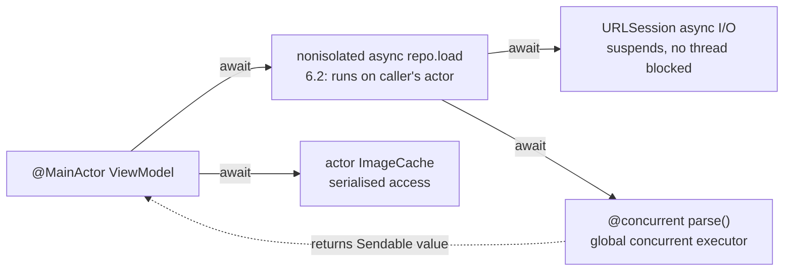

# Swift - Concurrency, Actors & Sendable

> [!info] Deep dive of [[Swift]]

> [!abstract] TL;DR
> Swift concurrency combines `async`/`await` with **structured tasks** (`async let`, `TaskGroup`) and **actors** that serialise access to mutable state. **`Sendable`** marks values safe to cross isolation boundaries, and in the Swift 6 language mode data races are **compile errors**.
> - **Swift 6.2 "approachable concurrency"** flips the defaults:
>   - modules can default to `@MainActor`
>   - `nonisolated async` functions run on the **caller's** actor
>   - real parallelism is opt-in with `@concurrent`
> - **Core rule**: keep UI state on `@MainActor`, push heavy work into `@concurrent` functions, and bridge callbacks with continuations or `AsyncStream`.

## Concept

### Isolation domains
| Domain | What runs there | Declared by |
|---|---|---|
| **MainActor** | UI, view models, most app code (6.2 default option) | `@MainActor`, or module default isolation = MainActor |
| **Actor instance** | Mutable state owned by that actor, one task at a time | `actor Cache { … }` |
| **Global actor** | Shared serial executor for a subsystem | `@globalActor actor DatabaseActor` |
| **Nonisolated** | No actor. In 6.2 `nonisolated async` inherits the caller's isolation | `nonisolated`, `nonisolated(nonsending)` (SE-0461) |
| **Concurrent** | Global concurrent executor (background threads) | `@concurrent` (6.2) / `Task.detached` |

### Sendable in one table
| Type | Sendable? |
|---|---|
| Value types with Sendable members (`struct Order`, enums) | ✅ Inferred (non-public) or declare explicitly |
| `final class` with only immutable `let` Sendable properties | ✅ Declare `Sendable` |
| Classes with mutable state | ❌ Make an actor, protect with `Mutex`, or `@unchecked Sendable` (you promise) |
| Actors | ✅ Always |
| Closures crossing boundaries | Must be `@Sendable` (capture only Sendable values) |
| `sending` parameters (SE-0430) | Transfer ownership of non-Sendable values once |

### Structured vs unstructured tasks
| API | Structured | Inherits actor/priority/task-locals | Use |
|---|---|---|---|
| `async let` | ✅ | ✅ | Fixed small parallel fan-out |
| `withTaskGroup` / `withThrowingTaskGroup` | ✅ | ✅ | Dynamic fan-out, bounded loops |
| `Task { }` | ❌ (unstructured) | ✅ | Start async work from sync code (button tap) |
| `Task.detached { }` | ❌ | ❌ | Rare. Truly independent work |

## How It Works

- **Suspension points** (`await`) let the executor run other work. There's no thread per task, and the cooperative thread pool is sized to CPU cores, so **never block** it with semaphores or synchronous waits.
- **Actor reentrancy**: during an `await` inside an actor method, other calls can run on the actor, so state may have changed when you resume. Re-check invariants after each `await`.
- **Cancellation is cooperative**: `Task.isCancelled` / `try Task.checkCancellation()`. Parent cancellation propagates to child tasks in groups and `async let`.

## Practical Usage

### View model + repository (Swift 6.2 defaults)
```swift
@MainActor
@Observable
final class OrdersViewModel {
    private(set) var orders: [Order] = []
    private(set) var error: String?
    private let repo: OrderRepository
    init(repo: OrderRepository) { self.repo = repo }

    func load(tenantId: String) async {
        do { orders = try await repo.orders(tenantId: tenantId) }       // back on MainActor after await
        catch is CancellationError { /* view went away */ }
        catch { self.error = error.localizedDescription }
    }
}

struct OrderRepository: Sendable {
    let api: APIClient
    nonisolated func orders(tenantId: String) async throws -> [Order] {  // 6.2: runs on caller's executor
        let data = try await api.get("/orders?tenant=\(tenantId)")
        return try await decodeOrders(data)
    }
    @concurrent func decodeOrders(_ data: Data) async throws -> [Order] { // explicit background work
        try JSONDecoder().decode([Order].self, from: data)
    }
}
```

### Bounded parallel fan-out with a task group
```swift
func thumbnails(for urls: [URL], maxConcurrent: Int = 4) async throws -> [URL: Image] {
    try await withThrowingTaskGroup(of: (URL, Image).self) { group in
        var result: [URL: Image] = [:]
        var iterator = urls.makeIterator()
        for _ in 0..<maxConcurrent { if let u = iterator.next() { group.addTask { (u, try await fetchImage(u)) } } }
        while let (url, image) = try await group.next() {
            result[url] = image
            if let u = iterator.next() { group.addTask { (u, try await fetchImage(u)) } }   // keep ≤ maxConcurrent in flight
        }
        return result
    }
}
```

### Actor for shared mutable state
```swift
actor TokenStore {
    private var token: String?
    private var refreshTask: Task<String, Error>?

    func validToken() async throws -> String {
        if let token { return token }
        if let refreshTask { return try await refreshTask.value }     // dedupe concurrent refreshes
        let t = Task { try await AuthAPI.refresh() }
        refreshTask = t
        defer { refreshTask = nil }
        let fresh = try await t.value                                  // reentrancy: re-check state after await
        token = fresh
        return fresh
    }
}
```

### Bridging callbacks
```swift
// One-shot callback → async (resume exactly once!)
func currentLocation() async throws -> CLLocation {
    try await withCheckedThrowingContinuation { cont in
        locator.requestOnce { result in cont.resume(with: result) }
    }
}

// Stream of events → AsyncStream (e.g. realtime messages)
func messages(channel: RealtimeChannel) -> AsyncStream<Message> {
    AsyncStream { continuation in
        let sub = channel.onMessage { continuation.yield($0) }
        continuation.onTermination = { _ in sub.cancel() }
    }
}
for await msg in messages(channel: ch) { handle(msg) }
```

### Flutter iOS plugin note
- Method-channel handlers are invoked on the **main thread**, and `FlutterResult` must be called on the main thread too.
- From async Swift, do the work in a `Task`, then hop back with `await MainActor.run { result(value) }` ([[Flutter - Platform Channels & FFI]]).

## Patterns & Anti-patterns
| Pattern | When | Anti-pattern to avoid |
|---|---|---|
| `@MainActor` view models, `@concurrent` for CPU work | SwiftUI apps | `DispatchQueue.main.async` sprinkled across async code |
| Actors (or `Mutex`) for shared mutable state | Caches, token stores, counters | Classes marked `@unchecked Sendable` with unprotected vars |
| Task groups with bounded concurrency | Batch downloads/uploads | Spawning 1,000 `Task {}` at once |
| `withCheckedContinuation` with exactly-once resume | Wrapping legacy callbacks | Forgetting to resume (task hangs forever) or resuming twice (crash) |
| Keep tasks structured, store `Task` handles to cancel | Screen-scoped work | Fire-and-forget `Task {}` that outlives the screen |
| Adopt Swift 6 mode module by module with 6.2 defaults | Migrations | Silencing everything with `nonisolated(unsafe)` / `@preconcurrency` |

## Performance & Trade-offs
- **Actor hops** cost a context switch on each cross-actor `await`. Chatty fine-grained actor calls in tight loops are slow, so batch work inside the actor.
- **Main-actor default** simplifies correctness, but CPU-heavy code (JSON decoding of big payloads, image processing) then runs on the UI thread unless marked `@concurrent`. Profile with Instruments (Swift Concurrency template).
- **GCD vs Swift concurrency**: GCD remains for legacy APIs. Mixing blocking GCD semaphores with async code can deadlock the cooperative pool.
- **`Mutex`** (Synchronization module, Swift 6) suits tiny critical sections without async. Actors suit async, state-heavy components.

## Tips & Reminders
> [!tip]
> - **Turn on strict checking early** (Swift 6 language mode, or `-strict-concurrency=complete` on Swift 5 mode). With 6.2's approachable defaults, most app modules migrate with few annotations.
> - **Prefer value types** (`struct`, `enum`) for models. They're Sendable by construction and make cross-actor passing trivial.
> - **Use `@preconcurrency import`** for third-party SDKs not yet annotated, and track removing it.
> - **In ZP's stack**: most mobile work is [[Flutter]]. Swift concurrency matters for native iOS plugins (payments, WhatsApp/notification extensions, HealthKit) and for reviewing client native apps. Keep plugin APIs async on the Dart side and main-thread-safe on the Swift side.

## Version Notes
| Version | Change |
|---|---|
| 5.5 (2021) | `async`/`await`, actors, structured concurrency, `Sendable` |
| 5.7–5.10 (2022–24) | Stricter checking previews, `@preconcurrency`, global-actor inference changes |
| **6.0** (2024-09) | **Swift 6 language mode**: data-race safety as errors. `sending`, `Mutex`, typed throws |
| **6.2** (2025-09, Xcode 26) | **Approachable concurrency**: default actor isolation option (MainActor), `nonisolated async` runs on caller's actor (SE-0461 `nonisolated(nonsending)`), `@concurrent` for explicit parallelism |
| 6.3 (2026-03-24) | Platform focus: Embedded Swift stable, official Android SDK, FreeBSD, better Wasm. 6.3.x point releases through mid-2026 |

> [!warning] Unverified — check before relying on this
> Exact 6.2 attribute spellings/build settings (`nonisolated(nonsending)`, "Default Actor Isolation" in Xcode) come mostly from third-party guides, and a Swift 6.4 release may exist by now. Check Swift Evolution SE-0461/SE-0466 and swift.org/blog.

## Critical Issues & Gotchas
> [!danger] Actor reentrancy bugs
> Actors prevent simultaneous access, **not interleaving**. While an actor method awaits (network refresh, DB read), other callers run on the same actor and can change state. Results include double refreshes, stale caches and lost updates. Re-validate state after every `await`, and dedupe in-flight work with stored `Task` handles (as in `TokenStore`).

> [!danger] Blocking the cooperative pool
> `DispatchSemaphore.wait()`, `Thread.sleep`, synchronous network calls or `Task { … }.value`-style waits inside async code block one of a few cooperative threads. A handful of them can deadlock the whole app. Use `await`-based APIs, `Task.sleep`, and continuations for legacy APIs.

> [!warning] Gotchas
> - `Task {}` inherits the current actor. A `Task {}` created in a `@MainActor` context runs its synchronous parts on the main thread.
> - `@unchecked Sendable` silences the compiler without making code safe. Every use needs a lock or immutability argument in a comment.
> - Continuations: missing `resume` is a leak/hang. `CheckedContinuation` logs misuse in debug, `Unsafe…` doesn't.
> - `AsyncStream` with the default unbounded buffer can grow without limit. Set `bufferingPolicy: .bufferingNewest(n)` for high-rate sources.
> - Global mutable variables (`var config`) are errors in Swift 6 mode. Use `let`, actors, or `nonisolated(unsafe)` with justification.

## Related
- [[Swift]]
- [[Kotlin - Coroutines & Flow]] — the Android analogue
- [[Dart - Async, Streams & Isolates]] — Flutter concurrency model
- [[Flutter - Platform Channels & FFI]] — Swift plugins and threading
- [[Java - Virtual Threads & Structured Concurrency]] — structured concurrency on the JVM
- [[Rust]] — compile-time data-race safety via `Send`/`Sync`

## References
- The Swift Programming Language, Concurrency: https://docs.swift.org/swift-book/documentation/the-swift-programming-language/concurrency/
- SE-0461 (nonisolated async on caller's actor): https://github.com/swiftlang/swift-evolution/blob/main/proposals/0461-async-function-isolation.md
- SE-0466 (default main actor isolation): https://github.com/swiftlang/swift-evolution/blob/main/proposals/0466-control-default-actor-isolation.md
- Swift 6 migration guide: https://www.swift.org/migration/documentation/migrationguide/
- What's new in Swift, March 2026: https://swift.org/blog/whats-new-in-swift-march-2026/
