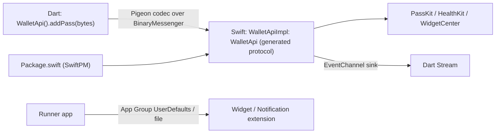

# Swift - iOS Native Integration for Flutter Apps

> [!info] Deep dive of [[Swift]]

> [!abstract] TL;DR
> Write Swift in a Flutter app only for iOS capabilities no maintained plugin covers:
> - widgets/Live Activities, App Intents, PassKit/Wallet, HealthKit, CoreNFC, CallKit;
> - notification service extensions;
> - vendor SDKs.
>
> How:
> - **Pigeon** generates type-safe Dart ↔ Swift APIs. Use `EventChannel` for streams, and FFI via `@_cdecl` only for hot paths.
> - Since **Flutter 3.44, Swift Package Manager is the default**, and the **CocoaPods registry goes read-only on 2026-12-02**, so new native code and plugins should ship SwiftPM support.
> - Handle Swift 6 concurrency (main-actor handlers), App Groups for extensions, entitlements, and a **privacy manifest**.

## Concept
| Approach | Best for | Notes |
|---|---|---|
| Existing plugin | Camera, location, IAP, notifications | First choice. Check SwiftPM support + maintenance |
| **Pigeon** (codegen) | App-specific native features | Generates Swift protocol + Dart API, typed models, async |
| `MethodChannel` / `EventChannel` (raw) | Tiny one-off calls, streams | Stringly-typed, so wrap it or move to Pigeon |
| FFI (`@_cdecl` C ABI, ffigen/swiftgen) | Hot paths, sync calls, C/Rust libs | Manual memory management, no Swift types across the boundary |
| App extensions (widget, notification service, share) | Home-screen widgets, rich notifications | Separate targets, communicate via App Groups, not channels |
| Add-to-app | Embedding Flutter into an existing iOS app | Flutter as a module in a Swift host |

**Dependency managers**:

| Item | Status |
|---|---|
| Swift Package Manager | **Default since Flutter 3.44** for iOS/macOS. Plugins provide `Package.swift` |
| CocoaPods | Maintenance mode. **Registry read-only from 2026-12-02** (existing pods still install) |
| Plugin authors | Support both SwiftPM and CocoaPods "until further notice" (Flutter guidance) |

## How It Works


## Practical Usage
**Pigeon definition** (`pigeons/wallet.dart`, run `dart run pigeon --input pigeons/wallet.dart`):
```dart
import 'package:pigeon/pigeon.dart';

@ConfigurePigeon(PigeonOptions(
  dartOut: 'lib/native/wallet.g.dart',
  swiftOut: 'ios/Runner/Wallet.g.swift',
))
class PassResult { PassResult({required this.added, this.error}); bool added; String? error; }

@HostApi()
abstract class WalletApi {
  bool canAddPasses();
  @async
  PassResult addPass(Uint8List pkpass);
}
```
**Swift implementation** (registered in `AppDelegate`/plugin; Swift 6 main-actor aware):
```swift
import PassKit
import Flutter

final class WalletApiImpl: NSObject, WalletApi {
  func canAddPasses() throws -> Bool { PKAddPassesViewController.canAddPasses() }

  func addPass(pkpass: FlutterStandardTypedData, completion: @escaping (Result<PassResult, Error>) -> Void) {
    Task { @MainActor in
      do {
        let pass = try PKPass(data: pkpass.data)
        guard let vc = PKAddPassesViewController(pass: pass),
              let root = UIApplication.shared.connectedScenes
                .compactMap({ ($0 as? UIWindowScene)?.keyWindow?.rootViewController }).first else {
          completion(.success(PassResult(added: false, error: "no_presenter"))); return
        }
        root.present(vc, animated: true)
        completion(.success(PassResult(added: true, error: nil)))
      } catch {
        completion(.success(PassResult(added: false, error: "invalid_pass")))
      }
    }
  }
}

// AppDelegate.swift
// WalletApiSetup.setUp(binaryMessenger: controller.binaryMessenger, api: WalletApiImpl())
```
**Sharing data with a WidgetKit extension** (App Group):
```swift
// Runner (called from Dart via Pigeon) and Widget extension both use the same suite
let shared = UserDefaults(suiteName: "group.my.kedaiahseng.app")
shared?.set(try? JSONEncoder().encode(todaySummary), forKey: "today_summary")
WidgetCenter.shared.reloadTimelines(ofKind: "TodaySales")
```
**Plugin `Package.swift`** (SwiftPM support for a local/private plugin):
```swift
// swift-tools-version: 5.9
import PackageDescription
let package = Package(
  name: "rarticle_wallet",
  platforms: [.iOS("13.0")],
  products: [.library(name: "rarticle-wallet", targets: ["rarticle_wallet"])],
  dependencies: [],
  targets: [.target(name: "rarticle_wallet", resources: [.process("PrivacyInfo.xcprivacy")])]
)
```
**Wrong way**:
```text
❌ Calling UIKit from a background thread in a channel handler      → crashes / undefined behaviour; hop to @MainActor
❌ Hand-editing Podfile post_install hacks for a new plugin         → breaks under SwiftPM default; registry going read-only
❌ Widget extension calling the Flutter engine                       → extensions can't run Flutter; share data via App Groups
❌ Missing PrivacyInfo.xcprivacy for required-reason APIs            → App Store Connect warnings/rejections
```

## Patterns & Anti-patterns
| Pattern | When | Anti-pattern to avoid |
|---|---|---|
| Pigeon for every app-specific native API | Any custom native feature | Raw channels with string method names everywhere |
| Small Swift surface, logic in Dart | Maintainability | Business logic duplicated in Swift and Kotlin |
| Errors as typed results (codes) | Native failures | Throwing raw `NSError` messages to Dart |
| `@MainActor` for UI, `Task` for async work | Swift 6 concurrency | Blocking the platform thread with sync I/O |
| App Groups for extension data | Widgets, notification extensions | Expecting extensions to talk to Dart |
| SwiftPM support in your plugins (+ CocoaPods during transition) | New plugins | Pods-only plugins after 2026 |
| Privacy manifest per target/plugin | All App Store builds | Ignoring required-reason API declarations |

## Performance & Trade-offs
- **Channel overhead**: Pigeon/channels serialize messages asynchronously (sub-millisecond for small payloads). Fine for feature calls, wrong for per-frame or high-frequency data (use FFI or textures).
- **FFI**: synchronous, very fast, but limited to C-compatible types via `@_cdecl`, with manual memory ownership. Reserve it for crypto, image processing and codecs.
- **Two native codebases**: every native feature needs Swift and Kotlin implementations plus tests. Budget roughly 2× the effort of a pure-Dart feature ([[Kotlin]]).
- **Extensions** have strict memory/time limits (e.g. notification service extensions get seconds and little RAM). Keep them minimal.

## Tips & Reminders
> [!tip] In ZP's stack
> - **Typical SME asks needing Swift**: Apple Wallet loyalty cards/passes, home-screen widgets (today's sales/orders for owners), rich push notifications with images, and NFC loyalty tags. Quote these as native work items, separate from Flutter screens.
> - **Before 2026-12-02**: ensure client apps build with SwiftPM (`flutter config --enable-swift-package-manager` is default on 3.44+), remove custom Podfile hacks, and check every plugin for SwiftPM support ([[Flutter - Build, Release & Store Compliance]]).
> - **Pigeon definitions live in the Flutter repo**, generated Swift/Kotlin checked in, and CI fails if generated code is stale.

- Use Xcode 26 / Swift 6 language mode for new native code, and test on the oldest iOS version you support ([[Swift - Concurrency, Actors & Sendable]]).
- Keep entitlements (App Groups, NFC, Wallet, push) consistent across Debug/Release and extension targets.
- Write XCTest unit tests for Swift implementations, and Flutter `integration_test` for the Dart ↔ Swift path ([[Flutter - Platform Channels & FFI]]).
- Notification service extensions need their own provisioning profiles and App Group to read shared config ([[Flutter - Push Notifications & Background Work]]).

## Version Notes
| Date / version | Change |
|---|---|
| 2024 | Apple privacy manifests (`PrivacyInfo.xcprivacy`) and required-reason API declarations enforced for App Store submissions |
| Swift 6.0 / 6.2 (2024–25) | Strict concurrency. 6.2 approachable concurrency (main-actor default) ([[Swift]]) |
| Flutter 3.44 (2026) | **Swift Package Manager default** for iOS/macOS. CocoaPods only when disabled |
| 2026-12-02 | **CocoaPods trunk read-only**. Existing pod versions remain installable |
| Flutter 3.47 (2026-08) | Current stable at writing ([[Flutter]]) |

> [!warning] Unverified — check before relying on this
> Flutter's UIScene lifecycle migration guidance and iOS 27 requirements weren't found in official docs this run. Pigeon's current Swift API signatures (e.g. `FlutterStandardTypedData` mapping) vary by Pigeon version, so regenerate and follow the generated protocol.

## Critical Issues & Gotchas
> [!danger] CocoaPods sunset breaks unmaintained iOS builds
> From 2026-12-02 no new pod versions can be published. Apps relying on pods-only plugins, or on Podfile workarounds, can't receive fixes for those dependencies, and CI images may drift. Migrate to SwiftPM now, replace abandoned plugins, and vendor or fork what can't move.

> [!danger] Native crashes bypass Dart error handling
> A force-unwrap or UIKit misuse in Swift crashes the whole app, and Dart `try/catch` doesn't help. Use `guard`/`do-catch`, return typed errors through Pigeon, and make sure crash reporting captures native crashes with uploaded dSYMs ([[Flutter - App Security, Obfuscation & Secure Storage]]).

- **Threading**: Flutter calls platform handlers on the platform (main) thread by default. Long work there freezes the UI, and UI work off it crashes.
- **Engine lifecycle**: handlers registered on one `FlutterEngine` aren't available on another (add-to-app, background engines).
- **Version skew**: generated Pigeon code must match on both sides. Regenerate after every definition change.
- **App Review**: features like Wallet passes, NFC and HealthKit need entitlements and justification. Missing purpose strings or capabilities cause rejections.

## Related
- [[Swift]]
- [[Flutter - Platform Channels & FFI]] — the Dart side of channels, Pigeon and FFI
- [[Swift - Concurrency, Actors & Sendable]] — main-actor rules for handlers
- [[Flutter - Build, Release & Store Compliance]] — signing, privacy manifests, review
- [[Flutter - Push Notifications & Background Work]] — notification service extensions
- [[Kotlin]] — the Android counterpart implementation

## References
- https://flutter.dev/blog/saying-goodbye-to-cocoapods-swift-package-manager-is-soon-the-default-in-flutter
- https://docs.flutter.dev/packages-and-plugins/swift-package-manager/for-app-developers
- https://docs.flutter.dev/packages-and-plugins/swift-package-manager/for-plugin-authors
- https://pub.dev/packages/pigeon
- https://developer.apple.com/documentation/bundleresources/privacy-manifest-files
