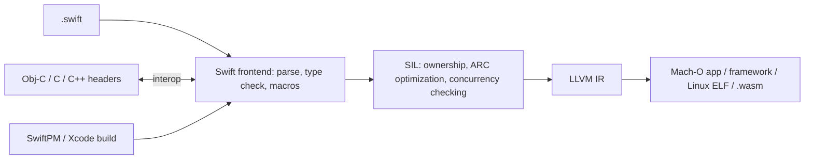

# Swift

> [!abstract] TL;DR
> Swift is Apple's compiled, memory-safe language for iOS, macOS, watchOS, tvOS and visionOS, and increasingly for servers, embedded devices, WebAssembly and even Android.
> - **Language strengths**: value types, optionals, protocol-oriented generics, and **compile-time data-race safety** (Swift 6).
> - **Swift 6.2** (Xcode 26) made concurrency *approachable*: code is main-actor/single-threaded by default, and parallelism is opt-in (`@concurrent`).
> - **For ZP**: Swift matters mostly for native iOS modules behind [[Flutter]] apps (plugins, extensions, widgets) and for App Store compliance. Full native iOS apps are rarely the cheapest path for SME clients.

## Introduction
- **Origin**: Chris Lattner at Apple (2010), announced at WWDC 2014, open-sourced (Apache 2.0) in 2015. Evolves via the public Swift Evolution process. Workgroups cover server, embedded, Android and Windows.
- **Problem**: replace Objective-C with a safe, fast, modern language while keeping full interop with Apple's Objective-C/C frameworks.
- **Where it sits**: all native Apple apps (SwiftUI/UIKit), app extensions (widgets, Live Activities, notification service extensions, App Intents), iOS sides of [[Flutter]]/[[React Native]] plugins, Swift on Server (Vapor, Hummingbird), and Embedded Swift on microcontrollers.

## Core Concepts

### Language essentials
```swift
struct Order: Codable, Identifiable, Sendable {      // value type, copied on assignment (copy-on-write for collections)
    let id: UUID
    var totalSen: Int
    var customerName: String?                          // optional: explicit absence
}

enum PayResult {                                       // enums with associated values
    case ok(receiptURL: URL)
    case declined(reason: String)
    case timeout
}

func describe(_ r: PayResult) -> String {
    switch r {                                         // exhaustive
    case .ok(let url): "Paid: \(url)"
    case .declined(let reason) where reason == "insufficient": "Top up first"
    case .declined(let reason): "Declined: \(reason)"
    case .timeout: "Try again"
    }
}

let name = order.customerName ?? "Walk-in"            // nil-coalescing
guard let url = URL(string: raw) else { throw APIError.badURL }   // early exit
```
| Feature | Notes |
|---|---|
| Value vs reference types | `struct`/`enum` (values, preferred) vs `class` (references, ARC-managed) vs `actor` (isolated reference) |
| Optionals | `T?`, `if let`, `guard let`, `?.`, `??`. Force unwrap `!` crashes on nil |
| Protocols + generics | Protocol-oriented design, `some View` (opaque), `any Protocol` (existential) |
| Error handling | `throws`/`try`/`catch`. **Typed throws** (`throws(PaymentError)`) since 6.0 |
| ARC | Automatic reference counting (no tracing GC). Retain cycles need `weak`/`unowned` |
| Macros (5.9) | `@Observable`, `#Preview`, `#expect` (Swift Testing) |
| Result builders | SwiftUI's declarative DSL |
| Ownership (`~Copyable`, `borrowing`, `consuming`) | Non-copyable types, `Span`, `InlineArray` (6.2) for performance |

### Concurrency
```swift
// Swift 6.2 / Xcode 26 default: code runs on the main actor unless you opt out
@Observable
final class OrdersModel {
    var orders: [Order] = []
    func load() async {
        do { orders = try await api.fetchOrders() }            // suspends, UI stays responsive
        catch { /* show error */ }
    }
}

@concurrent                                                    // explicitly run off the main actor
func resizeImages(_ urls: [URL]) async throws -> [Data] {
    try await withThrowingTaskGroup(of: Data.self) { group in  // structured concurrency
        for u in urls { group.addTask { try await resize(u) } }
        return try await group.reduce(into: []) { $0.append($1) }
    }
}

actor TokenStore {                                             // serialized access to mutable state
    private var token: String?
    func set(_ t: String) { token = t }
    func get() -> String? { token }
}
```
- **Swift 6 language mode**: data races become **compile errors**. Types crossing isolation boundaries must be `Sendable`.
- **Approachable concurrency (6.2)**: `nonisolated async` functions run on the caller's actor by default, new projects default to `@MainActor` isolation, and `@concurrent` marks real parallel work. That removed most "Sendable" error noise from Swift 6.0/6.1 migrations.

## Architecture / How It Works

- **SIL** (Swift Intermediate Language) is where ARC is optimized, ownership is checked and concurrency isolation is enforced.
- **ABI stability** (Swift 5.0, 2019) means the Swift runtime ships with Apple OSes, so apps don't bundle it. **Module stability** enables binary frameworks (XCFrameworks).
- **Interop**: seamless Objective-C/C. **C++ interop** since 5.9. Java interop (swift-java) for server/Android.
- **Cross-platform**: Linux/Windows toolchains, static Linux SDK (musl), WebAssembly (6.2), Embedded Swift (no runtime, MCUs), official Android workgroup and SDK previews.

## Project Structure
```text
ShopApp/
├── ShopApp.xcodeproj
├── ShopApp/
│   ├── ShopApp.swift            # @main App
│   ├── Features/Orders/{OrdersView.swift, OrdersModel.swift}
│   ├── Core/{APIClient.swift, Models.swift}
│   ├── Resources/Assets.xcassets
│   ├── Info.plist               # usage descriptions (NSCameraUsageDescription …)
│   └── PrivacyInfo.xcprivacy    # required-reason APIs, data collection
├── ShopWidget/                  # WidgetKit extension
├── Packages/ShopCore/Package.swift   # local SwiftPM package for shared logic
└── ShopAppTests/                # Swift Testing (@Test, #expect)
```
```swift
// Package.swift
// swift-tools-version: 6.2
import PackageDescription
let package = Package(
    name: "ShopCore",
    platforms: [.iOS(.v17), .macOS(.v14)],
    products: [.library(name: "ShopCore", targets: ["ShopCore"])],
    targets: [.target(name: "ShopCore"), .testTarget(name: "ShopCoreTests", dependencies: ["ShopCore"])]
)
```

## Use Cases
| Use case | Why it fits |
|---|---|
| Native iOS/macOS/visionOS apps | First-class APIs, SwiftUI, best performance and platform fit |
| Flutter/React Native native modules | Pigeon/Turbo Module implementations, iOS SDK wrappers |
| App extensions (widgets, Live Activities, App Intents, NSE) | Must be native Swift even in Flutter apps |
| Server-side APIs (Vapor, Hummingbird) | Fast, low memory, shared models with iOS app |
| Embedded / Wasm | Embedded Swift, Swift for WebAssembly |
| Cross-platform SME app by a solo dev | **Weaker fit**. [[Flutter]] ships Android + iOS from one codebase |

## Pros & Cons
| Pros | Cons |
|---|---|
| Memory safety + compile-time data-race safety | Concurrency migration (Swift 6) was painful pre-6.2 |
| Excellent performance, no GC pauses (ARC) | Apple-centric ecosystem. Xcode/macOS required for Apple targets |
| Expressive types: enums, generics, protocols, macros | Slow type-checking on complex expressions, slower builds |
| SwiftUI: fast declarative UI, live previews | SwiftUI gaps/bugs across OS versions. UIKit still needed sometimes |
| Seamless Obj-C/C/C++ interop | Server/Android ecosystems are small |
| Open source, active evolution | Language churn: frequent new features to learn |

## Alternatives & Peers
| Alternative | Strength vs Swift | Weakness vs Swift | Pick it when… |
|---|---|---|---|
| [[Flutter]] / [[Dart]] | One codebase for iOS + Android (+ web/desktop), fast iteration | Less native look/feel, plugin layer for platform APIs | SME apps (ZP's default) |
| [[Kotlin]] (KMP + Compose MP) | Shared logic/UI with Android | iOS tooling less mature | Android-first teams wanting iOS |
| [[React Native]] | JS/TS skills, web sharing | Native modules still need Swift | React-heavy teams |
| Objective-C | Legacy codebases | Unsafe, verbose, declining | Maintaining old apps |
| [[Rust]] | Cross-platform core with C ABI | No Apple UI framework | Shared native core across platforms |

## Tips & Reminders
> [!tip]
> - New projects: Swift 6 language mode + Xcode 26 defaults (main-actor isolation). Add `@concurrent` only where work is truly parallel.
> - Prefer `struct` + `@Observable` models, SwiftUI for new screens, and `async/await` over completion handlers. Use Swift Testing for new tests.
> - Avoid `!` force-unwraps and `try!` in production paths. Use `guard let` + typed errors.
> - Watch retain cycles in closures (`[weak self]`) and in Combine/NotificationCenter observers.
> - Maintain `PrivacyInfo.xcprivacy` and usage-description strings. Missing ones cause App Store rejections or runtime crashes.
> - **In ZP's stack**: write Swift for [[Flutter]] iOS integrations (Pigeon host APIs, see [[Flutter - Platform Channels & FFI]]), push notification service extensions (rich WhatsApp-like notifications), home-screen widgets and App Intents. Keep app logic in Dart. Build with Xcode 26+ per App Store rules.

## Versions & Breaking Changes
| Version | Released | Key changes | Breaking / migration notes |
|---|---|---|---|
| 1.0 | 2014-09 | Launch | — |
| 3.0 | 2016-09 | API naming guidelines, open source evolution | Massive source break (migrator) |
| 5.0 | 2019-03 | **ABI stability**, Result type | Runtime ships with OS |
| 5.5 | 2021-09 | `async`/`await`, actors, structured concurrency | — |
| 5.9 | 2023-09 | Macros, C++ interop, `~Copyable`, `@Observable` (iOS 17) | — |
| **6.0** | 2024-09 | **Swift 6 language mode** (data-race safety errors), typed throws, Embedded Swift, Swift Testing | Opt-in per module. Many Sendable errors on migration |
| 6.1 | 2025-03 | Concurrency refinements, trailing commas in more places | — |
| **6.2** | 2025-09 (Xcode 26) | **Approachable concurrency** (default main actor, `@concurrent`, caller-isolated async), `InlineArray`, `Span`, WebAssembly support | Behaviour change for `nonisolated async` functions. Review when enabling new defaults |
| 6.3 | 2026-03 (Xcode 26.4) | Embedded and tooling improvements | Check release notes |

> [!warning] Unverified — check before relying on this
> Swift 6.3 contents and any later 2026 release weren't confirmed from primary sources. Check https://www.swift.org/blog/ and the Xcode release notes.

## Critical Issues & Gotchas
> [!danger] App Store gatekeeping is a platform risk
> Swift apps ship only through Apple's toolchain and review. Since **2026-04-28** uploads must be built with Xcode 26 / iOS 26 SDK. Privacy manifests, required-reason APIs, Sign in with Apple rules and guideline 4.2 (minimum functionality) can block releases. Apple's EU DMA alternative-distribution rules don't apply in Malaysia. See [[Flutter - Build, Release & Store Compliance]].

> [!danger] Crashes from force unwraps and threading violations
> `!`/`try!`/`as!` crash the app (no exceptions to catch). UIKit/SwiftUI mutation off the main thread corrupts state or crashes. Before Swift 6 mode, these data races weren't caught at compile time. Enable strict concurrency checking, and ship with Crashlytics/Sentry dSYM upload.

> [!warning] Gotchas
> - Retain cycles: closures capturing `self` strongly inside classes/view models leak memory (no cycle-collecting GC).
> - Complex literal expressions or long `+` chains can hit "the compiler is unable to type-check this expression in reasonable time". Split them and add type annotations.
> - SwiftUI view identity: changing `id` or conditional branches resets `@State`, which is the same identity concept as Flutter keys.
> - `Codable` with snake_case APIs (Supabase) needs `keyDecodingStrategy = .convertFromSnakeCase` or explicit `CodingKeys`.
> - Minimum deployment target choices restrict APIs (`@Observable` needs iOS 17). Check client device demographics first.

## Deep Dives
N/A — no deep dives planned yet. Candidates: Swift concurrency (actors, Sendable, 6.2 defaults), SwiftUI architecture.

## Related
- [[Kotlin]] — Android/KMP counterpart
- [[Flutter]] · [[Dart]] — ZP's cross-platform default
- [[Flutter - Platform Channels & FFI]] — Swift side of Flutter plugins
- [[Flutter - Build, Release & Store Compliance]] — App Store rules
- [[React Native]] — native modules in Swift
- [[Rust]] — systems peer with similar ownership ideas

## References
- Swift docs / The Swift Programming Language: https://docs.swift.org/swift-book/
- Swift blog (releases): https://www.swift.org/blog/
- Swift Evolution: https://www.swift.org/swift-evolution/
- Swift 6.2 approachable concurrency (InfoQ): https://www.infoq.com/news/2025/08/swift62-approachable-concurrency
- Swift 6.2 migration guide for iOS 26: https://stora.sh/blog/2026-04-14-swift-6-2-approachable-concurrency-ios-26-migration-guide
- State of Swift 2026: https://devnewsletter.com/p/state-of-swift-2026/
