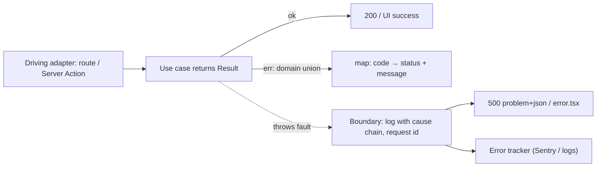

# TypeScript - Error Handling & Result Types

> [!info] Deep dive of [[TypeScript]]

> [!abstract] TL;DR
> Split failures into two kinds:
> - **Expected outcomes** (validation failed, order already paid, out of stock): return them as **typed values**, a discriminated-union `Result`, so the compiler forces callers to handle each case.
> - **Unexpected faults** (DB down, bug, network): **throw** `Error` subclasses with `cause`, and let one boundary per layer (route handler, worker, error boundary) log and translate them.
>
> `catch (e)` gives `unknown`, so narrow it. Never throw strings, never swallow errors, and map domain errors to HTTP/problem details in exactly one place.

## Concept
| Category | Example | Mechanism | Who handles it |
|---|---|---|---|
| Validation | Bad phone format | `Result` / Zod `safeParse` | Caller → field errors |
| Domain rule | `OrderAlreadyPaid`, `InsufficientStock` | `Result` with a typed error union | Use-case caller → UX message / 409 |
| Not found / forbidden | Order not in tenant | `Result` or typed error → 404 | Adapter mapping |
| Transient infra | Timeout, 429, connection reset | Throw (`RetryableError`) | Retry layer, queue |
| Bugs / invariants | `undefined is not a function` | Throw (let it crash the request) | Error boundary + alerting |

**Result vs throw**:

| | Return `Result<T, E>` | Throw |
|---|---|---|
| Visible in types | ✅ `E` is part of the signature | ❌ invisible |
| Forces handling | ✅ (narrowing on `ok`) | ❌ easy to forget |
| Ergonomics | More verbose without helpers | Concise, unwinds the stack automatically |
| Best for | Expected business outcomes | Faults you can't handle locally |

## How It Works


## Practical Usage
**Minimal Result type** (no dependency):
```ts
export type Result<T, E> = { ok: true; value: T } | { ok: false; error: E };
export const ok = <T>(value: T): Result<T, never> => ({ ok: true, value });
export const err = <E>(error: E): Result<never, E> => ({ ok: false, error });
```
**Domain errors as a discriminated union**:
```ts
type ConfirmError =
  | { code: 'not_found'; orderId: string }
  | { code: 'already_confirmed'; orderId: string }
  | { code: 'out_of_stock'; sku: string; available: number };

export async function confirmOrder(deps: Deps, id: string): Promise<Result<Order, ConfirmError>> {
  const order = await deps.orders.byId(id);
  if (!order) return err({ code: 'not_found', orderId: id });
  if (order.status !== 'pending') return err({ code: 'already_confirmed', orderId: id });
  const stock = await deps.stock.check(order.items);
  if (!stock.ok) return err({ code: 'out_of_stock', sku: stock.sku, available: stock.available });
  await deps.orders.save(order.confirm());
  return ok(order);
}
```
**One mapping point** (exhaustive, so adding an error code breaks the build until it's handled):
```ts
function toProblem(e: ConfirmError): { status: number; code: string; detail: string } {
  switch (e.code) {
    case 'not_found': return { status: 404, code: e.code, detail: 'Order not found' };
    case 'already_confirmed': return { status: 409, code: e.code, detail: 'Order was already confirmed' };
    case 'out_of_stock': return { status: 409, code: e.code, detail: `Only ${e.available} left of ${e.sku}` };
    default: { const _exhaustive: never = e; throw new Error(`unhandled ${JSON.stringify(_exhaustive)}`); }
  }
}
```
**Faults: subclasses with `cause`** (ES2022), plus a retry decision:
```ts
export class UpstreamError extends Error {
  constructor(message: string, readonly retryable: boolean, options?: { cause?: unknown }) {
    super(message, options);
    this.name = 'UpstreamError';
  }
}
try {
  await meta.sendTemplate(msg);
} catch (e) {
  const status = (e as { status?: number }).status;
  throw new UpstreamError('WhatsApp send failed', status === 429 || (status ?? 500) >= 500, { cause: e });
}
```
**Narrowing `unknown` in catch**:
```ts
try { await run(); }
catch (e: unknown) {
  if (e instanceof UpstreamError && e.retryable) return queue.retry(job);
  log.error({ err: serializeError(e) }, 'job failed');   // keep stack + cause chain
  throw e;
}
const serializeError = (e: unknown) =>
  e instanceof Error ? { name: e.name, message: e.message, stack: e.stack, cause: e.cause ? serializeError(e.cause) : undefined } : { value: String(e) };
```
**Resource cleanup with `using`** (TS 5.2+, runtime support needed):
```ts
await using client = await pool.connectDisposable();   // released even if the block throws
```
**Wrong way**:
```ts
throw 'order failed';                                   // ❌ no stack, no type, instanceof checks impossible
try { await save(); } catch {}                          // ❌ swallowed: data silently not saved
catch (e) { return res.json({ error: e.message }) }     // ❌ leaks internals; e may not be an Error
```

## Patterns & Anti-patterns
| Pattern | When | Anti-pattern to avoid |
|---|---|---|
| `Result` for expected domain outcomes | Use cases, validators | Exceptions as control flow for "already paid" |
| Throw `Error` subclasses with `cause` for faults | Infra, bugs | Re-wrapping without `cause` (lost root error) |
| Exhaustive `switch` with `never` | Mapping error unions | `default: 500` hiding new error cases |
| Boundary per layer: route/action, worker, UI `error.tsx` | Everywhere | `try/catch` around every line |
| Retry only `retryable` faults with backoff | Third-party calls | Retrying validation errors or 4xx forever |
| Structured logs with request ID + serialized cause chain | Production | `console.log(e)` → `{}` in JSON logs |

## Performance & Trade-offs
- **Throwing is not slow enough to matter** at request scale, but stack capture in hot loops (parsers over 100k items) adds up. Results avoid that and make expected failures cheap.
- **Library helpers** (`neverthrow` for `Result`/`ResultAsync` chaining, `Effect` for typed effects, retries and DI) reduce boilerplate. Effect is powerful but a large paradigm shift; adopt it only team-wide.
- **Verbosity**: Results add `if (!r.ok) return r` plumbing. Keep them at domain boundaries, not in every utility.
- **Error tracking cost**: sending every expected domain error to Sentry floods it. Report faults, and count domain errors as metrics.

## Tips & Reminders
> [!tip] In ZP's stack
> - **Use cases** return `Result` with code unions.
> - **Server Actions** map them to `{ ok, message, fieldErrors }` ([[React - Forms, Actions & Optimistic UI]]).
> - **Route handlers** map them to problem+json with stable `code`s ([[REST API - Versioning, Pagination & Error Design]]).
> - **Workers** throw `UpstreamError` with `retryable`, so BullMQ/pgmq retries only transient failures.
> - **Flutter** mirrors the same error codes in a sealed class for localized messages.

- Enable `strict` (includes `useUnknownInCatchVariables`) and lint rules such as `@typescript-eslint/only-throw-error` and `no-floating-promises`.
- Install process-level handlers in Node workers (`unhandledRejection` → log + exit non-zero) so silent async failures become visible restarts.
- In Next.js, `notFound()` / `redirect()` work by throwing special errors. Don't catch them in generic `try/catch` blocks, or rethrow non-domain errors.
- Error messages shown to users are copy, not stack traces: localize them (BM/EN) by `code`.

## Version Notes
| Version | Change relevant here |
|---|---|
| ES2022 / TS 4.6+ | `Error` `cause` option (`new Error(msg, { cause })`) |
| TS 4.4 | `useUnknownInCatchVariables` (part of `strict`) |
| TS 5.2 | `using` / `await using` explicit resource management (needs runtime or polyfill `Symbol.dispose`) |
| Node 22+ | `Symbol.dispose`/`asyncDispose` available. Unhandled rejections crash the process by default (since 15) |
| TS 7 (2026) | Native compiler. Same error-handling semantics |

## Critical Issues & Gotchas
> [!danger] Swallowed errors corrupt data quietly
> `catch {}` or `.catch(() => null)` around writes makes failures invisible: orders not saved, WhatsApp not sent, nobody alerted. Every catch must handle (retry, compensate, map) or rethrow, and log with context.

> [!danger] Leaking internals in error responses
> Returning `e.message` or stacks to clients exposes SQL, file paths, tokens in URLs and provider error bodies. Map to stable codes and generic messages, and keep details in server logs with the request ID ([[OWASP Top 10 - API Security Top 10 in Practice]]).

- **`instanceof` across bundles**: duplicate package copies (dual ESM/CJS) produce two `Error` subclasses, so `instanceof UpstreamError` fails. Also check `e.name`/a brand property ([[JavaScript - Modules, ESM-CJS Interop & Bundling]]).
- **Server Action errors in production**: thrown errors reach the client sanitized (digest only). Return expected errors as values, or users see a generic failure.
- **`Promise.all` fails fast** and loses the other results. Use `Promise.allSettled` when partial success matters (bulk sends).
- **`JSON.stringify(error)` is `{}`**: Error properties are non-enumerable. Serialize explicitly, as above.

## Related
- [[TypeScript]]
- [[TypeScript - Advanced Types]] — discriminated unions, `never` exhaustiveness
- [[TypeScript - Runtime Validation with Zod & Type-Safe APIs]] — `safeParse` results at boundaries
- [[REST API - Versioning, Pagination & Error Design]] — problem+json mapping
- [[Design Patterns - Hexagonal Architecture in TypeScript & Dart]] — use cases returning Results
- [[System Design - Reliability Patterns]] — retries, backoff, idempotency

## References
- https://www.typescriptlang.org/docs/handbook/release-notes/typescript-4-4.html#use-unknown-catch-variables
- https://www.typescriptlang.org/docs/handbook/release-notes/typescript-5-2.html
- https://developer.mozilla.org/en-US/docs/Web/JavaScript/Reference/Global_Objects/Error/cause
- https://github.com/supermacro/neverthrow
- https://effect.website/
