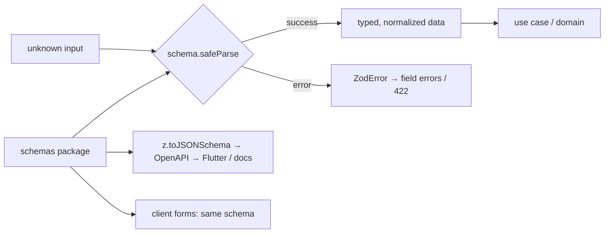

# TypeScript - Runtime Validation with Zod & Type-Safe APIs

> [!info] Deep dive of [[TypeScript]]

> [!abstract] TL;DR
> TypeScript types are erased at runtime, so **every trust boundary needs a runtime schema**:
> - env vars, request bodies, form data;
> - webhooks, third-party API responses;
> - JSONB columns, LLM outputs.
>
> Define the schema once with Zod and derive the type with `z.infer`. `safeParse` at the edge, then pass plain typed data inward. Share schemas between client and server, and export JSON Schema / OpenAPI for non-TS consumers like Flutter.

## Concept
- **Parse, don't validate**: a successful parse returns a **new, typed, normalized** value (trimmed, coerced, defaulted). Code after the boundary never sees `unknown`.
- **Zod 4** (stable 2025) rewrote the core: faster parsing, smaller types, top-level string formats (`z.email()`, `z.uuid()`, `z.iso.datetime()`), the unified `error` customization param, native `z.toJSONSchema()`, and **Zod Mini** (function-based, tree-shakable API for bundle-sensitive clients).
- **Standard Schema**: a shared interface (`~standard`) implemented by Zod, Valibot, ArkType and others. Libraries such as tRPC, Hono, TanStack Form and React Hook Form resolvers accept any compliant schema, so you're less locked into one validator.
- **Where to validate**:

| Boundary | Schema source | Failure handling |
|---|---|---|
| `process.env` at boot | `env.ts` | Crash on start (fail fast) |
| Route handlers / server actions | Shared `schemas/` package | 400/422 with field errors |
| Webhooks (Meta, payment gateways) | Vendor payload subset | 200 + log + dead-letter (don't make the vendor retry forever) |
| Third-party API responses | Minimal "what we use" schema | Alert. Treat as vendor contract drift |
| DB JSONB / config blobs | Versioned schema | Migrate or default |
| LLM structured output | Same schema passed to the provider | Retry or fallback ([[LLM APIs & SDKs]]) |

## How It Works


## Practical Usage
**Env validation** (fail at boot, not at 3am):
```ts
// src/env.ts
import { z } from 'zod';

const Env = z.object({
  NODE_ENV: z.enum(['development', 'test', 'production']),
  DATABASE_URL: z.url(),
  SUPABASE_SECRET_KEY: z.string().min(20),
  META_APP_SECRET: z.string().min(16),
  WORKER_CONCURRENCY: z.coerce.number().int().min(1).max(50).default(8),
});
export const env = Env.parse(process.env);           // throws with a readable list of missing/invalid vars
```
**Shared domain schema + inferred types**:
```ts
// packages/schemas/order.ts
export const Phone = z.string().trim().regex(/^\+?60\d{8,10}$/, { error: 'Malaysian phone number required' });
export const OrderItem = z.object({ sku: z.string().min(1), qty: z.int().positive().max(999) });
export const CreateOrder = z.strictObject({                      // reject unknown keys (mass assignment)
  customerPhone: Phone,
  items: z.array(OrderItem).min(1).max(50),
  note: z.string().max(500).optional(),
  deliverAt: z.iso.datetime({ offset: true }).optional(),
});
export type CreateOrder = z.infer<typeof CreateOrder>;
```
**Next.js server action / route handler**:
```ts
'use server';
export async function createOrder(_: unknown, formData: FormData) {
  const parsed = CreateOrder.safeParse({
    customerPhone: formData.get('phone'),
    items: JSON.parse(String(formData.get('items') ?? '[]')),
    note: formData.get('note') || undefined,
  });
  if (!parsed.success) return { ok: false, errors: z.flattenError(parsed.error).fieldErrors };
  const order = await orders.create(await currentTenant(), parsed.data);   // typed CreateOrder
  return { ok: true, id: order.id };
}
```
**Discriminated unions for webhooks**:
```ts
const WaStatus = z.object({ type: z.literal('status'), id: z.string(), status: z.enum(['sent', 'delivered', 'read', 'failed']) });
const WaMessage = z.object({ type: z.literal('message'), from: z.string(), text: z.object({ body: z.string() }).optional() });
const WaEvent = z.discriminatedUnion('type', [WaStatus, WaMessage]);

const r = WaEvent.safeParse(normalize(body));
if (!r.success) { log.warn({ issues: r.error.issues }, 'unknown wa payload'); return new Response('ok'); }
switch (r.data.type) { case 'status': /* … */ break; case 'message': /* … */ break; }   // exhaustive
```
**Branded IDs** (stop mixing tenant and user IDs):
```ts
export const TenantId = z.uuid().brand<'TenantId'>();
export type TenantId = z.infer<typeof TenantId>;
```
**Export for non-TS consumers**:
```ts
import { writeFileSync } from 'node:fs';
writeFileSync('openapi/components/CreateOrder.json', JSON.stringify(z.toJSONSchema(CreateOrder), null, 2));
// → openapi-generator → Dart client for the Flutter app
```
**Wrong way**:
```ts
const body = (await req.json()) as CreateOrder;      // ❌ a cast is a lie: no runtime check, any shape passes
const qty = Number(body.qty);                        // ❌ NaN flows into the DB
const flag = z.coerce.boolean().parse('false');      // ❌ true: Boolean("false"); use z.stringbool()
```

## Patterns & Anti-patterns
| Pattern | When | Anti-pattern to avoid |
|---|---|---|
| Schemas in a shared package, types via `z.infer` | Monorepo (Next.js + workers + scripts) | Hand-written interfaces drifting from validators |
| `z.strictObject` for writes | Create/update payloads | Default `z.object` silently stripping keys you meant to reject, or `looseObject` passing `role: 'admin'` through |
| `safeParse` + mapped field errors | User input | `parse` throwing raw `ZodError` 500s from server actions |
| Minimal schemas for third-party responses | Vendor APIs | Modelling the entire vendor payload (breaks on every harmless addition) |
| Contract-first type-safe RPC (tRPC/oRPC/Hono RPC) for TS-only clients | Next.js ↔ own API | REST + hand-maintained fetch wrappers in a TS-only stack |
| OpenAPI from schemas for polyglot clients | Flutter, partners | tRPC for an API that Flutter must consume |

## Performance & Trade-offs
- **Parse cost**: Zod 4 parses typical request payloads in microseconds. It's negligible next to I/O. Very large arrays (10k+ items) or deep recursive schemas are where cost shows. Zod 4.5 added **schema compilation** for hot paths, and 4.6 fixed a recursive-schema memory regression.
- **Bundle size**: full Zod adds noticeable client JS. **Zod Mini** or Valibot cut it for client-only forms. Server-side size doesn't matter.
- **TS compile time**: huge `z.infer` chains on very large schemas slow the checker. Zod 4's types are much lighter than v3's. Export named types (`type X = z.infer<…>`) instead of inferring repeatedly.
- **Type-safe API options**:

| Option | Clients | Pick it when… |
|---|---|---|
| tRPC / oRPC | TS only | One team owns Next.js + API; fastest DX |
| Hono RPC + `@hono/zod-openapi` | TS + OpenAPI | Want RPC types **and** an OpenAPI doc for Flutter |
| Next.js server actions + shared schemas | Same app | Form mutations inside one Next.js app |
| OpenAPI-first (spec → generated TS/Dart clients) | Many languages | Public/partner APIs, mobile-heavy products |

## Tips & Reminders
> [!tip] In ZP's stack
> - Keep Zod schemas in `packages/schemas` and use them in Next.js server actions, Supabase Edge Functions (Deno: `npm:zod`), n8n Code nodes (via a small bundled helper), and LLM structured outputs (`zodOutputFormat`).
> - Export JSON Schema → OpenAPI for the Flutter app's generated Dart client.
> - Validate Meta webhook payloads with a **minimal** discriminated union, so new fields Meta adds don't break parsing.

- Map Supabase `null` correctly: DB columns return `null`, not `undefined`. Use `.nullable()` (or `.nullish()`) on read schemas, and `.optional()` on input schemas.
- Use `z.stringbool()` for env and query flags (`"true"/"false"/"1"/"0"`), never `z.coerce.boolean()`.
- Keep DB constraints too (CHECK, NOT NULL, FK). Zod guards the API, constraints guard the data from every other writer (n8n, SQL editor, migrations).
- Format errors once: `z.flattenError()` for forms, `z.treeifyError()` for nested payloads, `z.prettifyError()` for logs and CLI.

## Version Notes
| Version | Released | Key changes | Breaking / migration notes |
|---|---|---|---|
| 3.x | 2020–2024 | De-facto TS validator | — |
| 4.0 | 2025 | New core, top-level formats, `error` param, `z.toJSONSchema`, Zod Mini, `z.strictObject`/`z.looseObject`, `z.stringbool` | `message` → `error`. `.email()` etc. deprecated in favour of `z.email()`. `z.record` needs key + value. `.default()` short-circuits for `undefined`. Error formatting helpers changed. Use the codemod or official migration guide |
| 4.2 | 2025 | Standard JSON Schema, `.toJSONSchema()` method, experimental `z.fromJSONSchema()` | `fromJSONSchema` round-trip not guaranteed |
| 4.5 | 2026-08-28 | Schema compilation, large memory reduction | — |
| 4.6 | 2026-09-09 | Compilation improvements, recursive-schema memory fix | — |

> [!warning] Unverified — check before relying on this
> The 4.5/4.6 details come from a single InfoQ report. Check https://github.com/colinhacks/zod/releases before pinning.

## Critical Issues & Gotchas
> [!danger] Default `z.object` strips unknown keys
> Unknown keys are dropped without error. That's safe for mass assignment, but it hides client bugs ("why isn't `deliveryNote` saved?" when the client sent `delivery_note`). Use `z.strictObject` on write endpoints so mistakes surface as 422s.

> [!danger] Casting instead of parsing
> `as T`, `JSON.parse(x) as T` and generic `fetch<T>()` wrappers give type confidence with zero runtime protection. They're a top source of production `undefined is not a function` errors and of injection via unexpected types (arrays where strings were expected). This maps to [[OWASP Top 10]] A03/A08.

- **Transforms don't export**: `.transform()`/`.pipe()` logic can't be represented in JSON Schema. Generated OpenAPI shows the input shape, so document transforms separately.
- **Dates over JSON** are strings. Validate with `z.iso.datetime()` and convert explicitly. `z.coerce.date()` accepts surprising inputs (`new Date('2026')`).
- **Mixed Zod versions** in a monorepo (v3 in one package, v4 in another) produce incompatible schema instances across packages. Pin one version at the workspace root.
- **Regex DoS**: user-supplied input against complex regexes in schemas can backtrack catastrophically. Keep regexes simple and add `.max()` length limits before the regex runs.

## Related
- [[TypeScript]]
- [[TypeScript - Advanced Types]] — branded types, inference, discriminated unions
- [[Next.js]] — server actions and route handlers as boundaries
- [[REST API]] — error formats and OpenAPI contracts
- [[LLM APIs & SDKs]] — Zod schemas as structured-output contracts
- [[Design Patterns - Hexagonal Architecture in TypeScript & Dart]] — validation in driving adapters

## References
- https://zod.dev/
- https://zod.dev/v4/changelog
- https://standardschema.dev/
- https://infoq.com/news/2026/10/zod-schema-compliation
- https://newreleases.io/project/npm/zod/release/4.3.0
