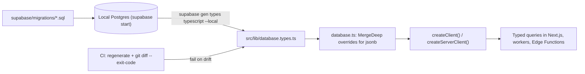

# TypeScript - Supabase Generated Types & Typed Queries

> [!info] Deep dive of [[TypeScript]]

> [!abstract] TL;DR
> 1. Generate `database.types.ts` from the schema with **`supabase gen types typescript`**, regenerated on every migration and checked in CI for drift.
> 2. Create clients as `createClient<Database>()` (and `createServerClient<Database>` in Next.js).
>
> postgrest-js then **infers row types from the select string**, including embedded relations. Use the helper types `Tables<'orders'>`, `TablesInsert<…>`, `Enums<…>`, and `QueryData<typeof query>` for derived shapes.
>
> Generated types describe the **database contract**, not runtime truth, so validate **inputs** with Zod. Types for `jsonb` columns are `Json` until you **override them** (type-fest `MergeDeep` or `.overrideTypes<>()`).
>
> Don't hand-write row interfaces that drift from the schema.

## Concept
| Piece | What it gives you | Notes |
|---|---|---|
| `Database` type | Schemas → Tables/Views/Functions/Enums with `Row`, `Insert`, `Update` | Generated, never edited by hand |
| `createClient<Database>` | Typed `.from()`, `.rpc()`, filters, inserts | Wrong column names fail at compile time |
| Select-string inference | `select('id, items:order_items(qty)')` → typed nested result | Relationships come from FKs |
| `Tables<'t'>` / `TablesInsert<'t'>` / `TablesUpdate<'t'>` | Row/insert/update shapes | Exported helpers in generated file |
| `Enums<'order_status'>` | Postgres enum union | Use in Zod `z.enum` via arrays |
| `QueryData<typeof q>` | Type of a query's result | For props/components |
| `.overrideTypes<T>()` | Override inferred result type (e.g. JSON column shape) | Replaces older `.returns<T>()` |
| `MergeDeep` (type-fest) | Override `Json` columns globally | Typed JSON across the app |

## How It Works


## Practical Usage
**Generate**:
```bash
npx supabase gen types typescript --local > src/lib/database.types.ts                 # from local stack
npx supabase gen types typescript --project-id "$PROJECT_REF" --schema public > src/lib/database.types.ts
```
**package.json scripts + CI drift check**:
```json
{
  "scripts": {
    "db:types": "supabase gen types typescript --local > src/lib/database.types.ts",
    "db:types:check": "npm run db:types && git diff --exit-code src/lib/database.types.ts"
  }
}
```
**Override JSON columns once** (`src/lib/database.ts`):
```ts
import type { MergeDeep } from "type-fest";
import type { Database as Generated } from "./database.types";

export type OrderMeta = { channel: "whatsapp" | "web"; utm?: Record<string, string> };

export type Database = MergeDeep<Generated, {
  public: { Tables: { orders: {
    Row: { meta: OrderMeta };
    Insert: { meta?: OrderMeta };
    Update: { meta?: OrderMeta };
  } } };
}>;
export type Tables<T extends keyof Database["public"]["Tables"]> = Database["public"]["Tables"][T]["Row"];
```
**Typed clients**:
```ts
// browser / server (Next.js)
import { createServerClient } from "@supabase/ssr";
export const createClient = async () =>
  createServerClient<Database>(process.env.NEXT_PUBLIC_SUPABASE_URL!, process.env.NEXT_PUBLIC_SUPABASE_PUBLISHABLE_KEY!, { cookies: /* … */ });
```
**Inferred nested results and `QueryData`**:
```ts
const ordersWithItems = (sb: SupabaseClient<Database>, tenantId: string) =>
  sb.from("orders")
    .select("id, status, total_cents, customer:customers(name, phone), items:order_items(qty, product:products(name))")
    .eq("tenant_id", tenantId);

export type OrderWithItems = QueryData<ReturnType<typeof ordersWithItems>>[number];
// → { id: number; status: Enums<'order_status'>; customer: { name: string; phone: string | null } | null; items: {...}[] }
```
**Typed RPC**:
```ts
const { data, error } = await sb.rpc("place_order", { p_tenant_id: tenantId, p_items: items });  // args checked
```
**Zod at the boundary, generated types inside**:
```ts
import type { Enums, TablesInsert } from "./database.types";
const statuses = ["pending", "paid", "shipped", "cancelled"] as const satisfies readonly Enums<"order_status">[];
const NewOrder = z.object({ customerId: z.string().uuid(), status: z.enum(statuses).default("pending") });
const row: TablesInsert<"orders"> = { customer_id: input.customerId, status: input.status, tenant_id };
```
**Wrong way**:
```ts
// ❌ hand-written interface drifting from the schema
interface Order { id: number; total: number }             // column is total_cents now

// ❌ casting away inference
const { data } = await sb.from("orders").select("*") as any;

// ❌ trusting types as validation for request bodies
await sb.from("orders").insert(req.body as TablesInsert<"orders">);   // unvalidated input
```

## Patterns & Anti-patterns
| Pattern | When | Anti-pattern to avoid |
|---|---|---|
| Generate from local DB after each migration | Every schema change | Generating from prod only occasionally |
| CI drift check (`git diff --exit-code`) | PRs | Stale types merged |
| Central `database.ts` with JSON overrides | `jsonb` columns | `as` casts at every call site |
| Derive types from queries (`QueryData`) | Components/props | Duplicated DTO interfaces |
| Zod for external input, generated types for DB | API boundaries | Types as runtime validation |
| Shared types package in monorepo | Next.js + workers + Edge Functions | Copy-pasting types per app |
| Narrow `select` strings | Performance and types | `select('*')` everywhere |

## Performance & Trade-offs
- **Compile-time cost**: deep select-string inference with many nested relations can slow the type checker and IDE. TypeScript 7 (native) helps a lot. Otherwise split complex queries or annotate with `.overrideTypes`.
- **Nullable inference**: views and left-joined embeds come out nullable (`| null`), even when your logic guarantees values. Prefer explicit `!inner` joins or overrides over non-null assertions everywhere.
- **Multi-schema**: generate with `--schema public,private` only for schemas exposed via the Data API. Keep internal schemas out of client bundles' types.
- **Edge Functions (Deno)**: import the same generated file via a shared path, or publish it from the monorepo package.

## Tips & Reminders
> [!tip] In ZP's stack
> - **Monorepo package** `@acme/db-types` consumed by Next.js admin, BullMQ workers and Edge Functions keeps every client in sync ([[Git - Monorepo Workflows with pnpm & Turborepo]]).
> - **Flutter side** doesn't get these types. Mirror critical models with `freezed`/`json_serializable` and contract tests, or generate Dart models from the same schema ([[Dart - Code Generation with build_runner, freezed & json_serializable]]).
> - **AI-generated migrations**: require regenerated types in the same PR, so compile errors reveal breaking column changes immediately.

- Use `!inner` in embeds (`customer:customers!inner(name)`) to filter by relation and get non-null types.
- Disambiguate multiple FKs to the same table with `table!fk_name(...)`.
- Re-export `Tables`, `Enums` helpers from one module to avoid deep import paths.
- Commit generated types. Don't generate at build time from production.

## Version Notes
| Version | Change relevant here |
|---|---|
| supabase-js 2.0 (2022) | Generated `Database` generics |
| postgrest-js (2023–24) | Select-string parser infers nested relation types. `QueryData` helper |
| supabase-js 2.4x (2025) | `.overrideTypes<T>()` (replacing `.returns<T>()` for overrides) |
| TypeScript 7.0 (2026-07) | Native compiler. Much faster checking of heavy generic types ([[TypeScript]]) |

> [!warning] Unverified — check before relying on this
> The exact supabase-js version that introduced `.overrideTypes` and deprecated `.returns`, and whether the CLI's generated helper types changed recently, weren't verified this run. Check https://supabase.com/docs/guides/api/rest/generating-types.

## Critical Issues & Gotchas
> [!danger] Types say it's safe, RLS says otherwise
> Generated types reflect columns, not permissions. A query typed as returning `Order[]` may return an empty array (RLS-filtered), and inserts may fail with `42501` at runtime. Handle `error` on every call, and test authorization in the database ([[Supabase - Database Testing with pgTAP & Policy Tests]]).

> [!danger] Stale types hide breaking migrations
> If types aren't regenerated after renaming or dropping a column, the app compiles and fails in production (`column does not exist`), or silently writes `null` to a renamed column. Enforce regeneration and drift checks in CI, and deploy migrations backward-compatibly ([[Docker - Healthchecks, Restart Policies & Zero-Downtime Deploys]]).

- **`Json` type** accepts any JSON. Without overrides, typos in JSON keys compile fine.
- **`bigint` IDs** come back as `number` in JS. Values beyond 2^53 lose precision, so use `text`/`uuid` or cast in SQL.
- **Date/timestamp columns** are typed `string`. Parse with care (`Asia/Kuala_Lumpur` vs UTC).
- **Service-role clients** typed the same way bypass RLS. Types don't distinguish privilege levels, so name clients clearly (`adminClient`).

## Related
- [[TypeScript]]
- [[Supabase - Drizzle ORM & Typed SQL]] — Drizzle for server-side typed SQL
- [[TypeScript - Runtime Validation with Zod & Type-Safe APIs]] — validating untrusted input
- [[TypeScript - Advanced Types]] — generics and mapped types behind the helpers
- [[Supabase - Migrations, Branching & Local Development]] — where types are generated from
- [[Supabase - Database Functions, Triggers & RPC]] — typed RPC calls
- [[Next.js - Admin Dashboards, Data Tables & Server-Side Filtering]] — typed table queries

## References
- https://supabase.com/docs/guides/api/rest/generating-types
- https://supabase.com/docs/reference/cli/supabase-gen-types
- https://supabase.com/docs/reference/javascript/typescript-support
- https://github.com/supabase/postgrest-js
- https://github.com/sindresorhus/type-fest
