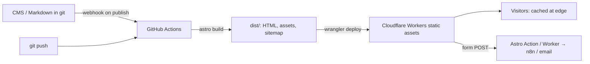

# Astro - Content Sites, SEO & Cloudflare Deployment

> [!info] Deep dive of [[Astro]]

> [!abstract] TL;DR
> For SME marketing sites: Astro static output + Tailwind + a Content Layer (Markdown or a headless CMS), deployed to **Cloudflare Workers with static assets** (or Pages) from GitHub. Rebuild on CMS webhooks.
> SEO is mostly hygiene:
> - set `site`, one canonical URL per page, a sitemap with **hreflang** for EN/BM;
> - `LocalBusiness` JSON-LD with address and hours;
> - optimized images and fast LCP.
>
> Keep forms server-side (Astro Actions or a webhook), behind Turnstile.

## Concept
| SEO element | Astro mechanism | Notes |
|---|---|---|
| Canonical + meta | `<SEO>` component in the layout, `Astro.url`, `Astro.site` | `site` in config is required for absolute URLs |
| Sitemap | `@astrojs/sitemap` (with i18n option) | Excludes drafts. Submit in Google Search Console |
| Multilingual | Built-in i18n routing (`/`, `/ms/`) + `hreflang` alternates | Avoids duplicate-content issues between EN and BM pages |
| Structured data | JSON-LD `<script type="application/ld+json">` | `LocalBusiness`, `Product`, `FAQPage`, `BreadcrumbList` |
| Images | `astro:assets` `<Image>` / `<Picture>` | AVIF/WebP, width/height → no CLS |
| Performance | Zero JS by default, islands only where needed | LCP/INP win over SPA templates |
| Analytics | Cloudflare Web Analytics (cookieless) | No cookie banner needed for that script |

**Deployment targets**:

| Target | Output | Pick it when… |
|---|---|---|
| Cloudflare Workers + static assets | `static` (or `server` with the Cloudflare adapter) | Default for client sites. Free tier, global CDN, preview URLs |
| Cloudflare Pages | `static` | Existing Pages projects (Cloudflare's direction favours Workers) |
| Coolify (nginx container or Node adapter) | `static` / `server` | Data must stay on your VPS, or the site shares a server with the client's app |

## How It Works


## Practical Usage
**`astro.config.mjs`**:
```js
import { defineConfig } from 'astro/config';
import sitemap from '@astrojs/sitemap';
import tailwindcss from '@tailwindcss/vite';

export default defineConfig({
  site: 'https://kedaiali.my',
  trailingSlash: 'never',
  i18n: { defaultLocale: 'en', locales: ['en', 'ms'], routing: { prefixDefaultLocale: false } },
  integrations: [sitemap({ i18n: { defaultLocale: 'en', locales: { en: 'en-MY', ms: 'ms-MY' } } })],
  image: { domains: ['cms.kedaiali.my'] },          // allow-list remote images for optimization
  vite: { plugins: [tailwindcss()] },
});
```
**SEO component** (canonical, alternates, OG):
```astro
---
// src/components/SEO.astro
const { title, description, image = '/og.jpg', alternates = [] } = Astro.props;
const canonical = new URL(Astro.url.pathname, Astro.site);
---
<title>{title}</title>
<meta name="description" content={description} />
<link rel="canonical" href={canonical} />
{alternates.map((a) => <link rel="alternate" hreflang={a.lang} href={new URL(a.path, Astro.site)} />)}
<link rel="alternate" hreflang="x-default" href={new URL('/', Astro.site)} />
<meta property="og:title" content={title} />
<meta property="og:description" content={description} />
<meta property="og:image" content={new URL(image, Astro.site)} />
<meta name="twitter:card" content="summary_large_image" />
```
**LocalBusiness JSON-LD** (local search for SMEs):
```astro
---
const ld = {
  '@context': 'https://schema.org', '@type': 'Bakery', name: 'Kedai Ali',
  url: 'https://kedaiali.my', telephone: '+60-82-123456',
  address: { '@type': 'PostalAddress', streetAddress: 'Jalan Padungan 12', addressLocality: 'Kuching',
             addressRegion: 'Sarawak', postalCode: '93100', addressCountry: 'MY' },
  geo: { '@type': 'GeoCoordinates', latitude: 1.5576, longitude: 110.3496 },
  openingHoursSpecification: [{ '@type': 'OpeningHoursSpecification', dayOfWeek: ['Monday','Tuesday','Wednesday','Thursday','Friday','Saturday'], opens: '08:00', closes: '18:00' }],
};
---
<script type="application/ld+json" set:html={JSON.stringify(ld)} />
```
**Cloudflare Workers static assets** (`wrangler.jsonc`) + CI:
```jsonc
{
  "name": "kedaiali-site",
  "compatibility_date": "2026-10-01",
  "assets": { "directory": "./dist", "not_found_handling": "404-page" }
}
```
```yaml
# .github/workflows/deploy.yml (excerpt)
on: { push: { branches: [main] }, repository_dispatch: { types: [cms_publish] } }
jobs:
  deploy:
    runs-on: ubuntu-latest
    steps:
      - uses: actions/checkout@v4
      - uses: pnpm/action-setup@v4
      - run: pnpm install --frozen-lockfile && pnpm astro build
      - run: pnpm wrangler deploy
        env: { CLOUDFLARE_API_TOKEN: "${{ secrets.CF_API_TOKEN }}", CLOUDFLARE_ACCOUNT_ID: "${{ vars.CF_ACCOUNT_ID }}" }
```
**Cache headers** (`public/_headers`, for Pages/Workers assets):
```text
/_astro/*
  Cache-Control: public, max-age=31536000, immutable
/*
  X-Content-Type-Options: nosniff
  Referrer-Policy: strict-origin-when-cross-origin
```
**Wrong way**:
```astro
<a href="/about/">About</a>    <!-- ❌ with trailingSlash 'never': redirect chains + duplicate URLs -->
           <!-- ❌ unoptimized, no width/height → slow LCP + CLS -->
```

## Patterns & Anti-patterns
| Pattern | When | Anti-pattern to avoid |
|---|---|---|
| One `SEO` component in the base layout, props per page | Every site | Hand-written meta tags drifting per page |
| Separate EN and BM pages with hreflang | Bilingual SME sites | Machine-translated duplicates with no alternates |
| JSON-LD that matches visible content (hours, address) | Local businesses | Schema markup contradicting the page (ignored or penalized) |
| Rebuild on CMS publish webhook | Headless CMS | Manual rebuilds, so clients wait for you |
| Forms via Astro Actions/Worker + Turnstile → n8n/email | Contact, booking | Third-party form widgets loading 300 KB of JS |
| Preview deployments per PR | Client review | Reviewing on production |

## Performance & Trade-offs
- **Static vs server**: static is the fastest, cheapest and most robust (nothing to run). Choose `server` only for pages that need per-request data (search, auth, stock). Server islands can mix both ([[Astro - Islands & Content Layer]]).
- **Cloudflare vs Coolify**: Workers static assets give a free, global, low-ops deployment with edge caching close to Malaysian users (KUL/SIN PoPs). Coolify keeps everything on your VPS but adds the TLS, cache and uptime burden.
- **Image pipeline cost**: build-time optimization of hundreds of CMS images slows builds. Cache `node_modules/.astro`, or use Cloudflare Images for very large catalogs.
- **i18n doubles content work**: budget translation review. Thin, auto-translated BM pages hurt more than help.

## Tips & Reminders
> [!tip] In ZP's stack
> - **SME website package**: Astro + Tailwind + Content Layer (Markdown, or Directus/Supabase loader), deployed to Cloudflare Workers from GitHub, with Cloudflare Web Analytics and the contact form → [[n8n]] webhook → WhatsApp/email notification.
> - **WAF**: apply the standard zone rules from [[Network Security - Cloudflare WAF & Rate Limiting Rules]].
> - **Handover**: give the client Search Console + Google Business Profile access in their own accounts (ownership and liability).

- Run Lighthouse/PageSpeed on mobile throttling before handover, and record LCP/INP/CLS in the handover document.
- Generate OG images at build time (Satori or `astro-og-canvas`) for shareable pages.
- Set `robots.txt` to block preview/staging hostnames (`Disallow: /` on previews) to avoid indexing duplicates.
- PDPA: contact forms collecting names and phones need a short consent notice and a privacy policy page.

## Version Notes
| Version / date | Change relevant here |
|---|---|
| Astro 4–5 (2024) | Content Layer, server islands, `astro:env`, Actions |
| 2026-01-16 | Cloudflare acquires Astro. Stays MIT, multi-host |
| Astro 6 (2026-03) | Dev server rewritten on Vite's Environment API: local dev can run in the Workers runtime (workerd) for parity. More runtimes, faster builds |
| Cloudflare | Workers static assets as the recommended path for static/full-stack sites. Pages still supported |

> [!warning] Unverified — check before relying on this
> Astro 6's exact stable date and the Pages→Workers guidance details come from secondary sources. Check https://astro.build/blog and Cloudflare's framework guide for Astro before migrating existing Pages projects.

## Critical Issues & Gotchas
> [!danger] Missing `site` and inconsistent URLs
> Without `site`, the canonical, sitemap and OG URLs are relative or wrong. Mixed trailing slashes or `www`/apex variants create duplicate pages in Google's index. Set `site` and `trailingSlash`, and add a redirect from the non-canonical host (Cloudflare redirect rule).

> [!danger] Vendor alignment risk
> Astro is now Cloudflare-owned, and the Cloudflare adapter and dev runtime get first-class treatment. Static output stays portable (any CDN or nginx). Avoid Workers-only bindings (KV, D1) in simple marketing sites unless needed, so clients can move hosts.

- **Remote images not in `image.domains`** are not optimized. They're served as-is, with layout shift.
- **SSR on Workers** has Node API limits (no `fs`, limited `net`). Libraries assuming Node can break at runtime, not at build.
- **Search Console ownership**: verifying the domain in your own account instead of the client's creates handover and liability problems later.
- **Robots and noindex leaks**: a staging `noindex` copied to production silently de-indexes the client's site. Add a CI check for `noindex` on production builds.

## Related
- [[Astro]]
- [[Astro - Islands & Content Layer]] — islands, server islands, content loaders
- [[Cloudflare]] — Workers, Pages, analytics, redirects
- [[Browser & Web Fundamentals - Core Web Vitals Optimization]] — LCP/INP/CLS targets
- [[Network Security - Cloudflare WAF & Rate Limiting Rules]] — zone protection
- [[Coolify]] — self-hosted alternative deployment

## References
- https://docs.astro.build/en/guides/integrations-guide/sitemap/
- https://docs.astro.build/en/guides/internationalization/
- https://developers.cloudflare.com/workers/static-assets/
- https://www.cloudflare.com/press/press-releases/2026/cloudflare-acquires-astro-to-accelerate-the-future-of-high-performance-web-development/
- https://bytes.dev/archives/469
- https://developers.google.com/search/docs/appearance/structured-data/local-business
