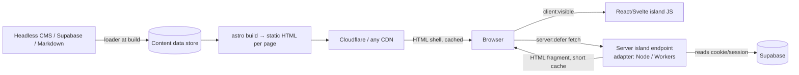

# Astro - Islands & Content Layer

> [!info] Deep dive of [[Astro]]

> [!abstract] TL;DR
> Astro ships **HTML by default**. Interactivity comes only from:
> - **client islands**: framework components hydrated by directive (`client:visible`, …)
> - **server islands**: `server:defer` fragments rendered per request after a cached static shell
>
> The **Content Layer** loads typed content from files, CMSs, APIs or databases at build time via **loaders**, validated by Zod. For SME marketing sites, catalogs and docs, the default is static pages, a few islands for cart/forms, and server islands for personalisation, deployed anywhere.

## Concept

### Three rendering units
| Unit | Rendered | Ships JS | Cacheable | Use for |
|---|---|---|---|---|
| Static Astro component | Build time | None | Fully (CDN) | Layouts, content, product pages |
| **Client island** (`client:*`) | Build/SSR + hydrated in browser | Component + framework runtime | Shell cached, island runs client-side | Cart drawer, search box, image gallery, booking widget |
| **Server island** (`server:defer`) | Per request, fetched after page load | Tiny loader script | Per island (own cache headers) | User avatar, cart count, personalised prices, stock levels |

### Choosing hydration
| Directive | Cost | Choose when |
|---|---|---|
| none | 0 KB | Default, always try first |
| `client:visible` | Hydrates on scroll into view | Below-the-fold widgets (best default for islands) |
| `client:idle` | After main thread idle | Non-urgent above-the-fold extras |
| `client:media` | Only on matching viewports | Mobile nav |
| `client:load` | Immediately (competes with LCP/INP) | Critical above-the-fold interaction only |
| `client:only="react"` | No SSR HTML | Components needing `window`. Reserve space to avoid CLS |

### Content Layer building blocks
| Piece | Role |
|---|---|
| `src/content.config.ts` | Declares collections: `loader` + `schema` |
| Built-in loaders | `glob()` (Markdown/MDX/JSON/YAML files), `file()` (single data file) |
| Custom loader | Object loader `{ name, load({ store, meta, parseData, logger }) }` for CMS/APIs/DB, with incremental sync via `meta` |
| Data store | Cached between builds (`.astro/`). Loaders can skip unchanged entries |
| Query APIs | `getCollection()`, `getEntry()`, `render()` for Markdown |
| **Live collections** | Runtime (per-request) loading instead of build time: experimental in 5.x, promoted in 6 (per beta notes) |

## How It Works

- **Server islands**: the static page contains a placeholder plus a small script. The browser requests `/_server-islands/<Component>?...` (props are **encrypted** with the build key), and the server renders the fragment with access to cookies/request. Fallback content shows until it arrives.
- **Client islands** are separate roots, so state must be shared via a store (nanostores) or URL/events, not React context.

## Practical Usage

### Static product page with both island types
```astro
---
// src/pages/products/[slug].astro (prerendered)
import { getCollection, getEntry } from "astro:content";
import Layout from "../../layouts/Layout.astro";
import AddToCart from "../../components/AddToCart.tsx";
import CartCount from "../../components/CartCount.astro";
import StockBadge from "../../components/StockBadge.astro";

export async function getStaticPaths() {
  const products = await getCollection("products");
  return products.map((p) => ({ params: { slug: p.id }, props: { p } }));
}
const { p } = Astro.props;
---
<Layout title={p.data.name}>
  <header><CartCount server:defer><span slot="fallback">🛒</span></CartCount></header>
  
  <h1>{p.data.name}</h1>
  <p>RM {(p.data.priceSen / 100).toFixed(2)}</p>
  <StockBadge sku={p.data.sku} server:defer><span slot="fallback">Checking stock…</span></StockBadge>
  <AddToCart client:visible sku={p.data.sku} />
</Layout>
```
```astro
---
// src/components/StockBadge.astro (server island; needs an adapter)
const { sku } = Astro.props;
const stock = await getStock(sku);                                   // Supabase query
Astro.response.headers.set("Cache-Control", "public, max-age=60");  // cache the fragment briefly
---
<span class={stock > 0 ? "text-emerald-700" : "text-red-700"}>{stock > 0 ? `${stock} in stock` : "Out of stock"}</span>
```

### Custom loader from a headless CMS (incremental)
```ts
// src/content.config.ts
import { defineCollection, z } from "astro:content";

const products = defineCollection({
  loader: {
    name: "directus-products",
    async load({ store, meta, parseData, logger }) {
      const since = meta.get("lastSync");
      const url = `${import.meta.env.CMS_URL}/items/products?filter[date_updated][_gt]=${since ?? "1970-01-01"}`;
      const { data } = await fetch(url, { headers: { Authorization: `Bearer ${import.meta.env.CMS_TOKEN}` } }).then((r) => r.json());
      for (const item of data) {
        store.set({ id: item.slug, data: await parseData({ id: item.slug, data: item }) });
      }
      meta.set("lastSync", new Date().toISOString());
      logger.info(`synced ${data.length} products`);
    },
  },
  schema: z.object({ name: z.string(), sku: z.string(), priceSen: z.number().int(), status: z.enum(["draft", "published"]) }),
});
export const collections = { products };
```
- Trigger rebuilds from CMS webhooks (Cloudflare Pages deploy hook, or a Coolify webhook redeploy), and let the incremental `meta` avoid refetching everything.
- Deletions need handling too: periodically fetch IDs and `store.delete()` missing ones, or do a full refresh weekly.

### Sharing state between islands (nanostores)
```ts
// src/stores/cart.ts
import { persistentAtom } from "@nanostores/persistent";
export const cartCount = persistentAtom<number>("cartCount", 0, { encode: String, decode: Number });
```
```tsx
// AddToCart.tsx (React island)
import { useStore } from "@nanostores/react";
import { cartCount } from "../stores/cart";
export default function AddToCart({ sku }: { sku: string }) {
  const count = useStore(cartCount);
  return <button onClick={async () => { await addToCart(sku); cartCount.set(count + 1); }}>Add to cart</button>;
}
```

## Patterns & Anti-patterns
| Pattern | When | Anti-pattern to avoid |
|---|---|---|
| Static shell + server islands for personal bits | Catalogs, marketing sites with login | Turning the whole site SSR to show a username |
| `client:visible` by default | Below-the-fold widgets | `client:load` on everything (React-SPA-like JS cost) |
| Typed collections with Zod schemas | Any content | Untyped `fetch` in every page frontmatter |
| Incremental loaders + webhook rebuilds | CMS-driven sites | Rebuilding 5,000 pages with full refetch on every typo fix |
| nanostores for cross-island state | Cart/auth state | Expecting React context to span islands |
| Fallback slots with reserved size for server islands | Personalised fragments | Empty placeholders that shift layout (CLS) |

## Performance & Trade-offs
- **JS budget**: a typical Astro product page ships 0–30 KB of JS versus 150–300 KB for an equivalent SPA. That's a big INP/LCP win on mid-range phones ([[Browser & Web Fundamentals - Core Web Vitals Optimization]]).
- **Server islands** add a second request after load. Fine for non-critical fragments, but don't put LCP content in them.
- **Build time vs freshness**:
  - **Build-time collections**: fastest pages, but content updates need rebuilds.
  - **Live collections or SSR pages**: fresh data, but you pay per-request compute.
  - **Mix**: catalog static, stock and prices via server islands.
- **Adapters**: static output runs anywhere. Server islands need an adapter (Node on Coolify, or Cloudflare Workers). Workers have Node API limits, so check SDK compatibility (e.g. Supabase client works, some Node-only libs don't).

## Tips & Reminders
> [!tip]
> - **Set a stable build key** in multi-instance deployments, so server-island prop encryption matches across instances and deploys (`astro create-key` → `ASTRO_KEY` env).
> - **Prefer Preact/Svelte islands** for tiny widgets when React isn't otherwise needed, since the runtime cost is smaller.
> - **Use View Transitions** (`<ClientRouter />`) carefully: islands persist or re-mount depending on `transition:persist`. Test cart state across navigations.
> - **Images**: use `astro:assets` `<Image>` with explicit sizes, and restrict remote image domains ([[Astro]] gotchas).
> - **In ZP's stack**:
>   - **SME sites**: Astro static on Cloudflare (or Coolify Node adapter) with a Directus/Strapi or Supabase loader, React islands for booking/cart, and server islands reading Supabase for stock and logged-in state.
>   - **Workflow**: rebuild via a CMS webhook through n8n.

## Version Notes
| Version | Change |
|---|---|
| 2.x–4.x | Content collections (Markdown-only, `src/content/config.ts`) |
| **5.0** (2024-12) | Content Layer with loaders, `src/content.config.ts`, server islands stable, `output: 'hybrid'` removed (static default + per-page `prerender = false`) |
| 5.x (2025) | Live content collections (experimental), sessions, CSP and font APIs. Incremental improvements |
| **6** (beta 2026-01) | workerd dev server, first-class Workers, live collections promoted. Stable date unconfirmed |

> [!warning] Unverified — check before relying on this
> The Astro 6 stable release and the final status of live content collections weren't confirmed. Check https://docs.astro.build/en/guides/upgrade-to/v6/. Legacy `src/content/config.ts` collections need migration to loaders (`glob()`) when upgrading from v4.

## Critical Issues & Gotchas
> [!danger] Leaking secrets or private data into static HTML
> Frontmatter in prerendered pages runs at **build time**. Anything fetched there (including draft content or internal prices), and any non-`PUBLIC_` value you render, is baked into public HTML on the CDN. Filter `status = 'published'` in loaders, never render secrets, and put per-user data only in server islands or SSR routes with auth checks.

> [!danger] Server islands are public endpoints
> - **The exposure**: island URLs can be requested directly by anyone, and props are encrypted but the endpoint runs your code with the requester's cookies.
> - **Required checks**: authorise inside the island (session check, tenant check) like any API, rate-limit expensive islands, and cache only fragments that aren't user-specific (`private` vs `public` Cache-Control).

> [!warning] Gotchas
> - A missing adapter makes `server:defer` fail at build. Static-only deployments can't use server islands.
> - Changing a collection schema invalidates the data store cache. A first build after a schema change is a full rebuild.
> - `client:only` islands render no HTML, which is bad for SEO content. Use SSR-capable islands for indexable text.
> - Island props must be serialisable (no functions, class instances). Pass IDs and fetch inside.
> - CMS webhook storms (bulk edits) trigger many rebuilds. Debounce deploy hooks (e.g. 2-minute delay in n8n).

## Related
- [[Astro]]
- [[React]] — island components
- [[Cloudflare]] — Workers adapter, deploy hooks, CDN caching
- [[Supabase]] — server-island data source
- [[Browser & Web Fundamentals - Core Web Vitals Optimization]] — JS budget and LCP
- [[Next.js]] — when a full app framework fits better

## References
- Astro islands: https://docs.astro.build/en/concepts/islands/
- Server islands: https://docs.astro.build/en/guides/server-islands/
- Content collections & loaders: https://docs.astro.build/en/guides/content-collections/
- Content Loader API: https://docs.astro.build/en/reference/content-loader-reference/
- Sharing state between islands: https://docs.astro.build/en/recipes/sharing-state-islands/
- Cloudflare acquires Astro (2026-01-16): https://www.cloudflare.com/press/press-releases/2026/cloudflare-acquires-astro-to-accelerate-the-future-of-high-performance-web-development/
