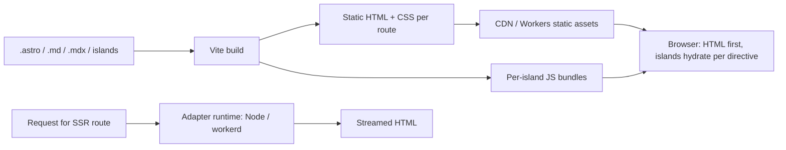

# Astro

> [!abstract] TL;DR
> Astro is a content-first web framework that ships **zero JavaScript by default**: pages render to HTML at build time or on the server, and only interactive **islands** (React, Vue, Svelte, Solid, Preact components) hydrate on the client. That makes it the best fit for marketing sites, landing pages, blogs, docs and e-commerce storefronts, where Core Web Vitals and SEO matter more than app-like interactivity.
> - **Ownership**: in **January 2026 Cloudflare acquired Astro**. It stays MIT and host-agnostic, but the roadmap now tilts towards Workers.
> - **Choosing vs Next.js**: for an SME marketing site, pick Astro. For a dashboard or SaaS app, pick [[Next.js]].

## Introduction
- **Origin**: created by Fred K. Schott and team (2021), 1.0 in 2022-08. Developed by The Astro Technology Company, now part of [[Cloudflare]] (announced 2026-01-16). MIT license, and a funded ecosystem.
- **Problem**: SPA frameworks ship large JS bundles to render mostly static content, which hurts LCP/INP and SEO. Astro inverts the default: HTML first, JS opt-in per component.
- **Where it sits**:
  - Static or server-rendered content sites, deployed to CDNs (Cloudflare Workers/Pages, Netlify, Vercel) or a Node server/[[Docker]] on [[Coolify]].
  - Pairs with headless CMSs (Sanity, Storyblok, Contentful, Keystatic, Decap) or Markdown/MDX in the repo.
  - **Starlight** is Astro's docs-site framework.

## Core Concepts

### `.astro` components
```astro
---
// src/pages/products/[slug].astro: frontmatter runs on the server/build only
import Layout from '../../layouts/Layout.astro';
import { getCollection, getEntry, render } from 'astro:content';
import AddToCart from '../../components/AddToCart.tsx';      // React island
import { Image } from 'astro:assets';

export async function getStaticPaths() {
  const products = await getCollection('products');
  return products.map((p) => ({ params: { slug: p.id }, props: { product: p } }));
}
const { product } = Astro.props;
const { Content } = await render(product);
---
<Layout title={product.data.name}>
  <Image src={product.data.cover} alt={product.data.name} width={800} />
  <h1>{product.data.name}</h1>
  <p>RM {(product.data.priceSen / 100).toFixed(2)}</p>
  <Content />
  <AddToCart client:visible sku={product.data.sku} />   <!-- hydrates only when scrolled into view -->
</Layout>
```

### Hydration directives
| Directive | Hydrates when | Use for |
|---|---|---|
| (none) | Never: HTML only | Default for everything static |
| `client:load` | Immediately on page load | Above-the-fold critical interactivity |
| `client:idle` | `requestIdleCallback` | Non-urgent widgets |
| `client:visible` | Enters viewport (IntersectionObserver) | Carts, carousels, comments below the fold |
| `client:media="(max-width: 768px)"` | Media query matches | Mobile-only menus |
| `client:only="react"` | Client-only render (no SSR) | Components using `window` |
| `server:defer` | **Server island**: rendered on demand after the cached shell | Personalized fragments (cart count, user avatar) on static pages |

### Content Layer (collections)
```ts
// src/content.config.ts
import { defineCollection, z } from 'astro:content';
import { glob } from 'astro/loaders';

const products = defineCollection({
  loader: glob({ pattern: '**/*.md', base: './src/content/products' }),   // or a custom loader: CMS, Supabase, API
  schema: ({ image }) => z.object({ name: z.string(), sku: z.string(), priceSen: z.number().int(), cover: image() }),
});
export const collections = { products };
```

### Rendering modes
- **Static (default)**: every page is prerendered at build time.
- **On-demand**: add an adapter (`@astrojs/node`, `@astrojs/cloudflare`, Vercel, Netlify) and set `export const prerender = false` on pages that need SSR (forms, auth, personalization). Mixed static + SSR per page.
- **Actions** (`astro:actions`): type-safe server functions with Zod validation for forms/mutations. **Middleware**, **sessions** and **i18n routing** are built in.

## Architecture / How It Works

- Built on **Vite** (dev server, HMR, bundling). Astro 6 runs the dev server on **workerd** (the Workers runtime) for parity with Cloudflare production.
- **Islands**: each framework component renders to HTML on the server, then hydrates independently with its own small bundle. Islands don't share a React tree. Share state via nanostores or custom events.
- **View transitions**: `<ClientRouter />` adds SPA-like navigation with the View Transitions API, keeping MPA simplicity.
- **Images**: `astro:assets` optimizes (Sharp) at build or on-demand, with responsive `srcset` and layout props.

## Project Structure
```text
site/
├── astro.config.mjs        # integrations (react, mdx, sitemap), adapter, output, i18n, image domains
├── src/
│   ├── pages/              # file-based routing: index.astro, blog/[slug].astro, api/contact.ts (endpoints)
│   ├── layouts/Layout.astro
│   ├── components/         # .astro + framework islands
│   ├── content/            # Markdown/MDX/JSON content
│   ├── content.config.ts   # collection schemas + loaders
│   ├── actions/index.ts    # astro:actions
│   └── middleware.ts
├── public/                 # copied as-is (favicons, robots.txt)
└── package.json
```
```bash
npm create astro@latest
npx astro add react tailwind mdx sitemap cloudflare
npx astro check && npx astro build
```

## Use Cases
| Use case | Why it fits |
|---|---|
| SME marketing sites, landing pages | Near-zero JS, excellent Lighthouse/CWV, cheap static hosting |
| Blogs, docs (Starlight), knowledge bases | Content collections, MDX, search integrations (Pagefind) |
| E-commerce storefronts | Static catalog + islands for cart/checkout + server islands for personalization |
| Multilingual sites (EN/BM/ZH) | Built-in i18n routing |
| Portfolio and campaign microsites | Fast builds, simple deploys |
| Dashboards, SaaS apps with heavy client state | **Poor fit**. Use [[Next.js]]/[[React]] SPA patterns |

## Pros & Cons
| Pros | Cons |
|---|---|
| Zero JS by default → top Core Web Vitals and SEO | Not designed for app-like, highly interactive UIs |
| Bring any UI framework (React, Vue, Svelte, Solid) | Islands are isolated. Cross-island state needs extra tooling |
| Content Layer with typed schemas and custom loaders | SSR features depend on adapters. Edge runtimes limit Node APIs |
| Static + on-demand rendering per page, server islands | Smaller ecosystem than Next.js for auth/data patterns |
| Simple mental model, fast Vite DX | Ownership by Cloudflare = roadmap/vendor alignment risk |
| Cheap hosting anywhere (any static host) | Major versions every ~12 months with migration work |

## Alternatives & Peers
| Alternative | Strength vs Astro | Weakness vs Astro | Pick it when… |
|---|---|---|---|
| [[Next.js]] | Full-stack React apps, RSC, huge ecosystem | Heavier JS, more complex caching, Vercel-centric | SaaS, dashboards, apps with auth (ZP's app default) |
| Eleventy (11ty) | Even simpler, pure static | No component islands/SSR story | Pure static content |
| Hugo | Extremely fast builds (Go), single binary | Go templates, no JS framework components | Huge static content sites |
| SvelteKit / Nuxt | Full-stack Svelte/Vue apps | More JS by default | App-like sites in Svelte/Vue |
| WordPress | Non-technical editing, plugins | Security/maintenance burden, slower | Client insists on WP editing |

## Tips & Reminders
> [!tip]
> - Default to no directive. Add `client:visible`/`client:idle` before `client:load`. Audit JS with the build output and Lighthouse.
> - Put dynamic bits in **server islands** (`server:defer`) instead of making the whole page SSR, so the page stays CDN-cacheable.
> - Validate content with Zod schemas so broken frontmatter fails the build, not production.
> - Use `astro check` in CI (type-checks `.astro` files) and `@astrojs/sitemap` + canonical URLs for SEO.
> - **In ZP's stack**: build client marketing/landing sites in Astro + [[Tailwind CSS]], deployed as static assets on [[Cloudflare]] Workers (free tier) or an Nginx container on [[Coolify]]. Contact/lead forms → Astro Action or endpoint → [[n8n]] webhook (WhatsApp/CRM). Keep the app/dashboard in [[Next.js]] + [[Supabase]], and link between them by subdomain.

## Versions & Breaking Changes
| Version | Released | Key changes | Breaking / migration notes |
|---|---|---|---|
| 1.0 | 2022-08 | Islands, multi-framework | — |
| 2.0 | 2023-01 | Content collections, hybrid rendering | Markdown/collections API changes |
| 3.0 | 2023-08 | View Transitions, image optimization stable | Image API changes |
| 4.0 | 2023-12 | Dev toolbar, i18n routing | — |
| **5.0** | 2024-12 | **Content Layer** (loaders), **server islands**, simplified prerendering (`output: 'hybrid'` removed), `astro:env` | Collections config moves to `src/content.config.ts` with loaders. Legacy collections flag |
| Cloudflare acquisition | 2026-01 | Astro team joins Cloudflare. MIT and host-agnostic pledged | Watch adapter parity across hosts |
| **6** | Beta 2026-01 | Dev server on workerd, first-class Workers, live content collections, more runtimes | Follow the official v6 upgrade guide |

> [!warning] Unverified — check before relying on this
> Astro 6's stable release date and final breaking-change list weren't confirmed (only beta coverage found). Check https://docs.astro.build/en/guides/upgrade-to/v6/ and https://github.com/withastro/astro/releases.

## Critical Issues & Gotchas
> [!danger] Vendor alignment after the Cloudflare acquisition
> Cloudflare pledged that Astro stays open source (MIT) and deployable anywhere. Still, priorities (workerd dev server, Workers-first features) may favour Cloudflare hosting, and other adapters (Vercel/Netlify/Node) could lag. For client sites, prefer static output (portable to any host) and keep SSR use minimal, so you can migrate hosts without code changes.

> [!danger] SSR endpoints are a real backend
> Once you add an adapter, endpoints, Actions and middleware are server code: input validation, CSRF (Astro's `security.checkOrigin`), rate limiting and secret handling apply. Past advisories in Astro and its adapters include middleware/path-normalization bypasses and image-endpoint abuse (unvalidated remote image domains → SSRF/bandwidth abuse). Restrict `image.domains`/`remotePatterns` and keep Astro patched.

> [!warning] Gotchas
> - Code in the component frontmatter runs at **build time** for static pages. `Astro.request` headers/cookies aren't available unless the page is server-rendered.
> - Secrets: only `astro:env` server variables (or non-`PUBLIC_` env vars) stay server-side. `PUBLIC_` vars end up in client bundles.
> - Islands with `client:only` render nothing on the server, which causes layout shift and no SEO content. Reserve space.
> - Using React context across islands doesn't work (separate roots). Use nanostores.
> - Large content sites: build time grows with pages and image processing. Cache `node_modules/.astro` and images in CI.

## Deep Dives
- [[Astro - Islands & Content Layer]]
- [[Astro - Content Sites, SEO & Cloudflare Deployment]] — SEO component, hreflang i18n, LocalBusiness JSON-LD, Workers static assets + CI, SME handover

## Related
- [[Next.js]] — app framework peer, when to choose which
- [[React]] — most common island framework
- [[Cloudflare]] — Astro's owner since 2026, Workers deployment
- [[Tailwind CSS]] — styling
- [[TypeScript]] — typed content schemas and components
- [[Browser & Web Fundamentals]] — Core Web Vitals, hydration cost
- [[n8n]] — form/lead handling backend

## References
- Astro docs: https://docs.astro.build/
- Releases: https://github.com/withastro/astro/releases
- Cloudflare acquires Astro (2026-01): https://secure.businesswire.com/news/home/20260116386991/en/Cloudflare-Acquires-Astro-to-Accelerate-the-Future-of-High-Performance-Web-Development
- Astro 6 beta overview: https://blog.codercops.com/blog/astro-6-beta-edge-computing-cloudflare-workers-2026
- Server islands: https://docs.astro.build/en/guides/server-islands/
- Starlight: https://starlight.astro.build/
