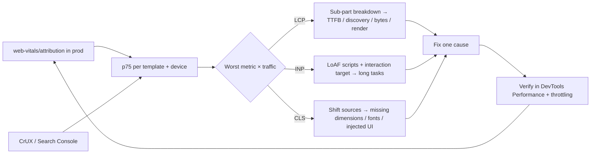

# Browser & Web Fundamentals - Core Web Vitals Optimization

> [!info] Deep dive of [[Browser & Web Fundamentals]]

> [!abstract] TL;DR
> Optimize from **field data at p75 on mobile**, not Lighthouse on a MacBook.
> - **Break each metric into sub-parts**, then fix the biggest one:
>   - **LCP** = TTFB + resource load delay + load duration + render delay
>   - **INP** = input delay + processing + presentation delay
>   - **CLS** = unreserved space + late fonts and banners
> - **Biggest wins** for SME sites: a cached HTML at the edge, a prioritized hero image, less third-party JS, and yielding long tasks.

## Concept

### Thresholds (75th percentile of page loads, mobile and desktop separately)
| Metric | Good | Poor | Measures |
|---|---|---|---|
| **LCP** | ≤ 2.5 s | > 4.0 s | When the main content (largest image/text block) rendered |
| **INP** | ≤ 200 ms | > 500 ms | Worst-ish (p98 per page) latency from interaction to next paint over the whole visit |
| **CLS** | ≤ 0.1 | > 0.25 | Largest burst (5 s session window) of unexpected layout shifts |

- **Ranking use**: Google uses CrUX field data, a 28-day rolling window, aggregated per URL or origin. Lab tools (Lighthouse, PageSpeed lab section) only help you debug.

### Sub-part budgets (what "good" usually looks like)
| LCP sub-part | Target share | Typical culprit |
|---|---|---|
| TTFB | ~40% (≤ 800 ms) | Uncached SSR, slow DB, origin far from users (SG/US vs MY), redirects |
| Resource load **delay** | < 10% | Hero image discovered late (CSS background, JS-inserted, lazy-loaded) |
| Resource load **duration** | ~40% | Oversized images, no AVIF/WebP, no CDN |
| Element render **delay** | < 10% | Render-blocking CSS/JS, client-side rendering, font blocking text LCP |

| INP phase | Typical culprit | Fix |
|---|---|---|
| Input delay | Main thread busy (hydration, third-party scripts, timers) | Less JS, defer third parties, break long tasks |
| Processing duration | Heavy event handlers, synchronous state updates re-rendering large trees | `startTransition`, memoization, smaller components, workers |
| Presentation delay | Large DOM, layout thrash, expensive paint | `content-visibility`, smaller DOM, avoid forced reflow |

## How It Works

- **Long Animation Frames (LoAF) API**: attributes slow frames to specific scripts (source URL, function, duration). It's the main tool for finding which third-party or app script causes poor INP.
- **bfcache**: back/forward navigations restored from cache are instant and count as great LCP/INP. Pages are excluded by `unload` handlers, `Cache-Control: no-store` on HTML (in some browsers), or open connections.

## Practical Usage

### Field measurement with attribution
```ts
// app/web-vitals.ts (client)
import { onLCP, onINP, onCLS, onTTFB } from "web-vitals/attribution";

function send(m: any) {
  const body = JSON.stringify({
    name: m.name, value: m.value, rating: m.rating, page: location.pathname,
    // the WHY:
    lcp: m.name === "LCP" ? { el: m.attribution.target, ttfb: m.attribution.timeToFirstByte, delay: m.attribution.resourceLoadDelay,
                               dur: m.attribution.resourceLoadDuration, render: m.attribution.elementRenderDelay } : undefined,
    inp: m.name === "INP" ? { target: m.attribution.interactionTarget, input: m.attribution.inputDelay,
                               proc: m.attribution.processingDuration, pres: m.attribution.presentationDelay,
                               scripts: m.attribution.longAnimationFrameEntries?.flatMap((f: any) => f.scripts.map((s: any) => s.sourceURL)) } : undefined,
    cls: m.name === "CLS" ? { target: m.attribution.largestShiftTarget } : undefined,
  });
  navigator.sendBeacon("/api/rum", body);
}
[onLCP, onINP, onCLS, onTTFB].forEach((fn) => fn(send));
```

### LCP playbook
```tsx
// Next.js: hero image discovered early, high priority, right size
import Image from "next/image";
<Image src="/hero.avif" alt="Kopi & kuih delivered in Kuching" width={1200} height={630}
       priority sizes="(max-width: 768px) 100vw, 1200px" />   // priority → preload + fetchpriority=high, no lazy-load
```
```html
<!-- Non-Next sites: make the LCP resource discoverable in the HTML -->
<link rel="preload" as="image" href="/hero-1200.avif" imagesrcset="/hero-600.avif 600w, /hero-1200.avif 1200w" imagesizes="100vw" fetchpriority="high">
<link rel="preconnect" href="https://cdn.example.my" crossorigin>
```
- **TTFB**:
  - Cache HTML at the edge (Cloudflare Cache Rules for anonymous pages, or static/ISR pages in [[Next.js]]).
  - Avoid redirect chains (`http → https → www`).
  - Put the origin near users: SG beats US for Malaysia.
  - Enable **Early Hints (103)** for critical assets.
- **Images**: never lazy-load the LCP image. Use AVIF/WebP with responsive `srcset`, no CSS `background-image` for the hero, and no carousel as LCP element (JS-delayed).
- **Render delay**: inline critical CSS (Tailwind's output is usually small), `defer` non-critical JS, and avoid client-only rendering of above-the-fold content.

### INP playbook
```ts
// Yield inside long work so the browser can paint between chunks
async function processRows(rows: Row[]) {
  for (let i = 0; i < rows.length; i++) {
    handle(rows[i]);
    if (i % 200 === 0) await (globalThis.scheduler?.yield?.() ?? new Promise((r) => setTimeout(r, 0)));
  }
}
```
```tsx
// React: keep the input responsive, defer the expensive re-render
const [query, setQuery] = useState("");
const deferred = useDeferredValue(query);
<input value={query} onChange={(e) => setQuery(e.target.value)} />
<ProductList filter={deferred} />          // memoized, renders at lower priority
// Or: startTransition(() => setFilters(next)) for non-urgent updates
```
- **Paint first**: give immediate visual feedback (button pressed state), then do the work. Don't `await` a network call before painting the spinner.
- **Third parties**: load chat widgets (Tawk, Crisp), tag managers and pixels after interaction or idle (`next/script strategy="lazyOnload"`, or a facade that loads on click).
- **DOM**: virtualize long lists (> 500 rows), use `content-visibility: auto` for below-the-fold sections, and avoid reading layout (`offsetHeight`) right after writing styles.

### CLS playbook
```css
img, video { max-width: 100%; height: auto; }   /* with width/height attributes set, browsers derive aspect-ratio */
.ad-slot, .embed { min-height: 250px; }                                            /* reserve space for late content */
@font-face { font-family: "Inter"; src: url(/inter.woff2) format("woff2"); font-display: swap; size-adjust: 107%; }
```
- In Next.js, `next/font` self-hosts fonts and generates size-adjusted fallbacks, which avoids font-swap shifts.
- Cookie/consent banners and "download our app" bars should overlay (`position: fixed`), not push content. Inject UI only in response to user input (shifts within 500 ms of input don't count).

### Instant navigations (multi-page sites)
```html
<script type="speculationrules">
{ "prerender": [{ "where": { "href_matches": "/products/*" }, "eagerness": "moderate" }] }
</script>
```
- Speculation Rules prerender likely-next pages in Chromium. Pair them with bfcache-friendly pages (no `unload` listeners).

## Patterns & Anti-patterns
| Pattern | When | Anti-pattern to avoid |
|---|---|---|
| RUM with attribution, segmented by template + device | Always | Chasing a Lighthouse 100 on desktop |
| Edge-cached HTML for anonymous pages | Marketing sites, catalogs | Uncached SSR on every request from a US origin |
| LCP image in HTML with `fetchpriority="high"` | Hero-driven pages | `loading="lazy"` on everything, hero in a JS carousel |
| Defer/facade third-party widgets | Chat, analytics, pixels | Five trackers + chat widget loaded synchronously in `<head>` |
| Yield long tasks, transitions for heavy updates | Dashboards, filters | 300 ms synchronous filter on every keystroke |
| Reserve space for media/embeds/banners | Always | Late-injected promo bars pushing the page down |
| Performance budget in CI (Lighthouse CI / bundle size) | Teams, client retainers | No regression guard; one plugin ruins months of work |

## Performance & Trade-offs
- **SSR vs static**: SSR helps LCP render delay but can hurt TTFB. Static/ISR plus edge caching gives the best of both for content that doesn't vary per user.
- **Hydration cost** is the top INP driver in React apps. Server Components, islands ([[Astro]]) and less client JS cut it, at the price of rearchitecting interactive parts.
- **Image CDN** (Cloudflare Images/Polish, Next image optimizer): big LCP wins, but watch transformation pricing and cache-key explosion from arbitrary sizes.
- **Diminishing returns**: once p75 is "good" on the money pages, further gains rarely move SEO. Spend the effort on conversion UX instead.

## Tips & Reminders
> [!tip]
> - **Test like your users**: a mid-range Android (e.g. Samsung A-series) on 4G, with DevTools CPU 4× + "Fast 4G" throttling. Malaysian mobile traffic often dominates SME sites.
> - **Track by template** (home, product, checkout), not just origin, because one heavy template drags the origin score.
> - **Check Search Console's CWV report monthly**. Field data lags ~28 days, so verify fixes in RUM first.
> - **WordPress/Elementor client sites**: biggest wins are removing unused plugins, a caching plugin + Cloudflare APO, and image optimization. Expect LCP gains of seconds.
> - **In ZP's stack**:
>   - **Delivery**: [[Next.js]] on Coolify behind [[Cloudflare]] (cache rules for anonymous HTML, Brotli, HTTP/3, Early Hints), `next/image` + `next/font`, and third-party scripts via `lazyOnload`.
>   - **Monitoring**: RUM beacons go to a small Supabase table with a weekly p75 report.
>   - **Offering**: sell a "CWV audit + fix" package with before/after field data.

## Version Notes
| Date | Change |
|---|---|
| 2020-05 | Core Web Vitals announced (LCP, FID, CLS) |
| 2021-06 | CWV part of Google page experience ranking signals. CLS session windows (2021) |
| **2024-03-12** | **INP replaces FID** |
| 2024–2025 | LoAF API shipped in Chromium. `web-vitals` v4–v5 attribution includes LoAF entries and LCP sub-parts |
| 2025-12 | LCP and INP measurable across all major browsers (Baseline) |
| 2026 | Thresholds unchanged (no official change announced) |

> [!warning] Unverified — check before relying on this
> Third-party 2026 articles disagree on whether Google plans new metrics or thresholds. Treat web.dev and Google Search Central as the authority. Check the current `next/image` API (`priority` vs newer preload options) for your Next.js version.

## Critical Issues & Gotchas
> [!danger] Third-party scripts can wipe out all your work
> A single chat widget, A/B-testing snippet or ad tag can add 300–800 ms of main-thread work on mid-range phones, which turns INP from good to poor overnight when marketing adds it via GTM. Require performance review for tag changes, load third parties after interaction, and monitor INP attribution by script URL (LoAF).

> [!danger] Optimising lab scores while field data stays red
> Lighthouse runs a cold load without interactions, so it can't see INP problems or real network and device mixes. Teams ship "100 score" sites that fail CWV in Search Console. Always validate with RUM and CrUX at p75, segmented by mobile.

> [!warning] Gotchas
> - `loading="lazy"` on the LCP image (common in CMS themes and some image components) adds seconds of load delay.
> - A hero `<video>` or a slider makes the LCP element unpredictable. Set a static poster image.
> - Client-side A/B tests that hide content until JS runs (anti-flicker snippets) delay LCP for everyone.
> - `Cache-Control: no-store` on HTML can exclude pages from bfcache in some browsers. Prefer `private, max-age=0, must-revalidate` where appropriate.
> - SPA soft navigations aren't counted as new page loads in CrUX (soft-navigation measurement is experimental), so measure route changes in RUM yourself.

## Related
- [[Browser & Web Fundamentals]]
- [[Next.js]] — `next/image`, `next/font`, `next/script`, caching/ISR
- [[React]] — transitions, deferred values, Server Components
- [[JavaScript - Event Loop & Async]] — long tasks, yielding
- [[Cloudflare]] — edge HTML caching, Early Hints, image optimization
- [[HTTP & HTTPS]] — TTFB, HTTP/3, caching headers

## References
- web.dev Core Web Vitals: https://web.dev/articles/vitals
- Optimize LCP: https://web.dev/articles/optimize-lcp
- Optimize INP: https://web.dev/articles/optimize-inp
- Optimize CLS: https://web.dev/articles/optimize-cls
- web-vitals library: https://github.com/GoogleChrome/web-vitals
- Long Animation Frames API: https://developer.chrome.com/docs/web-platform/long-animation-frames
