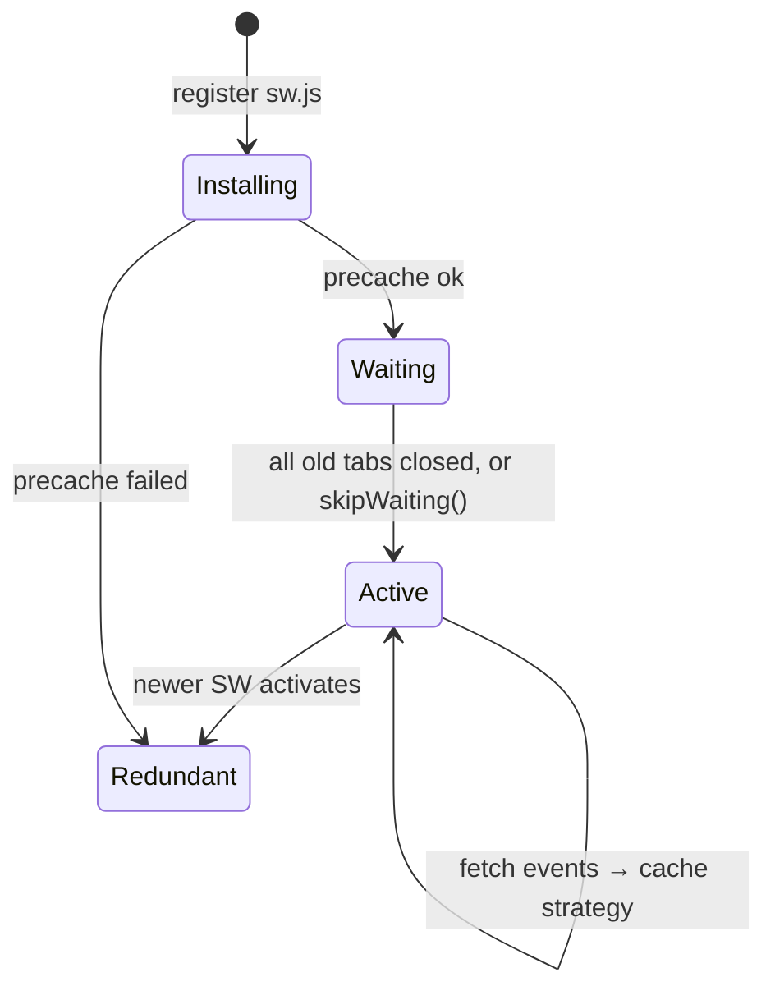

# Browser & Web Fundamentals - Storage, Cookies & Service Workers

> [!info] Deep dive of [[Browser & Web Fundamentals]]

> [!abstract] TL;DR
> - **Cookies** carry the session: `__Host-` prefix, `HttpOnly; Secure; SameSite=Lax`, short-lived, no `Domain`.
> - **IndexedDB** holds offline data (async, large, quota-managed). **localStorage** holds only harmless UI preferences, never tokens.
> - **Service workers** give offline/PWA caching, with explicit strategies per resource type and a deliberate update flow. A bad SW can pin users to a broken version.
>
> Safari limits script-writable storage to **7 days without interaction** for non-installed sites. Treat browser storage as a cache, never the source of truth.

## Concept
**Cookie attributes that matter**:

| Attribute | Effect | Default recommendation |
|---|---|---|
| `HttpOnly` | JS can't read it (XSS can't steal it) | Always, for session/auth cookies |
| `Secure` | HTTPS only | Always |
| `SameSite=Lax` | Sent on top-level GET navigations from other sites, not on cross-site POST/iframes | Default for sessions |
| `SameSite=Strict` | Never sent cross-site (even link clicks) | Admin panels |
| `SameSite=None; Secure` | Sent cross-site | Only for real embedded/3P use |
| `__Host-` prefix | Must be `Secure`, `Path=/`, **no `Domain`**, so subdomains can't overwrite it | Session cookies |
| `Partitioned` (CHIPS) | Cookie keyed by top-level site | Embedded widgets/iframes |
| `Max-Age` | Lifetime. Chrome caps at 400 days | Session: hours to days |

**Storage options**:

| Store | Capacity | API | Readable by XSS | Use for |
|---|---|---|---|---|
| Cookies | ~4 KB each, ~180 per domain | HTTP headers | Not if `HttpOnly` | Session identifiers |
| `localStorage` / `sessionStorage` | ~5–10 MB | Sync, strings | **Yes** | Theme, dismissed banners |
| IndexedDB | Quota-based (large on Chromium; stricter on Safari) | Async, structured, transactions | Yes | Offline data, drafts, outbox |
| Cache API | Quota-based | Request → Response pairs | Yes | SW asset/API caching |
| OPFS | Quota-based | File-like, fast (workers) | Yes | SQLite-WASM, large files |

- **Quota and eviction**: storage is "best-effort" by default and can be evicted under pressure. `navigator.storage.persist()` asks for persistence. **Safari ITP** deletes script-writable storage after 7 days without user interaction for sites in a regular tab; home-screen web apps are treated differently.
- **Third-party cookies**: Chrome reversed its deprecation plan in 2025 and keeps them by default with user controls. Safari, Firefox and Brave block them by default. Design embeds with CHIPS or first-party flows anyway.

## How It Works

- A new service worker **waits** until every tab using the old one closes. Calling `skipWaiting()` + `clients.claim()` activates it immediately, but old pages may then receive new cached assets mid-session.
- SWs are scoped to their path (`/sw.js` → whole origin), require HTTPS (localhost excepted), and intercept every `fetch` in scope.

## Practical Usage
**Session cookie from a Next.js route handler**:
```ts
import { cookies } from 'next/headers';

export async function POST(req: Request) {
  const session = await createSession(await req.json());
  (await cookies()).set('__Host-sid', session.id, {
    httpOnly: true, secure: true, sameSite: 'lax', path: '/', maxAge: 60 * 60 * 8,   // no `domain`: required for __Host-
  });
  return Response.json({ ok: true });
}
```
**Supabase SSR** stores the auth session in cookies (split into chunks such as `sb-<ref>-auth-token.0`, `.1` when large). Let `@supabase/ssr` manage them, and refresh in middleware so server components see a valid session.

**IndexedDB outbox** for offline form submits (with `idb`):
```ts
import { openDB } from 'idb';
const db = await openDB('app', 1, { upgrade: (d) => d.createObjectStore('outbox', { keyPath: 'id' }) });
export async function queueOrder(order: Draft) {
  await db.put('outbox', { id: crypto.randomUUID(), order, createdAt: Date.now() });   // idempotency key = id
}
export async function flush() {
  for (const item of await db.getAll('outbox')) {
    const r = await fetch('/api/orders', { method: 'POST', headers: { 'Idempotency-Key': item.id }, body: JSON.stringify(item.order) });
    if (r.ok || r.status === 409) await db.delete('outbox', item.id);
  }
}
const persisted = await navigator.storage?.persist?.();   // ask the browser not to evict
```
**Service worker with Serwist** (Workbox-based; next-pwa successor) and per-resource strategies:
```ts
// app/sw.ts
import { Serwist, CacheFirst, NetworkFirst, StaleWhileRevalidate, ExpirationPlugin } from 'serwist';
declare const self: ServiceWorkerGlobalScope & { __SW_MANIFEST: any };

new Serwist({
  precacheEntries: self.__SW_MANIFEST,
  skipWaiting: false,                         // update on next load; show a "new version" toast instead
  clientsClaim: true,
  runtimeCaching: [
    { matcher: ({ request }) => request.destination === 'image', handler: new CacheFirst({ cacheName: 'img',
        plugins: [new ExpirationPlugin({ maxEntries: 200, maxAgeSeconds: 30 * 86400 })] }) },
    { matcher: ({ url }) => url.pathname.startsWith('/api/catalog'), handler: new StaleWhileRevalidate({ cacheName: 'catalog' }) },
    { matcher: ({ request }) => request.mode === 'navigate', handler: new NetworkFirst({ cacheName: 'pages', networkTimeoutSeconds: 3 }) },
  ],
}).addEventListeners();
```
**Logout must clear client state**:
```ts
await fetch('/api/logout', { method: 'POST' });             // server clears cookie (Max-Age=0)
await Promise.all((await caches.keys()).map((k) => caches.delete(k)));
indexedDB.deleteDatabase('app');
```
**Wrong way**:
```ts
localStorage.setItem('access_token', jwt);                  // ❌ any XSS exfiltrates it
document.cookie = 'session=abc; Domain=.example.my';        // ❌ readable/overwritable by every subdomain (previews, user sites)
self.addEventListener('fetch', (e) => e.respondWith(caches.match(e.request).then((r) => r ?? fetch(e.request))));
// ❌ cache-first for everything: HTML and API responses go stale forever, even across user accounts
```

## Patterns & Anti-patterns
| Pattern | When | Anti-pattern to avoid |
|---|---|---|
| `__Host-` + `HttpOnly` + `SameSite=Lax` session cookie | Web apps | Tokens in localStorage |
| Separate registrable domain for user content / previews | Multi-tenant, Coolify previews | User-controlled subdomains sharing the app's cookie domain |
| Strategy per resource: cache-first (hashed static), network-first (HTML), SWR (semi-static API) | PWAs | One global strategy |
| "Update available" prompt + `skipWaiting` on user action | SW updates | Silent `skipWaiting()` mixing old HTML with new chunks |
| IndexedDB outbox + idempotency keys | Offline submits | Fire-and-forget fetch that silently loses data offline |
| Clear caches and IDB on logout / account switch | Shared devices | Next user sees previous user's cached data |

## Performance & Trade-offs
- **Cookies on every request**: large cookies (Supabase chunked sessions, analytics) add KBs to each request, including static assets on the same host. Serve assets from a cookie-free host/CDN path if cookies grow.
- **localStorage is synchronous** and blocks the main thread on big reads. Prefer IndexedDB for anything above a few KB.
- **Precache size**: precaching 20 MB of assets on first load hurts mobile users (data costs on Malaysian prepaid plans). Precache the shell; runtime-cache the rest.
- **Service worker startup** adds a few ms to each navigation when the SW must boot. Navigation preload mitigates this for network-first pages.

## Tips & Reminders
> [!tip] In ZP's stack
> - **Next.js + Supabase**: cookie-based sessions via `@supabase/ssr`, never `localStorage` tokens. Middleware refreshes the session.
> - **Offline**: for field-sales/order-taking web apps, Serwist + an IndexedDB outbox. For heavy offline needs, prefer the Flutter app with a local DB ([[Flutter - Offline Storage & Sync]]).
> - **Preview environments**: Coolify previews on a separate domain (e.g. `*.preview-example.dev`), never subdomains of the production cookie domain.

- Inspect in DevTools → Application: cookies (attributes, partition key), storage usage, SW status ("Update on reload" for development).
- Version cache names (`pages-v3`) and delete old caches in `activate`.
- Test PWA behaviour on iOS Safari specifically: storage limits, push (installed web apps only) and update timing differ from Chrome.
- Treat everything in browser storage as user-tamperable input when it's sent back to the server.

## Version Notes
| Date | Change |
|---|---|
| 2020–21 | `SameSite=Lax` default in Chromium. Safari ITP 7-day cap on script-writable storage |
| 2023 | iOS 16.4: Web Push for home-screen web apps. CHIPS (`Partitioned`) ships in Chrome |
| 2024 | Chrome caps cookie lifetime at 400 days. next-pwa unmaintained, Serwist emerges |
| 2025-04 | Chrome keeps third-party cookies (no deprecation, no new prompt). 2025-10: several Privacy Sandbox APIs retired; CHIPS and FedCM continue |

> [!warning] Unverified — check before relying on this
> Safari's current quota numbers and home-screen-app eviction exemptions weren't re-checked this run. See WebKit's storage policy posts before promising offline guarantees on iOS.

## Critical Issues & Gotchas
> [!danger] Stuck service worker
> A buggy SW that cache-first serves `index.html` can pin users to a broken release, and they won't see fixes until the SW updates. Keep the SW file itself uncached (`Cache-Control: no-cache` on `/sw.js`), network-first for HTML, and have a kill switch: deploy a no-op SW that unregisters itself.

> [!danger] Cookie scope across subdomains
> `Domain=.example.my` cookies are sent to, and can be set by, every subdomain, including tenant-custom subdomains or previews running other code. This enables session fixation and cookie tossing. Use `__Host-` cookies and keep untrusted content on a different registrable domain.

- **Caching authenticated responses**: SW or CDN caches keyed only by URL can serve one user's `/api/me` to another. Never runtime-cache personalized API routes, or include the user in the cache key and clear it on logout.
- **Safari eviction**: offline drafts in IndexedDB can vanish after 7 days of no interaction in Safari tabs. Sync to the server opportunistically, and tell users.
- **CSRF still exists with `SameSite=None`**: embedded or cross-site flows that need `None` must add CSRF tokens or origin checks ([[Network Security - Common Web Attacks]]).
- **Quota errors** (`QuotaExceededError`) appear on low-storage phones. Catch them, degrade gracefully, and keep caches bounded with expiration.

## Related
- [[Browser & Web Fundamentals]]
- [[Browser & Web Fundamentals - Core Web Vitals Optimization]] — caching's effect on LCP/INP
- [[Next.js]] — cookies API, middleware, PWA setup
- [[JWT - Refresh Tokens, Revocation & Storage]] — where tokens should and shouldn't live
- [[Network Security - Common Web Attacks]] — XSS, CSRF, session fixation
- [[Flutter - Offline Storage & Sync]] — native offline alternative

## References
- https://developer.mozilla.org/en-US/docs/Web/HTTP/Cookies
- https://developer.mozilla.org/en-US/docs/Web/API/Storage_API/Storage_quotas_and_eviction_criteria
- https://webkit.org/tracking-prevention/
- https://serwist.pages.dev/
- https://www.techradar.com/pro/security/google-chrome-delays-third-party-cookies-plan-yet-again
- https://stape.io/news/google-chrome-cookie-deprecation
