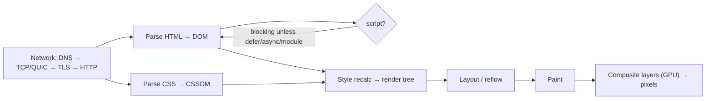

# Browser & Web Fundamentals

> [!abstract] TL;DR
> Everything a frontend runs on: how a browser turns bytes into pixels (**critical rendering path**), how it schedules work (**event loop**, main thread), how it fetches and caches resources ([[HTTP & HTTPS]]), how it isolates sites (**same-origin policy, CORS, cookies, CSP**), and how users perceive speed (**Core Web Vitals**: LCP ≤ 2.5 s, INP ≤ 200 ms, CLS ≤ 0.1).
> - **Platform status**: LCP and INP became **Baseline** (measurable in all major browsers) in December 2025. **Interop 2026** is aligning anchor positioning, view transitions, Navigation API, scroll-driven animations and more across engines.
> - **Why it matters**: most frontend performance and security bugs are platform misunderstandings, not framework bugs.

## Introduction
- **Engines**: Blink (Chrome, Edge, Opera, Samsung, most Android WebViews), WebKit (Safari, and **all iOS browsers**), Gecko (Firefox). JavaScript engines: V8, JavaScriptCore, SpiderMonkey.
- **Standards**: WHATWG (HTML, DOM, Fetch living standards), W3C (CSS, accessibility), TC39 (JavaScript). **Baseline** (web.dev/MDN) labels features as "Newly available" (in all core browsers) or "Widely available" (30+ months later).
- **Where it sits**: under every web app ([[Next.js]], [[Astro]]), WebViews in mobile apps (Flutter `webview_flutter`, in-app browsers), PWAs and admin dashboards.

## Core Concepts

### Critical rendering path

- **Render-blocking**: CSS in `<head>` blocks rendering. Classic `<script>` blocks parsing. Use `defer`/`type="module"`/`async`, inline critical CSS, and preload key assets.
- **Layout thrashing**: interleaving DOM writes and reads of geometry (`offsetHeight`, `getBoundingClientRect`) forces synchronous layouts. Batch reads, then writes.
- **Compositor-only animations**: `transform` and `opacity` skip layout/paint. Animating `top`/`width`/`box-shadow` doesn't.

### Main thread and the event loop
- One main thread runs JS, style, layout and input handling. **Long tasks (> 50 ms)** block interactions and hurt INP.
- Order: task → microtasks (promises) → rendering opportunity (`requestAnimationFrame`, style/layout/paint) → next task. See [[JavaScript - Event Loop & Async]].
- Yield to the browser with `scheduler.yield()` (Chromium, progressively available) or `setTimeout(0)`. Move heavy work to **Web Workers**.

### Core Web Vitals
| Metric | Measures | Good | Poor | Common fixes |
|---|---|---|---|---|
| **LCP** (Largest Contentful Paint) | Loading of main content | ≤ 2.5 s | > 4 s | Fast TTFB/CDN, preload hero image (`fetchpriority="high"`), avoid client-only rendering of hero, optimized images (AVIF/WebP, sizes) |
| **INP** (Interaction to Next Paint) | Responsiveness across all interactions | ≤ 200 ms | > 500 ms | Break long tasks, less hydration JS, debounce handlers, workers |
| **CLS** (Cumulative Layout Shift) | Visual stability | ≤ 0.1 | > 0.25 | Width/height on media, reserve space for ads/embeds, `font-display` + size-adjust |

INP replaced FID as a Core Web Vital on 2024-03-12. Measure with field data (CrUX, `web-vitals` library), not only Lighthouse.

### Security model
| Mechanism | What it does | Key points |
|---|---|---|
| **Same-origin policy** | Scripts can only read responses/DOM from the same scheme+host+port | Foundation of web security |
| **CORS** | Server opt-in for cross-origin reads | `Access-Control-Allow-Origin` (never `*` with credentials), preflight `OPTIONS` for non-simple requests |
| Cookies | `HttpOnly`, `Secure`, `SameSite=Lax/Strict/None`, `__Host-` prefix, `Partitioned` (CHIPS) | `SameSite=Lax` default mitigates most CSRF |
| **CSP** | Allow-list script/style/frame sources | Nonce/hash-based `script-src` + `strict-dynamic` stops most XSS escalation |
| Isolation headers | COOP/COEP/CORP, `X-Frame-Options`/`frame-ancestors` | Clickjacking protection, cross-origin isolation for SharedArrayBuffer |
| Sandboxing | iframe `sandbox`, site isolation (process per site) | Spectre-era defenses |
| Permissions | Permissions API, Permissions-Policy header | Camera, geolocation, payment |

### Storage
| API | Size | Notes |
|---|---|---|
| Cookies | ~4 KB each | Sent with every request. Use for sessions only |
| `localStorage`/`sessionStorage` | ~5–10 MB | Synchronous, string-only, readable by any XSS (never store tokens) |
| IndexedDB | Large (quota-based) | Async, structured. Offline data |
| Cache API + Service Worker | Large | Offline/PWA asset caching |
| OPFS | Large | Fast file access (SQLite WASM) |

Safari's ITP caps script-writable storage at **7 days** without user interaction, which affects PWAs and analytics.

## Architecture / How It Works
- **Multi-process architecture**: browser process (UI, network, storage), one renderer process per site (site isolation), GPU process, utility processes. A crashing or compromised renderer is sandboxed.
- **Resource loading**: the preload scanner discovers resources early, and fetch priority (`fetchpriority`, `<link rel=preload>`, `<link rel=preconnect>`) and HTTP/2/3 multiplexing determine ordering. **103 Early Hints** let servers hint resources before the HTML is ready.
- **HTTP caching**: `Cache-Control` (`max-age`, `s-maxage`, `immutable`, `stale-while-revalidate`, `no-store`), validators (`ETag`/`If-None-Match`), and hashed asset filenames for long-lived caching. bfcache (back/forward cache) makes navigation instant unless you use `unload` handlers or `Cache-Control: no-store`.
- **Hydration cost**: SSR HTML arrives fast, but hydration executes JS for interactivity. Islands ([[Astro]]) and Server Components ([[Next.js]]) reduce it.

## Project Structure
N/A — platform knowledge. Practical checklist in a project:
```html
<head>
  <meta charset="utf-8" />
  <meta name="viewport" content="width=device-width, initial-scale=1" />
  <link rel="preconnect" href="https://cdn.example.my" crossorigin />
  <link rel="preload" as="image" href="/hero.avif" fetchpriority="high" />
  <link rel="stylesheet" href="/app.css" />
  <script type="module" src="/app.js"></script>        <!-- deferred by default -->
</head>
<body>
  
  
</body>
```
```ts
import { onLCP, onINP, onCLS } from 'web-vitals';
[onLCP, onINP, onCLS].forEach((fn) => fn((m) => navigator.sendBeacon('/rum', JSON.stringify(m))));   // field data (RUM)
```

## Use Cases
| Situation | Fundamentals that matter |
|---|---|
| Slow landing page (SEO/ads) | LCP: TTFB, hero image priority, render-blocking CSS/JS |
| Laggy dashboard interactions | INP: long tasks, hydration, re-render cost, workers |
| Content jumping on load | CLS: dimensions, font loading, late-injected banners |
| API calls failing from the frontend | CORS, preflights, cookies `SameSite`, credentials mode |
| Login loops in embedded/iframe contexts | Third-party cookie restrictions, `SameSite=None; Secure`, CHIPS |
| Offline-capable PWA | Service workers, Cache API, IndexedDB, Safari limits |

## Pros & Cons
| Platform trait | Pros | Cons |
|---|---|---|
| Universal reach (no install) | Any device, instant updates | Engine differences (esp. iOS WebKit-only) |
| Strong isolation model | Safe-by-default cross-site separation | CORS/cookie complexity for legit integrations |
| Rich modern APIs (Popover, View Transitions, anchor positioning) | Less JS needed | Uneven support until Baseline. Polyfills needed |
| Progressive enhancement | Resilient experiences | Requires discipline in SPA-first stacks |

## Alternatives & Peers
| Delivery option | Strength vs the web | Weakness | Pick it when… |
|---|---|---|---|
| Native apps ([[Flutter]], Swift, Kotlin) | Full device APIs, store presence, offline | Store review, install friction | Heavy device features, push-centric apps |
| PWA | Installable, offline, push (iOS 16.4+) | iOS limitations, storage eviction | Lightweight app-like tools |
| WebViews in apps | Reuse web content | Performance, debugging, policy issues | Hybrid content screens |
| Mini-programs/super-apps (WeChat, TNG eWallet mini apps) | Distribution inside large platforms | Platform lock-in | Malaysian/Chinese consumer reach |

## Tips & Reminders
> [!tip]
> - Measure field data (CrUX/Search Console, `web-vitals` RUM). Lighthouse lab scores on a fast laptop mislead. Test on a mid-range Android over 4G.
> - Ship less JS: server-render, island-hydrate, lazy-load below-the-fold, remove unused third-party scripts (chat widgets, trackers are top INP killers).
> - Images: AVIF/WebP, correct `sizes`, explicit dimensions, `loading="lazy"` except for the LCP image.
> - Set security headers (CSP with nonces, HSTS, `frame-ancestors`, `Referrer-Policy`) and session cookies `HttpOnly; Secure; SameSite=Lax`.
> - Check features against **Baseline** before relying on them without fallbacks.
> - **In ZP's stack**: [[Next.js]]/[[Astro]] behind [[Cloudflare]] (Brotli, HTTP/3, image optimization, cache rules), Tailwind for minimal CSS, and a Core Web Vitals report as a paid deliverable for SME websites (SEO and Google Ads quality score impact).

## Versions & Breaking Changes
| Change | Date | Impact |
|---|---|---|
| `SameSite=Lax` default for cookies (Chrome) | 2020 | Cross-site POST/iframes lost cookies unless `SameSite=None; Secure` |
| INP replaces FID in Core Web Vitals | 2024-03-12 | Responsiveness measured across the whole visit |
| Google abandons third-party cookie deprecation | 2024-07 / 2025 | Chrome keeps 3P cookies. Safari/Firefox still block them. Privacy Sandbox APIs wound down (2025) |
| Popover API, `@starting-style`, View Transitions (same-document) Baseline | 2024–2025 | Less JS for overlays/animations |
| LCP + INP measurable in all major browsers (Safari 26.2) | 2025-12 | RUM for Web Vitals beyond Chromium |
| **Interop 2026** | 2026 | 20 focus areas: anchor positioning, container style queries, view transitions, Navigation API, scroll-driven animations, WebTransport, IndexedDB `getAllRecords()` … |

> [!warning] Unverified — check before relying on this
> Third-party cookie/Privacy Sandbox status changes frequently. Check https://privacysandbox.com/ and MDN before designing cross-site auth/embeds.

## Critical Issues & Gotchas
> [!danger] Third-party script supply chain (polyfill.io, 2024)
> The `polyfill.io` domain was bought and began serving malicious redirects to mobile users of 100k+ sites that embedded its script. Any third-party `<script src>` runs with full access to your page (session, forms, payment fields). Self-host critical scripts, use Subresource Integrity (`integrity=`) where possible, apply CSP allow-lists, and audit tags regularly (Google Tag Manager is a common injection point).

> [!danger] Browser zero-days are routinely exploited
> Chrome, Safari and Firefox ship several in-the-wild exploited zero-day fixes per year (V8 type confusion, WebKit, ANGLE/GPU bugs). Users on outdated browsers and stale in-app WebViews (Android System WebView, embedded Chromium in Electron apps) are exposed. Keep Electron/WebView dependencies current, and don't assume WebViews auto-update on old devices.

> [!warning] Gotchas
> - CORS errors are browser enforcement. The request may still reach the server (preflight aside), so CORS is not an authorization mechanism.
> - `localStorage` tokens + any XSS = account takeover. Prefer HttpOnly cookies (with CSRF defenses) or the BFF pattern.
> - iOS: all browsers use WebKit, so a Safari bug affects Chrome-on-iPhone users too.
> - `100vh` on mobile includes browser chrome. Use `dvh`/`svh`/`lvh` units.
> - `unload` handlers and `Cache-Control: no-store` disable bfcache, making back navigation slow.
> - Fonts: missing `font-display: swap` causes invisible text (FOIT). Mismatched fallback metrics cause CLS.

## Deep Dives
N/A — no deep dives planned yet. Candidates: Core Web Vitals optimization playbook, web security headers & CSP.

## Related
- [[HTTP & HTTPS]] — transport, caching, TLS
- [[JavaScript - Event Loop & Async]] — tasks, microtasks, rendering steps
- [[Next.js]] · [[Astro]] — rendering strategies that shape LCP/INP
- [[Tailwind CSS]] — modern CSS features (layers, container queries)
- [[OWASP Top 10]] — XSS, CSRF, misconfiguration
- [[WebGL]] — GPU rendering in the browser

## References
- web.dev (performance, Core Web Vitals): https://web.dev/
- LCP & INP Baseline announcement: https://web.dev/blog/lcp-and-inp-are-now-baseline-newly-available
- Interop 2026: https://web.dev/blog/interop-2026
- MDN Web Docs: https://developer.mozilla.org/
- How browsers work (MDN): https://developer.mozilla.org/en-US/docs/Web/Performance/How_browsers_work
- Baseline: https://web.dev/baseline
