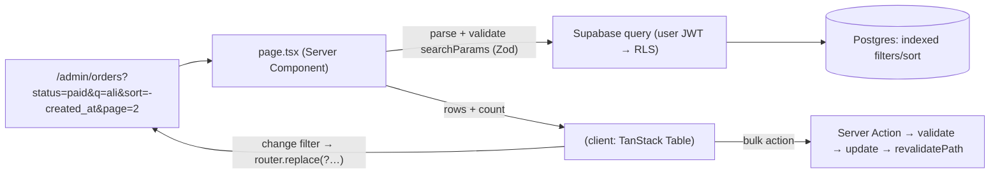

# Next.js - Admin Dashboards, Data Tables & Server-Side Filtering

> [!info] Deep dive of [[Next.js]]

> [!abstract] TL;DR
> Back-office screens (orders, customers, bookings) are most of what SME clients use daily. A solid pattern:
> - **URL as state**: filters, sort and page live in `searchParams`, so views are shareable, bookmarkable and survive refresh. `nuqs` gives typed hooks.
> - **Server Components fetch** the current page with **server-side filtering/sorting/pagination**, using offset for small tables and **keyset** for large ones, through a **user-scoped Supabase client** so RLS applies.
> - **Client table** (TanStack Table + shadcn/ui) handles only rendering, column visibility and row selection.
> - **Mutations** via Server Actions with validation and `revalidatePath`.
> - **Exports and bulk ops** over a few thousand rows go to a **background job**.

## Concept
| Concern | Recommended approach | Avoid |
|---|---|---|
| State (filters/sort/page) | URL `searchParams` (nuqs) | `useState` only (lost on refresh, not shareable) |
| Data fetching | Server Component per page request | Fetch-all then filter on the client |
| Pagination | Offset ≤ ~10k rows. Keyset beyond | `OFFSET 200000` |
| Total counts | `count: 'estimated'` or capped counts on big tables | `count(*)` on every keystroke |
| Search | `ilike` + trigram index, or FTS | Unindexed `%term%` scans |
| Table UI | TanStack Table headless + shadcn/ui | Heavy grid libs for simple lists |
| Mutations | Server Actions + Zod + revalidate | Client-side Supabase writes with service role |
| Exports | Streamed CSV route or background job | Building 100k-row CSV in memory |
| Authorization | RLS + role checks in actions | Hiding buttons as "security" |

## How It Works


## Practical Usage
**Validate `searchParams` in the page** (Next.js 15+/16: `searchParams` is a Promise):
```tsx
// app/admin/orders/page.tsx
import { z } from "zod";
const Params = z.object({
  q: z.string().trim().max(100).optional(),
  status: z.enum(["pending", "paid", "shipped", "cancelled"]).optional(),
  sort: z.enum(["created_at", "-created_at", "total", "-total"]).default("-created_at"),
  page: z.coerce.number().int().min(1).max(500).default(1),
});

export default async function OrdersPage({ searchParams }: { searchParams: Promise<Record<string, string>> }) {
  const p = Params.parse(await searchParams);
  const { rows, count } = await listOrders(p);
  return <OrdersTable rows={rows} count={count} pageSize={25} />;
}
```
**Server-side query through a user-scoped client**:
```ts
export async function listOrders(p: z.infer<typeof Params>) {
  const supabase = await createClient();                        // @supabase/ssr, user session → RLS
  const size = 25, from = (p.page - 1) * size;
  let q = supabase.from("orders")
    .select("id, code, customer_name, status, total_cents, created_at", { count: "estimated" });
  if (p.status) q = q.eq("status", p.status);
  if (p.q) q = q.or(`code.ilike.%${p.q}%,customer_name.ilike.%${p.q}%`);   // ensure Zod limits chars
  const desc = p.sort.startsWith("-");
  q = q.order(p.sort.replace("-", ""), { ascending: !desc }).range(from, from + size - 1);
  const { data, count, error } = await q;
  if (error) throw error;
  return { rows: data, count: count ?? 0 };
}
```
**Typed URL state on the client** (nuqs):
```tsx
"use client";
import { useQueryState, parseAsInteger, parseAsStringEnum } from "nuqs";
export function StatusFilter() {
  const [status, setStatus] = useQueryState("status",
    parseAsStringEnum(["pending", "paid", "shipped", "cancelled"]).withOptions({ shallow: false }));
  const [, setPage] = useQueryState("page", parseAsInteger.withDefault(1));
  return <Select value={status ?? ""} onValueChange={(v) => { setStatus(v || null); setPage(1); }} />;
}
```
**Keyset pagination for big tables** (stable ordering with a tiebreaker):
```sql
select id, code, created_at from orders
where tenant_id = $1 and (created_at, id) < ($2, $3)       -- cursor from last row
order by created_at desc, id desc limit 25;
-- index: create index on orders (tenant_id, created_at desc, id desc);
```
**Bulk action via Server Action**:
```ts
"use server";
export async function markShipped(ids: unknown) {
  const parsed = z.array(z.coerce.number().int()).min(1).max(200).parse(ids);
  const supabase = await createClient();
  await requireRole(supabase, ["admin", "ops"]);
  const { error } = await supabase.from("orders").update({ status: "shipped" }).in("id", parsed);
  if (error) throw new Error("bulk_update_failed");
  revalidatePath("/admin/orders");
}
```
**Streamed CSV export** (route handler, moderate sizes; huge exports → background job):
```ts
export async function GET(req: Request) {
  const supabase = await createClient();
  const stream = new ReadableStream({
    async start(c) {
      c.enqueue("code,customer,status,total\n");
      for (let from = 0; ; from += 1000) {
        const { data } = await supabase.from("orders").select("code,customer_name,status,total_cents")
          .order("id").range(from, from + 999);
        if (!data?.length) break;
        for (const r of data) c.enqueue(`${r.code},"${r.customer_name.replace(/"/g, '""')}",${r.status},${r.total_cents / 100}\n`);
      }
      c.close();
    },
  });
  return new Response(stream, { headers: { "content-type": "text/csv", "content-disposition": "attachment; filename=orders.csv" } });
}
```
**Wrong way**:
```text
❌ select * from orders → client-side filter in the browser   → slow, leaks all tenant data the role can read
❌ Service-role client in admin pages                          → RLS bypassed; any bug = cross-tenant exposure
❌ Exact count(*) with every filter change on 2M rows           → seconds per request
❌ CSV cells starting with = + - @ unescaped                   → CSV/formula injection in Excel
```

## Patterns & Anti-patterns
| Pattern | When | Anti-pattern to avoid |
|---|---|---|
| URL-driven filters, reset page on filter change | All list views | Filters in local state only |
| Composite indexes matching filter + sort | Hot list queries | Indexes on single columns only ([[PostgreSQL - Indexing]]) |
| Debounced search (300 ms) | Search boxes | Query per keystroke |
| Saved views (`?status=paid&sort=-total`) as links | Ops teams | Re-applying filters manually daily |
| Row actions + confirm dialogs for destructive ops | Admin UX | One-click deletes |
| Audit log on admin mutations | Back office | No record of who changed what |
| Background export with email/link | > ~10k rows | Timeout-prone synchronous exports |

## Performance & Trade-offs
- **RSC per filter change** means a server round trip each time. That's fine for admin use. Add `loading.tsx`/Suspense skeletons and `useTransition` for responsiveness.
- **Offset vs keyset**: offset allows "jump to page 37" but degrades with depth. Keyset is constant-time but next/prev only. Admin tables usually tolerate offset up to a few hundred pages.
- **Counts**: `estimated` uses planner stats (fast, approximate). Show "~12,400 results" on large tables.
- **Client bundle**: TanStack Table is headless and small. Avoid shipping heavy grid packages unless you need spreadsheet-like editing.

## Tips & Reminders
> [!tip] In ZP's stack
> - **Scaffold once, reuse per client**: an `AdminTable` kit (URL state, filters, pagination, export, bulk actions) in a shared package cuts each new back office to schema + columns ([[Git - Monorepo Workflows with pnpm & Turborepo]]).
> - **Consider build vs buy**: for internal-only CRUD with no custom logic, a tool like Appsmith/NocoDB on top of Postgres may be cheaper than a bespoke Next.js admin. Bespoke wins when workflows, branding or client-facing portals matter.
> - **Malaysian formats**: RM currency with `Intl.NumberFormat('ms-MY', { style: 'currency', currency: 'MYR' })`, dates in `Asia/Kuala_Lumpur`.

- Escape CSV cells beginning with `= + - @` (prefix `'`) to prevent formula injection.
- Keep column definitions typed from generated Supabase types.
- Paginate on the server even for "small" tables. Clients' data grows.
- Log admin exports. Bulk personal-data downloads are a PDPA concern.

## Version Notes
| Version | Change relevant here |
|---|---|
| Next.js 13.4 | App Router stable, Server Components fetching |
| Next.js 15 (2024-10) | `searchParams`/`params` became Promises (async) |
| Next.js 16 (2025) | Cache Components / `use cache`. Dynamic by default for request data ([[Next.js - App Router & Rendering Strategies]]) |
| TanStack Table v8 | Headless table, server-side modes (`manualPagination`, `manualSorting`) |
| nuqs 2.x | Typed URL state, App Router adapter |

> [!warning] Unverified — check before relying on this
> Current nuqs major version and its Next.js 16 adapter details weren't verified this run. Check https://nuqs.dev and the Next.js `searchParams` docs.

## Critical Issues & Gotchas
> [!danger] Admin panels built on the service role
> It's tempting to use the service-role key "because it's internal". Then any IDOR, missing tenant filter or compromised staff account exposes every tenant's data, with RLS bypassed. Use a user-scoped client with RLS and role claims, and reserve the service role for narrowly scoped server jobs ([[Supabase - Row Level Security]]).

> [!danger] Injection through filter parameters
> Building PostgREST `or()` filters or raw SQL from unvalidated `searchParams` allows filter injection (e.g. adding `,tenant_id.neq.x`) or SQL injection in RPCs. Validate with Zod enums/regex, whitelist sortable columns, and escape characters that are special in PostgREST filter syntax.

- **Stale data after mutations**: forgetting `revalidatePath`/`revalidateTag` shows old rows until refresh.
- **Timezone bugs in date filters**: "today" in UTC vs MYT drops evening orders. Convert ranges to `Asia/Kuala_Lumpur`.
- **Selection across pages**: bulk actions on "all matching" need a server-side query, not just the visible IDs.
- **Large `in()` lists** in URLs hit length limits. Cap bulk sizes and send IDs in the action body.

## Related
- [[Next.js]]
- [[Next.js - App Router & Rendering Strategies]] — Server Components and dynamic rendering
- [[Next.js - Server Actions, Mutations & Security]] — validated mutations
- [[REST API - Versioning, Pagination & Error Design]] — pagination strategies
- [[PostgreSQL - Indexing]] — indexes behind fast filters
- [[Next.js - Background Jobs, Cron & Long-Running Tasks]] — large exports and bulk jobs

## References
- https://nextjs.org/docs/app/api-reference/file-conventions/page
- https://tanstack.com/table/latest/docs/guide/pagination
- https://nuqs.dev/docs
- https://ui.shadcn.com/docs/components/data-table
- https://supabase.com/docs/reference/javascript/using-filters
