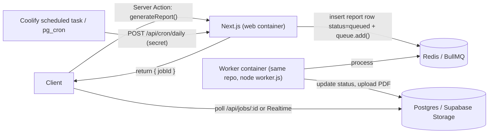

# Next.js - Background Jobs, Cron & Long-Running Tasks

> [!info] Deep dive of [[Next.js]]

> [!abstract] TL;DR
> Next.js request handlers (Server Actions, route handlers) are for **short work**. Anything slow, retryable or scheduled goes elsewhere:
> - **`after()`**: fire-and-forget work after the response (logging, analytics, cache warm). Same process, **no retries, no durability**.
> - **Job queue + worker** (BullMQ on Redis, or pgmq on Postgres): durable, retried, rate-limited jobs (emails, PDFs, AI calls, WhatsApp sends). The worker runs as a **separate container** from the same repo.
> - **Scheduled jobs**: system cron/Coolify scheduled tasks hitting a protected route, `pg_cron`, or BullMQ repeatable jobs. Avoid `setInterval` inside the Next.js server.
> - **Workflows with humans/integrations**: hand off to [[n8n]] via a signed webhook.
>
> Rule: the request **enqueues and returns a job ID**, and the UI polls or subscribes for status.

## Concept
| Mechanism | Durability | Retries | Duration | Pick it when… |
|---|---|---|---|---|
| Inline in Server Action | Request lifetime | ❌ | Seconds | Fast DB writes |
| `after()` | ❌ (lost on crash/redeploy) | ❌ | Short. Bounded by platform limits | Logs, analytics, non-critical side effects |
| BullMQ worker (Redis) | ✅ (Redis persistence) | ✅ backoff | Minutes–hours | Emails, PDFs, AI, imports |
| pgmq / outbox (Postgres) | ✅ transactional | ✅ visibility timeout | Minutes | Supabase-centric apps, exactly-tied-to-commit jobs |
| Supabase Edge Function + cron | ✅ via queue | Partial | Short (CPU/wall limits) | Light serverless jobs ([[Supabase - Edge Functions, Cron & Queues]]) |
| n8n workflow | ✅ executions | ✅ per node | Long, with waits | Integrations, approvals, multi-step business flows |
| Vercel Cron + Functions | Platform | ❌ (build your own) | Plan max duration | Vercel-hosted apps only |

## How It Works


## Practical Usage
**`after()` for non-critical follow-up work**:
```ts
import { after } from "next/server";

export async function POST(req: Request) {
  const order = await createOrder(await req.json());
  after(async () => {
    await track("order_created", { id: order.id });    // if this fails, nobody retries — acceptable for analytics
  });
  return Response.json({ id: order.id });
}
```
**Shared queue definition** (`lib/queues.ts`):
```ts
import { Queue } from "bullmq";
import IORedis from "ioredis";
export const connection = new IORedis(process.env.REDIS_URL!, { maxRetriesPerRequest: null });
export const reportQueue = new Queue("reports", {
  connection,
  defaultJobOptions: { attempts: 5, backoff: { type: "exponential", delay: 10_000 }, removeOnComplete: 1000, removeOnFail: 5000 },
});
```
**Enqueue from a Server Action and return the job ID**:
```ts
"use server";
export async function requestReport(input: unknown) {
  const { month } = ReportInput.parse(input);
  const user = await requireUser();
  const report = await db.reports.insert({ tenantId: user.tenantId, month, status: "queued" });
  await reportQueue.add("monthly", { reportId: report.id }, { jobId: `report:${report.id}` });  // idempotent
  return { reportId: report.id };
}
```
**Worker entrypoint** (`worker.ts`, separate container, same image):
```ts
import { Worker } from "bullmq";
import { connection } from "./lib/queues";

const worker = new Worker("reports", async (job) => {
  await db.reports.update(job.data.reportId, { status: "running" });
  const pdf = await renderMonthlyReport(job.data.reportId);           // slow: queries + PDF
  const url = await uploadToStorage(pdf);
  await db.reports.update(job.data.reportId, { status: "done", url });
}, { connection, concurrency: 2, limiter: { max: 10, duration: 1000 } });

worker.on("failed", (job, err) => log.error({ jobId: job?.id, err }, "report_failed"));
process.on("SIGTERM", async () => { await worker.close(); process.exit(0); });   // graceful on redeploy
```
**Protected cron route** (triggered by Coolify scheduled task, system cron or uptime pinger):
```ts
export async function POST(req: Request) {
  if (req.headers.get("authorization") !== `Bearer ${process.env.CRON_SECRET}`) return new Response(null, { status: 401 });
  await reportQueue.add("daily-digest", {}, { jobId: `digest:${new Date().toISOString().slice(0, 10)}` });  // one per day
  return Response.json({ queued: true });
}
```
```bash
# Coolify scheduled task (or host crontab), MYT 07:00 = 23:00 UTC
curl -fsS -X POST -H "Authorization: Bearer $CRON_SECRET" https://app.client.my/api/cron/daily
```
**Wrong way**:
```ts
// ❌ Long AI/PDF work inside a Server Action: timeouts, double-submits, lost work on redeploy
export async function generate() { const pdf = await renderHuge(); await sendEmail(pdf); }

// ❌ setInterval in instrumentation.ts / server module: runs once per instance, dies on redeploy, duplicates when scaled
setInterval(syncCrm, 60_000);

// ❌ after() for payment fulfilment: crash between response and after() = paid but never fulfilled
```

## Patterns & Anti-patterns
| Pattern | When | Anti-pattern to avoid |
|---|---|---|
| Enqueue + return job ID + status row | Anything > ~2 s | Spinners waiting on long requests |
| Deterministic `jobId` (e.g. `report:123`) | Double-clicks, retries | Duplicate jobs per click |
| Worker = same repo, separate process/container | Self-hosted on Coolify | Workers inside the web server process |
| Cron triggers enqueue only | Scheduled work | Cron route doing the heavy work inline |
| Graceful shutdown (`worker.close()`) | Redeploys | Killing jobs mid-run without retry |
| Status via polling or Supabase Realtime | UI feedback | Leaving users guessing |
| n8n for cross-system workflows | CRM/WhatsApp/approvals | Re-implementing workflow engines in code |

## Performance & Trade-offs
- **Separate worker container** doubles deploy units but isolates CPU-heavy jobs (PDF, image, AI parsing) from web latency. Size worker concurrency to CPU and RAM.
- **Redis dependency**: BullMQ needs `maxmemory-policy noeviction` and persistence (AOF). An evicting cache Redis loses jobs ([[Message Queues - BullMQ in Production]]).
- **pgmq instead of Redis**: one less service on small projects and transactional enqueue, but lower throughput and more Postgres load.
- **Serverless hosts** (Vercel) cap function duration and have no long-running workers. Use an external queue/worker service or n8n for heavy jobs.

## Tips & Reminders
> [!tip] In ZP's stack
> - **Coolify**: deploy the same image twice: web (`node server.js`) and worker (`node worker.js`, no domain). Both share env vars. Add the worker to the same Docker network as Redis ([[Next.js - Self-Hosting, Standalone Builds & ISR on Coolify]]).
> - **WhatsApp/AI tasks**: enqueue per message with per-tenant rate limits (BullMQ `limiter` or group keys) to respect Meta and LLM rate limits.
> - **Choose n8n vs code**: client-editable business logic and integrations go in n8n. Core product logic (billing, reports, data processing) goes in code workers with tests.

- Store job status in Postgres (source of truth). Redis job state is transient (`removeOnComplete`).
- Set `CRON_SECRET` per environment, and never expose cron routes without auth.
- Use `Asia/Kuala_Lumpur` in scheduling logic, and convert cron schedules to UTC on servers.
- Bull Board or a small admin page for failed jobs + retry button saves support time.

## Version Notes
| Version | Change relevant here |
|---|---|
| Next.js 15.0 (2024-10) | `unstable_after` |
| Next.js 15.1 (2024-12) | `after()` stable |
| Next.js 16 (2025) | Cache Components/`use cache`, `proxy.ts` replaces middleware naming. Background job patterns unchanged |
| BullMQ 5.x | Job schedulers (replacing repeatable jobs API), flows, groups (Pro) |

> [!warning] Unverified — check before relying on this
> Current BullMQ major/minor, the Job Scheduler API naming, and Vercel function duration limits per plan weren't verified this run. Check https://docs.bullmq.io and the Next.js `after` docs.

## Critical Issues & Gotchas
> [!danger] Work lost on redeploy or crash
> `after()` callbacks, in-memory queues and `setInterval` jobs vanish when Coolify replaces the container. Each deploy silently drops in-flight emails, invoices or WhatsApp sends. Anything with business impact must be a durable job (BullMQ with persistent Redis, pgmq, or n8n) with retries and idempotency.

> [!danger] Duplicate execution when scaled or retried
> Two web replicas each running a scheduler send every digest twice, and retried jobs can double-charge or double-message. Use a single scheduling source (one cron trigger, BullMQ job schedulers with deterministic IDs), and make handlers idempotent (unique constraints, `jobId`, idempotency keys).

- **Server Action timeouts**: reverse proxies (Traefik/Cloudflare ~100 s) cut long requests even when Node keeps working. The user retries and creates duplicates.
- **Serializing job data**: pass IDs, not full objects or secrets. Re-read from the DB in the worker.
- **Worker memory leaks** (Puppeteer/PDF libs): recycle workers periodically or run jobs in child processes.
- **Time zones**: a "daily at 9" cron on a UTC server fires at 5 pm MYT.

## Related
- [[Next.js]]
- [[Message Queues - BullMQ in Production]] — queue config, Redis requirements, monitoring
- [[Next.js - Self-Hosting, Standalone Builds & ISR on Coolify]] — web + worker deployment
- [[Next.js - Server Actions, Mutations & Security]] — what belongs in actions
- [[Supabase - Edge Functions, Cron & Queues]] — pg_cron and pgmq alternative
- [[n8n]] — workflow handoff for integrations

## References
- https://nextjs.org/docs/app/api-reference/functions/after
- https://docs.bullmq.io/
- https://docs.bullmq.io/guide/workers/graceful-shutdown
- https://coolify.io/docs/knowledge-base/cron-syntax
- https://supabase.com/docs/guides/queues
