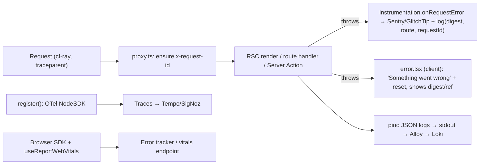

# Next.js - Error Handling, Logging & Observability

> [!info] Deep dive of [[Next.js]]

> [!abstract] TL;DR
> Three layers:
> - **Boundaries** (`error.tsx`, `global-error.tsx`, `not-found.tsx`) give users a recovery UI.
> - **Server capture** via `instrumentation.ts`: `register()` for OpenTelemetry/Sentry init and **`onRequestError`** for every server-side error with route context.
> - **Structured JSON logs** with a **request ID** propagated from Cloudflare/Traefik, shipped to Loki/Grafana or an error tracker (Sentry, or self-hosted **GlitchTip** for a lighter footprint).
>
> Expected failures are values, not exceptions ([[TypeScript - Error Handling & Result Types]]). In production, users only see a digest, so log the digest server-side to correlate. Redact PII everywhere.

## Concept
| Layer | File / API | Catches | Notes |
|---|---|---|---|
| Segment boundary | `app/**/error.tsx` (client component) | Render/data errors in that segment and below | Gets `error` (with `digest`) + `reset()`. Doesn't catch errors in the same segment's `layout.tsx` |
| Root boundary | `app/global-error.tsx` | Errors in the root layout | Must render its own `<html><body>` |
| Not found | `notFound()` + `not-found.tsx` | Missing resources | Thrown internally, so don't swallow it in `try/catch` |
| Server hook | `instrumentation.ts` → `onRequestError(err, request, context)` | Errors in RSC rendering, route handlers, Server Actions, proxy | One central place to report with route/type context |
| Init hook | `instrumentation.ts` → `register()` | — | Start OTel SDK / Sentry once per server process |
| Client errors | `window.onerror`, error tracker SDK | Event handlers, effects, hydration issues | Boundaries don't catch event-handler errors |
| Web vitals | `useReportWebVitals` | LCP/INP/CLS from real users | Send to your analytics endpoint |

**Tooling options**:

| Tool | Strength | Cost/ops | Pick it when… |
|---|---|---|---|
| Sentry (SaaS) | Best Next.js integration, source maps, replays | Paid beyond free tier | Default for client production apps |
| GlitchTip (self-hosted) | Sentry-SDK compatible, light (Postgres + Redis) | One more service | Data residency / cost-sensitive |
| Self-hosted Sentry | Full features | Very heavy (Kafka, ClickHouse, many containers) | Rarely for a solo founder |
| OpenTelemetry → Grafana Tempo/Loki or SigNoz | Vendor-neutral traces + logs | You run the backend | You already run Grafana |
| Plain JSON logs → Loki | Cheapest | Search-only, no grouping | Small apps, plus alerts on error rate |

## How It Works


## Practical Usage
**Instrumentation** (`instrumentation.ts` at the project root or `src/`):
```ts
import type { Instrumentation } from 'next';

export async function register() {
  if (process.env.NEXT_RUNTIME === 'nodejs') {
    await import('./observability/otel');          // NodeSDK with OTLP exporter, service.name = 'web'
    await import('./observability/sentry.server'); // Sentry/GlitchTip DSN init
  }
}

export const onRequestError: Instrumentation.onRequestError = async (err, request, context) => {
  const e = err as Error & { digest?: string };
  logger.error({
    err: { name: e.name, message: e.message, stack: e.stack, digest: e.digest },
    path: request.path, method: request.method,
    requestId: request.headers['x-request-id'],
    routerKind: context.routerKind, routeType: context.routeType, routePath: context.routePath,
  }, 'request_error');
  captureException(e, { tags: { route: context.routePath, type: context.routeType } });
};
```
**Structured logger with redaction**:
```ts
// lib/logger.ts
import pino from 'pino';
export const logger = pino({
  level: process.env.LOG_LEVEL ?? 'info',
  redact: { paths: ['req.headers.authorization', 'req.headers.cookie', '*.password', '*.ic', '*.phone'], censor: '[redacted]' },
  base: { service: 'web', env: process.env.APP_ENV, sha: process.env.GIT_SHA },
});
```
**Segment error boundary** (shows a reference users can send to support):
```tsx
'use client';
export default function Error({ error, reset }: { error: Error & { digest?: string }; reset: () => void }) {
  return (
    <div role="alert">
      <p>Maaf, ada masalah. Sila cuba lagi.</p>
      {error.digest && <p>Ref: {error.digest}</p>}
      <button onClick={() => reset()}>Cuba lagi</button>
    </div>
  );
}
```
**Request IDs from the edge** (`proxy.ts`):
```ts
export function proxy(req: NextRequest) {
  const id = req.headers.get('x-request-id') ?? req.headers.get('cf-ray') ?? crypto.randomUUID();
  const headers = new Headers(req.headers);
  headers.set('x-request-id', id);
  const res = NextResponse.next({ request: { headers } });
  res.headers.set('x-request-id', id);
  return res;
}
```
**Wrong way**:
```ts
try { await placeOrder(); } catch (e) { console.log(e); }       // ❌ swallowed; JSON logs show {} for Error objects
try { const p = await getProduct(id); if (!p) notFound(); } catch { /* ❌ also catches notFound/redirect throws */ }
logger.info({ body: await req.json() });                        // ❌ logs IC numbers, phones, tokens (PDPA)
```

## Patterns & Anti-patterns
| Pattern | When | Anti-pattern to avoid |
|---|---|---|
| Result values for expected failures, throw for faults | Actions, route handlers | Exceptions for "out of stock" |
| `onRequestError` as the single server error sink | All server code | Ad-hoc `captureException` in every file |
| Segment `error.tsx` near risky UI (dashboards, checkout) | App Router | Only a root error page |
| Request ID in logs, error reports and user-visible refs | Support workflows | "It broke yesterday", with nothing to search |
| JSON logs to stdout, shipped by the platform | Docker/Coolify | Log files inside containers |
| Source maps uploaded to the tracker, not served publicly | Production builds | Public source maps or unreadable minified stacks |
| Alert on rates (5xx %, error spikes), not single events | On-call (solo) | Email per error |

## Performance & Trade-offs
- **OTel overhead**: auto-instrumentation adds some CPU and memory. Sample traces (e.g. 10%, plus 100% of errors) on small VPSs.
- **Error tracker volume**: noisy errors (bots hitting `/wp-login.php`, extension-caused client errors) burn quotas. Filter and rate-limit events in the SDK `beforeSend`.
- **Session replay** (Sentry) is powerful but captures screens with personal data. Mask inputs by default, or skip it for PDPA-sensitive apps.
- **GlitchTip vs Sentry**: GlitchTip covers error grouping/alerts with far fewer resources but lacks advanced performance/replay features. That's often enough for SME apps.

## Tips & Reminders
> [!tip] In ZP's stack
> - **Per client app**: Sentry free tier or one shared self-hosted GlitchTip (projects per client), JSON logs → Alloy → Loki, and Uptime Kuma on `/api/health` ([[Docker - Logging, Metrics & Resource Limits on a VPS]]).
> - **Trace AI calls separately** in Langfuse (prompt, tokens, cost), and link them with the same request ID ([[AI Evals & Observability - Tracing & Production Monitoring with Langfuse]]).
> - **User-facing errors in BM/EN** with a reference code. Support finds the digest/request ID in logs in seconds.

- Log `GIT_SHA` in every event so regressions map to deploys.
- Watch hydration errors after dependency upgrades. They often only show in production builds.
- Report `useReportWebVitals` to a cheap endpoint (Postgres table or Plausible-like tool) for real-user INP/LCP ([[Browser & Web Fundamentals - Core Web Vitals Optimization]]).
- Correlate with Traefik access logs via the same request ID for latency breakdowns ([[Traefik - Observability & Troubleshooting]]).

## Version Notes
| Version | Change relevant here |
|---|---|
| 13.4 | App Router `error.tsx`, `global-error.tsx`, `not-found.tsx` |
| 14 / 15 | `instrumentation.ts` stable (15). **`onRequestError`** hook (15) |
| 15 | Production Server Action/RSC errors sanitized to digests |
| 16 (2025-10) | `middleware.ts` → `proxy.ts`. Instrumentation unchanged |

> [!warning] Unverified — check before relying on this
> The exact `onRequestError` context fields across 16.x minors and current Sentry/GlitchTip SDK setup steps weren't verified. Check https://nextjs.org/docs/app/api-reference/file-conventions/instrumentation.

## Critical Issues & Gotchas
> [!danger] Logs and error reports as a PII leak
> Request bodies, headers (cookies, `Authorization`), Server Action arguments and replay recordings end up in third-party trackers and log stores, which are often outside Malaysia and retained for months. Redact at the logger and SDK level (`beforeSend`), disable default PII collection, set retention, and list the tracker as a data processor (PDPA).

> [!danger] Swallowed errors hide data loss
> `catch {}` around writes, or boundaries that "recover" by showing stale data, can make failed payments or orders look like success. Every catch must handle, return a typed failure, or rethrow. Alert on error-rate increases after each deploy.

- **`error.tsx` doesn't catch errors in the same segment's layout**. Put a boundary one level up, or use `global-error.tsx`.
- **Event-handler and async errors** in client components bypass boundaries. Capture them with the browser SDK, and handle promise rejections.
- **Source map exposure**: `productionBrowserSourceMaps: true` publishes your source. Upload maps to the tracker privately instead.
- **Edge runtime** code paths don't run Node-only SDKs. Keep server routes on the Node runtime unless you've verified SDK support.

## Related
- [[Next.js]]
- [[TypeScript - Error Handling & Result Types]] — expected failures as values, faults as exceptions
- [[Next.js - Server Actions, Mutations & Security]] — error digests and action failures
- [[Docker - Logging, Metrics & Resource Limits on a VPS]] — log shipping and alerts
- [[AI Evals & Observability - Tracing & Production Monitoring with Langfuse]] — LLM-specific tracing
- [[Traefik - Observability & Troubleshooting]] — proxy-side logs and metrics

## References
- https://nextjs.org/docs/app/getting-started/error-handling
- https://nextjs.org/docs/app/api-reference/file-conventions/instrumentation
- https://nextjs.org/docs/app/guides/open-telemetry
- https://docs.sentry.io/platforms/javascript/guides/nextjs/
- https://glitchtip.com/documentation
