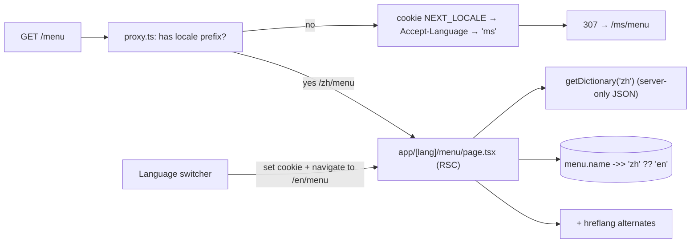

# Next.js - Internationalization & Multi-Language Routing

> [!info] Deep dive of [[Next.js]]

> [!abstract] TL;DR
> The App Router has **no built-in `i18n` config** (that was the Pages Router). The standard pattern:
> - a **`[lang]` route segment** (`/ms/…`, `/en/…`, `/zh/…`);
> - **locale detection in `proxy.ts`** (cookie → `Accept-Language` → default `ms`) that redirects bare paths;
> - **server-loaded dictionaries** (or `next-intl`) used in Server Components;
> - **`Intl` APIs** for RM, dates and plurals, and **hreflang** alternates for SEO.
>
> Keep UI strings in message files and catalog content in the DB (`jsonb` per locale). Use the same message codes as the Flutter app.

## Concept
| Concern | Approach | Notes |
|---|---|---|
| URL strategy | Locale prefix (`/ms/menu`) | Best for SEO and shareable links. Domains (`.my` vs `.com`) are possible via proxy |
| Detection | `proxy.ts`: cookie `NEXT_LOCALE` → `Accept-Language` → default | Only on first visit, and never override an explicit URL locale |
| Messages | JSON dictionaries per locale, loaded server-side | `server-only` import keeps unused locales out of client bundles |
| Library | `next-intl` (RSC support, ICU messages, typed keys) or plain dictionaries | Plain JSON is enough for small sites |
| Formatting | `Intl.NumberFormat('ms-MY', { style: 'currency', currency: 'MYR' })`, `Intl.DateTimeFormat`, `Intl.PluralRules` | Time zone `Asia/Kuala_Lumpur` |
| Static generation | `generateStaticParams` returns all locales | ISR/caching keyed by locale |
| SEO | `alternates.languages` + `x-default` | See [[Next.js - Metadata, SEO & Image Optimization]] |
| DB content | `name jsonb {"ms","en","zh"}` + fallback chain | Not in message files |

## How It Works


## Practical Usage
**Locale config and detection** (`proxy.ts`):
```ts
import { NextResponse, type NextRequest } from 'next/server';
export const locales = ['ms', 'en', 'zh'] as const;
export type Locale = (typeof locales)[number];
const defaultLocale: Locale = 'ms';

function detect(req: NextRequest): Locale {
  const cookie = req.cookies.get('NEXT_LOCALE')?.value as Locale | undefined;
  if (cookie && locales.includes(cookie)) return cookie;
  const header = req.headers.get('accept-language') ?? '';
  for (const part of header.split(',')) {
    const tag = part.split(';')[0].trim().toLowerCase();
    if (tag.startsWith('zh')) return 'zh';
    if (tag.startsWith('en')) return 'en';
    if (tag.startsWith('ms') || tag.startsWith('id')) return 'ms';
  }
  return defaultLocale;
}

export function proxy(req: NextRequest) {
  const { pathname } = req.nextUrl;
  if (locales.some((l) => pathname === `/${l}` || pathname.startsWith(`/${l}/`))) return NextResponse.next();
  const url = req.nextUrl.clone();
  url.pathname = `/${detect(req)}${pathname}`;
  return NextResponse.redirect(url);
}
export const config = { matcher: ['/((?!api|_next|.*\\..*).*)'] };
```
**Server-side dictionaries**:
```ts
// app/[lang]/dictionaries.ts
import 'server-only';
const dictionaries = {
  ms: () => import('./dictionaries/ms.json').then((m) => m.default),
  en: () => import('./dictionaries/en.json').then((m) => m.default),
  zh: () => import('./dictionaries/zh.json').then((m) => m.default),
};
export const getDictionary = (l: Locale) => dictionaries[l]();
```
**Page and layout**:
```tsx
// app/[lang]/layout.tsx
export function generateStaticParams() { return locales.map((lang) => ({ lang })); }
export default async function Layout({ children, params }: { children: React.ReactNode; params: Promise<{ lang: Locale }> }) {
  const { lang } = await params;
  const htmlLang = { ms: 'ms-MY', en: 'en-MY', zh: 'zh-Hans-MY' }[lang];
  return <html lang={htmlLang}><body>{children}</body></html>;
}

// app/[lang]/menu/page.tsx
export default async function Menu({ params }: { params: Promise<{ lang: Locale }> }) {
  const { lang } = await params;
  const t = await getDictionary(lang);
  const items = await getMenu();                                       // name: { ms, en, zh }
  const rm = new Intl.NumberFormat('ms-MY', { style: 'currency', currency: 'MYR' });
  return (
    <main>
      <h1>{t.menu.title}</h1>
      {items.map((i) => <p key={i.id}>{i.name[lang] ?? i.name.en} — {rm.format(i.priceCents / 100)}</p>)}
    </main>
  );
}
```
**Language switcher** (keeps the current path, persists choice):
```tsx
'use client';
export function LangSwitch({ lang, pathname }: { lang: Locale; pathname: string }) {
  return locales.map((l) => (
    <a key={l} href={pathname.replace(`/${lang}`, `/${l}`)} hrefLang={l}
       onClick={() => { document.cookie = `NEXT_LOCALE=${l}; path=/; max-age=31536000; samesite=lax`; }}>
      {l.toUpperCase()}
    </a>
  ));
}
```
**Wrong way**:
```text
❌ Language stored only in a cookie, same URL for all languages → Google indexes one language; links show the wrong language
❌ Importing all dictionaries in a client component             → every locale shipped to every visitor
❌ Redirecting based on Accept-Language on every request        → users can't open /en links shared by others
❌ Hand-formatted prices ("RM" + price.toFixed(2))              → wrong grouping; breaks with locales and large numbers
```

## Patterns & Anti-patterns
| Pattern | When | Anti-pattern to avoid |
|---|---|---|
| Locale prefix for all public pages | SEO-relevant sites | Cookie-only or IP-based language |
| Detect only when no locale in URL | First visit | Forced redirects overriding user choice |
| Server-loaded dictionaries / next-intl with RSC | App Router | Client-side i18n libraries loading all messages |
| Message keys/codes shared with Flutter and API errors | Multi-platform products | Different wording and codes per platform |
| DB `jsonb` per locale with `en` fallback | Catalogs, menus, CMS content | Translating dynamic content in message files |
| Cache keys and tags include locale | ISR/`'use cache'` | One cached page served for all languages |
| Translated slugs only if worth the complexity | Content-heavy SEO | Translated slugs without redirects/canonical rules |

## Performance & Trade-offs
- **Static generation × locales** multiplies build output (3 locales × 500 pages = 1,500). Use ISR/on-demand generation for long tails.
- **Bundle size**: server-only dictionaries keep client JS small. Pass only needed strings to client components as props.
- **next-intl vs DIY**: next-intl gives ICU plurals/selects, typed keys and formatting helpers (worth it for apps). DIY JSON is enough for marketing sites with a few dozen strings.
- **Caching**: each locale is a separate cache entry. Tag by locale and entity (`menu:t42:zh`) for precise purges ([[Next.js - Caching]], [[Cloudflare - Caching Rules, CDN & Cache Purging]]).

## Tips & Reminders
> [!tip] In ZP's stack
> - **Default `ms` with `en` and `zh`** for Malaysian SME sites, with the language switcher visible in the header. Many customers browse in English but order in BM or Chinese.
> - **One message catalogue source**: keep `ms/en/zh` JSON in a shared package. Convert to Flutter ARB in CI, so web and app copy stay identical ([[Flutter - Internationalization & Localization]]).
> - **Supabase content**: `jsonb` translations with a check that `en` exists. An RPC/view returns the right locale with a fallback ([[PostgreSQL - JSONB Patterns & Full-Text Search]]).

- Set `<html lang>` correctly for screen readers and search engines (`ms-MY`, `en-MY`, `zh-Hans-MY`).
- PDPA notices and consent text must exist in Malay and English. Put them through the same pipeline and legal review.
- Translate transactional emails and WhatsApp templates per user locale on the server, too.
- Test long BM strings in buttons/nav at mobile widths. They're often 20–30% longer than English.

## Version Notes
| Version | Change relevant here |
|---|---|
| Pages Router (10+) | Built-in `i18n` config (locales, defaultLocale, domains) |
| App Router (13.4+) | No built-in i18n routing. `[lang]` segment + middleware/proxy pattern, `generateStaticParams` |
| 15 | Async `params` (await in pages/layouts/metadata) |
| 16 (2025-10) | `middleware.ts` renamed `proxy.ts`. Same i18n pattern |

> [!warning] Unverified — check before relying on this
> Current `next-intl` version/API for Next.js 16 and any new official i18n helpers weren't checked. See https://nextjs.org/docs/app/guides/internationalization and the next-intl docs.

## Critical Issues & Gotchas
> [!danger] Wrong-language caching and leaks
> If cache keys or CDN rules ignore the locale (or the cookie-based variant), users get pages in random languages, and personalized variants can leak between users. Keep the locale in the URL path, include it in cache tags/keys, and never vary cached HTML on cookies at the edge.

> [!danger] Redirect loops and broken shared links
> Over-eager proxy logic (redirect on every request, or matching static assets/API routes) causes loops, breaks `/api` and images, or forces users away from the language in a link they were sent. Redirect only when the path lacks a locale, and exclude `api`, `_next` and file paths in the matcher.

- **Missing translations** silently fall back to keys or English. Add a CI check that all locale files contain the same keys.
- **Mixed-script search**: product search must handle BM, English and Chinese queries (trigram for Chinese).
- **Dates in UTC vs MYT**: render with `timeZone: 'Asia/Kuala_Lumpur'`, or server/client hydration mismatches appear around midnight UTC.
- **`Accept-Language` from crawlers** is often English. Rely on hreflang, not detection, for indexing.

## Related
- [[Next.js]]
- [[Next.js - Metadata, SEO & Image Optimization]] — hreflang, localized metadata, sitemaps
- [[Next.js - Middleware, Auth & Multi-Tenant Routing]] — proxy.ts composition with auth/tenants
- [[Flutter - Internationalization & Localization]] — shared message catalogues with the app
- [[Next.js - Caching]] — locale-aware cache keys and tags
- [[PostgreSQL - JSONB Patterns & Full-Text Search]] — translated content in the DB

## References
- https://nextjs.org/docs/app/guides/internationalization
- https://next-intl.dev/docs/getting-started/app-router
- https://developer.mozilla.org/en-US/docs/Web/JavaScript/Reference/Global_Objects/Intl
- https://developers.google.com/search/docs/specialty/international/localized-versions
- https://nextjs.org/docs/app/api-reference/file-conventions/proxy
