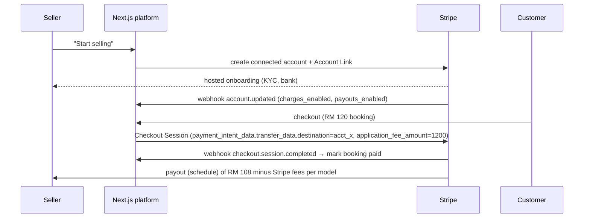

# Next.js - Marketplace Payments with Stripe Connect

> [!info] Deep dive of [[Next.js]]

> [!abstract] TL;DR
> A marketplace or multi-merchant platform (booking marketplace, food ordering for many outlets, tutor platform) needs to take customer payments, **pay out to sellers**, and keep a **platform fee**. **Stripe Connect** handles seller onboarding (KYC), split payments, payouts, and tax/1099-style reporting where applicable.
> - **Charge types**:
>   - **destination charges**: platform is merchant of record, transfers to seller, keeps an application fee. Simplest for most marketplaces.
>   - **direct charges**: seller is merchant of record, platform takes a fee. Good for SaaS-for-merchants.
>   - **separate charges & transfers**: one payment split to many sellers, e.g. a cart with several shops.
> - **Liability**: whoever is merchant of record bears refunds, disputes and negative balances. Design for it explicitly.
> - **Malaysia**: confirm Connect availability and supported payment methods (cards, FPX, GrabPay) for Malaysian platforms and connected accounts. Local gateways rarely offer true split payouts, so you may end up collecting centrally and paying out manually, with licensing implications.

## Concept
| Concept | Meaning | Notes |
|---|---|---|
| Platform account | Your Stripe account | Holds fees, controls onboarding |
| Connected account | Seller/merchant account | KYC via Stripe-hosted or embedded onboarding |
| Controller properties | Who handles fees, losses, dashboard access | Replaces Standard/Express/Custom labels in newer APIs |
| Destination charge | Charge on platform, `transfer_data.destination` = seller | Platform liable for disputes by default |
| Direct charge | Charge created on seller account (`Stripe-Account` header) | Seller liable. Platform fee via `application_fee_amount` |
| Separate charges & transfers | Charge once, `transfers.create` to several sellers | Multi-seller carts. Transfer group |
| Application fee | Platform's cut | Fixed or % per charge |
| Payouts | Connected account → seller bank | Schedule per account. Delays for new accounts |

**Choosing a charge type**:

| Model | Charge type |
|---|---|
| Customers buy from "the platform" (marketplace brand) | Destination charges |
| SaaS where each merchant sells under own brand | Direct charges |
| Cart with items from multiple sellers | Separate charges & transfers |

## How It Works


## Practical Usage
**Create connected account + onboarding link** (Server Action):
```ts
"use server";
export async function startSellerOnboarding() {
  const { seller } = await requireSeller();
  const account = seller.stripeAccountId
    ? { id: seller.stripeAccountId }
    : await stripe.accounts.create({
        country: "MY", email: seller.email,
        controller: { fees: { payer: "application" }, losses: { payments: "application" }, stripe_dashboard: { type: "express" } },
        capabilities: { card_payments: { requested: true }, transfers: { requested: true } },
        metadata: { seller_id: seller.id },
      });
  if (!seller.stripeAccountId) await db.sellers.update(seller.id, { stripeAccountId: account.id });
  const link = await stripe.accountLinks.create({
    account: account.id, type: "account_onboarding",
    refresh_url: `${APP_URL}/seller/onboarding?refresh=1`, return_url: `${APP_URL}/seller/onboarding/done`,
  });
  redirect(link.url);
}
```
**Destination charge with platform fee**:
```ts
const session = await stripe.checkout.sessions.create({
  mode: "payment",
  line_items: [{ price_data: { currency: "myr", unit_amount: 12000, product_data: { name: "Haircut – Kedai ABC" } }, quantity: 1 }],
  payment_intent_data: {
    application_fee_amount: 1200,                       // 10% platform fee in sen
    transfer_data: { destination: seller.stripeAccountId },
    metadata: { booking_id: booking.id, seller_id: seller.id },
  },
  success_url: `${APP_URL}/bookings/${booking.id}?paid=1`,
  cancel_url: `${APP_URL}/bookings/${booking.id}`,
});
```
**Multi-seller cart** (separate charges & transfers):
```ts
// after payment_intent.succeeded for the whole cart
for (const line of cart.sellers) {
  await stripe.transfers.create(
    { amount: line.amountCents - line.feeCents, currency: "myr", destination: line.stripeAccountId,
      transfer_group: `order_${order.id}`, source_transaction: chargeId },
    { idempotencyKey: `transfer-${order.id}-${line.sellerId}` });
}
```
**Gate selling on account status** (webhook `account.updated`):
```ts
if (event.type === "account.updated") {
  const a = event.data.object as Stripe.Account;
  await db.sellers.updateByStripe(a.id, { chargesEnabled: a.charges_enabled, payoutsEnabled: a.payouts_enabled,
    requirementsDue: a.requirements?.currently_due ?? [] });
}
```
**Wrong way**:
```text
❌ Collecting all money in your own bank account and paying sellers manually → may require payment/e-money licensing; reconciliation hell
❌ Listing sellers before charges_enabled                                   → failed checkouts
❌ Transfers without idempotency keys                                       → double payouts on retries
❌ Ignoring disputes on destination charges                                 → platform absorbs chargebacks and fees
```

## Patterns & Anti-patterns
| Pattern | When | Anti-pattern to avoid |
|---|---|---|
| Hosted/embedded onboarding (Account Links / embedded components) | Seller KYC | Building your own KYC forms |
| Webhook-driven seller status + order state | Always | Polling or trusting redirects |
| Idempotent transfers per order line | Multi-seller | Retries creating duplicate transfers |
| Refund + reverse transfer + refund application fee policy | Refunds | Platform paying refunds out of fees unknowingly |
| Ledger table of fees, transfers, refunds per order | Reconciliation | Relying on Stripe dashboard only |
| Clear seller terms (fees, payout timing, disputes) | Contracts | Ambiguous liability |

## Performance & Trade-offs
- **Destination vs direct charges**: destination is simpler for marketplaces (one integration, platform branding) but puts dispute liability on the platform. Direct shifts liability to sellers but complicates reporting.
- **Payout timing**: new connected accounts often have delayed payout schedules. Set seller expectations in onboarding.
- **Fees stack**: Stripe processing + Connect fees (per active account/payout, depending on configuration) + your application fee. Model unit economics per transaction ([[Next.js - SaaS Subscription Billing & Plan Entitlements]]).
- **Local alternatives**: Malaysian gateways may support sub-merchants or split settlement only via special agreements. Evaluate if Connect isn't available for the client's model ([[Next.js - Payments with Stripe & Malaysian Gateways]]).

## Tips & Reminders
> [!tip] In ZP's stack
> - **Before quoting a marketplace build**: confirm Stripe Connect availability for a Malaysian platform with Malaysian sellers and the required payment methods (FPX/DuitNow), the client's licensing position (Bank Negara rules on holding funds), and who handles disputes.
> - **Data model**: `sellers.stripe_account_id`, `orders.seller_id`, and a `payments_ledger` table (charge, fee, transfer, refund, dispute rows) with RLS by seller ([[Supabase - Row Level Security]]).
> - **E-invoicing**: depending on merchant-of-record setup, who issues e-invoices (platform vs seller) changes. Clarify with the client's accountant ([[n8n - MyInvois e-Invoicing Integration]]).

- Test the full lifecycle in test mode: onboarding, charge, refund, dispute, payout failure.
- Show sellers a dashboard (Express dashboard link or embedded components).
- Reconcile monthly: sum of charges = transfers + fees + refunds + balance.
- Use `transfer_group` to tie related charges/transfers for reporting.

## Version Notes
| Date | Change relevant here |
|---|---|
| 2017–2022 | Connect account types Standard/Express/Custom |
| 2024 | Controller properties (fees/losses/dashboard) model. Embedded Connect components |
| 2025–26 | Expanded embedded onboarding/dashboards. Country/payment-method availability evolving |

> [!warning] Unverified — check before relying on this
> Whether Stripe Connect supports Malaysian platforms with Malaysian connected accounts for your model, FPX/DuitNow availability on connected accounts, Connect fee schedules, and Bank Negara licensing implications weren't verified. Check Stripe's Connect country availability docs and get local legal advice.

## Critical Issues & Gotchas
> [!danger] Becoming an unlicensed payment intermediary
> Collecting customer funds into your or the client's bank account and later paying sellers can amount to operating a payment/e-money service, which needs licensing or a licensed partner in Malaysia. Use a regulated platform (Stripe Connect or a licensed local provider with split settlement), so funds flow through licensed infrastructure, and get legal confirmation for the client's model.

> [!danger] Dispute and refund losses land on the platform
> With destination charges, chargebacks, refunds and negative seller balances are debited from the platform by default. A fraudulent seller or a wave of disputes can wipe out fees and more. Define refund/dispute policies in seller terms, reverse transfers on refunds, hold reserves or delay payouts for new sellers, and monitor dispute rates.

- **Onboarding requirements change**: `requirements.currently_due` can block payouts later. Notify sellers proactively.
- **Currency**: keep MYR end-to-end to avoid FX fees on transfers.
- **Account deletion/offboarding** must settle balances first.
- **Webhooks for connected accounts** need a Connect webhook endpoint (events from connected accounts) in addition to platform events ([[REST API - Webhooks & Idempotency]]).

## Related
- [[Next.js]]
- [[Next.js - Payments with Stripe & Malaysian Gateways]] — single-merchant payments and local gateways
- [[Next.js - SaaS Subscription Billing & Plan Entitlements]] — subscriptions vs marketplace payments
- [[REST API - Webhooks & Idempotency]] — reliable webhook processing
- [[System Design - Multi-Tenant SaaS Architecture]] — tenant/seller modelling
- [[Supabase - Row Level Security]] — per-seller data isolation

## References
- https://docs.stripe.com/connect
- https://docs.stripe.com/connect/charges
- https://docs.stripe.com/connect/destination-charges
- https://docs.stripe.com/connect/separate-charges-and-transfers
- https://docs.stripe.com/connect/express-accounts
