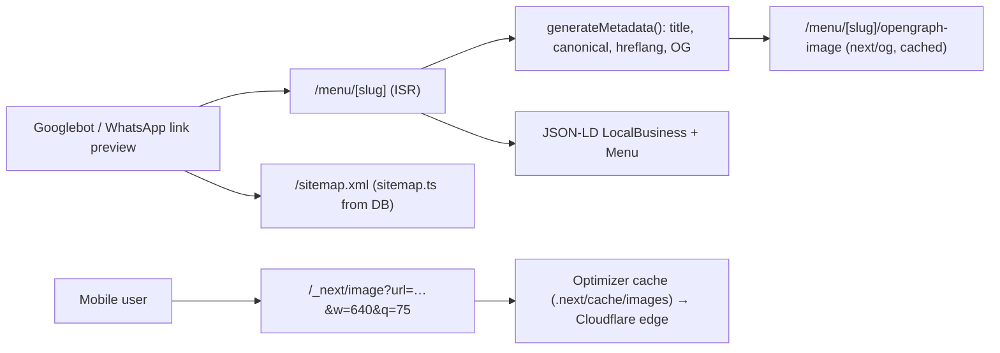

# Next.js - Metadata, SEO & Image Optimization

> [!info] Deep dive of [[Next.js]]

> [!abstract] TL;DR
> Use the **Metadata API** (`metadata` / `generateMetadata`) with a `metadataBase`, plus file conventions: **`sitemap.ts`**, **`robots.ts`**, **`opengraph-image.tsx`**, `icon`, `manifest`.
> - Add **canonical + hreflang** (`ms-MY`, `en-MY`, `zh-MY`) for multilingual sites, and **JSON-LD** (`LocalBusiness`, `Product`) for rich results.
> - **`next/image`**: set `sizes`, allow-list sources with `remotePatterns`, and know the **v16 defaults** (`qualities: [75]`, longer cache TTL, `domains` removed). Preload only the LCP image.
> - **`next/font`** self-hosts fonts with no layout shift.
> - Patch to **≥ 16.3.8**: `next/og` (CVE-2026-94545 RCE) and the image optimizer (SSRF) had 2026 security fixes.

## Concept
| Concern | Next.js feature | Output |
|---|---|---|
| Title/description/OG/Twitter | `export const metadata` / `generateMetadata()` | `<head>` tags (merged parent → child) |
| Absolute URLs | `metadataBase: new URL('https://…')` | Resolves relative OG/canonical URLs |
| Canonical + languages | `alternates: { canonical, languages }` | `<link rel="canonical">`, `hreflang` |
| Social images | `opengraph-image.tsx` with `ImageResponse` (`next/og`) | Generated PNG per route |
| Crawling | `app/sitemap.ts`, `app/robots.ts` | `/sitemap.xml`, `/robots.txt` |
| Structured data | `<script type="application/ld+json">` in the page | Rich results (local business, products, FAQ) |
| Images | `next/image` + `images` config | Resized WebP/AVIF, lazy loading, `srcset` |
| Fonts | `next/font/google` / `next/font/local` | Self-hosted, `size-adjust` fallback (no CLS) |

**`next/image` v16 settings worth knowing**:

| Setting | Behaviour | Note |
|---|---|---|
| `remotePatterns` | Allow-list of remote hosts/paths | `domains` removed |
| `localPatterns` | Needed for local `src` with query strings | New requirement |
| `qualities` | Allowed `quality` values, default `[75]` | Other values are coerced. Disallowed `q` in direct requests → 400 |
| `minimumCacheTTL` | Optimizer cache lifetime | Raised from 60 s (v15) to 4 h per Vercel KB (sources disagree) |
| `imageSizes` / `deviceSizes` | Generated widths | 16 px removed from defaults |
| `formats` | `['image/avif', 'image/webp']` | AVIF is smaller but slower to encode (CPU on your VPS) |

## How It Works


## Practical Usage
**Root defaults + per-page metadata**:
```ts
// app/layout.tsx
export const metadata: Metadata = {
  metadataBase: new URL('https://kedaiahseng.my'),
  title: { default: 'Kedai Ah Seng', template: '%s | Kedai Ah Seng' },
  openGraph: { siteName: 'Kedai Ah Seng', locale: 'ms_MY', type: 'website' },
  robots: { index: true, follow: true },
};

// app/[lang]/menu/[slug]/page.tsx
export async function generateMetadata({ params }: { params: Promise<{ lang: string; slug: string }> }): Promise<Metadata> {
  const { lang, slug } = await params;
  const item = await getMenuItem(slug);                          // cached fetch, shared with the page
  if (!item) return { title: 'Not found', robots: { index: false } };
  return {
    title: item.name[lang] ?? item.name.en,
    description: item.description[lang]?.slice(0, 155),
    alternates: {
      canonical: `/${lang}/menu/${slug}`,
      languages: { 'ms-MY': `/ms/menu/${slug}`, 'en-MY': `/en/menu/${slug}`, 'zh-MY': `/zh/menu/${slug}` },
    },
    openGraph: { images: [{ url: item.imageUrl, width: 1200, height: 630 }] },
  };
}
```
**Sitemap and robots from the database**:
```ts
// app/sitemap.ts
export default async function sitemap(): Promise<MetadataRoute.Sitemap> {
  const items = await listPublishedMenuItems();
  return items.flatMap((i) => (['ms', 'en', 'zh'] as const).map((l) => ({
    url: `https://kedaiahseng.my/${l}/menu/${i.slug}`, lastModified: i.updatedAt, changeFrequency: 'weekly', priority: 0.7,
  })));
}
// app/robots.ts
export default function robots(): MetadataRoute.Robots {
  return { rules: [{ userAgent: '*', allow: '/', disallow: ['/admin', '/api'] }], sitemap: 'https://kedaiahseng.my/sitemap.xml' };
}
```
**JSON-LD for local SEO**:
```tsx
const jsonLd = {
  '@context': 'https://schema.org', '@type': 'Restaurant', name: 'Kedai Ah Seng',
  address: { '@type': 'PostalAddress', streetAddress: 'Jalan Padungan', addressLocality: 'Kuching', addressRegion: 'Sarawak', addressCountry: 'MY' },
  telephone: '+60-82-000000', servesCuisine: ['Malaysian', 'Chinese'], priceRange: 'RM',
};
<script type="application/ld+json" dangerouslySetInnerHTML={{ __html: JSON.stringify(jsonLd).replace(/</g, '\\u003c') }} />
```
**Images and fonts**:
```tsx
<Image src={item.imageUrl} alt={item.name.ms} width={1200} height={800}
       sizes="(max-width: 768px) 100vw, 50vw" preload={isHero} />   // preload only the LCP image (older versions: priority)
// next.config.ts
images: { remotePatterns: [{ protocol: 'https', hostname: '*.supabase.co', pathname: '/storage/v1/object/public/**' }],
          qualities: [60, 75], formats: ['image/webp'] }

import { Inter } from 'next/font/google';
const inter = Inter({ subsets: ['latin'], display: 'swap', variable: '--font-inter' });
```
**Wrong way**:
```text
❌ OG image URLs relative without metadataBase      → broken WhatsApp/Facebook previews
❌ remotePatterns: [{ hostname: '**' }]              → your server becomes an open image proxy (SSRF/abuse, CPU burn)
❌ <Image> without sizes on responsive layouts      → phones download desktop-sized images
❌ preload/priority on every image                  → competes with the real LCP image
❌ One language URL, content switched by cookie     → Google indexes one language only
```

## Patterns & Anti-patterns
| Pattern | When | Anti-pattern to avoid |
|---|---|---|
| `metadataBase` + title template in the root layout | Every app | Repeating absolute URLs everywhere |
| Language-prefixed routes + hreflang | Multilingual MY sites | Cookie- or IP-based language switching for crawlers |
| `sitemap.ts` generated from published DB rows | Catalogs, menus, listings | Static sitemap forgotten after launch |
| `noindex` for previews, staging and thin pages | Non-production | Indexed preview URLs competing with production |
| Narrow `remotePatterns` (host + path) | `next/image` | Wildcard hosts |
| External image transforms (Cloudflare/Supabase) for heavy galleries | Image-heavy sites | `sharp` on a small VPS for thousands of images |
| JSON-LD matching visible content | Local business, products | Structured data that contradicts the page (manual actions) |

## Performance & Trade-offs
- **LCP** is usually the hero image: preload it, serve the right size via `sizes`, and avoid lazy-loading it ([[Browser & Web Fundamentals - Core Web Vitals Optimization]]).
- **Optimizer CPU**: first-hit resizing on a 2-vCPU KVM costs tens to hundreds of ms per image. Longer `minimumCacheTTL`, a persistent cache volume and Cloudflare caching of `/_next/image` responses cut repeats ([[Cloudflare - Caching Rules, CDN & Cache Purging]]).
- **AVIF vs WebP**: AVIF is ~20% smaller but much slower to encode. WebP-only is a sane default for self-hosting.
- **`generateMetadata` data fetching** shares the request's cached fetch with the page (dedupe). Avoid separate uncached DB calls that double latency.
- **OG image generation** is CPU work too. Cache the routes (static or ISR), and keep fonts/assets small.

## Tips & Reminders
> [!tip] In ZP's stack
> - **SME websites**: JSON-LD `LocalBusiness`/`Restaurant` with address, WhatsApp number and hours, a Google Business Profile link, and an `ms-MY` primary locale. That's quick local-SEO wins clients notice.
> - **WhatsApp link previews** use OG tags. Test every shared URL with the Facebook Sharing Debugger before launch.
> - **Images from Supabase Storage**: narrow `remotePatterns` to the public bucket path, or use Supabase/Cloudflare transforms and plain `` with `srcset` ([[Supabase - Storage, Uploads & Image Transformations]]).

- Add `robots: { index: false }` via env for staging/preview builds, and check `X-Robots-Tag` at the proxy too ([[Coolify - Preview Deployments, Environments & Secrets]]).
- Keep titles ≤ ~60 chars and descriptions ≤ ~155 chars per language. BM strings run longer.
- Submit the sitemap in Google Search Console, and monitor "Page indexing" after launches.
- For content-heavy marketing sites with little interactivity, Astro may be lighter ([[Astro - Content Sites, SEO & Cloudflare Deployment]]).

## Version Notes
| Version | Change relevant here |
|---|---|
| 13.2 | Metadata API, file-based metadata (`opengraph-image`, `sitemap`, `robots`) |
| 14 | `next/og` built in (was `@vercel/og`). Viewport split into `generateViewport` |
| 15 | Async `params` in `generateMetadata`. Streaming metadata (15.2+) |
| 16 (2025-10) | `next/image`: `qualities` default `[75]`, `localPatterns` for query strings, `domains` removed, `minimumCacheTTL` default raised, 16 px removed from `imageSizes` |
| 16.3.6 / 16.3.8 (2026-09) | CVE-2026-94545 (`next/og` RCE) fixed. Image Optimization SSRF + cache issues fixed in 16.3.8 / 15.5.27 ([[Next.js]]) |

> [!warning] Unverified — check before relying on this
> The `minimumCacheTTL` default (4 h per Vercel KB vs 1 year in another source) and whether `priority` was renamed to `preload` in v16 weren't confirmed. Check https://nextjs.org/docs/app/guides/upgrading/version-16.

## Critical Issues & Gotchas
> [!danger] Image optimizer and OG generation as attack surface
> `/_next/image` fetches remote URLs on your server, and `next/og` renders untrusted text into SVG/PNG. 2026 brought an `next/og` RCE (CVE-2026-94545) and an image-optimizer SSRF. Keep Next.js ≥ 16.3.8, use narrow `remotePatterns`, don't render raw user input in OG images without escaping/length limits, and rate-limit these routes at Cloudflare.

> [!danger] Indexed staging and preview sites
> Preview deployments without `noindex` get crawled (links in WhatsApp groups, sitemaps pointing at wrong hosts). Duplicate content then outranks or confuses the real site, and unfinished pages appear in Google. Enforce `noindex` + `X-Robots-Tag` on every non-production hostname.

- **Canonical pointing at the wrong language** de-indexes the other languages. Each language page is canonical to itself, with hreflang alternates.
- **JSON-LD injection**: serializing user content into `<script>` without escaping `<` allows XSS. Escape as shown.
- **Large `sitemap.ts`**: over 50,000 URLs per sitemap requires `generateSitemaps` (sitemap index).
- **Font licensing and subsets**: CJK fonts via `next/font` can be huge. Limit subsets, or use system fonts for Chinese text.

## Related
- [[Next.js]]
- [[Browser & Web Fundamentals - Core Web Vitals Optimization]] — LCP/CLS/INP fixes
- [[Next.js - Self-Hosting, Standalone Builds & ISR on Coolify]] — image optimizer cache and CPU on your own servers
- [[Astro - Content Sites, SEO & Cloudflare Deployment]] — lighter option for content sites
- [[Cloudflare - Caching Rules, CDN & Cache Purging]] — caching images and OG routes at the edge
- [[Supabase - Storage, Uploads & Image Transformations]] — image sources and transforms

## References
- https://nextjs.org/docs/app/getting-started/metadata-and-og-images
- https://nextjs.org/docs/app/api-reference/functions/generate-metadata
- https://nextjs.org/docs/app/api-reference/components/image
- https://vercel.com/kb/guide/reduce-image-optimization-costs-on-vercel
- https://developers.google.com/search/docs/specialty/international/localized-versions
