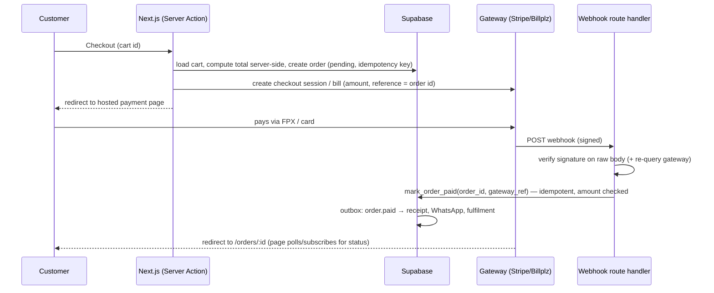

# Next.js - Payments with Stripe & Malaysian Gateways

> [!info] Deep dive of [[Next.js]]

> [!abstract] TL;DR
> **One rule**: the order is paid when a **verified server-to-server event** says so (Stripe webhook signature / Billplz `X-Signature` + re-query), **never** because the browser came back to a success URL.
> - Create the payment server-side (Server Action) with amounts from your DB, not the client.
> - Redirect to a hosted page (Stripe Checkout, Billplz/ToyyibPay FPX).
> - Handle the webhook in a **route handler with the raw body**, mark the order paid **idempotently**, then trigger receipts and fulfilment via an outbox.
>
> In Malaysia, FPX + DuitNow QR + cards cover most SME customers. Stripe is convenient for cards/international, local gateways are cheaper for FPX. Check **MyInvois e-invoicing** obligations per client turnover.

## Concept
| Gateway | Methods | Strengths | Watch out |
|---|---|---|---|
| Stripe (Malaysia) | Cards, FPX, GrabPay, wallets (Apple/Google Pay) | Best API/docs, Checkout, subscriptions, test mode | Fees vs local FPX pricing. Payout timing |
| Billplz | FPX (online banking), cards, e-wallets, DuitNow (per account) | Cheap FPX, popular with SMEs, simple bills API | Callback signature scheme, fewer subscription features |
| ToyyibPay | FPX, cards | Low fees, quick onboarding | API ergonomics, reliability checks |
| Others (iPay88, SenangPay, Curlec, HitPay) | Mixed | Existing merchant relationships, recurring (Curlec) | Varying API quality |

**Event sources of truth**:

| Signal | Trust | Use for |
|---|---|---|
| Browser redirect (`?paid=true`) | ❌ Never | Showing "we're confirming your payment…" |
| Webhook/callback with valid signature | ✅ | Marking paid |
| Server re-query of the payment/bill | ✅✅ | Defence in depth, reconciliation |
| Daily settlement report | ✅ | Reconciliation and accounting |

## How It Works


## Practical Usage
**Create a Stripe Checkout Session** (Server Action; amounts from DB):
```ts
'use server';
import Stripe from 'stripe';
const stripe = new Stripe(process.env.STRIPE_SECRET_KEY!);

export const startCheckout = authedAction(z.object({ orderId: z.string().uuid() }), {}, async ({ orderId }, { tenantId }) => {
  const order = await orders.getPendingForTenant(tenantId, orderId);          // total computed server-side
  const session = await stripe.checkout.sessions.create({
    mode: 'payment',
    currency: 'myr',
    payment_method_types: ['card', 'fpx', 'grabpay'],
    line_items: [{ price_data: { currency: 'myr', unit_amount: order.totalCents, product_data: { name: `Order ${order.no}` } }, quantity: 1 }],
    client_reference_id: order.id,
    metadata: { orderId: order.id, tenantId },
    success_url: `${process.env.APP_URL}/orders/${order.id}?from=checkout`,
    cancel_url: `${process.env.APP_URL}/cart`,
  }, { idempotencyKey: `checkout:${order.id}:${order.version}` });
  redirect(session.url!);
});
```
**Stripe webhook route** (raw body, signature, idempotent update):
```ts
// app/api/webhooks/stripe/route.ts
export const runtime = 'nodejs';
export async function POST(req: Request) {
  const raw = await req.text();                                               // raw body required for the signature
  let event: Stripe.Event;
  try {
    event = stripe.webhooks.constructEvent(raw, req.headers.get('stripe-signature')!, process.env.STRIPE_WEBHOOK_SECRET!);
  } catch { return new Response('bad signature', { status: 400 }); }

  if (event.type === 'checkout.session.completed' || event.type === 'checkout.session.async_payment_succeeded') {
    const s = event.data.object as Stripe.Checkout.Session;
    if (s.payment_status === 'paid') {
      await db.rpc('mark_order_paid', { p_order_id: s.metadata!.orderId, p_gateway: 'stripe',
        p_gateway_ref: s.payment_intent as string, p_amount_cents: s.amount_total, p_event_id: event.id });
    }
  }
  return new Response('ok');                                                  // 2xx fast; heavy work via outbox
}
```
**Billplz bill + callback verification** (FPX):
```ts
// create bill (server): POST https://www.billplz.com/api/v3/bills, Basic auth with API key
const body = new URLSearchParams({
  collection_id: process.env.BILLPLZ_COLLECTION!, email: c.email, mobile: c.phone, name: c.name,
  amount: String(order.totalCents), description: `Order ${order.no}`, reference_1_label: 'Order', reference_1: order.id,
  callback_url: `${APP_URL}/api/webhooks/billplz`, redirect_url: `${APP_URL}/orders/${order.id}`,
});

// verify callback: sort params (excluding x_signature), join key+value with '|', HMAC-SHA256 with X Signature key
function verifyBillplz(params: Record<string, string>) {
  const { x_signature, ...rest } = params;
  const source = Object.keys(rest).sort().map((k) => `${k}${rest[k]}`).join('|');
  const mac = createHmac('sha256', process.env.BILLPLZ_X_SIGNATURE_KEY!).update(source).digest('hex');
  return x_signature?.length === mac.length && timingSafeEqual(Buffer.from(mac), Buffer.from(x_signature));
}
// then: re-GET /api/v3/bills/{id} with the API key and check paid=true + amount before mark_order_paid
```
**Idempotent paid-marking in the DB**:
```sql
create table public.payment_events (gateway text, event_id text, primary key (gateway, event_id));
-- inside mark_order_paid: insert event (on conflict do nothing → return if duplicate),
-- check amount = order.total_cents, update orders set status='paid' where id = … and status = 'pending',
-- insert outbox row 'order.paid' (receipt, WhatsApp, e-invoice)
```
**Wrong way**:
```text
❌ Marking paid on the success_url page load            → anyone can visit /success?order=123
❌ Amount sent from the browser                         → client edits RM 120.00 to RM 1.20
❌ Parsing JSON before verifying the Stripe signature    → body re-serialized; verification fails or is skipped
❌ Non-idempotent webhook handler                       → retries double-ship orders / double-credit wallets
```

## Patterns & Anti-patterns
| Pattern | When | Anti-pattern to avoid |
|---|---|---|
| Server-computed totals + order idempotency key | Every checkout | Client-sent prices |
| Webhook = source of truth, redirect = UX only | All gateways | Trusting redirect parameters |
| Verify signature on raw body, then re-query for local gateways | FPX gateways | Signature-only (or nothing) |
| Event-ID dedupe table + conditional status update | Webhooks | Assuming exactly-once delivery |
| Outbox for receipts/fulfilment after commit | Side effects | Sending WhatsApp inside the webhook transaction |
| Daily reconciliation job vs gateway settlement | Finance hygiene | Discovering mismatches at month-end |
| Separate test/live keys per environment | Previews/staging | Live keys in previews ([[Coolify - Preview Deployments, Environments & Secrets]]) |

## Performance & Trade-offs
- **Fees**: FPX via local gateways is usually cheaper per transaction than card rails. Stripe charges more per transaction but saves engineering time (subscriptions, refunds, disputes, test tooling). Compare per client volume.
- **Conversion**: FPX bank redirects add steps. Saved cards/wallets convert better for repeat buyers, and DuitNow QR suits in-person/F&B flows.
- **Async payments**: FPX and some wallets confirm asynchronously, so handle "processing" states and late success events (`async_payment_succeeded`), and don't cancel orders too eagerly.
- **Webhook latency**: callbacks usually arrive within seconds but can be delayed or retried for hours. Show a status page that polls or subscribes (Supabase Realtime).

## Tips & Reminders
> [!tip] In ZP's stack
> - **SME ordering sites**: Billplz/ToyyibPay for FPX + DuitNow, Stripe for cards/international. One `payments` module with gateway adapters, and one `mark_order_paid` RPC ([[Supabase - Database Functions, Triggers & RPC]], [[Design Patterns - Hexagonal Architecture in TypeScript & Dart]]).
> - **Webhook entry**: a Cloudflare Worker or Next.js route verifies and enqueues, and workers update orders and send WhatsApp receipts via the outbox ([[System Design - Event-Driven Architecture & Outbox Pattern]]).
> - **Merchant accounts belong to the client** (their SSM registration, their bank payouts). You get developer/API access only. Write this in the SOW.

- Store amounts as integer sen (`total_cents`) everywhere. Format `RM` only in the UI.
- Log gateway references and event IDs on the order for support and refunds.
- Refunds and chargebacks need their own idempotent flows and status values.
- **E-invoicing**: check the client's MyInvois phase. Businesses under RM 1 million turnover are exempt as of the Dec 2025 decision, while larger SMEs may need e-invoices issued per transaction or as consolidated invoices.

## Version Notes
| Date | Change |
|---|---|
| 2024-08 → 2025-07 | MyInvois phases 1–3 (turnover > RM100m, RM25–100m, RM5–25m) |
| 2025-12-06 | Exemption threshold raised to RM 1 million. Planned July 2026 wave (RM0.5–1m) cancelled (reported) |
| 2026–2027 | RM1–5m phase: sources disagree (2026-01-01 with relaxation period vs postponed to 2027-01-01). Check LHDN |
| Next.js 15–16 | Route handlers read raw bodies via `await req.text()`. Server Actions for checkout creation ([[Next.js - Server Actions, Mutations & Security]]) |

> [!warning] Unverified — check before relying on this
> Stripe Malaysia payment-method availability (FPX/GrabPay/DuitNow), current Billplz signature details, and the RM1–5m MyInvois start date weren't verified against primary sources. Check Stripe/Billplz docs and hasil.gov.my before implementation and client advice.

## Critical Issues & Gotchas
> [!danger] Unverified callbacks mark fake payments as paid
> An attacker can POST a forged "paid" callback to your webhook URL or simply open the success URL. Without signature verification (and, for local gateways, a server re-query of the bill/payment), orders ship without money received. Verify on the raw body with constant-time comparison, check amount and currency against the order, and reject unknown references.

> [!danger] Duplicate processing from retries and races
> Gateways retry webhooks, deliver events out of order, and send both "completed" and "async succeeded" events. Non-idempotent handlers double-fulfil orders or double-credit balances. Dedupe by event ID, use conditional updates (`where status = 'pending'`), and make downstream side effects idempotent ([[REST API - Webhooks & Idempotency]]).

- **Edge runtime**: Stripe's Node SDK signature verification needs Node crypto. Keep webhook routes on `runtime = 'nodejs'`, or use the Web Crypto variant.
- **Middleware/proxy interference**: auth redirects or body parsing in `proxy.ts` can break webhooks. Exclude `/api/webhooks/*` from auth middleware.
- **Currency units**: Stripe uses the smallest unit (sen) and Billplz `amount` is in cents too. Mixing ringgit floats causes 100× errors.
- **PCI scope**: use hosted pages/elements so card data never touches your server. Don't log payment payloads containing personal data.

## Related
- [[Next.js]]
- [[REST API - Webhooks & Idempotency]] — signature verification and idempotency
- [[Flutter - Payments, In-App Purchases & Store Rules]] — mobile payment rules and FPX in apps
- [[Next.js - Server Actions, Mutations & Security]] — creating payments safely
- [[System Design - Event-Driven Architecture & Outbox Pattern]] — post-payment side effects
- [[Supabase - Database Functions, Triggers & RPC]] — atomic `mark_order_paid`

## References
- https://docs.stripe.com/payments/checkout
- https://docs.stripe.com/webhooks
- https://www.billplz.com/api
- https://www.hasil.gov.my/en/e-invoice/
- https://www.thestar.com.my/news/nation/2025/06/05/e-invoicing-deadlines-for-businesses-with-revenue-below-rm5mil-revised-says-lhdn
