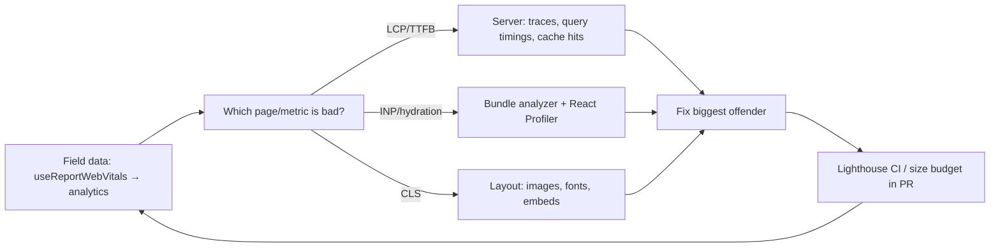

# Next.js - Performance Profiling & Bundle Optimization

> [!info] Deep dive of [[Next.js]]

> [!abstract] TL;DR
> Measure, then fix the biggest lever:
> 1. **Field data first**: Core Web Vitals (LCP, INP, CLS) from real users via `useReportWebVitals` or CrUX. Lab tools (Lighthouse) are for debugging.
> 2. **Client JS is the usual INP/LCP killer**: push `"use client"` boundaries **down to leaves**, keep data fetching in Server Components, lazy-load heavy widgets with `next/dynamic`, and analyze bundles with the **built-in analyzer** (16.1+) or `@next/bundle-analyzer`.
> 3. **Server time (TTFB)**: cache data (`use cache`/fetch cache), avoid request waterfalls (`Promise.all`), and keep DB queries indexed. Profile Node with `--cpu-prof` when self-hosting.
> 4. **Assets**: `next/image` with correct `sizes`, `next/font` (no layout shift), and third-party scripts via `next/script` with `lazyOnload`/worker strategies.
>
> On a Coolify VPS, the server side matters as much as the bundle. A slow DB or cold cache shows up as LCP.

## Concept
| Symptom | Likely cause | Fix |
|---|---|---|
| High LCP | Slow TTFB, unoptimized hero image, render-blocking fonts/CSS | Cache/stream, `priority` hero image with correct `sizes`, `next/font` |
| Poor INP | Large client bundles, long tasks in event handlers, heavy hydration | Smaller client islands, `useTransition`, defer non-urgent work, React Compiler |
| CLS | Images without dimensions, late-loading banners/fonts | Width/height or `fill` + container, reserve space, `next/font` |
| Large First Load JS | Barrel imports, date/chart/editor libs on every page | `optimizePackageImports`, dynamic imports, lighter libs |
| Slow navigations | Uncached dynamic data, sequential fetches | Parallel fetching, `loading.tsx` streaming, caching |
| Slow builds | Huge dependency graph, type checking | Turbopack (default), isolate type-check in CI |

## How It Works


## Practical Usage
**Report real-user Web Vitals**:
```tsx
"use client";
import { useReportWebVitals } from "next/web-vitals";
export function WebVitals() {
  useReportWebVitals((m) => {
    navigator.sendBeacon("/api/vitals", JSON.stringify({ name: m.name, value: m.value, id: m.id, page: location.pathname }));
  });
  return null;
}
// render <WebVitals /> once in app/layout.tsx
```
**Analyze bundles**:
```bash
npx next experimental-analyze                 # built-in analyzer (Next.js 16.1+, Turbopack)
# or, webpack builds:
ANALYZE=true npx next build --webpack          # with @next/bundle-analyzer configured
```
**Push client boundaries down** (keep the page a Server Component):
```tsx
// app/products/[id]/page.tsx (Server Component)
export default async function ProductPage({ params }: { params: Promise<{ id: string }> }) {
  const product = await getProduct((await params).id);          // server-only data, zero client JS
  return (
    <>
      <ProductGallery images={product.images} />                 {/* server-rendered */}
      <h1>{product.name}</h1>
      <AddToCartButton productId={product.id} />                 {/* tiny "use client" leaf */}
    </>
  );
}
```
**Lazy-load heavy client widgets**:
```tsx
import dynamic from "next/dynamic";
const SalesChart = dynamic(() => import("@/components/sales-chart"), { loading: () => <ChartSkeleton /> });
const RichEditor = dynamic(() => import("@/components/rich-editor"), { ssr: false });
```
**Tree-shake barrel-heavy packages**:
```ts
// next.config.ts
export default {
  experimental: { optimizePackageImports: ["lucide-react", "date-fns", "@radix-ui/react-icons"] },
  reactCompiler: true,                      // automatic memoization (stable in Next.js 16)
};
```
**Avoid server waterfalls**:
```ts
// ❌ sequential: 3 × latency
const user = await getUser(); const orders = await getOrders(); const stats = await getStats();
// ✅ parallel
const [user, orders, stats] = await Promise.all([getUser(), getOrders(), getStats()]);
```
**Third-party scripts**:
```tsx
<Script src="https://www.googletagmanager.com/gtag/js?id=G-XXXX" strategy="afterInteractive" />
<Script src="https://widget.chat-vendor.com/loader.js" strategy="lazyOnload" />
```
**Profile the self-hosted server**:
```bash
node --cpu-prof --cpu-prof-dir=/tmp/prof .next/standalone/server.js   # load test, then open .cpuprofile in Chrome DevTools
```
**Wrong way**:
```text
❌ "use client" at the top of layout.tsx           → whole app hydrates; Server Component benefits lost
❌ import * as Icons / moment with all locales      → hundreds of KB in First Load JS
❌ Optimizing Lighthouse scores on a dev laptop       → field INP on mid-range Android still poor
❌ Chat widget + 3 trackers loaded beforeInteractive → main thread blocked on every page
```

## Patterns & Anti-patterns
| Pattern | When | Anti-pattern to avoid |
|---|---|---|
| Client islands at leaves | All pages | Client components wrapping whole layouts |
| Field Web Vitals per route | Production | Lab scores only |
| Size budget check in CI (First Load JS per route) | PRs | Discovering bloat after release |
| `next/image` with accurate `sizes` | Responsive images | Full-size images scaled by CSS |
| Streaming with `loading.tsx` / Suspense | Slow data sections | Blocking whole page on slowest query |
| Lightweight libs (date-fns/dayjs, uPlot, native `Intl`) | Common needs | Heavy all-in-one libraries |
| Load third-party scripts late | Analytics/chat | Synchronous tag managers |

## Performance & Trade-offs
- **Server Components** cut client JS but move work to the server. On a small VPS, CPU-bound rendering under load raises TTFB, so cache aggressively ([[Next.js - Caching]]).
- **React Compiler** reduces re-render cost without manual `useMemo`, at slightly longer builds. Verify behaviour on components with mutation-heavy patterns.
- **`ssr: false`** reduces server work and bundle on first load, but delays content. Use it only for interactive-only widgets (editors, maps).
- **Image optimization** on a self-hosted server uses CPU (sharp). Use a CDN/loader (Cloudflare Images, Supabase transformations) for image-heavy sites ([[Next.js - Self-Hosting, Standalone Builds & ISR on Coolify]]).

## Tips & Reminders
> [!tip] In ZP's stack
> - **Test on a mid-range Android over 4G** (typical Malaysian SME customer). INP and LCP there are what matter, not on a MacBook.
> - **Cloudflare in front**: cache static assets and ISR pages at the edge. Check `cf-cache-status` and set correct `Cache-Control` ([[Cloudflare - Caching Rules, CDN & Cache Purging]]).
> - **Client deliverable**: a before/after Web Vitals report (PageSpeed + field data) is a tangible, sellable optimization package.

- Watch the "First Load JS" column in `next build` output per route.
- Use the React DevTools Profiler for slow interactions, and Chrome Performance panel "Long tasks".
- Prefer CSS (Tailwind) over JS animation libs for simple effects.
- Self-host fonts with `next/font` (no Google Fonts request at runtime).

## Version Notes
| Version | Change relevant here |
|---|---|
| 13–14 | App Router, Server Components, `next/font`, `optimizePackageImports` |
| 15 (2024-10) | React 19, async request APIs, Turbopack dev stable |
| 16 (2025-10) | Turbopack default for build, React Compiler stable, Cache Components |
| 16.1 (2025-12) | Turbopack file-system caching, built-in bundle analyzer (experimental) |
| 16.4.x (2026-11) | Current. Apply the November 2026 security release ([[Next.js]]) |

> [!warning] Unverified — check before relying on this
> The exact CLI command for the built-in analyzer (`next experimental-analyze`) and whether `reactCompiler` remains a top-level config key in 16.4 weren't verified this run. Check the Next.js docs for your version.

## Critical Issues & Gotchas
> [!danger] Accidental server data in client bundles
> Importing a server module (DB client, secrets) from a `"use client"` file can bundle code or environment values into the browser, or fail builds unpredictably. Use the `server-only` package in server modules, and pass only serializable, non-sensitive props to client components.

> [!danger] Optimizing the wrong metric
> Chasing a perfect Lighthouse score while real users suffer slow TTFB from an uncached Supabase query (or vice versa) wastes days. Start from field data per route, fix the top offender, and re-measure. Stop when vitals are "good", since further gains rarely change conversions for SME sites.

- **Barrel files** in your own code (`components/index.ts`) can defeat tree-shaking. Import directly.
- **Huge JSON props** from Server to Client components are serialized into HTML (RSC payload). Pass IDs or trimmed data.
- **Fonts with many weights** inflate downloads. Subset and limit weights.
- **Middleware/proxy** runs on every request. Keep it light ([[Next.js - Middleware, Auth & Multi-Tenant Routing]]).

## Related
- [[Next.js]]
- [[Browser & Web Fundamentals - Core Web Vitals Optimization]] — metric definitions and browser-level fixes
- [[Next.js - Metadata, SEO & Image Optimization]] — images and fonts
- [[Next.js - Caching]] — server-side speed
- [[React - Server Components]] — client/server boundaries
- [[Node.js - Performance & Diagnostics]] — profiling the Node server

## References
- https://nextjs.org/docs/app/guides/package-bundling
- https://nextjs.org/docs/app/api-reference/functions/use-report-web-vitals
- https://nextjs.org/docs/app/api-reference/components/script
- https://web.dev/articles/vitals
- https://react.dev/learn/react-compiler
