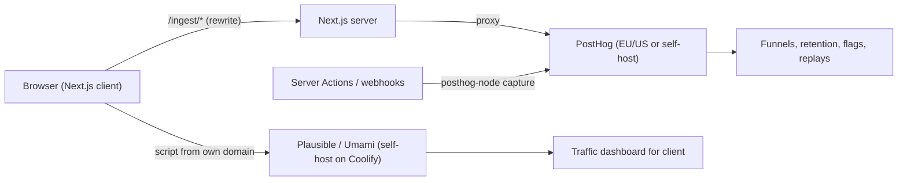

# Next.js - Product Analytics with PostHog & Plausible

> [!info] Deep dive of [[Next.js]]

> [!abstract] TL;DR
> Pick analytics by the question you need answered:
> - **Plausible / Umami / Cloudflare Web Analytics**: lightweight, **cookieless** traffic analytics (pages, referrers, countries, simple goals). Ideal for marketing sites and client dashboards. Plausible CE and Umami self-host easily on Coolify.
> - **PostHog**: **product analytics** (events, funnels, retention, cohorts), session replay, feature flags and experiments. Ideal for your SaaS products.
>
> Implementation essentials:
> - track **meaningful events** with a naming convention (`order_placed`, `plan_upgraded`);
> - send critical business events **server-side** (Server Actions/webhooks) so ad blockers don't drop them;
> - proxy client SDK traffic through your domain;
> - respect **consent and PII rules**: no IC/phone in event properties, mask session replay inputs.

## Concept
| Tool | Type | Cookies | Hosting | Pick it when… |
|---|---|---|---|---|
| Plausible | Web analytics | No | Cloud (EU) or self-host CE | Client marketing sites, simple goals |
| Umami | Web analytics | No | Self-host (Postgres) | Free, simple, self-hosted |
| Cloudflare Web Analytics | Web analytics (RUM) | No | Cloudflare (free) | Sites already on Cloudflare |
| PostHog | Product analytics + replay + flags | Optional (configurable) | Cloud US/EU or self-host | SaaS products, funnels, experiments |
| GA4 | Marketing analytics | Yes | Google | Ads attribution needs (consent complexity) |

**Event design**:

| Rule | Example |
|---|---|
| `object_action` snake_case | `booking_created`, `checkout_started`, `plan_upgraded` |
| Stable IDs, not PII | `tenant_id`, `user_id` (internal UUID), not phone/email |
| Properties for slicing | `plan`, `channel: "whatsapp"`, `amount_myr`, `outlet_id` |
| Server-side for money events | Payment webhooks → `payment_succeeded` |

## How It Works


## Practical Usage
**PostHog provider** (client, with consent-aware init):
```tsx
"use client";
import posthog from "posthog-js";
import { PostHogProvider } from "posthog-js/react";
import { useEffect } from "react";

export function Analytics({ children, consent }: { children: React.ReactNode; consent: boolean }) {
  useEffect(() => {
    posthog.init(process.env.NEXT_PUBLIC_POSTHOG_KEY!, {
      api_host: "/ingest",                       // reverse-proxied through our domain
      ui_host: "https://eu.posthog.com",
      person_profiles: "identified_only",
      capture_pageview: "history_change",
      persistence: consent ? "localStorage+cookie" : "memory",
      session_recording: { maskAllInputs: true },
      disable_session_recording: !consent,
    });
  }, [consent]);
  return <PostHogProvider client={posthog}>{children}</PostHogProvider>;
}
```
**Reverse proxy via rewrites** (`next.config.ts`):
```ts
export default {
  async rewrites() {
    return [
      { source: "/ingest/static/:path*", destination: "https://eu-assets.i.posthog.com/static/:path*" },
      { source: "/ingest/:path*", destination: "https://eu.i.posthog.com/:path*" },
    ];
  },
  skipTrailingSlashRedirect: true,
};
```
**Server-side capture for business events**:
```ts
import { PostHog } from "posthog-node";
const ph = new PostHog(process.env.POSTHOG_KEY!, { host: "https://eu.i.posthog.com", flushAt: 1, flushInterval: 0 });

export async function onPaymentSucceeded(evt: { tenantId: string; userId: string; amountCents: number; plan: string }) {
  ph.capture({ distinctId: evt.userId, event: "payment_succeeded",
    properties: { tenant_id: evt.tenantId, amount_myr: evt.amountCents / 100, plan: evt.plan, $groups: { tenant: evt.tenantId } } });
  await ph.shutdown();                     // flush in serverless/short-lived contexts
}
```
**Plausible on a client site** (self-hosted, script from own subdomain):
```tsx
<Script defer data-domain="client.my" src="https://stats.client.my/js/script.js" />
// custom goal
window.plausible?.("Booking Submitted", { props: { outlet: "kuching-central" } });
```
**Wrong way**:
```text
❌ posthog.identify(user.phone) / properties with IC numbers  → PII in third-party analytics (PDPA)
❌ Session replay without input masking                       → passwords, card numbers, addresses recorded
❌ Only client-side tracking of payments                      → ad blockers drop events; revenue metrics wrong
❌ 50 vague events ("click", "button")                         → unusable data
```

## Patterns & Anti-patterns
| Pattern | When | Anti-pattern to avoid |
|---|---|---|
| Tracking plan (event list + properties) in repo | Before implementing | Ad-hoc events |
| Server-side capture for revenue/state changes | Payments, signups | Client-only critical events |
| Group analytics by tenant (`$groups`) | B2B SaaS | Only per-user metrics |
| Reverse proxy through own domain | Client SDKs | Third-party domains blocked by ad blockers |
| Consent banner gating replay/cookies | Replay, identified users | Recording everyone silently |
| Cookieless analytics for marketing sites | Client websites | Heavy GA4 + consent complexity for simple needs |

## Performance & Trade-offs
- **Script weight**: Plausible (~1 KB) and Umami are tiny. PostHog's JS SDK is heavier, so lazy-load replay and feature-flag code where possible ([[Next.js - Performance Profiling & Bundle Optimization]]).
- **Self-host vs cloud**: Plausible CE and Umami self-host cheaply on Coolify. Self-hosted PostHog is resource-heavy (ClickHouse, Kafka) and better on cloud (EU region) for small teams.
- **Data residency**: PostHog EU and Plausible (EU) keep data in Europe. Self-hosting in Singapore keeps it closer to Malaysian users. Document it in privacy notices.
- **CSP**: add analytics hosts (or your proxy path) to `connect-src`/`script-src` ([[Next.js - Content Security Policy, Nonces & Security Headers]]).

## Tips & Reminders
> [!tip] In ZP's stack
> - **Client websites**: self-hosted Plausible or Umami on a shared Coolify server, with a monthly traffic report emailed via n8n. Cheap, privacy-friendly, and visible value.
> - **Your SaaS products**: PostHog (EU cloud free tier) with a tracking plan covering signup → activation (first WhatsApp message/booking) → upgrade → churn. Tie it to billing events ([[Next.js - SaaS Subscription Billing & Plan Entitlements]]).
> - **Feature flags**: PostHog flags work for web. For mobile apps, keep the Supabase `app_config` approach unless you already use PostHog ([[Flutter - Feature Flags, Remote Config & Forced Updates]]).

- Define activation metrics per product (e.g. "first booking created within 7 days").
- Exclude internal/test users via property filters.
- Include analytics vendors in the privacy policy and DPA sub-processor list ([[Supabase - Data Retention, PDPA & Account Deletion]]).
- Review the dashboard monthly. Unused analytics is wasted effort.

## Version Notes
| Date | Change relevant here |
|---|---|
| 2023–24 | PostHog EU cloud, person profiles option ("identified_only"). Plausible Community Edition |
| 2024–25 | Next.js App Router integration patterns (providers, rewrites) |
| 2025–26 | Umami 2.x. Cookieless analytics widely adopted for compliance |

> [!warning] Unverified — check before relying on this
> Current PostHog SDK option names (`capture_pageview: "history_change"`, `person_profiles`), proxy hostnames (`eu.i.posthog.com`, `eu-assets.i.posthog.com`), and free-tier limits weren't verified this run. Check PostHog's Next.js and reverse-proxy docs.

## Critical Issues & Gotchas
> [!danger] Personal data leaking into analytics
> Phone numbers in URLs (`/customer/60123456789`), emails in event properties, or unmasked session replays send personal data to analytics vendors, often outside Malaysia. That's a PDPA exposure and a breach risk. Use internal IDs, sanitize URLs/properties, mask inputs, and gate replay behind consent.

> [!danger] Wrong business decisions from incomplete data
> Ad blockers and consent refusals can drop 20–40% of client-side events in tech-savvy audiences. Funnels and revenue look worse (or better) than reality. Track money and state changes server-side, compare with database truth, and treat client analytics as directional.

- **Bot traffic** inflates page views. Filter known bots, and use Cloudflare bot signals.
- **Double counting** with both client and server events for the same action. Pick one source per event.
- **Time zones**: set the project timezone to Asia/Kuala_Lumpur for daily metrics.
- **Self-hosted analytics backups**: losing the DB loses history. Include it in backups.

## Related
- [[Next.js]]
- [[Next.js - Performance Profiling & Bundle Optimization]] — script weight and loading
- [[Next.js - Content Security Policy, Nonces & Security Headers]] — CSP for analytics hosts
- [[Next.js - SaaS Subscription Billing & Plan Entitlements]] — revenue events
- [[Supabase - Data Retention, PDPA & Account Deletion]] — PII and retention rules
- [[Cloudflare - Logs, Analytics & Security Events]] — edge-level traffic analytics

## References
- https://posthog.com/docs/libraries/next-js
- https://posthog.com/docs/advanced/proxy/nextjs
- https://plausible.io/docs/self-hosting
- https://umami.is/docs
- https://developers.cloudflare.com/web-analytics/
