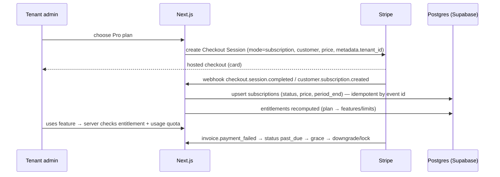

# Next.js - SaaS Subscription Billing & Plan Entitlements

> [!info] Deep dive of [[Next.js]]

> [!abstract] TL;DR
> Separate **billing** (who pays what, handled by Stripe or a local gateway) from **entitlements** (what a tenant may do, enforced by your app and database).
> - **Flow**: Stripe Checkout (subscription mode) → webhooks update a `subscriptions` table → an **entitlements** view/function maps plan → features/limits → enforce in Server Actions, RLS/RPCs and the UI.
> - **The webhook is the source of truth**, not the redirect back from Checkout. Handle `checkout.session.completed`, `customer.subscription.*` and `invoice.*` idempotently.
> - Use the **Customer Portal** for upgrades, cancellations, card updates and invoices instead of building them.
> - **Local market**: Malaysian SMEs often prefer FPX/DuitNow and annual invoices. Card-based auto-renewal via Stripe works, but offer manual annual payment + invoice as an alternative plan path.

## Concept
| Concept | Where it lives | Notes |
|---|---|---|
| Product / Price | Stripe | Monthly/annual prices, MYR or USD |
| Customer | Stripe (`customer_id` stored on tenant) | One per tenant (organization), not per user |
| Subscription | Stripe → mirrored in `subscriptions` table | status: trialing, active, past_due, canceled, unpaid, incomplete |
| Entitlements | Your DB (`plans`, `plan_features`) | Features, seats, quotas. Decoupled from Stripe price IDs |
| Usage | Your DB (+ Stripe meters if usage-based) | Messages sent, AI tokens, documents processed |
| Dunning | Stripe Smart Retries + emails | Grace period before downgrade |
| Invoices / tax | Stripe Invoicing (+ MyInvois where in scope) | Malaysian e-invoicing obligations apply to your company too |

**Pricing models**:

| Model | Pick it when… | Complexity |
|---|---|---|
| Flat tiers (Starter/Pro/Business) | Most SME SaaS | Low |
| Per seat | Team tools | Medium (seat sync) |
| Usage-based (metered) | AI/WhatsApp volume costs scale with usage | High (metering, surprises) |
| Hybrid (tier + included usage + overage) | WhatsApp/AI SaaS | Medium–high |

## How It Works


## Practical Usage
**Schema** (plans decoupled from Stripe IDs):
```sql
create table public.plans (id text primary key, name text, stripe_price_monthly text, stripe_price_yearly text);
create table public.plan_limits (plan_id text references plans, key text, value int, primary key (plan_id, key));
-- e.g. ('pro','seats',10), ('pro','wa_messages_month',5000), ('pro','ai_docs_month',500)
create table public.subscriptions (
  tenant_id uuid primary key references tenants,
  stripe_customer_id text unique, stripe_subscription_id text unique,
  plan_id text references plans, status text not null,
  current_period_end timestamptz, cancel_at_period_end boolean default false,
  updated_at timestamptz default now()
);
create table public.stripe_events (id text primary key, type text, received_at timestamptz default now());
```
**Entitlement function** (used by RPCs, Server Actions and RLS):
```sql
create or replace function public.limit_for(p_tenant uuid, p_key text) returns int
language sql stable security definer set search_path = '' as $$
  select coalesce(pl.value, 0)
  from public.subscriptions s
  join public.plan_limits pl on pl.plan_id = s.plan_id and pl.key = p_key
  where s.tenant_id = p_tenant
    and (s.status in ('active','trialing')
         or (s.status = 'past_due' and s.current_period_end > now() - interval '7 days'))   -- grace
$$;
```
**Create Checkout Session** (Server Action):
```ts
"use server";
export async function startCheckout(planId: "starter" | "pro", interval: "monthly" | "yearly") {
  const { tenant, user } = await requireTenantAdmin();
  const plan = await db.plans.get(planId);
  const session = await stripe.checkout.sessions.create({
    mode: "subscription",
    customer: tenant.stripeCustomerId ?? undefined,
    customer_email: tenant.stripeCustomerId ? undefined : user.email,
    line_items: [{ price: interval === "monthly" ? plan.stripe_price_monthly : plan.stripe_price_yearly, quantity: 1 }],
    subscription_data: { metadata: { tenant_id: tenant.id }, trial_period_days: tenant.hadTrial ? undefined : 14 },
    metadata: { tenant_id: tenant.id },
    success_url: `${APP_URL}/settings/billing?status=success`,
    cancel_url: `${APP_URL}/settings/billing`,
  });
  redirect(session.url!);
}
```
**Webhook handler** (route handler, raw body, idempotent):
```ts
export async function POST(req: Request) {
  const sig = req.headers.get("stripe-signature")!;
  const event = stripe.webhooks.constructEvent(await req.text(), sig, process.env.STRIPE_WEBHOOK_SECRET!);
  const fresh = await db.query("insert into stripe_events (id, type) values ($1,$2) on conflict do nothing returning id", [event.id, event.type]);
  if (!fresh.rowCount) return new Response("dup", { status: 200 });

  if (event.type.startsWith("customer.subscription.")) {
    const sub = event.data.object as Stripe.Subscription;
    const planId = await planFromPrice(sub.items.data[0].price.id);
    await db.query(`insert into subscriptions (tenant_id, stripe_customer_id, stripe_subscription_id, plan_id, status, current_period_end, cancel_at_period_end)
      values ($1,$2,$3,$4,$5,to_timestamp($6),$7)
      on conflict (tenant_id) do update set plan_id=excluded.plan_id, status=excluded.status,
        current_period_end=excluded.current_period_end, cancel_at_period_end=excluded.cancel_at_period_end, updated_at=now()`,
      [sub.metadata.tenant_id, sub.customer, sub.id, planId, sub.status, sub.items.data[0].current_period_end, sub.cancel_at_period_end]);
  }
  return new Response("ok");
}
```
**Enforce a quota in a Server Action**:
```ts
const [limit, used] = await Promise.all([db.rpc("limit_for", { p_tenant: tenantId, p_key: "ai_docs_month" }), usage.thisMonth(tenantId, "ai_docs")]);
if (used >= limit) throw new Error("plan_limit_reached");      // UI shows upgrade CTA
```
**Customer Portal**:
```ts
const portal = await stripe.billingPortal.sessions.create({ customer: tenant.stripeCustomerId, return_url: `${APP_URL}/settings/billing` });
redirect(portal.url);
```
**Wrong way**:
```text
❌ Activating the plan on the success_url redirect     → users skip payment by visiting the URL
❌ if (plan === 'pro') scattered across components       → impossible to change packaging later
❌ Stripe customer per user in a multi-user tenant       → duplicate subscriptions, wrong seat counts
❌ Hard lock immediately on payment failure              → churn from temporary card issues
```

## Patterns & Anti-patterns
| Pattern | When | Anti-pattern to avoid |
|---|---|---|
| Webhook-driven subscription state + event idempotency table | Always | Trusting client redirects |
| Plans/limits table, code checks keys not plan names | Packaging changes | Hard-coded plan names in code |
| Server-side enforcement (actions, RPC, RLS) + UI hints | Quotas/features | UI-only gating |
| Grace period for `past_due` | Dunning | Instant lockout |
| Customer Portal for self-service | Cancellations/cards/invoices | Building billing UI from scratch |
| Usage counters in your DB, reconciled monthly | Usage-based | Querying Stripe for every check |
| Annual manual invoice path (FPX/bank transfer) | Malaysian SMEs | Card-only, which loses local customers |

## Performance & Trade-offs
- **Entitlement checks** are on hot paths. Cache per request, or read from the DB with an index. Don't call Stripe synchronously.
- **Usage-based billing** aligns with WhatsApp/AI costs but creates bill shock for SMEs. A hybrid tier + included quota + soft cap is usually better received.
- **Stripe vs local gateways**: Stripe Billing gives subscriptions, portal, dunning and tax tooling. Malaysian gateways may lack mature recurring billing, so you'd need to build renewal reminders and manual payments yourself ([[Next.js - Payments with Stripe & Malaysian Gateways]]).
- **Proration** on mid-cycle upgrades complicates invoices. Decide policy (immediate proration vs next cycle) upfront.

## Tips & Reminders
> [!tip] In ZP's stack
> - **Your own SaaS products**: start with 2–3 flat tiers + annual discount and a 14-day trial. Add metered WhatsApp/AI overage only when usage data justifies it.
> - **Cost alignment**: map plan limits to your real costs (WhatsApp per-message fees, LLM tokens, Supabase usage), and track per-tenant margin monthly ([[Supabase - Usage, Cost Control & Plan Limits]]).
> - **Your own invoices**: Rarticle's subscription invoices may themselves fall under MyInvois obligations depending on turnover. Check with your accountant ([[n8n - MyInvois e-Invoicing Integration]]).

- Test webhooks locally with `stripe listen --forward-to localhost:3000/api/stripe/webhook`.
- Store prices in sen (cents). Display with `Intl.NumberFormat('ms-MY', {style:'currency', currency:'MYR'})`.
- Send in-app warnings at 80%/100% of quotas before blocking.
- Log entitlement denials, which show where upgrades come from.

## Version Notes
| Date | Change relevant here |
|---|---|
| 2020–23 | Stripe Checkout subscription mode, Customer Portal, Smart Retries |
| 2024–25 | Stripe Billing meters (usage-based billing API replacing legacy usage records). Billing period fields moved to subscription items in newer API versions |
| 2025–26 | Next.js 16 Server Actions/route handlers. Stripe Malaysia supports MYR, cards, FPX and GrabPay for one-time payments (recurring mainly cards) |

> [!warning] Unverified — check before relying on this
> Recurring payment method support in Malaysia (FPX/DuitNow for subscriptions), the exact Stripe API version where `current_period_end` moved to subscription items, and meter API details weren't verified this run. Check Stripe docs for your pinned API version.

## Critical Issues & Gotchas
> [!danger] Free access through webhook gaps
> If webhooks fail (wrong secret, endpoint down during deploy, events out of order), tenants keep paid features after cancellation, or paying customers stay locked out. Make the handler idempotent, process events by fetching the latest subscription from Stripe when order matters, monitor webhook failures in the Stripe dashboard, and run a nightly reconciliation job against Stripe.

> [!danger] Entitlements enforced only in the UI
> Hiding the "Export" button for Starter plans doesn't stop API calls or Server Actions. Users on lower plans call endpoints directly, or exceed quotas via scripts. Enforce limits server-side (actions, RPCs, RLS policies using `limit_for`), and treat UI gating as UX only.

- **Trials abuse**: repeated trials with new emails. Tie trials to tenant/payment method, and use Turnstile on signup.
- **Currency choice**: USD pricing for Malaysian SMEs adds FX friction. Price in MYR for local customers.
- **Tax/SST**: digital services tax rules differ for local vs foreign providers. Confirm with an accountant.
- **Deleting tenants** with active subscriptions must cancel Stripe subscriptions first.

## Related
- [[Next.js]]
- [[Next.js - Payments with Stripe & Malaysian Gateways]] — one-time payments and local gateways
- [[REST API - Webhooks & Idempotency]] — reliable webhook handling
- [[System Design - Multi-Tenant SaaS Architecture]] — tenant model
- [[Supabase - Row Level Security]] — enforcing entitlements in the DB
- [[Next.js - Server Actions, Mutations & Security]] — server-side checks

## References
- https://docs.stripe.com/billing/subscriptions/build-subscriptions
- https://docs.stripe.com/billing/subscriptions/webhooks
- https://docs.stripe.com/customer-management/integrate-customer-portal
- https://docs.stripe.com/billing/subscriptions/usage-based
- https://docs.stripe.com/payments/payment-methods/integration-options
