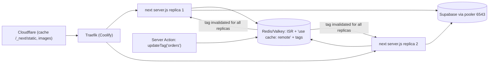

# Next.js - Self-Hosting, Standalone Builds & ISR on Coolify

> [!info] Deep dive of [[Next.js]]

> [!abstract] TL;DR
> Build with **`output: 'standalone'`** in a multi-stage Dockerfile: copy `.next/standalone` + `.next/static` + `public`, run `node server.js` as non-root with `HOSTNAME=0.0.0.0`.
> - **One replica** works out of the box.
> - **Two or more replicas** need shared state:
>   - a **`cacheHandler`** (ISR, route handler cache, images) and **`cacheHandlers`** (for `'use cache'`), backed by Redis/Valkey;
>   - a shared **`NEXT_SERVER_ACTIONS_ENCRYPTION_KEY`**;
>   - a `deploymentId`.
> - `NEXT_PUBLIC_*` is **baked at build time**, so build per environment.
> - Serve `/_next/static` through Cloudflare with immutable caching, and give Coolify a health check so deploys swap without downtime.

## Concept
| Concern | Vercel does it for you | Self-hosted on Coolify |
|---|---|---|
| Build output | Platform adapter | `output: 'standalone'` (traced minimal `node_modules`) |
| ISR / `revalidateTag` across instances | Global cache | **Shared cache handler** (Redis) or a single replica |
| `'use cache'` entries | Managed | In-memory per process by default. `cacheHandlers` for shared/remote |
| Image optimization | Edge image service | `sharp` in your container (CPU + disk `.next/cache/images`), or an external loader |
| Static assets/CDN | Built in | Cloudflare in front, `Cache-Control: immutable` for `/_next/static` |
| Version skew | Skew protection | `deploymentId` + reload prompt |
| Secrets/env | Project env | Coolify env (runtime) vs build variables (baked) |

**Build-time vs runtime variables**:

| Variable | Read when | Changing it requires |
|---|---|---|
| `NEXT_PUBLIC_*` | `next build` (inlined into JS) | **Rebuild** |
| Server-only (`DATABASE_URL`, API keys) | Runtime (`process.env` in server code) | Restart |
| Values in statically prerendered pages | Build time (the page is HTML already) | Rebuild, or make the route dynamic |

## How It Works


## Practical Usage
**Dockerfile** (pnpm, standalone, non-root, health check):
```dockerfile
# syntax=docker/dockerfile:1.7
FROM node:22-alpine AS base
RUN corepack enable
WORKDIR /app

FROM base AS deps
COPY package.json pnpm-lock.yaml ./
RUN --mount=type=cache,target=/root/.local/share/pnpm/store pnpm install --frozen-lockfile

FROM base AS build
COPY --from=deps /app/node_modules ./node_modules
COPY . .
ARG NEXT_PUBLIC_APP_ENV
ARG GIT_SHA
ENV NEXT_TELEMETRY_DISABLED=1 GIT_SHA=$GIT_SHA
RUN pnpm build

FROM node:22-alpine AS run
WORKDIR /app
ENV NODE_ENV=production NEXT_TELEMETRY_DISABLED=1 PORT=3000 HOSTNAME=0.0.0.0
RUN addgroup -S app && adduser -S app -G app
COPY --from=build --chown=app:app /app/.next/standalone ./
COPY --from=build --chown=app:app /app/.next/static ./.next/static
COPY --from=build --chown=app:app /app/public ./public
USER app
EXPOSE 3000
HEALTHCHECK --interval=10s --timeout=3s --start-period=20s CMD wget -qO- http://127.0.0.1:3000/api/health || exit 1
CMD ["node", "--max-old-space-size=576", "server.js"]
```
**Config for multiple replicas**:
```ts
// next.config.ts
import type { NextConfig } from 'next';
const config: NextConfig = {
  output: 'standalone',
  deploymentId: process.env.GIT_SHA,
  cacheComponents: true,
  cacheHandler: require.resolve('./cache/isr-handler.mjs'),     // ISR, route handler responses, images
  cacheMaxMemorySize: 0,                                        // disable per-process in-memory copy
  cacheHandlers: { remote: require.resolve('./cache/remote-handler.mjs') },   // 'use cache: remote'
  images: { remotePatterns: [{ protocol: 'https', hostname: '*.supabase.co' }], minimumCacheTTL: 86400 },
};
export default config;
```
```ts
// usage: shared across replicas via the remote handler
async function getMenu(tenantId: string) {
  'use cache: remote';
  cacheTag(`menu:${tenantId}`);
  cacheLife('hours');
  return db.menu.forTenant(tenantId);
}
```
**Health route** (dynamic, cheap, no cache):
```ts
// app/api/health/route.ts
export const dynamic = 'force-dynamic';
export async function GET() {
  return Response.json({ ok: true, sha: process.env.GIT_SHA });
}
```
**Cloudflare cache rule** for build assets (hashed filenames, safe to cache forever):
```text
If URI path starts with "/_next/static/" → Cache eligible, Edge TTL 1 year, respect origin immutable
If URI path starts with "/api/" or "/_next/data/" → Bypass cache
```
**Wrong way**:
```text
❌ 2 replicas, default file-system cache → user A sees the new menu, user B the old one for hours
❌ NEXT_PUBLIC_API_URL set only as a runtime env in Coolify → bundle still has the build-time value (or undefined)
❌ No health check → Coolify routes traffic to a container still compiling routes / crashing on boot
❌ Building on the same 4 GB VPS that serves production → next build OOM-kills the live app
```

## Patterns & Anti-patterns
| Pattern | When | Anti-pattern to avoid |
|---|---|---|
| Single replica + vertical sizing until needed | Most SME apps | Multiple replicas without shared cache |
| Redis/Valkey cache handlers + shared encryption key + `deploymentId` | 2+ replicas | "It works on one, so add replicas" |
| Separate build server or CI-built image (GHCR) | Small production VPS | `next build` on the serving host |
| Per-environment builds (staging/prod) | `NEXT_PUBLIC_*` differs | Promoting one image across environments with different public config |
| Cloudflare caching `/_next/static`, bypass for HTML/API by default | All deployments | Caching HTML containing user data |
| External image loader (Cloudflare Images / Supabase transforms) for heavy galleries | Image-heavy sites | `sharp` hammering a 2-vCPU KVM |
| Graceful shutdown + health check for rolling deploys | Zero downtime | Hard kills mid-request on every deploy |

## Performance & Trade-offs
- **Memory**: a Next.js 16 server typically sits at 200–500 MB and spikes with large RSC payloads. Set a container limit and `--max-old-space-size` (~75%) ([[Docker - Logging, Metrics & Resource Limits on a VPS]]).
- **Build**: `next build` with Turbopack needs 2–4 GB RAM for medium apps. Build in GitHub Actions and push to GHCR, then let Coolify pull the image.
- **Cache handler cost**: every cached read becomes a Redis round trip (~0.2–1 ms locally). Keep values small, set TTLs, and use a dedicated Redis DB with an eviction policy suited to caches ([[Redis - Caching Patterns & Invalidation]]).
- **Image optimization** is CPU-bound. First requests per size are slow. Persist `.next/cache/images` on a volume, or offload.
- **Cold starts** don't exist on long-running containers, which is one advantage over serverless. Keep at least one warm replica.

## Tips & Reminders
> [!tip] In ZP's stack
> - **Default client setup**: 1 replica on Coolify behind Traefik + Cloudflare, health check `/api/health`, image built in CI with `GIT_SHA`, Supabase via the transaction pooler ([[PostgreSQL - Connection Pooling with Supavisor & PgBouncer]]).
> - **When scaling to 2+**: add Valkey, both cache handlers, `NEXT_SERVER_ACTIONS_ENCRYPTION_KEY` and `deploymentId` ([[Next.js - Server Actions, Mutations & Security]]).
> - **Previews**: separate builds with preview `NEXT_PUBLIC_*` values ([[Coolify - Preview Deployments, Environments & Secrets]]).

- Need runtime-configurable public values (multi-tenant white-label)? Render them from the server (layout reads `process.env`/DB and passes props) instead of `NEXT_PUBLIC_*`.
- Pin Node (22 LTS or 24 LTS) in the Dockerfile, and match it in CI.
- Log in JSON to stdout, and let Coolify/Alloy collect it. Don't write log files inside the container.
- Check the `x-nextjs-cache` header (HIT/STALE/MISS) when debugging ISR.

## Version Notes
| Version | Change relevant here |
|---|---|
| 12 | `output: 'standalone'` (traced output) |
| 14.1 | Custom `cacheHandler` stable for self-hosted ISR |
| 15 | `sharp` used automatically for image optimization in standalone. Self-hosting guide expanded. `NEXT_SERVER_ACTIONS_ENCRYPTION_KEY` documented |
| 16 (2025-10) | Turbopack default. Cache Components (`'use cache'`, `cacheLife`, `cacheTag`). `cacheHandlers` (plural) for `'use cache'` variants (`remote`, `private`). Build Adapters API introduced |

> [!warning] Unverified — check before relying on this
> The stability status of the Build Adapters API, the exact `cacheHandlers` handler interface, and a vendor claim that Cache Components and legacy ISR caching can't both use a shared handler at once weren't confirmed. Check https://nextjs.org/docs/app/guides/self-hosting for your 16.x minor.

## Critical Issues & Gotchas
> [!danger] Cached personal data served to the wrong user
> A cache handler shared across replicas makes cache-key mistakes global. `'use cache'` on a function reading cookies/session without the user in its arguments, or a Cloudflare rule caching HTML, can show one customer's orders to another. Use `'use cache: private'` or keep user-specific data dynamic, and never edge-cache authenticated HTML ([[Next.js - Caching]]).

> [!danger] Unpatched self-hosted Next.js
> Vercel patches its platform layer quickly. Self-hosted apps stay vulnerable until you rebuild with a patched version (React2Shell 2025, the 2026 Server Actions DoS/SSRF fixes). Automate dependency updates (Renovate) and rebuild images on Next.js security releases ([[Node.js - Supply Chain Security & Dependency Hygiene]]).

- **`HOSTNAME` not set to `0.0.0.0`**: the standalone server binds to the container hostname/localhost, Traefik gets connection refused, and the app "deploys" but is unreachable.
- **Missing `.next/static` or `public` copy**: pages load without CSS/JS (404s on assets).
- **Disk growth**: the file-system ISR/image cache grows without bound on a volume. Set TTLs or move to Redis.
- **Proxy headers**: Server Actions' CSRF check compares `Origin` with `Host`/`X-Forwarded-Host`. Misconfigured proxies break all actions after moving behind a new domain.

## Related
- [[Next.js]]
- [[Next.js - Caching]] — `'use cache'`, tags and invalidation semantics
- [[Next.js - Server Actions, Mutations & Security]] — encryption key, `deploymentId`, origins
- [[Coolify - Preview Deployments, Environments & Secrets]] — build vs runtime variables per environment
- [[Docker - Dockerfile & Image Best Practices]] — multi-stage builds and non-root images
- [[Redis - Caching Patterns & Invalidation]] — backing store for shared cache handlers

## References
- https://nextjs.org/docs/app/guides/self-hosting
- https://nextjs.org/docs/app/api-reference/config/next-config-js/incrementalCacheHandlerPath
- https://nextjs.org/docs/app/api-reference/config/next-config-js/output
- https://github.com/caching-tools/next-shared-cache
- https://blog.platformatic.dev/watt-v318-unlocks-nextjs-16s-revolutionary-use-cache-directive-with-redisvalkey
