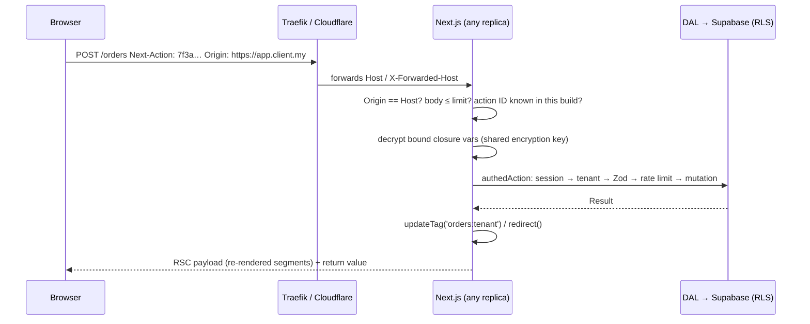

# Next.js - Server Actions, Mutations & Security

> [!info] Deep dive of [[Next.js]]

> [!abstract] TL;DR
> Every `'use server'` export is a **public POST endpoint** addressed by an action ID. Next.js adds Origin-based CSRF checks, unguessable IDs, closure encryption and a 1 MB body limit. **Authentication, tenant authorization, validation, rate limiting and idempotency are your job, in every action.**
> - Wrap actions in one `authedAction()` helper, so no action skips the checks.
> - Self-hosting on several replicas needs a shared `NEXT_SERVER_ACTIONS_ENCRYPTION_KEY` and a `deploymentId`, or actions break after deploys.
> - Patch quickly: 2025–26 brought RCE, DoS and CSRF-bypass CVEs in this exact surface.
>
> Form UX (`useActionState`, optimistic UI) is covered in [[React - Forms, Actions & Optimistic UI]]. This note covers the server side.

## Concept
| Mechanism | What Next.js does | What it doesn't do |
|---|---|---|
| Action ID | Hashed, unguessable ID per action and build. Unused actions are dropped from the build | Hide the endpoint: anyone with the page can read IDs from the client bundle |
| CSRF | POST only. Compares `Origin` with `Host` / `X-Forwarded-Host`. `serverActions.allowedOrigins` for extra origins | Protect GET route handlers or misconfigured proxies |
| Closure encryption | Variables captured by inline actions are encrypted (AES-GCM) into the page | Make secrets safe to capture: they still leave the server encrypted |
| Body limit | `serverActions.bodySizeLimit` (default `1mb`) | Stream files: use presigned uploads |
| Serialization | Args/returns via the RSC Flight protocol (FormData, plain objects, Dates, Maps) | Validate types at runtime: TypeScript types are erased |
| Client dispatch | Actions from one client run **one at a time** (queued) | Parallel data fetching: use RSC or route handlers for reads |

**Server Action vs route handler**:

| Use | Server Action | Route handler (`app/api/*/route.ts`) |
|---|---|---|
| Form/button mutations from your own UI | ✅ default | Possible |
| Webhooks (Meta, payment gateways), mobile app, n8n calls | ❌ | ✅ stable URL, own auth scheme |
| Streaming responses (SSE) | ❌ | ✅ |
| Public API contract / versioning | ❌ IDs change per build | ✅ |

## How It Works


## Practical Usage
**One wrapper for every action** (no dependency; `next-safe-action` offers the same as a library):
```ts
// lib/action.ts
import 'server-only';
import { z } from 'zod';
import { getSession } from '@/lib/auth';
import { rateLimit } from '@/lib/rate-limit';

type ActionResult<T> = { ok: true; data: T } | { ok: false; code: string; message: string; fieldErrors?: Record<string, string[]> };

export function authedAction<S extends z.ZodTypeAny, T>(
  schema: S,
  opts: { role?: 'owner' | 'staff'; limit?: number },
  fn: (input: z.infer<S>, ctx: { userId: string; tenantId: string }) => Promise<T>,
) {
  return async (raw: unknown): Promise<ActionResult<T>> => {
    const session = await getSession();                         // cookies(); verify, don't just decode
    if (!session) return { ok: false, code: 'unauthenticated', message: 'Please sign in again' };
    if (opts.role && !session.roles.includes(opts.role)) return { ok: false, code: 'forbidden', message: 'Not allowed' };
    if (!(await rateLimit(`act:${session.userId}`, opts.limit ?? 30))) return { ok: false, code: 'rate_limited', message: 'Too many requests' };
    const parsed = schema.safeParse(raw instanceof FormData ? Object.fromEntries(raw) : raw);
    if (!parsed.success) return { ok: false, code: 'invalid', message: 'Check the form', fieldErrors: parsed.error.flatten().fieldErrors };
    return { ok: true, data: await fn(parsed.data, { userId: session.userId, tenantId: session.tenantId }) };
  };
}
```
**An action using it** (tenant from the session, never from the form):
```ts
// app/(app)/orders/actions.ts
'use server';
import { updateTag } from 'next/cache';
import { authedAction } from '@/lib/action';
import { orders } from '@/lib/dal/orders';

export const confirmOrder = authedAction(
  z.object({ orderId: z.string().uuid(), idempotencyKey: z.string().min(8) }),
  { role: 'staff', limit: 60 },
  async ({ orderId, idempotencyKey }, { tenantId }) => {
    const order = await orders.confirm({ tenantId, orderId, idempotencyKey });   // DAL + RLS double check
    updateTag(`orders:${tenantId}`);                                             // read-your-writes for this user
    return { id: order.id, status: order.status };
  },
);
```
**Self-hosting config for multiple replicas** (Coolify, Docker):
```ts
// next.config.ts
export default {
  output: 'standalone',
  deploymentId: process.env.GIT_SHA,             // client and server agree on build; enables skew handling
  experimental: {
    serverActions: {                              // still under experimental in the config schema
      bodySizeLimit: '1mb',
      allowedOrigins: ['app.client.my', '*.client.my'],   // only if a proxy rewrites Host; never 'null'
    },
  },
};
```
```bash
# Same value on every replica and across rebuilds (32-byte base64). Store as a Coolify secret.
openssl rand -base64 32
# NEXT_SERVER_ACTIONS_ENCRYPTION_KEY=<value>
```
**Post-response work** without blocking the user:
```ts
import { after } from 'next/server';
after(async () => { await audit.log({ tenantId, action: 'order.confirm', orderId }); });
```
**Wrong way**:
```ts
'use server';
export async function updatePrice(tenantId: string, id: string, price: number) {   // ❌ tenantId from the client = IDOR
  await db.from('products').update({ price }).eq('id', id);                         // ❌ service-role client bypasses RLS
}
export async function exportAll() { return db.from('customers').select('*'); }      // ❌ helper accidentally exported = public data dump
```

## Patterns & Anti-patterns
| Pattern | When | Anti-pattern to avoid |
|---|---|---|
| `authedAction()` wrapper with session, role, Zod and rate limit | Every action | Ad-hoc checks that one action forgets |
| Tenant and user from the session | Multi-tenant apps | `tenantId` as a hidden form field |
| Data Access Layer (`server-only`, returns DTOs) | All DB access | Querying the DB directly inside components and actions |
| Supabase user-scoped client so RLS still applies | Mutations | Service-role key in actions "because it's server-side" |
| Idempotency key per submit (UUID from the form) | Payments, orders, WhatsApp sends | Double-submit creating two orders |
| Route handlers for webhooks, mobile and n8n | External callers | Calling action IDs from other systems |
| `'use server'` files exporting only actions | Action modules | Utilities in `'use server'` files (each export becomes an endpoint) |

## Performance & Trade-offs
- **Sequential dispatch**: concurrent actions from one tab queue up. A slow action (5 s LLM call) blocks the next click. Move long work to a queue and return a job ID ([[Message Queues - BullMQ in Production]]).
- **Round trip size**: an action that calls `revalidatePath('/')` re-renders a lot. Prefer `updateTag` / `revalidateTag` with narrow tags ([[Next.js - Caching]]).
- **Cold paths**: the auth + rate-limit wrapper costs one Redis call and one session lookup per action, about 1–3 ms on the same VPS. That's cheap compared with the risk it removes.
- **Bundle exposure**: every action used by a client component ships its ID. Dead-code elimination removes unused ones, so delete unused exports rather than leaving them.

## Tips & Reminders
> [!tip] In ZP's stack
> - **Multiple replicas or zero-downtime deploys on Coolify**: set `NEXT_SERVER_ACTIONS_ENCRYPTION_KEY` and `deploymentId: GIT_SHA`. Otherwise users with an open tab hit "Failed to find Server Action" or decryption errors after a deploy ([[Coolify - Multi-Server, Build Servers & Scaling]]).
> - **Behind Traefik and Cloudflare**: forward the original `Host` (Traefik does by default). If you rewrite hosts for custom tenant domains, list them in `allowedOrigins` ([[Next.js - Middleware, Auth & Multi-Tenant Routing]]).
> - **Rate limits** use Redis keyed by user and by IP ([[Redis - Rate Limiting & Distributed Locks]]).

- Return expected failures as values (`{ ok: false, code }`), and throw only for faults ([[TypeScript - Error Handling & Result Types]]). Thrown errors reach production clients as an opaque digest.
- Don't wrap `redirect()` / `notFound()` in generic `try/catch`: they work by throwing.
- Grep CI for `'use server'` files and review new exports in PRs, like new API routes.
- Files go to R2 via presigned URLs. The action only receives the object key ([[Cloudflare - R2 Storage & Presigned Uploads]]).

## Version Notes
| Version | Change relevant here |
|---|---|
| 14 (2023-10) | Server Actions stable. Origin/Host CSRF check, `allowedOrigins`, `bodySizeLimit` |
| 15 (2024-10) | Secure (unguessable, rotating) action IDs, dead-code elimination of unused actions. `NEXT_SERVER_ACTIONS_ENCRYPTION_KEY` documented for self-hosting. `after()` stable in 15.1 |
| 16 (2025-10) | `updateTag()` (actions only, read-your-writes), `revalidateTag(tag, profile)`, `refresh()`. `middleware.ts` → `proxy.ts` |
| 16.1.7 (2026-03) | CVE-2026-27978 fixed: `Origin: null` bypassed the CSRF check (affected ≥ 16.0.1, < 16.1.7) |
| 16.2.11 / 15.5.21 (2026-07) | CVE-2026-64641 (DoS via crafted action requests, CVSS 8.2), CVE-2026-64646 (Edge-runtime memory exhaustion), CVE-2026-64649 (SSRF on custom servers) fixed |

> [!warning] Unverified — check before relying on this
> The 2026 CVE details come from aggregators (vulert, cvefeed, cvelogic), not the Vercel advisories. Confirm affected ranges at https://github.com/vercel/next.js/security/advisories before reporting to clients.

## Critical Issues & Gotchas
> [!danger] React2Shell (CVE-2025-55182 / CVE-2025-66478, CVSS 10.0, Dec 2025)
> A deserialization flaw in the RSC Flight protocol gave unauthenticated RCE through the server-function endpoint on unpatched React 19 / Next.js 15–16 apps, even ones with no explicit actions. Exploitation started within days. Treat React and Next.js security releases as same-day patches, and rotate secrets on any app that was exposed unpatched ([[Next.js]]).

> [!danger] Server Actions are API endpoints without an API review
> Teams review `app/api` routes but treat actions as "just functions". Missing auth, tenant checks taken from client input, or a service-role client inside an action is BOLA/IDOR ([[OWASP Top 10 - API Security Top 10 in Practice]]). Enforce the wrapper, and keep RLS as the second wall ([[Supabase - Row Level Security]]).

- **`allowedOrigins: ['null']` or `'*'`** disables the CSRF protection you rely on. Sandboxed iframes send `Origin: null`.
- **Encryption key per replica**: without a shared key, closure-bound actions fail on whichever replica didn't render the page.
- **Version skew**: open tabs keep old action IDs after a deploy. Set `deploymentId`, and show a "new version, reload" prompt on the resulting error.
- **Edge runtime actions**: CVE-2026-64646 showed memory limits are tighter there. Prefer the Node runtime for actions doing real work.
- **Logging inputs**: actions receive raw FormData with IC numbers and phones. Redact before logging (PDPA).

## Related
- [[Next.js]]
- [[React - Forms, Actions & Optimistic UI]] — client side: `useActionState`, optimistic UI, progressive enhancement
- [[Next.js - Middleware, Auth & Multi-Tenant Routing]] — sessions and tenant resolution the wrapper uses
- [[Next.js - Caching]] — `updateTag`, `revalidateTag`, cache profiles
- [[TypeScript - Runtime Validation with Zod & Type-Safe APIs]] — schemas at the action boundary
- [[REST API - Webhooks & Idempotency]] — idempotency keys and when to use route handlers instead

## References
- https://nextjs.org/docs/app/guides/data-security
- https://nextjs.org/docs/app/getting-started/updating-data
- https://nextjs.org/docs/app/api-reference/config/next-config-js/serverActions
- https://nextjs.org/docs/app/guides/self-hosting
- https://vulert.com/vuln-db/CVE-2026-64641
- https://www.cvelogic.com/cve/CVE-2026-27978
