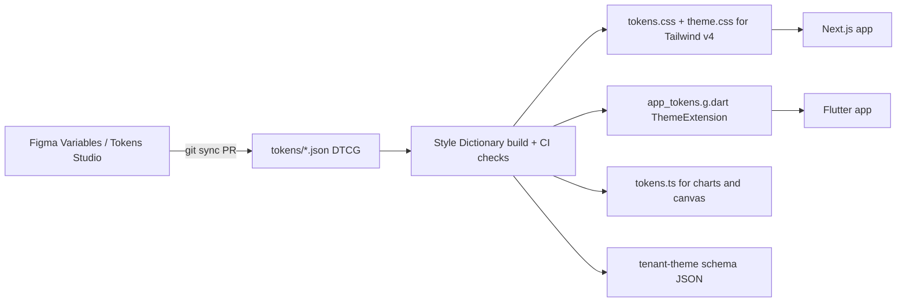

# Tailwind CSS - Design Token Pipeline for Web & Flutter

> [!info] Deep dive of [[Tailwind CSS]]

> [!abstract] TL;DR
> One `tokens/` package in DTCG JSON is the source of truth. **Style Dictionary** builds:
> - CSS variables plus a Tailwind v4 `@theme inline` file for Next.js;
> - a Dart `ThemeExtension` and `ColorScheme` for Flutter;
> - a JSON schema for runtime tenant themes.
>
> Tokens are versioned with semver and CI checks contrast. Nobody copies hex values by hand. Runtime theming on the web lives in [[Tailwind CSS - Theming & Component Architecture]]. This note covers the **build pipeline** that feeds it.

## Concept
- **DTCG format** (W3C Community Group, first stable 2025.10): each token has `$value`, an optional `$type` and `$description`, and aliases written as `"{color.brand.600}"`. Groups are nested objects. Tool support includes Style Dictionary, Tokens Studio, zeroheight and Penpot.
- **Three tiers**. Only semantic tokens reach components:

| Tier | Example | Consumed by |
|---|---|---|
| Primitive | `color.teal.600 = oklch(0.6 0.12 190)` | Semantic tokens only |
| Semantic | `color.primary = {color.teal.600}` (light), `{color.teal.400}` (dark) | Components on both platforms |
| Component (optional) | `button.radius = {radius.md}` | One component family |

- **Modes** (light/dark, tenant brands) are separate token sets that override the **semantic** layer only. Primitives are shared.
- **Platform transforms** convert units and formats: `rem` to Flutter logical px, OKLCH to sRGB ARGB, font weights to `FontWeight.w600`, and `cubicBezier` to `Cubic`.

## How It Works

1. Designers edit Figma Variables, or Tokens Studio with git sync. The output is a PR on `tokens/`, never a direct write to apps.
2. CI runs:
   - a Style Dictionary build;
   - an alias-cycle check;
   - WCAG contrast checks on declared pairs (`on-primary` vs `primary` ≥ 4.5:1);
   - a snapshot diff of the generated outputs.
3. The package is published as `@acme/tokens` (npm) and as a path or git dependency for Flutter. Apps bump the version explicitly.

## Practical Usage
**Source tokens** (`tokens/semantic.light.json`):
```json
{
  "color": {
    "primary":    { "$type": "color", "$value": "{color.teal.600}", "$description": "Brand actions" },
    "on-primary": { "$type": "color", "$value": "{color.neutral.0}" },
    "surface":    { "$type": "color", "$value": "{color.neutral.0}" }
  },
  "radius": { "md": { "$type": "dimension", "$value": { "value": 8, "unit": "px" } } }
}
```
**Style Dictionary config** (ESM, v4+ API):
```js
// tokens/sd.config.mjs
import StyleDictionary from 'style-dictionary';
import { formatHex8, parse } from 'culori';

StyleDictionary.registerTransform({
  name: 'color/flutterHex', type: 'value', transitive: true,
  filter: (t) => t.$type === 'color',
  transform: (t) => {                                 // gamut-clamped sRGB → 0xAARRGGBB
    const h = formatHex8(parse(t.$value));            // '#rrggbbaa'
    return `0x${h.slice(7, 9)}${h.slice(1, 7)}`.toUpperCase().replace('0X', '0x');
  },
});

for (const mode of ['light', 'dark']) {
  const sd = new StyleDictionary({
    source: ['tokens/primitives.json', `tokens/semantic.${mode}.json`],
    platforms: {
      css: {
        transformGroup: 'css', prefix: 'ds', buildPath: 'dist/css/',          // --ds-color-primary
        files: [{ destination: `${mode}.css`, format: 'css/variables',
                  options: { selector: mode === 'light' ? ':root' : '.dark', outputReferences: true } }],
      },
      flutter: {
        transforms: ['attribute/cti', 'name/camel', 'color/flutterHex', 'size/flutter/remToDouble'],
        buildPath: 'dist/flutter/',
        files: [{ destination: `tokens_${mode}.g.dart`, format: 'flutter/theme-extension',
                  filter: (t) => t.path[0] !== 'primitive' }],
      },
    },
  });
  await sd.buildAllPlatforms();
}
```
**Tailwind v4 bridge** (`theme.css`, written once by hand). It maps the prefixed variables to utilities; without the prefix, `--color-primary: var(--color-primary)` would be a self-reference cycle:
```css
@import "@acme/tokens/css/light.css";
@import "@acme/tokens/css/dark.css";
@theme inline {
  --color-*: initial;                       /* drop Tailwind's default palette: tokens only */
  --color-primary: var(--ds-color-primary);
  --color-on-primary: var(--ds-color-on-primary);
  --color-surface: var(--ds-color-surface);
  --radius-md: var(--ds-radius-md);
}
```
**Flutter output + usage** (generated `ThemeExtension`, hand-written wiring):
```dart
// tokens_light.g.dart — generated by a custom 'flutter/theme-extension' format
@immutable
class AppTokens extends ThemeExtension<AppTokens> {
  const AppTokens({required this.primary, required this.onPrimary, required this.surface, required this.radiusMd});
  final Color primary, onPrimary, surface;
  final double radiusMd;
  static const light = AppTokens(primary: Color(0xFF00897B), onPrimary: Color(0xFFFFFFFF), surface: Color(0xFFFFFFFF), radiusMd: 8);

  @override
  AppTokens copyWith({Color? primary, Color? onPrimary, Color? surface, double? radiusMd}) => AppTokens(
      primary: primary ?? this.primary, onPrimary: onPrimary ?? this.onPrimary,
      surface: surface ?? this.surface, radiusMd: radiusMd ?? this.radiusMd);

  @override
  AppTokens lerp(AppTokens? o, double t) => o == null ? this : AppTokens(
      primary: Color.lerp(primary, o.primary, t)!, onPrimary: Color.lerp(onPrimary, o.onPrimary, t)!,
      surface: Color.lerp(surface, o.surface, t)!, radiusMd: lerpDouble(radiusMd, o.radiusMd, t)!);
}
```
```dart
ThemeData buildTheme(AppTokens t, Brightness b) => ThemeData(
  colorScheme: ColorScheme.fromSeed(seedColor: t.primary, brightness: b)
      .copyWith(primary: t.primary, onPrimary: t.onPrimary, surface: t.surface),
  extensions: [t],
);
final tokens = Theme.of(context).extension<AppTokens>()!;   // in widgets
```
**Wrong way**:
```dart
const brandTeal = Color(0xFF009688);   // ❌ hand-copied from Figma; drifts from web's oklch(0.6 0.12 190)
```

## Patterns & Anti-patterns
| Pattern | When | Anti-pattern to avoid |
|---|---|---|
| Tokens repo or package with semver + changelog | Any web + mobile product | Tokens edited inside each app's `globals.css` / `theme.dart` |
| Semantic layer only exposed to components | Always | Components using `teal-600` directly, so dark mode needs per-component fixes |
| Generated `ThemeExtension` + `ColorScheme` mapping | Flutter | Only `ColorScheme`, cramming custom roles into `tertiary` |
| `--color-*: initial` in `@theme` | Strict design systems | Tailwind defaults (`bg-blue-500`) leaking past review |
| Runtime tenant theme = semantic overrides validated by JSON schema | White-label SaaS | Letting tenants set arbitrary CSS or primitives |
| Contrast + snapshot checks in CI | Every token PR | Visual QA after release |

## Performance & Trade-offs
- **Build cost**: a Style Dictionary run over ~500 tokens takes under 1 s, so put it in a pre-commit hook or a Turborepo task. Generated files are committed or published, never built at app runtime.
- **Web runtime**: CSS variables add no JS. Theme switch = class or attribute flip. Flutter's `ThemeExtension.lerp` gives animated light/dark transitions for free.
- **Colour fidelity**: OKLCH primitives can fall outside sRGB. Gamut-map (clamp chroma) **in the transform**, otherwise web P3 screens and Flutter show different colours. Flutter 3.27+ has wide-gamut `Color` (Display P3), but you must opt into it per platform.
- **Unit mismatch**: `1rem = 16px` on web. Flutter uses logical pixels and **unitless** `TextStyle.height` (line-height ÷ font-size). CSS `box-shadow` spread has no direct `BoxShadow` equivalent beyond `spreadRadius`. Expect a small set of per-platform tokens.
- **Runtime tenant themes**: storing semantic overrides as `jsonb` on `tenants` ([[System Design - Multi-Tenant SaaS Architecture]]) enables theming without app releases, at the cost of a schema-validation path in both clients.

## Tips & Reminders
> [!tip] In ZP's stack
> - Use a Turborepo/pnpm monorepo with `packages/tokens` (Style Dictionary), `apps/web` (Next.js + Tailwind v4) and `apps/mobile` (Flutter, depending on the tokens package via a `path:` dependency on the `dist/flutter` folder).
> - For white-label client apps, ship base tokens in the build and fetch tenant overrides from Supabase at startup.
> - Cache tenant overrides in `shared_preferences` so the first frame isn't unbranded.

- Name semantic tokens by role (`primary`, `on-primary`, `surface-muted`), matching Material 3 role names where possible. The Flutter `ColorScheme` mapping then becomes 1:1.
- Keep a `$description` on every semantic token. Style Dictionary emits it as doc comments in Dart and CSS.
- Test a theme change end-to-end once: change one token → PR → CI → bump the package in both apps → screenshot diff.
- Primitives can live in OKLCH for perceptual scales, while apps consume generated sRGB/P3. Designers keep editing in Figma either way.

## Version Notes
| Version | Change relevant here |
|---|---|
| DTCG Format Module 2025.10 (2025-10-28) | First stable spec. Community Group report, not a W3C Standard. Structured colour and dimension values (`{ value, unit }`) |
| Style Dictionary v4 (2024) | ESM, async API, `$value`/`$type` DTCG support, `outputReferences` improvements |
| Style Dictionary v5 (2025) | DTCG-first. README seen at 5.5.0. Check the changelog for removed v3 hooks |
| Tailwind v4.0 (2025-01) → 4.3 | CSS-first `@theme` replaces `tailwind.config.js` theme objects. Use `@theme inline` for variable-backed tokens |
| Flutter 3.27 (2024-12) | Wide-gamut `Color` (`.r/.g/.b` doubles, `withValues()`). `withOpacity` and `.value` deprecated, so generators must emit the new API |

> [!warning] Unverified — check before relying on this
> Style Dictionary v5 details (default format, removed APIs) came from a vendor guide and npm READMEs. Check https://styledictionary.com before upgrading.

## Critical Issues & Gotchas
> [!danger] Figma Variables REST API is plan-gated
> Pulling variables automatically through Figma's REST API needs an Enterprise plan. On lower plans, the pipeline depends on a plugin (Tokens Studio, or a variables export plugin) and on a designer pressing "push". That makes it a single point of failure: document the manual export path.

> [!danger] Breaking token renames
> Renaming `primary` → `brand` silently breaks Flutter compile, or worse, leaves web classes resolving to nothing (`bg-brand` with no variable means transparent). Treat removed or renamed semantic tokens as a **major** version bump, and keep deprecated aliases for one minor version.

- **Alias cycles and missing references** fail the build late. Run `sd.buildAllPlatforms()` in CI on every PR, not only on release.
- **`--color-*: initial`** also removes `white`, `black` and `transparent` unless you redefine them.
- **Dark mode mismatch**: web keys off the `.dark` class while Flutter keys off `Brightness`. Make sure both read the same user preference (system / light / dark) from the same setting.
- **Platform risk**: Tailwind Labs' 2026 layoffs (see [[Tailwind CSS]]) are a reason to keep tokens framework-agnostic in DTCG JSON. If Tailwind stalls, only the small `theme.css` bridge changes.

## Related
- [[Tailwind CSS]]
- [[Tailwind CSS - Theming & Component Architecture]] — runtime theming, shadcn/ui, cva
- [[Flutter]] — ThemeData, Material 3 roles
- [[Flutter - State Management]] — theme-mode providers
- [[System Design - Multi-Tenant SaaS Architecture]] — per-tenant branding storage
- [[Next.js]] — consuming the tokens package

## References
- https://www.w3.org/community/design-tokens/2025/10/28/design-tokens-specification-reaches-first-stable-version/
- https://www.designtokens.org/
- https://styledictionary.com/
- https://unpkg.com/style-dictionary@5.5.0/README.md
- https://zeroheight.com/whats-new/use-tokens-anywhere-by-exporting-to-style-dictionary/
- https://docs.flutter.dev/release/breaking-changes/wide-gamut-framework
