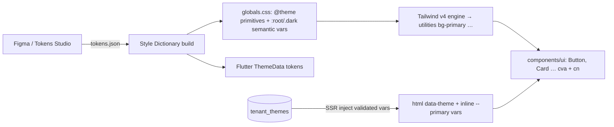

# Tailwind CSS - Theming & Component Architecture

> [!info] Deep dive of [[Tailwind CSS]]

> [!abstract] TL;DR
> - **Token tiers**: **primitive** (`--color-emerald-600`), then **semantic** (`--primary`, `--background`), then **component** usage (`bg-primary`).
> - **Mechanics**: semantic tokens are CSS variables swapped per theme (`.dark`, `[data-theme="tenant"]`), and Tailwind v4's `@theme inline` maps them to utilities. One component library then serves light/dark and every white-label tenant **without rebuilding CSS**.
> - **Components**: shadcn/ui-style, i.e. code you own, `cva` variants, `cn()` = `clsx` + `tailwind-merge`, and accessible primitives (Radix or Base UI).

## Concept

### Token tiers
| Tier | Example | Lives in | Changes when… |
|---|---|---|---|
| **Primitive** | `--color-emerald-600: oklch(0.6 0.15 160)` | `@theme` | Brand palette changes (rare) |
| **Semantic** | `--primary`, `--primary-foreground`, `--background`, `--muted`, `--destructive`, `--ring`, `--radius` | `:root`, `.dark`, `[data-theme=…]` | Theme/mode/tenant switches (runtime) |
| **Component** | `bg-primary text-primary-foreground rounded-md` | Component files | Design decisions per component |

- Components must **only use semantic utilities** (`bg-primary`, `text-muted-foreground`), never primitives (`bg-emerald-600`). Otherwise dark mode and white-labelling require editing every component.

### `@theme` vs `@theme inline` (v4)
| Directive | Effect | Use for |
|---|---|---|
| `@theme { --color-brand: oklch(...) }` | Defines a token **and** generates utilities (`bg-brand`), emitted as a CSS variable | Primitive palette, spacing, fonts |
| `@theme inline { --color-primary: var(--primary) }` | Utilities reference the *runtime* variable directly (no static resolution) | Semantic tokens that change per theme/tenant |

### shadcn/ui architecture (the de facto pattern)
| Piece | Role |
|---|---|
| CLI + registry | Copies component source into **your repo** (`components/ui/*`). You own and edit it. Registries can ship components, themes and blocks |
| Primitives | Radix UI (unified `radix-ui` package in 2026) or **Base UI** (selectable at init) for accessibility/behaviour |
| `cva` | Variant API (`variant`, `size`) mapped to class strings |
| `cn()` | `twMerge(clsx(...))`: conditional classes plus conflict resolution (`p-2` vs `p-4`) |
| CSS variables | Semantic tokens in `globals.css`. Themes = variable sets |

## How It Works

- **Runtime theming is pure CSS**: utilities like `bg-primary` compile to `background-color: var(--color-primary)`, which resolves to `var(--primary)`, set per scope. Switching `.dark` or `data-theme` repaints without JS re-rendering.

## Practical Usage

### `globals.css` (Tailwind v4 + semantic tokens)
```css
@import "tailwindcss";
@custom-variant dark (&:where(.dark, .dark *));          /* class-based dark mode */

@theme {
  --font-sans: "Inter", ui-sans-serif, system-ui, sans-serif;
  --color-emerald-600: oklch(0.6 0.15 160);
  --color-slate-950: oklch(0.13 0.03 265);
}

:root {
  --background: oklch(1 0 0);
  --foreground: oklch(0.15 0.02 265);
  --primary: oklch(0.6 0.15 160);
  --primary-foreground: oklch(0.98 0 0);
  --muted: oklch(0.96 0.01 265);
  --muted-foreground: oklch(0.45 0.02 265);
  --destructive: oklch(0.58 0.22 27);
  --ring: oklch(0.6 0.15 160);
  --input: oklch(0.92 0.01 265);
  --radius: 0.625rem;
}
.dark {
  --background: oklch(0.15 0.02 265);
  --foreground: oklch(0.97 0 0);
  --primary: oklch(0.7 0.14 160);
  --muted: oklch(0.25 0.02 265);
  --muted-foreground: oklch(0.7 0.02 265);
}
[data-theme="kopi-kita"] { --primary: oklch(0.5 0.12 50); --ring: oklch(0.5 0.12 50); --radius: 0.25rem; }

@theme inline {
  --color-background: var(--background);
  --color-foreground: var(--foreground);
  --color-primary: var(--primary);
  --color-primary-foreground: var(--primary-foreground);
  --color-muted: var(--muted);
  --color-muted-foreground: var(--muted-foreground);
  --color-destructive: var(--destructive);
  --color-ring: var(--ring);
  --color-input: var(--input);
  --radius-lg: var(--radius);
  --radius-md: calc(var(--radius) - 2px);
}
```

### Component with variants (shadcn-style)
```tsx
import { cva, type VariantProps } from "class-variance-authority";
import { Slot } from "radix-ui";
import { cn } from "@/lib/utils";          // export const cn = (...i: ClassValue[]) => twMerge(clsx(i));

const button = cva(
  "inline-flex items-center justify-center gap-2 rounded-md text-sm font-medium transition-colors " +
  "focus-visible:outline-none focus-visible:ring-2 focus-visible:ring-ring disabled:pointer-events-none disabled:opacity-50",
  {
    variants: {
      variant: {
        default: "bg-primary text-primary-foreground hover:bg-primary/90",
        outline: "border border-input bg-background hover:bg-muted",
        destructive: "bg-destructive text-white hover:bg-destructive/90",
        ghost: "hover:bg-muted",
      },
      size: { sm: "h-8 px-3", md: "h-10 px-4", lg: "h-11 px-6", icon: "size-10" },
    },
    defaultVariants: { variant: "default", size: "md" },
  },
);

export function Button({ className, variant, size, asChild, ...props }:
  React.ComponentProps<"button"> & VariantProps<typeof button> & { asChild?: boolean }) {
  const Comp = asChild ? Slot.Root : "button";
  return <Comp className={cn(button({ variant, size }), className)} {...props} />;
}
```

### White-label tenant themes (SSR, validated)
```tsx
// app/layout.tsx: tenant resolved from hostname (branding only; auth comes from the session)
const theme = await getTenantTheme(host);                        // { primary: "oklch(0.5 0.12 50)", radius: "0.25rem" }
const safe = sanitizeThemeVars(theme);                          // allow-list keys + regex for oklch()/rem values; no url(), no ;
return (
  <html lang="en" data-theme={theme.slug} style={safe as React.CSSProperties} suppressHydrationWarning>
    <body className="bg-background text-foreground">{children}</body>
  </html>
);
```
- Inline `--primary` values override the stylesheet defaults for that tenant, with no per-tenant CSS build ([[System Design - Multi-Tenant SaaS Architecture]]).
- Avoid dark-mode flash: set the `.dark` class before paint (an inline script reading the cookie or `prefers-color-scheme`, or `next-themes`).

### Dynamic classes: what Tailwind can't see
```tsx
// ❌ Not generated: the compiler scans source text, not runtime values
<div className={`bg-${color}-500`} />
// ✅ Map to complete class names, or use CSS variables
const tone = { success: "bg-emerald-500", danger: "bg-red-500" } as const;
<div className={tone[status]} />
<div className="bg-(--tenant-accent)" style={{ "--tenant-accent": accent } as React.CSSProperties} />
```

## Patterns & Anti-patterns
| Pattern | When | Anti-pattern to avoid |
|---|---|---|
| Semantic tokens + `@theme inline` | Any app with dark mode or white-label | Hard-coded `bg-emerald-600 dark:bg-emerald-400` in every component |
| Own your components (shadcn), wrap primitives | Product UIs | Heavy third-party UI kits fighting your tokens |
| `cva`/`tailwind-variants` for variants, `cn()` for overrides | Reusable components | String concatenation with conflicting classes (`p-2 … p-4`) |
| Tokens generated from one source (Figma → Style Dictionary) | Web + Flutter apps | Copy-pasted hex values diverging across platforms |
| `@utility` for genuinely reusable custom utilities | Repeated patterns | `@apply` everywhere, recreating BEM in CSS files |
| OKLCH palettes with contrast checks | Accessible themes | Tenant-chosen colours without contrast validation (unreadable buttons) |

## Performance & Trade-offs
- **CSS size** stays small: utilities are generated once regardless of the number of themes, and themes are just variable blocks (bytes, not KB).
- **Runtime theme switch** is cheap (variable change → repaint). Avoid toggling classes on thousands of nodes. Switch at `<html>` level.
- **Owning components** means you also own updates. Re-run the shadcn CLI diff/migrate deliberately (e.g. the 2026 unified `radix-ui` migration) instead of auto-updating.
- **Radix vs Base UI**: both accessible. Base UI is newer, and a team might pick it for its API or maintenance outlook. Don't mix primitive libraries within one design system.

## Tips & Reminders
> [!tip]
> - **Name tokens by role**, not colour (`--primary`, not `--green`), so a tenant with an orange brand doesn't need renamed tokens.
> - **Validate tenant colours**: compute contrast of `--primary` vs `--primary-foreground` (WCAG AA ≥ 4.5:1 for text), and auto-pick a foreground from the OKLCH lightness.
> - **Configure `tailwind-merge`** if you add custom tokens or utility groups, so it resolves conflicts correctly.
> - **Keep `components/ui`** for primitives and `components/<feature>` for composed product components. That avoids editing primitives for one screen.
> - **In ZP's stack**:
>   - **Client SaaS**: shadcn + Tailwind v4 on Next.js with a `tenant_themes` table (primary, radius, logo) injected at SSR.
>   - **Mobile**: Flutter apps consume the same token JSON for `ThemeData`, keeping brands consistent across web and mobile.

## Version Notes
| Version | Change |
|---|---|
| Tailwind v3 (2021–2024) | `tailwind.config.js` theme, JIT, `darkMode: 'class'` |
| **Tailwind v4.0** (2025-01) | CSS-first `@theme`, `@theme inline`, `@custom-variant`, `@utility`, OKLCH palette, Rust engine |
| v4.1–4.3 (2025–2026) | Text shadows/masks (4.1), more utilities and integrations (webpack plugin in 4.2). 4.3.x current |
| shadcn/ui (2025) | Tailwind v4 + React 19 support, OKLCH theme variables, `@theme inline` mapping |
| shadcn/ui (2026) | Base UI option at init (Jan). Unified `radix-ui` package with a `migrate radix` command (Feb) |

> [!warning] Unverified — check before relying on this
> shadcn 2026 changes (Base UI option, unified Radix package) come from third-party mirrors, and no Tailwind 4.4 release was found. Check ui.shadcn.com/docs/changelog and the Tailwind blog.

## Critical Issues & Gotchas
> [!danger] CSS injection via tenant-controlled theme values
> Writing tenant-supplied strings into a `<style>` tag or `style` attribute without validation allows CSS injection: `url()` beacons for tracking/exfiltration, UI redress, or breaking out of the declaration. Allow-list the variable names, validate values with strict regexes (`oklch(...)`, `#rrggbb`, `rem` lengths), and never interpolate raw strings into `<style>` blocks.

> [!danger] Dark-mode flash and hydration mismatch
> Rendering the theme class on the client after hydration causes a white flash and React hydration warnings. Set the class or `data-theme` on `<html>` server-side (cookie) or via a tiny blocking script, and use `suppressHydrationWarning` on `<html>` only.

> [!warning] Gotchas
> - The v3 → v4 upgrade changed defaults (border colour = `currentColor`, ring width, `shadow`/`rounded` scale renames). Run `npx @tailwindcss/upgrade` and review visual diffs.
> - `@theme` (not inline) referencing `var(--primary)` resolves at definition scope, so per-theme overrides seem to "not work". Use `@theme inline` for runtime vars.
> - Opacity modifiers (`bg-primary/90`) on variables need colour values in a format `color-mix()` can handle. OKLCH works.
> - Class strings built in other files (CMS, DB) aren't scanned. Add `@source` paths or safelist via `@source inline(...)`.
> - Copy-pasted shadcn components drift from upstream accessibility fixes. Review the changelog quarterly.

## Related
- [[Tailwind CSS]]
- [[React]] — component composition, `asChild`/Slot patterns
- [[Next.js]] — SSR theme injection, layouts
- [[System Design - Multi-Tenant SaaS Architecture]] — white-label tenants
- [[Browser & Web Fundamentals]] — cascade layers, CSS variables, contrast
- [[Flutter]] — sharing design tokens with mobile
- [[Tailwind CSS - Design Token Pipeline for Web & Flutter]] — build pipeline feeding these tokens

## References
- Tailwind CSS theme variables: https://tailwindcss.com/docs/theme
- Tailwind dark mode (v4): https://tailwindcss.com/docs/dark-mode
- shadcn/ui theming: https://ui.shadcn.com/docs/theming
- shadcn/ui changelog: https://ui.shadcn.com/docs/changelog
- class-variance-authority: https://cva.style/docs
- tailwind-merge: https://github.com/dcastil/tailwind-merge
