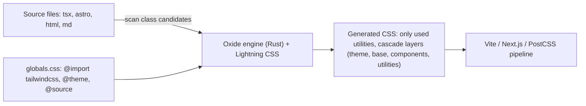

# Tailwind CSS

> [!abstract] TL;DR
> Tailwind is a **utility-first CSS framework**: you style by composing small single-purpose classes (`flex gap-4 rounded-lg bg-white p-6 shadow-sm md:grid-cols-3`) in markup, and the compiler emits only the CSS you used. It's the default styling layer for [[Next.js]]/[[React]]/[[Astro]] projects and AI-generated UIs, and shadcn/ui builds on it.
> - **v4** (2025) brought a Rust-powered engine (~5–100× faster builds), **CSS-first config** (`@theme` instead of `tailwind.config.js`), automatic content detection, and native cascade layers/OKLCH colors. Current is **v4.3.x**.
> - **Business risk**: Tailwind Labs cut ~75% of its engineering team in January 2026 (AI-driven revenue drop). It now has sponsors (Vercel, Supabase, Google AI Studio), but watch the maintenance cadence.

## Introduction
- **Origin**: Adam Wathan, Steve Schoger and team, 1.0 in 2019. MIT license. Commercial products: **Tailwind Plus** (formerly Tailwind UI: components/templates) and Catalyst. Revenue depends on docs traffic converting to paid products.
- **Problem**: traditional CSS grows append-only (naming debates, dead styles, specificity wars). Component-library CSS is hard to customize. Utilities co-locate styling with markup and constrain choices to a design system.
- **Where it sits**: React/Next.js/Astro/Vue/Svelte apps, shadcn/ui (copy-paste components using Tailwind + Radix), daisyUI, Headless UI. LLM coding tools default to Tailwind classes, which reinforces the ecosystem.

## Core Concepts

### Utilities, variants, responsive design
```tsx
export function PlanCard({ plan, featured }: { plan: Plan; featured?: boolean }) {
  return (
    <div className={cn(
      "flex flex-col gap-4 rounded-2xl border p-6 shadow-sm",
      "bg-white dark:bg-zinc-900 dark:border-zinc-800",                 // dark mode variant
      featured && "ring-2 ring-emerald-500",                            // conditional classes via clsx/tailwind-merge
    )}>
      <h3 className="text-lg font-semibold text-zinc-900 dark:text-zinc-50">{plan.name}</h3>
      <p className="text-3xl font-bold">RM {plan.price}<span className="text-sm font-normal text-zinc-500">/mo</span></p>
      <button className="mt-auto rounded-lg bg-emerald-600 px-4 py-2 text-white hover:bg-emerald-700
                         focus-visible:outline-2 focus-visible:outline-offset-2 disabled:opacity-50
                         sm:w-auto w-full">Choose plan</button>
    </div>
  );
}
```
| Feature | Example |
|---|---|
| Responsive (mobile-first breakpoints) | `sm:` 40rem, `md:` 48rem, `lg:` 64rem, `xl:` 80rem, `2xl:` 96rem |
| State variants | `hover:`, `focus-visible:`, `active:`, `disabled:`, `aria-expanded:`, `data-[state=open]:` |
| Group/peer | `group-hover:`, `peer-checked:` |
| Container queries (built in v4) | `@container` + `@md:grid-cols-2` |
| Dark mode | `dark:` (media query by default, or class/selector strategy) |
| Arbitrary values | `w-[37rem]`, `grid-cols-[200px_1fr]`, `bg-[var(--brand)]` |
| Modern CSS | `starting:` (`@starting-style`), `not-*`, `inert`, 3D transforms, text-shadow/masks (4.1) |

### v4 CSS-first configuration
```css
/* app/globals.css */
@import "tailwindcss";
@source "../packages/ui";                 /* extra content paths (auto-detection covers the project) */
@plugin "@tailwindcss/typography";

@theme {
  --color-brand-50:  oklch(0.97 0.02 160);
  --color-brand-600: oklch(0.55 0.15 160);
  --font-sans: "Inter", ui-sans-serif, system-ui;
  --breakpoint-3xl: 120rem;
}

@custom-variant dark (&:where(.dark, .dark *));   /* class-based dark mode */

@layer components {
  .btn-primary { @apply rounded-lg bg-brand-600 px-4 py-2 text-white hover:bg-brand-600/90; }
}
```
Theme values become **CSS variables** (`var(--color-brand-600)`) usable anywhere, including in JS animation libraries.

## Architecture / How It Works

- **Just-in-time generation**: the engine scans files for class-name *strings* and generates CSS only for those it finds. Classes must appear as complete strings in source (`bg-red-500`, not `` `bg-${color}-500` ``).
- **v4 engine**: written in Rust ("Oxide") with Lightning CSS for transforms, prefixing and nesting. Full builds are ~3–5× faster and incremental rebuilds up to ~100× faster than v3.
- Output uses native **cascade layers** (`@layer theme, base, components, utilities`), `@property` and `color-mix()`. That's why v4 requires modern browsers (Safari 16.4+, Chrome 111+, Firefox 128+).
- Integrations: `@tailwindcss/vite` (fastest), `@tailwindcss/postcss` (Next.js), CLI, webpack plugin (4.2).

## Project Structure
```text
app/
├── app/globals.css              # @import "tailwindcss"; @theme {...}
├── components/ui/               # shadcn/ui components (owned code, Tailwind classes)
├── lib/utils.ts                 # cn() = clsx + tailwind-merge
├── postcss.config.mjs           # { plugins: { "@tailwindcss/postcss": {} } } (Next.js)
└── .prettierrc                  # plugins: ["prettier-plugin-tailwindcss"] (class sorting)
```
```ts
// lib/utils.ts: merge conflicting classes predictably (later wins)
import { clsx, type ClassValue } from "clsx";
import { twMerge } from "tailwind-merge";
export const cn = (...inputs: ClassValue[]) => twMerge(clsx(inputs));
```
```bash
npm install tailwindcss @tailwindcss/postcss        # Next.js
npx @tailwindcss/upgrade                            # automated v3 → v4 migration
npx shadcn@latest init && npx shadcn@latest add button dialog form
```

## Use Cases
| Use case | Why it fits |
|---|---|
| SaaS dashboards and admin panels | Fast iteration, consistent spacing/colors, shadcn/ui components |
| Marketing/landing sites ([[Astro]], Next.js) | Tiny CSS output, responsive utilities, design tokens |
| Design systems with tokens | `@theme` variables shared across apps |
| AI-assisted UI generation | Models produce Tailwind markup reliably |
| Email HTML | **Weaker fit**. Email clients need inline styles (use a dedicated tool like Maizzle/React Email) |
| Flutter apps | **Not applicable**. Flutter has its own widget styling |

## Pros & Cons
| Pros | Cons |
|---|---|
| No naming, no dead CSS, small production bundles | Long class strings. Markup gets noisy |
| Design constraints (spacing/color scales) improve consistency | Learning the vocabulary. Debugging requires reading markup |
| Fast builds (v4), great DX with IntelliSense + Prettier sorting | Dynamic class names must be safelisted or written fully |
| Huge ecosystem (shadcn/ui, Tailwind Plus, templates) | Encourages copy-paste UI sameness |
| Framework-agnostic | v4 drops support for older browsers |
| Theme values as CSS variables | Vendor health risk after the 2026 layoffs |

## Alternatives & Peers
| Alternative | Strength vs Tailwind | Weakness vs Tailwind | Pick it when… |
|---|---|---|---|
| CSS Modules / plain modern CSS (nesting, layers, container queries) | No dependency, full CSS power | Naming and organization overhead | Small sites, CSS-savvy teams |
| UnoCSS | Faster, highly configurable, presets incl. Tailwind-compatible | Smaller ecosystem | Custom utility engines |
| Panda CSS / vanilla-extract / StyleX | Type-safe, zero-runtime CSS-in-JS | More setup | Large design systems in TS |
| Component libraries (MUI, Mantine, Chakra) | Complete components out of the box | Harder to customize, heavier | Internal tools needing speed over branding |
| Bootstrap | Familiar, component classes | Generic look, less flexible | Legacy/admin templates |

## Tips & Reminders
> [!tip]
> - Use `cn()` (clsx + tailwind-merge) for conditional and overridable classes in components.
> - Never build class names dynamically from strings. Map variants to full class strings (`const color = { ok: "bg-emerald-600", err: "bg-red-600" }[status]`).
> - Install the official Prettier plugin for class ordering and the VS Code IntelliSense extension.
> - Extract repeated patterns into **components**, not `@apply` everywhere. Keep `@apply` for small primitives.
> - Accessibility: use `focus-visible:` rings, `sr-only`, sufficient contrast (OKLCH palettes), and `motion-safe:`/`motion-reduce:`.
> - **In ZP's stack**:
>   - [[Next.js]] dashboards: Tailwind v4 + shadcn/ui, with client brand colors in `@theme`.
>   - [[Astro]] landing pages: Tailwind with `@tailwindcss/vite`.
>   - Keep one shared preset/theme file per client for consistent proposals and demos.

## Versions & Breaking Changes
| Version | Released | Key changes | Breaking / migration notes |
|---|---|---|---|
| 1.0 | 2019-05 | Utility-first framework | — |
| 2.0 | 2020-11 | Dark mode, extended palette | — |
| 3.0 | 2021-12 | JIT engine always on, arbitrary values | `purge` → `content` |
| **4.0** | 2025-01-22 | Rust engine, CSS-first `@theme`, auto content detection, container queries, OKLCH palette, cascade layers, Vite plugin | Config moves to CSS. Renamed utilities (`shadow-sm`→`shadow-xs`, `rounded`→`rounded-sm`, `outline-none`→`outline-hidden`). Default border color = `currentColor`. Modern browsers only. Use `@tailwindcss/upgrade` |
| 4.1 | 2025-04 | Text shadows, masks, `@source not`, pointer variants, safe alignment | — |
| 4.2 | 2026 | New palettes (mauve, olive, mist, taupe), webpack plugin, block-flow spacing utilities | — |
| **4.3.x** | 2026 (4.3.1 on 2026-06-12) | Fixes/refinements | — |

> [!warning] Unverified — check before relying on this
> Exact 4.2/4.3 release dates come from a changelog aggregator. Check https://github.com/tailwindlabs/tailwindcss/releases.

## Critical Issues & Gotchas
> [!danger] Project sustainability risk (January 2026)
> Tailwind Labs laid off ~75% of its engineers, citing an ~80% revenue drop as AI tools reduced docs traffic (which drove paid sales) while usage kept growing. Vercel, Supabase and Google AI Studio stepped in as sponsors. The MIT-licensed framework won't disappear, but expect slower development. Pin versions, avoid depending on paid-only assets for client deliverables, and keep a design-token layer that could move to plain CSS if needed.

> [!danger] v3 → v4 migration breaks visuals silently
> Renamed scale steps (`shadow`, `rounded`, `blur`), default border/ring color changes, `space-*` selector changes, and dropped legacy browser support can change UI without build errors. Run `npx @tailwindcss/upgrade`, then do a visual regression pass (Playwright screenshots) before deploying client sites.

> [!warning] Gotchas
> - Classes generated from runtime data (`text-${color}-600`) don't exist in the output. Use full strings or inline CSS variables.
> - Class conflicts (`p-2 p-4`) resolve by CSS source order, not class order. Use tailwind-merge.
> - Content outside the project (monorepo packages, node_modules UI libs) needs `@source` paths.
> - CMS/Markdown HTML needs the `@tailwindcss/typography` `prose` classes. Utilities don't apply to unclassed tags.
> - Very long class lists hurt readability. Extract components, or use variants libraries (`cva`, `tailwind-variants`).

## Deep Dives
- [[Tailwind CSS - Theming & Component Architecture]]

Candidates: Tailwind + Flutter design-token pipeline.

## Related
- [[Next.js]] · [[React]] — primary usage with shadcn/ui
- [[Astro]] — content sites styled with Tailwind
- [[Browser & Web Fundamentals]] — cascade layers, container queries, CSS features v4 relies on
- [[TypeScript]] — `cva`/`tailwind-variants` typed variants

## References
- Tailwind docs: https://tailwindcss.com/docs
- v4.0 announcement: https://tailwindcss.com/blog/tailwindcss-v4
- Upgrade guide (v3 → v4): https://tailwindcss.com/docs/upgrade-guide
- Releases: https://github.com/tailwindlabs/tailwindcss/releases
- Layoffs coverage (DevClass, 2026-01): https://www.devclass.com/ai-ml/2026/01/08/tailwind-labs-lays-off-75-percent-of-engineers-thanks-to-brutal-impact-of-ai/4079571
- shadcn/ui: https://ui.shadcn.com/
