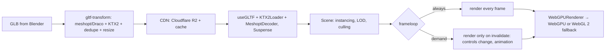

# WebGL - three.js & React Three Fiber Performance

> [!info] Deep dive of [[WebGL]]

> [!abstract] TL;DR
> 3D on the web is usually bottlenecked by four things:
> 1. **draw calls** (CPU → GPU submissions): instance, batch, merge
> 2. **GPU memory/bandwidth**: compress textures to KTX2, geometry to Draco/Meshopt
> 3. **fill rate**: cap pixel ratio, limit post-processing and shadows
> 4. **React overhead in R3F**: mutate refs in `useFrame`, never `setState` per frame
>
> Render **on demand** for configurators/product viewers, measure with `renderer.info` + `r3f-perf`, and always `dispose()` what you load.

## Concept

### Budgets for mid-range phones (rule of thumb)
| Resource | Target | Why |
|---|---|---|
| Draw calls per frame | < 100–200 | Each call has CPU/driver overhead (worse on WebGL than WebGPU) |
| Triangles | < 0.5–1M visible | Vertex processing + memory |
| Texture memory | < 100–200 MB | Mobile GPUs share RAM. Exceeding it crashes tabs (iOS Safari) |
| Device pixel ratio | ≤ 1.5–2 | Fill rate scales with pixels² (DPR 3 = 9× the pixels of DPR 1) |
| Frame time | 16.7 ms (60 fps), or 8.3 ms (120 Hz) | Includes JS, React, physics, render |
| Download size | Hero model < 2–5 MB compressed | LCP, mobile data costs |

### Where time goes
| Symptom | Likely bottleneck | Fix |
|---|---|---|
| Low FPS, GPU idle, many objects | CPU / draw calls | `InstancedMesh`, `BatchedMesh`, merge static geometry, fewer materials |
| Low FPS at high resolution only | Fill rate / fragment shaders | Lower DPR, cheaper materials, fewer post effects |
| Stutters when content appears | Shader compilation, texture upload | Preload, `renderer.compileAsync`, KTX2, warm-up frame |
| Memory grows over navigation | Missing `dispose()` | Dispose geometries/materials/textures/render targets |
| Jank during React updates | Re-renders of the scene tree | Refs + `useFrame`, memoise, split state |

## How It Works

- **Draw call**: one mesh with one material is one call. 1,000 identical trees as separate meshes means 1,000 calls. As one `InstancedMesh`, it's **1 call** with per-instance matrices.
- **R3F** reconciles React elements into a three.js scene graph. React renders should happen on *structural* changes. Per-frame animation belongs in `useFrame` mutating objects directly, outside React.

## Practical Usage

### Asset pipeline (biggest single win)
```bash
# Compress geometry (meshopt), textures (KTX2/ETC1S or UASTC), resize, prune unused data
npx @gltf-transform/cli optimize model.glb model.opt.glb \
  --compress meshopt --texture-compress ktx2 --texture-size 2048 --simplify true
npx gltfjsx model.opt.glb --types --transform    # generate a typed R3F component
```

### Canvas setup for product viewers (render on demand, adaptive DPR)
```tsx
import { Canvas } from "@react-three/fiber";
import { PerformanceMonitor, AdaptiveDpr, Environment, OrbitControls, useGLTF } from "@react-three/drei";
import { useState, Suspense } from "react";

export function ProductViewer() {
  const [dpr, setDpr] = useState(1.5);
  return (
    <Canvas frameloop="demand" dpr={dpr} camera={{ position: [0, 1, 3], fov: 40 }} gl={{ antialias: true, powerPreference: "high-performance" }}>
      <PerformanceMonitor onDecline={() => setDpr(1)} onIncline={() => setDpr(Math.min(2, window.devicePixelRatio))} />
      <Suspense fallback={null}>
        <Shoe />
        <Environment preset="city" />                      {/* image-based lighting instead of many real-time lights */}
      </Suspense>
      <OrbitControls makeDefault />                         {/* triggers invalidate() on change with frameloop="demand" */}
    </Canvas>
  );
}
function Shoe() { const { scene } = useGLTF("/models/shoe.opt.glb"); return <primitive object={scene} />; }
useGLTF.preload("/models/shoe.opt.glb");
```

### Per-frame updates without React re-renders
```tsx
// ❌ setState every frame → React reconciles 60×/s
// ✅ mutate via ref inside useFrame
function Spinner() {
  const ref = useRef<THREE.Mesh>(null!);
  useFrame((_, delta) => { ref.current.rotation.y += delta * 0.5; });
  return <mesh ref={ref}><boxGeometry /><meshStandardMaterial color="orange" /></mesh>;
}
```

### Instancing thousands of objects
```tsx
function Trees({ positions }: { positions: [number, number, number][] }) {
  const ref = useRef<THREE.InstancedMesh>(null!);
  const { nodes, materials } = useGLTF("/models/tree.glb") as any;
  useLayoutEffect(() => {
    const m = new THREE.Matrix4();
    positions.forEach((p, i) => ref.current.setMatrixAt(i, m.makeTranslation(...p)));
    ref.current.instanceMatrix.needsUpdate = true;
  }, [positions]);
  return <instancedMesh ref={ref} args={[nodes.Tree.geometry, materials.Leaves, positions.length]} />;
}
// Different geometries sharing a material → THREE.BatchedMesh (one draw call, per-object visibility)
```

### Measure
```tsx
import { Perf } from "r3f-perf";
<Perf position="top-left" />                         // FPS, GPU/CPU ms, calls, triangles, memory
// three.js directly: renderer.info.render.calls / .triangles; renderer.info.memory.textures
```

### Dispose on unmount (non-R3F / manual objects)
```ts
function disposeObject(root: THREE.Object3D) {
  root.traverse((o: any) => {
    o.geometry?.dispose();
    (Array.isArray(o.material) ? o.material : [o.material]).forEach((m: any) => {
      if (!m) return;
      Object.values(m).forEach((v: any) => v?.isTexture && v.dispose());
      m.dispose();
    });
  });
}
// R3F disposes declaratively created objects on unmount; manually created ones (primitive, caches) are yours
```

## Patterns & Anti-patterns
| Pattern | When | Anti-pattern to avoid |
|---|---|---|
| `frameloop="demand"` + `invalidate()` | Configurators, product viewers, static scenes | Rendering 60 fps forever on an idle scene (battery, heat, INP) |
| KTX2 textures + meshopt/Draco | All production assets | 4K PNG textures and uncompressed GLBs straight from Blender |
| Instancing / BatchedMesh / merged static geometry | Repeated or many small objects | One mesh per object for 5,000 items |
| Baked lighting/AO + environment maps | Product & architectural scenes | Many real-time shadow-casting lights |
| Refs + `useFrame` for animation | R3F | `useState` updates per frame or in pointer-move handlers |
| Adaptive DPR / `PerformanceMonitor` | Mixed device fleets | Fixed DPR 3 on phones |
| Lazy-load the 3D canvas below the fold | Marketing pages | 3D hero that blocks LCP and main thread |

## Performance & Trade-offs
- **WebGPU vs WebGL 2**:
  - **WebGPU**: lower CPU overhead per draw call, compute shaders, better multi-threading prospects. Initialisation is async (`await renderer.init()`), and some WebGL-era addons/shaders need TSL ports.
  - **WebGL 2**: the universal fallback.
- **Quality vs speed**: post-processing (bloom, SSAO, DOF) can each cost several ms per frame on mobile. Offer a "low" quality tier.
- **Main-thread contention**: heavy React UI and 3D share the main thread. OffscreenCanvas plus a worker (`@react-three/offscreen`) isolates rendering, at the cost of more complex event handling.
- **SEO/LCP**: canvas content isn't indexable and can delay LCP. Render a static poster image first, then hydrate the 3D island on interaction or visibility ([[Browser & Web Fundamentals - Core Web Vitals Optimization]]).

## Tips & Reminders
> [!tip]
> - **Profile on a real mid-range Android** with Chrome remote debugging. Desktop GPUs hide everything.
> - **Use one material per object type** where possible. Material and shader switches break batching.
> - **Handle `webglcontextlost`** (mobile background tabs, GPU resets): show a reload prompt and recreate resources.
> - **Host models on R2 behind Cloudflare** with long cache TTLs and versioned filenames ([[Cloudflare]]).
> - **In ZP's stack**: 3D is a niche add-on for client sites, e.g. product configurators and property/venue previews. Use R3F inside a Next.js client component (dynamic import, `ssr: false`), `frameloop="demand"`, and a gltf-transform pipeline, with a poster image fallback for SEO and slow devices.

## Version Notes
| Item | Change |
|---|---|
| three.js r150s–r160s (2023–24) | `BatchedMesh` (r159), WebGPU renderer maturing, TSL (three shading language) |
| three.js r171 (2024-12/2025) | Zero-config WebGPU: `import * as THREE from "three/webgpu"` with automatic WebGL 2 fallback |
| three.js r18x (2025–26) | `WebGPURenderer` recommended path. WebGL renderer maintained as fallback |
| R3F v8 → **v9** (2025) | React 19 support, new types. Requires matching drei/postprocessing majors |
| Browsers | WebGPU in Chrome/Edge, Safari 26 (2025-09) and Firefox (Windows/macOS Apple Silicon) |

> [!warning] Unverified — check before relying on this
> The current three.js revision (sources cite r182–r185) and the R3F major beyond v9 weren't confirmed. Check github.com/mrdoob/three.js/releases and the R3F changelog before pinning versions.

## Critical Issues & Gotchas
> [!danger] Memory leaks crash mobile tabs
> Navigating between product pages in an SPA without disposing textures and geometries accumulates GPU memory until iOS Safari kills the tab ("A problem repeatedly occurred"). Dispose manually created resources, reuse cached models (`useGLTF` cache), and check `renderer.info.memory` after navigation loops.

> [!danger] Uncompressed assets and 4K textures
> A single uncompressed 4K RGBA texture is 64 MB of GPU memory (more with mipmaps), whatever the PNG file size. Ten of them exceed mobile budgets. Always convert textures to KTX2 and resize to what's actually visible (1K–2K for most product materials).

> [!warning] Gotchas
> - Transparent objects are sorted and drawn separately. Lots of them kill performance and cause sorting artifacts. Use alpha-test or dithering where possible.
> - `castShadow` on everything multiplies render passes. Enable shadows selectively, or bake them.
> - Creating `new THREE.Vector3()` inside `useFrame` allocates per frame and causes GC pauses. Reuse module-level temporaries.
> - With `frameloop="demand"`, custom animations must call `invalidate()` or nothing updates.
> - Next.js SSR: three.js touches `window`, so load the canvas with `dynamic(() => import(...), { ssr: false })` ([[Next.js]]).

## Related
- [[WebGL]]
- [[React]] — reconciliation costs, refs
- [[Next.js]] — client-only 3D components
- [[Browser & Web Fundamentals - Core Web Vitals Optimization]] — LCP/INP impact of 3D
- [[JavaScript - Event Loop & Async]] — main-thread budget
- [[Cloudflare]] — asset delivery

## References
- three.js WebGPURenderer manual: https://threejs.org/manual/en/webgpurenderer
- R3F performance pitfalls: https://r3f.docs.pmnd.rs/advanced/pitfalls
- R3F scaling performance: https://r3f.docs.pmnd.rs/advanced/scaling-performance
- glTF Transform CLI: https://gltf-transform.dev/cli
- Discover three.js, tips & tricks: https://discoverthreejs.com/tips-and-tricks/
