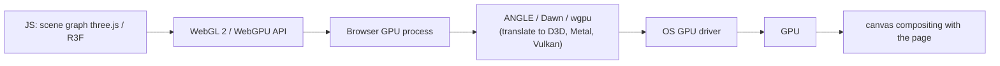

# WebGL

> [!abstract] TL;DR
> WebGL is the browser's JavaScript binding to the GPU. **WebGL 2** (based on OpenGL ES 3.0) runs everywhere and powers 3D product viewers, data visualizations, maps, games and shader effects. You almost never write it raw: use **three.js** / **React Three Fiber**, Babylon.js or PlayCanvas.
> - **Successor**: **WebGPU**, a modern API with compute shaders and WGSL, now enabled in Chrome/Edge, Safari 26 and Firefox (Windows/macOS).
> - **2026 default**: three.js `WebGPURenderer`, which **falls back to WebGL 2** automatically.
> - **Main costs**: bundle size, battery/GPU load on low-end phones, and accessibility/SEO, since canvas content is invisible to crawlers.

## Introduction
- **History**:
  - WebGL 1.0 (2011, Khronos, OpenGL ES 2.0).
  - **WebGL 2.0** (2017, ES 3.0: instancing, 3D textures, MRT, transform feedback).
  - **WebGPU** (W3C GPU for the Web WG; Chrome 113 in 2023, Safari 26 in 2025-09, Firefox Windows 2025-07, macOS Apple Silicon 2025-11).
- **Problem**: hardware-accelerated 2D/3D in the browser without plugins (Flash/Unity Web Player).
- **Where it sits**: a `<canvas>` element inside a normal page ([[React]]/[[Next.js]]/[[Astro]]), fed by a scene-graph library. Common in e-commerce configurators, real-estate tours, landing-page hero effects, maps (Mapbox GL, deck.gl) and charting at scale.

## Core Concepts

### The pipeline in one table
| Stage | What happens | You control |
|---|---|---|
| Buffers | Vertex data (positions, normals, UVs) uploaded to GPU memory | `gl.bufferData`, geometry in three.js |
| **Vertex shader** | Runs per vertex: transforms to clip space | GLSL ES 3.00 (`#version 300 es`) |
| Rasterization | Triangles → fragments (pixels) | Fixed-function: culling, depth test, blending |
| **Fragment shader** | Runs per pixel: color, lighting, textures | GLSL, the main performance hotspot |
| Framebuffer | Output to canvas or offscreen texture (post-processing) | Render targets |

- **State machine API**: bind buffer → set attribute pointers → use program → set uniforms → `drawArrays`/`drawElements`. Verbose and error-prone, hence libraries.
- **Draw calls** are the CPU cost unit. Batch with **instancing** (`InstancedMesh`) and merged geometries.
- **Uniforms / attributes / varyings / textures** are how data flows into shaders.

### WebGL 2 vs WebGPU
| | WebGL 2 | WebGPU |
|---|---|---|
| Model | OpenGL ES 3.0 global state machine | Modern explicit API (Vulkan/Metal/D3D12-like): pipelines, bind groups, command encoders |
| Shaders | GLSL ES | **WGSL** |
| Compute | No (hacks via fragment shaders) | **Compute shaders**: GPU particles, physics, ML inference |
| CPU overhead | Higher per draw call | Lower, multithreading-friendly |
| Support (2026) | ~Universal | Chrome/Edge (2023), Safari 26+, Firefox Windows/macOS. Linux/Android variance |
| Use | Safe default and fallback | New projects via three.js `WebGPURenderer` (auto-fallback) |

### three.js minimal scene
```ts
import * as THREE from 'three/webgpu';                 // WebGPU entry point; falls back to WebGL 2
import { GLTFLoader } from 'three/addons/loaders/GLTFLoader.js';

const renderer = new THREE.WebGPURenderer({ antialias: true });
await renderer.init();                                  // async init required
renderer.setPixelRatio(Math.min(devicePixelRatio, 2)); // cap DPR: 3x phones melt otherwise
renderer.setSize(innerWidth, innerHeight);
document.body.appendChild(renderer.domElement);

const scene = new THREE.Scene();
const camera = new THREE.PerspectiveCamera(45, innerWidth / innerHeight, 0.1, 100);
camera.position.set(0, 1, 4);
scene.add(new THREE.HemisphereLight(0xffffff, 0x444444, 2));

const gltf = await new GLTFLoader().loadAsync('/models/sofa.glb');
scene.add(gltf.scene);
renderer.setAnimationLoop(() => renderer.render(scene, camera));
```

### React Three Fiber (declarative)
```tsx
'use client';
import { Canvas } from '@react-three/fiber';
import { OrbitControls, useGLTF, Environment } from '@react-three/drei';

function Sofa() { const { scene } = useGLTF('/models/sofa.glb'); return <primitive object={scene} />; }

export default function Viewer() {
  return (
    <Canvas dpr={[1, 2]} camera={{ position: [0, 1, 4], fov: 45 }} frameloop="demand">   {/* render only on change */}
      <Sofa />
      <Environment preset="apartment" />
      <OrbitControls enablePan={false} />
    </Canvas>
  );
}
```

## Architecture / How It Works

- Browsers don't call OpenGL directly. **ANGLE** translates WebGL to D3D11/Metal/Vulkan. **Dawn** (Chrome) and **wgpu** (Firefox) implement WebGPU. Shaders are validated and rewritten for safety.
- The GPU process is sandboxed. Context loss (`webglcontextlost`) happens when the GPU resets, the tab is backgrounded on mobile, or too many contexts exist (~16 per page). Handle it.
- `requestAnimationFrame` drives the loop at display refresh rate. Rendering continuously when nothing changes wastes battery, so use on-demand rendering.

## Project Structure
```text
app/
├── components/three/
│   ├── Viewer.tsx            # <Canvas> wrapper, client-only, lazy-loaded
│   ├── Model.tsx             # useGLTF + materials
│   └── Effects.tsx           # postprocessing (bloom, SSAO) — opt-in
├── public/models/
│   ├── sofa.glb              # Draco/Meshopt-compressed glTF
│   └── textures/*.ktx2       # Basis Universal GPU-compressed textures
└── scripts/optimize-models.sh   # gltf-transform optimize --compress meshopt --texture-compress ktx2
```
```tsx
// Next.js: keep three.js out of the server bundle and initial JS
const Viewer = dynamic(() => import('@/components/three/Viewer'), { ssr: false, loading: () => <PosterImage /> });
```

## Use Cases
| Use case | Why it fits |
|---|---|
| Product configurators (furniture, cars, packaging) | Real-time materials/colors, glTF assets, AR handoff (model-viewer) |
| Data visualization at scale (100k+ points, maps) | GPU rendering via deck.gl, regl, Mapbox/MapLibre GL |
| Immersive landing pages / brand campaigns | Shader effects, scroll-driven 3D |
| Browser games, simulations, digital twins | Babylon.js/PlayCanvas engines, physics |
| On-device ML / GPU compute | WebGPU compute (ONNX Runtime Web, Transformers.js) |
| Standard business dashboards / forms | **Poor fit**. SVG/Canvas 2D charts are lighter and accessible |

## Pros & Cons
| Pros | Cons |
|---|---|
| Hardware-accelerated 3D/2D in every browser, no install | Large JS + asset payloads (three.js ~150–200 KB gz + models) |
| Rich ecosystem: three.js, R3F, Babylon, deck.gl | Performance varies wildly across devices/GPUs |
| WebGPU adds compute and lower overhead | WebGPU support still uneven on Linux/older Android |
| glTF standard pipeline from Blender | Canvas content isn't accessible or crawlable by default |
| Can replace native apps for viewers/configurators | Shader debugging is painful. Context loss handling is needed |
| Same code on desktop and mobile web | Battery drain and thermal throttling on phones |

## Alternatives & Peers
| Alternative | Strength vs WebGL | Weakness vs WebGL | Pick it when… |
|---|---|---|---|
| WebGPU (direct or via three.js) | Compute shaders, modern API, lower CPU cost | Support gaps, newer tooling | New GPU-heavy projects, with WebGL fallback |
| Canvas 2D / SVG | Simple, accessible (SVG), tiny | No 3D, slow at 10k+ elements | Charts, diagrams, simple animation |
| CSS 3D transforms / Lottie / Rive | No GPU programming, small | Limited to UI-style animation | Micro-interactions, hero animations |
| `<model-viewer>` (Google) | One tag for glTF + AR (Quick Look / Scene Viewer) | Less control | Simple product 3D/AR on e-commerce |
| Unity/Godot WebGL export | Full game engine and editor | Huge builds, slow load | Real games, existing engine assets |
| Native (Flutter/Swift/Kotlin + Metal/Vulkan) | Max performance, ARKit/ARCore | Store distribution | Heavy AR/3D apps |

## Tips & Reminders
> [!tip]
> - Optimize assets first: `gltf-transform optimize` (Meshopt/Draco geometry, KTX2 textures), polygon budgets (~50–200k triangles for mobile scenes), texture sizes ≤ 2048 px.
> - Cap `devicePixelRatio` at 2, use `frameloop="demand"` / render on change, and pause when the canvas is off-screen (IntersectionObserver).
> - Lazy-load the 3D bundle and show a static poster image first, which protects LCP and SEO. Provide an accessible text alternative and controls.
> - Dispose geometries, materials, textures and render targets when unmounting (memory leaks are GPU-side and invisible to the JS heap).
> - Profile with Spector.js (WebGL captures), the three.js `renderer.info` draw-call counts, and Chrome's Performance panel GPU track.
> - **In ZP's stack**: for SME clients (furniture, property, F&B packaging), use `<model-viewer>` or R3F inside [[Next.js]]/[[Astro]] for product 3D/AR. Host compressed `.glb`/KTX2 assets on R2 behind [[Cloudflare]] with long cache TTLs. Quote 3D work separately: asset creation and optimization usually cost more than the code.

## Versions & Breaking Changes
| Version | Released | Key changes | Breaking / migration notes |
|---|---|---|---|
| WebGL 1.0 | 2011-03 | OpenGL ES 2.0 in browsers | Extensions needed for instancing, float textures |
| **WebGL 2.0** | 2017-01 | ES 3.0: instancing, VAOs, 3D textures, MRT, UBOs | GLSL `#version 300 es` syntax differs from WebGL 1 shaders |
| WebGPU (Chrome 113) | 2023-05 | Explicit API, WGSL, compute | New API. No GLSL |
| WebGPU in Firefox / Safari 26 | 2025-07 / 2025-09 (macOS ARM Firefox 2025-11) | Cross-browser availability | Linux and some Android GPUs still inconsistent |
| three.js `WebGPURenderer` + TSL | r16x–r18x (2024–2026) | Node-based **TSL** shading language compiles to WGSL or GLSL. Auto-fallback to WebGL 2 | Custom `ShaderMaterial` GLSL doesn't port automatically. Rewrite in TSL. Import from `three/webgpu` |

> [!warning] Unverified — check before relying on this
> Exact three.js revision where `WebGPURenderer` became the recommended default, and Firefox Linux/Android WebGPU status, weren't confirmed from primary sources. Check https://threejs.org/docs/ and https://caniuse.com/webgpu.

## Critical Issues & Gotchas
> [!danger] GPU-driver attack surface and fingerprinting
> WebGL/WebGPU expose GPU drivers to web content. Browsers sandbox and validate heavily, but GPU-process bugs are recurring high-severity browser CVEs (sandbox escapes chained with renderer bugs). `WEBGL_debug_renderer_info` and timing behaviour are also used for **fingerprinting**. Keep browsers updated, and don't rely on GPU info for app logic.

> [!danger] Mobile performance and crashes
> Uncompressed textures (a 4096² RGBA texture = 64 MB of VRAM, more with mipmaps) and DPR 3 rendering crash iOS Safari tabs (memory limits) or thermally throttle phones within a minute. Budget memory, compress textures (KTX2), and test on a mid-range Android and an older iPhone.

> [!warning] Gotchas
> - `webglcontextlost` / WebGPU device loss: listen and rebuild resources, or reload the viewer gracefully.
> - Too many canvases (one per product card) exceed the per-page context limit. Use one shared canvas (drei `<View>`) or static images.
> - Transparent objects need sorting. Order-dependent blending causes artifacts.
> - The color space changed in three.js (r152+): `SRGBColorSpace` + physically correct lighting defaults. Old tutorials look washed out or too dark.
> - Next.js/SSR: three.js touches `window`, so import client-side only (`dynamic(..., { ssr: false })` or `'use client'` + lazy).

## Deep Dives
- [[WebGL - three.js & React Three Fiber Performance]]

Candidates: WebGPU & TSL migration.

## Related
- [[React]] — React Three Fiber
- [[Next.js]] — client-only 3D components, lazy loading
- [[Astro]] — islands for 3D widgets on content sites
- [[Browser & Web Fundamentals]] — rendering pipeline, Core Web Vitals
- [[JavaScript]] — async loading, typed arrays
- [[Cloudflare]] — R2/CDN for 3D assets

## References
- WebGL 2 spec / Khronos: https://registry.khronos.org/webgl/specs/latest/2.0/
- WebGPU spec: https://www.w3.org/TR/webgpu/
- three.js docs (WebGPURenderer): https://threejs.org/docs/pages/WebGPURenderer.html
- React Three Fiber: https://r3f.docs.pmnd.rs/
- Khronos WebGL & WebGPU status (SIGGRAPH 2026): https://www.khronos.org/developers/linkto/webgl-and-webgpu-sigg26
- three.js WebGPU migration guide: https://www.utsubo.com/blog/webgpu-threejs-migration-guide
- glTF Transform: https://gltf-transform.dev/
