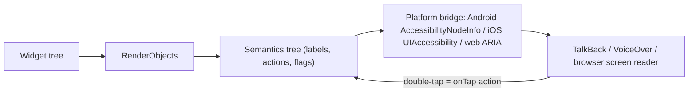

# Flutter - Accessibility & Semantics

> [!info] Deep dive of [[Flutter]]

> [!abstract] TL;DR
> Flutter builds a **semantics tree** alongside the widget tree, and TalkBack/VoiceOver read that, not your pixels. Most standard widgets are accessible by default. Custom gestures, icon buttons, images and canvas-painted UI aren't.
> - **Label** every meaningful image/icon button.
> - **Merge** related text into one announcement, and **exclude** decoration.
> - Keep tap targets ≥ 48×48 dp, respect **text scaling** (`TextScaler`) without clipping, and meet **contrast** (4.5:1 for body text).
> - Test with screen readers on real devices, and add **guideline matchers** to widget tests.
>
> Accessibility also improves usability for older customers and one-handed use, which is common with SME customer apps.

## Concept
| Concern | Flutter tool | Rule of thumb |
|---|---|---|
| What screen readers say | `Semantics(label:, hint:, value:, button: true)` | Label = what it is. Hint = what happens |
| Images / icons | `Image(semanticLabel:)`, `IconButton(tooltip:)`, `Icon(semanticLabel:)` | Decorative → `ExcludeSemantics` |
| Grouping | `MergeSemantics` | Card with title + price + rating → one announcement |
| Hiding noise | `ExcludeSemantics`, `BlockSemantics` | Background content behind modals |
| Live updates | `Semantics(liveRegion: true)`, `SemanticsService.announce` | Cart total changes, errors |
| Text size | `MediaQuery.textScalerOf(context)` | Layouts survive 200% text |
| Touch targets | `MaterialTapTargetSize.padded`, min 48×48 | Small icons get bigger hit areas |
| Contrast | Theme tokens | 4.5:1 body, 3:1 large text/icons (WCAG) |
| Focus/keyboard | `FocusTraversalGroup`, `Shortcuts`, `Actions` | Logical order for switch access/keyboards/web |

## How It Works


## Practical Usage
**Icon buttons and images**:
```dart
IconButton(
  icon: const Icon(Icons.add_shopping_cart),
  tooltip: t.addToCart,                       // tooltip doubles as the semantic label
  onPressed: () => cart.add(item),
);
Image.network(item.photoUrl, semanticLabel: t.photoOf(item.name));      // meaningful image
const ExcludeSemantics(child: DecorativeWave());                          // decoration: silent
```
**Product card announced as one unit**:
```dart
MergeSemantics(
  child: Semantics(
    button: true,
    hint: t.opensDetails,
    child: InkWell(
      onTap: () => context.push('/product/${p.id}'),
      child: Column(children: [
        Text(p.name),
        Text(rm.format(p.priceCents / 100)),
        Text(t.ratingOutOf5(p.rating)),        // "4.5 out of 5", not "★★★★½"
      ]),
    ),
  ),
);
```
**Custom gesture widget** (no built-in semantics → add them):
```dart
Semantics(
  label: t.quantity, value: '$qty', increasedValue: '${qty + 1}', decreasedValue: '${qty - 1}',
  onIncrease: () => setQty(qty + 1), onDecrease: () => setQty(qty - 1),
  child: SwipeStepper(value: qty, onChanged: setQty),
);
```
**Announce dynamic changes and errors**:
```dart
SemanticsService.announce(t.addedToCart(item.name), Directionality.of(context));
Semantics(liveRegion: true, child: Text(errorText ?? ''));
```
**Text scaling without breaking layouts**:
```dart
final scaler = MediaQuery.textScalerOf(context);
// let text wrap; avoid fixed heights; cap only extreme scales on dense widgets
Text(p.name, maxLines: 3, overflow: TextOverflow.ellipsis,
     textScaler: scaler.clamp(maxScaleFactor: 2.0));
```
**Guideline checks in widget tests**:
```dart
testWidgets('checkout meets a11y guidelines', (tester) async {
  final handle = tester.ensureSemantics();
  await tester.pumpWidget(const App(initialRoute: '/checkout'));
  await expectLater(tester, meetsGuideline(androidTapTargetGuideline));
  await expectLater(tester, meetsGuideline(iOSTapTargetGuideline));
  await expectLater(tester, meetsGuideline(textContrastGuideline));
  await expectLater(tester, meetsGuideline(labeledTapTargetGuideline));
  handle.dispose();
});
```
**Wrong way**:
```dart
GestureDetector(onTap: pay, child: const Icon(Icons.payment, size: 18));   // ❌ unlabeled, 18 dp target
MediaQuery(data: MediaQuery.of(context).copyWith(textScaler: TextScaler.noScaling), child: app);  // ❌ ignores user setting
Text('★★★★☆');                                                             // ❌ read as "black star black star…"
```

## Patterns & Anti-patterns
| Pattern | When | Anti-pattern to avoid |
|---|---|---|
| Standard Material/Cupertino widgets first | All UI | Custom painters for buttons |
| Tooltips/labels on every icon-only control | Icon buttons, FABs | Silent icons |
| `MergeSemantics` for cards/list rows | Lists, product tiles | Each text announced separately with no context |
| Respect text scale, test at 1.5× and 2× | All screens | Global `noScaling` |
| Errors announced + shown near fields | Forms | Color-only error indication |
| Contrast from design tokens checked in CI | Theming | Brand colors failing 4.5:1 on white |
| Localized semantic labels | BM/EN/ZH apps | English-only labels in localized apps ([[Flutter - Internationalization & Localization]]) |

## Performance & Trade-offs
- **Semantics cost**: the semantics tree is built only when an accessibility service is active (or `ensureSemantics`). Heavy custom semantics on huge lists can add overhead, so keep labels concise.
- **Flutter web** builds semantics on demand (placeholder button to enable), so check web accessibility explicitly. SEO-heavy sites belong in Next.js/Astro anyway.
- **Design trade-offs**: larger tap targets and text scaling reduce information density. Design for it upfront rather than retrofitting.
- **Testing cost**: automated matchers catch tap targets, labels and contrast, while manual screen-reader passes catch order and wording. Do both before major releases.

## Tips & Reminders
> [!tip] In ZP's stack
> - **SME customer apps** (ordering, bookings) have many older users who enlarge text. Test checkout at 200% text and with TalkBack on a mid-range Android phone.
> - **Design tokens** shared between Tailwind and Flutter should include contrast-checked color pairs ([[Tailwind CSS - Design Token Pipeline for Web & Flutter]]).
> - **Acceptance criteria in SOWs**: "core flows usable with TalkBack/VoiceOver and 200% text" is cheap to promise when built in from the start.

- Use `Semantics(header: true)` for section titles, so screen-reader users can jump between headings.
- Announce price/total changes in carts. Silent dynamic updates confuse screen-reader users.
- Avoid timeouts on OTP screens without a way to extend or resend.
- Add accessibility checks to widget tests for top flows ([[Flutter - Testing]]).

## Version Notes
| Date / version | Change |
|---|---|
| Flutter 3.16+ | `TextScaler` replaces `textScaleFactor` (nonlinear scaling support on Android 14) |
| 2023-10 | WCAG 2.2 published (focus appearance, target size minimum, accessible authentication) |
| 2025-06-28 | **European Accessibility Act** applies to many consumer digital services in the EU |
| Flutter 3.47 (2026-08) | Current stable at writing ([[Flutter]]) |

> [!warning] Unverified — check before relying on this
> Newer Flutter semantics APIs (e.g. semantic roles) and their versions weren't checked. Malaysian legal requirements for app accessibility for private businesses are limited, while EU/US clients may have binding obligations. Confirm per project.

## Critical Issues & Gotchas
> [!danger] Unlabeled custom controls make core flows impossible
> A payment button built from `GestureDetector` + `Icon`, a custom quantity stepper, or a canvas-drawn chart with no semantics is invisible or meaningless to screen readers. Blind users can't complete checkout at all. Prefer standard widgets, add `Semantics` to custom controls, and verify each core flow with TalkBack and VoiceOver.

> [!danger] Disabling text scaling breaks real users
> Forcing `TextScaler.noScaling` (often to "fix" overflow) ignores OS accessibility settings and fails users with low vision, and some app store reviewers and enterprise clients check this. Fix layouts (wrapping, flexible heights, scrolling) instead. Clamp only extreme scales on specific dense widgets.

- **Color-only status** (red/green order status) fails color-blind users. Add text or icons.
- **Focus order** follows widget order by default. Visually reordered layouts (Stack/Positioned) can announce out of order, so use `FocusTraversalGroup`/`OrdinalSortKey`.
- **Modals and overlays** must block underlying semantics, or screen readers wander behind dialogs.
- **Auto-playing animations** can disturb users with vestibular disorders. Respect `MediaQuery.disableAnimationsOf(context)` ([[Flutter - Animations & Motion]]).

## Related
- [[Flutter]]
- [[Flutter - Forms, Validation & Input UX]] — labeled fields and announced errors
- [[Flutter - Testing]] — guideline matchers in widget tests
- [[Flutter - Internationalization & Localization]] — localized semantic labels
- [[Flutter - Rendering & Widget Lifecycle]] — how the semantics tree is built
- [[Tailwind CSS - Design Token Pipeline for Web & Flutter]] — contrast-safe shared tokens

## References
- https://docs.flutter.dev/ui/accessibility-and-internationalization/accessibility
- https://api.flutter.dev/flutter/widgets/Semantics-class.html
- https://api.flutter.dev/flutter/flutter_test/meetsGuideline.html
- https://www.w3.org/TR/WCAG22/
- https://developer.android.com/guide/topics/ui/accessibility/apps
