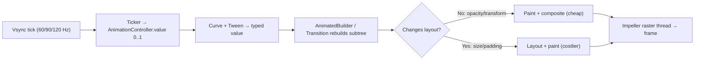

# Flutter - Animations & Motion

> [!info] Deep dive of [[Flutter]]

> [!abstract] TL;DR
> Pick the lightest tool that works:
> 1. **Implicit animations** (`AnimatedContainer`, `AnimatedOpacity`, `AnimatedSwitcher`, `TweenAnimationBuilder`) for state-driven changes. No controller.
> 2. **Explicit animations** (`AnimationController` + `Tween` + `AnimatedBuilder`/transitions) for loops, sequences, gestures and staggering.
> 3. **Hero / page transitions** for navigation continuity.
> 4. **Lottie / Rive** for designer-made vector motion.
>
> Keep animations on the **paint/compositing** path (opacity, transform) rather than relayout. Rebuild only the animated subtree, dispose controllers, and respect **reduce motion**. Motion should explain state changes, not decorate.

## Concept
| Approach | API | Use for | Cost |
|---|---|---|---|
| Implicit | `AnimatedContainer`, `AnimatedOpacity`, `AnimatedAlign`, `AnimatedSwitcher`, `AnimatedSize` | Toggle/selection/expand states | Lowest code. Duration + curve only |
| Custom implicit | `TweenAnimationBuilder<T>` | Animate any value to a target | No controller |
| Explicit | `AnimationController`, `Tween`, `CurvedAnimation`, `*Transition` widgets | Repeat, reverse, chain, gesture-driven | Needs `TickerProvider` + dispose |
| Physics | `SpringSimulation`, `controller.animateWith`, `fling` | Drag-to-dismiss, bottom sheets | Feels native |
| Shared element | `Hero`, `PageRouteBuilder`, go_router `CustomTransitionPage` | List → detail continuity | Route-level |
| Lists | `AnimatedList`, `SliverAnimatedList` | Insert/remove items | Needs keys/indices |
| Declarative chains | `flutter_animate` (`.animate().fadeIn().slideY()`) | Quick staggered UI motion | Package dependency |
| Designer assets | `lottie` (After Effects JSON), `rive` (state machines) | Onboarding, empty states, interactive icons | Asset size, runtime |
| Shaders | `FragmentProgram` (GLSL) | Custom effects | Advanced, per-GPU testing |

## How It Works

- Frame budget: **16.7 ms at 60 Hz, 8.3 ms at 120 Hz**, split between UI and raster threads.
- `vsync: this` (via `SingleTickerProviderStateMixin`) pauses tickers when the widget is off-screen (`TickerMode`).

## Practical Usage
**Implicit: animate a state change**:
```dart
AnimatedContainer(
  duration: const Duration(milliseconds: 220),
  curve: Curves.easeOutCubic,
  padding: EdgeInsets.all(selected ? 16 : 12),
  decoration: BoxDecoration(
    color: selected ? scheme.primaryContainer : scheme.surface,
    borderRadius: BorderRadius.circular(selected ? 20 : 12),
  ),
  child: child,
);

AnimatedSwitcher(                                     // swap loading → content → error
  duration: const Duration(milliseconds: 200),
  child: switch (state) {
    Loading() => const CircularProgressIndicator(key: ValueKey('loading')),
    Loaded(:final items) => OrderList(items, key: const ValueKey('list')),
    Failed(:final msg) => ErrorView(msg, key: const ValueKey('error')),
  },
);
```
**Explicit: controller with proper lifecycle**:
```dart
class PulseBadge extends StatefulWidget { const PulseBadge({super.key}); @override State<PulseBadge> createState() => _S(); }
class _S extends State<PulseBadge> with SingleTickerProviderStateMixin {
  late final _c = AnimationController(vsync: this, duration: const Duration(milliseconds: 900))..repeat(reverse: true);
  late final _scale = Tween(begin: 1.0, end: 1.15).animate(CurvedAnimation(parent: _c, curve: Curves.easeInOut));
  @override void dispose() { _c.dispose(); super.dispose(); }
  @override Widget build(BuildContext context) =>
      ScaleTransition(scale: _scale, child: const Badge(label: Text('New')));   // transform only, no relayout
}
```
**Staggered entrance** (`Interval`s on one controller):
```dart
final fade = CurvedAnimation(parent: _c, curve: const Interval(0.0, 0.6, curve: Curves.easeOut));
final slide = Tween(begin: const Offset(0, 0.1), end: Offset.zero)
    .animate(CurvedAnimation(parent: _c, curve: const Interval(0.2, 1.0, curve: Curves.easeOutCubic)));
FadeTransition(opacity: fade, child: SlideTransition(position: slide, child: card));
```
**Hero + custom route transition** (go_router):
```dart
Hero(tag: 'product-${p.id}', child: Image.network(p.thumb));      // list & detail use the same tag
GoRoute(
  path: '/product/:id',
  pageBuilder: (c, s) => CustomTransitionPage(
    key: s.pageKey,
    child: ProductPage(id: s.pathParameters['id']!),
    transitionsBuilder: (c, a, _, child) => FadeTransition(opacity: a, child: child),
  ),
);
```
**Respect reduce motion**:
```dart
final reduce = MediaQuery.disableAnimationsOf(context);
final d = reduce ? Duration.zero : const Duration(milliseconds: 250);
```
**Wrong way**:
```dart
setState(() => _value = controller.value);   // ❌ rebuilds the whole screen every frame; use AnimatedBuilder(child:)
AnimationController(vsync: this, duration: d); // ❌ created in build() and never disposed → leaks/ticker errors
AnimatedContainer(height: open ? 400 : 0, child: hugeList);   // ❌ relayout of a heavy subtree each frame
Opacity(opacity: _a.value, child: complexTree); // ❌ use FadeTransition (no rebuild, compositor opacity)
```

## Patterns & Anti-patterns
| Pattern | When | Anti-pattern to avoid |
|---|---|---|
| Implicit first, explicit when needed | Most UI states | Controllers for one-shot toggles |
| `AnimatedBuilder(child:)` with static child passed through | Explicit animations | Rebuilding static subtrees per frame |
| `*Transition` widgets (Fade/Scale/Slide/Rotation) | Transform/opacity | `Opacity` + `setState` per frame |
| One controller + `Interval`s for staggering | Sequenced entrances | Many timers/`Future.delayed` chains |
| Durations 150–300 ms, ease-out curves | UI feedback | 800 ms+ transitions on every tap |
| Motion tokens (durations/curves) in theme | Consistent design | Magic numbers per widget |
| Rive state machines for interactive icons | Toggles, onboarding | Huge Lottie files for simple effects |
| Skeleton shimmer only while loading > 300 ms | Network waits | Flashing skeletons for fast responses |

## Performance & Trade-offs
- **Impeller** precompiles shaders, which removes most first-run **shader-compilation jank** that Skia had. Still profile on low-end Android, where heavy blur/`BackdropFilter`/`saveLayer` remain expensive ([[Flutter - Performance & DevTools]]).
- **Layout vs paint**: animating size/padding forces layout. Prefer `Transform`/`FadeTransition`, or `AnimatedSize` on small subtrees.
- **`RepaintBoundary`** around a continuously animating widget isolates repaints. Check with "Highlight repaints" in DevTools.
- **Lottie** parses JSON and renders vector layers on CPU/GPU, so large compositions drop frames. **Rive** is generally lighter and interactive, but adds a runtime dependency and designer tooling.
- **Battery**: infinite `repeat()` animations keep the ticker active. Stop them when off-screen or idle.

## Tips & Reminders
> [!tip] In ZP's stack
> - **SME apps** (ordering, booking, loyalty) benefit most from small, functional motion: add-to-cart feedback, status-change transitions, Hero list → detail. Skip decorative animation budgets in fixed-price quotes.
> - **Define motion tokens** (`fast 150ms`, `normal 250ms`, `emphasized curve`) once in the theme, shared with web design tokens where relevant.
> - **Test on a ~RM 600 Android phone** in profile mode. Flagship-only testing hides jank that most Malaysian users will see.

- `flutter run --profile` + the DevTools Performance tab: aim for no frames > budget during key animations.
- Use `AnimatedSwitcher` with distinct `ValueKey`s, or it won't animate between same-type children.
- Use `timeDilation = 5.0` (from `scheduler`) in debug to inspect motion slowly.
- Respect `MediaQuery.disableAnimationsOf` for accessibility ([[Flutter - Accessibility & Semantics]]).
- Keep animation state local. Don't push per-frame values into Riverpod/Bloc ([[Flutter - State Management]]).

## Version Notes
| Version | Change relevant here |
|---|---|
| 3.10 (2023) | Impeller default on iOS |
| 3.16 | Impeller preview on Android. Material 3 default (new motion specs) |
| 3.27 (2024-12) | Impeller default on Android API 29+ (Vulkan), with OpenGLES fallback paths evolving |
| 3.29+ | Skia fallback removed on iOS. Continued Impeller performance work |
| 3.47 (2026-08) | Current stable at writing ([[Flutter]]) |

> [!warning] Unverified — check before relying on this
> Exact Impeller milestones per Android API level/device class, and current major versions of `flutter_animate`, `lottie` and `rive` packages weren't re-verified this run. Check pub.dev and the Flutter release notes.

## Critical Issues & Gotchas
> [!danger] Undisposed controllers and leaked tickers
> Creating an `AnimationController` without `dispose()`, or in `build()`, leaks tickers ("A Ticker was active when the widget was disposed") and keeps frames scheduled, which drains battery and causes subtle jank. Create controllers in state (`late final` or `initState`), and always dispose. Use `TickerProviderStateMixin` when there's more than one controller.

> [!danger] Animating heavy subtrees kills frame rate on low-end devices
> Animating size, `ClipPath`, blur or `Opacity` over large lists triggers layout/`saveLayer` every frame. That's smooth on an iPhone and 20 fps on budget Android. Animate transforms/opacity via transitions, isolate with `RepaintBoundary`, and profile on real low-end hardware before demoing to clients.

- **Hero tag collisions**: duplicate tags on one route throw. Include unique IDs.
- **Hero + images**: different `fit`/shape between source and target causes visible jumps. Use `flightShuttleBuilder` if needed.
- **Implicit animations restart** if the parent rebuilds with new keys. Keep keys stable.
- **Golden/widget tests**: use `pumpAndSettle` carefully. Infinite animations never settle, so pump fixed durations instead ([[Flutter - Testing]]).
- **Lottie from network URLs** fails offline. Bundle critical assets.

## Related
- [[Flutter]]
- [[Flutter - Performance & DevTools]] — profiling jank, raster vs UI thread
- [[Flutter - Rendering & Widget Lifecycle]] — layout/paint/composite pipeline
- [[Flutter - Accessibility & Semantics]] — reduce motion and screen readers
- [[Flutter - Navigation & Routing]] — custom page transitions with go_router
- [[Flutter - State Management]] — keep per-frame state local

## References
- https://docs.flutter.dev/ui/animations
- https://docs.flutter.dev/ui/animations/implicit-animations
- https://docs.flutter.dev/perf/impeller
- https://pub.dev/packages/flutter_animate
- https://rive.app/docs/runtimes/flutter/flutter
