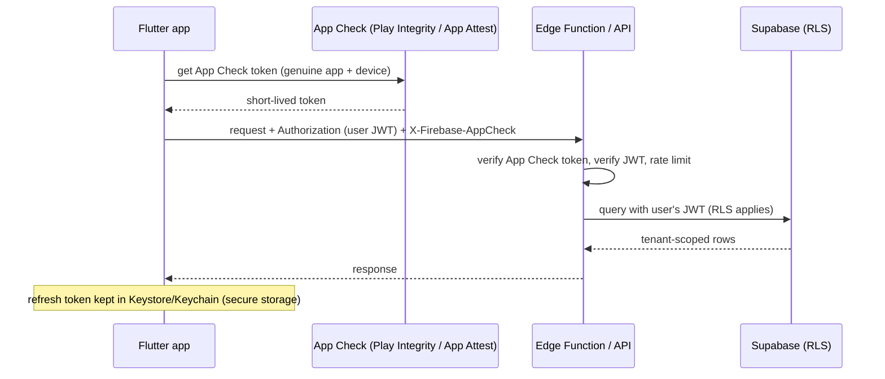

# Flutter - App Security, Obfuscation & Secure Storage

> [!info] Deep dive of [[Flutter]]

> [!abstract] TL;DR
> **The app binary and device are untrusted.** Anything shipped (keys, endpoints, business rules) can be extracted, and any check can be patched out.
> - **Never ship secrets.** Only the Supabase publishable/anon key belongs in the app, and RLS + server checks do the protecting.
> - **Tokens** go in **`flutter_secure_storage`** (Keystore/Keychain), not SharedPreferences.
> - **Obfuscate** release builds (`--obfuscate --split-debug-info`) for cost-raising, not protection.
> - **Attestation** (Firebase App Check: Play Integrity / App Attest) proves requests come from your genuine app. Enforce it on the server.
> - Treat root/jailbreak detection and pinning as risk signals with trade-offs, not walls.

## Concept
| Threat (OWASP MASVS area) | Realistic attack | Control | Strength |
|---|---|---|---|
| Secrets in the binary | `strings`/`blutter` on the APK reveals keys | No secrets client-side. Server proxies third-party APIs | **Strong** (removes the asset) |
| Token theft from storage | Rooted device / backup extraction reads prefs | Keystore/Keychain via secure storage, backups excluded | Good |
| Fake clients / scripted abuse | Bot hits your API with the anon key | App Check / Play Integrity / App Attest verified server-side, plus rate limits | Good (raises cost) |
| Reverse engineering logic | Decompile Dart AOT snapshot | Obfuscation, logic server-side | Weak (delays only) |
| MITM on hostile networks | User-installed CA, proxy | TLS (default), optional pinning | Medium (pinning has ops cost) |
| Tampered/rooted runtime | Frida hooks bypass checks | RASP (e.g. freeRASP), server-side decisions | Weak–medium |
| Data leakage on screen | Screenshots, app switcher previews, screen recording | `FLAG_SECURE`, iOS snapshot blur | Good for casual leaks |
| Deep link / redirect hijack | Malicious app claims your scheme | App Links / Universal Links, PKCE | Good |

## How It Works


## Practical Usage
**Release builds with obfuscation + symbol upload**:
```bash
flutter build appbundle --release --obfuscate --split-debug-info=build/symbols/android
flutter build ipa --release --obfuscate --split-debug-info=build/symbols/ios
# keep build/symbols per version (CI artifact) and upload to Crashlytics/Sentry for readable stack traces
```
**Secure storage for tokens** (`flutter_secure_storage` 10.x):
```dart
const storage = FlutterSecureStorage(
  aOptions: AndroidOptions(),                                         // v10: AES-GCM via Keystore by default
  iOptions: IOSOptions(accessibility: KeychainAccessibility.first_unlock_this_device),  // not synced to iCloud
);
await storage.write(key: 'refresh_token', value: token);
```
**Supabase session in secure storage** instead of plain SharedPreferences:
```dart
class SecureLocalStorage extends LocalStorage {
  final _s = const FlutterSecureStorage();
  @override Future<void> initialize() async {}
  @override Future<bool> hasAccessToken() => _s.containsKey(key: supabasePersistSessionKey);
  @override Future<String?> accessToken() => _s.read(key: supabasePersistSessionKey);
  @override Future<void> persistSession(String s) => _s.write(key: supabasePersistSessionKey, value: s);
  @override Future<void> removePersistedSession() => _s.delete(key: supabasePersistSessionKey);
}
await Supabase.initialize(url: url, anonKey: publishableKey,
    authOptions: FlutterAuthClientOptions(localStorage: SecureLocalStorage()));
```
**iOS Keychain survives uninstall**: clear stale tokens on first launch:
```dart
final prefs = await SharedPreferences.getInstance();
if (!(prefs.getBool('installed') ?? false)) {
  await const FlutterSecureStorage().deleteAll();
  await prefs.setBool('installed', true);
}
```
**Exclude sensitive data from Android backups** (`AndroidManifest.xml`):
```xml
<application android:allowBackup="false" android:fullBackupContent="false"
             android:dataExtractionRules="@xml/data_extraction_rules" …>
```
**Block screenshots on sensitive screens** (Android, via a small platform channel or a package):
```kotlin
window.setFlags(WindowManager.LayoutParams.FLAG_SECURE, WindowManager.LayoutParams.FLAG_SECURE)
```
**Wrong way**:
```dart
const openAiKey = 'sk-…';                        // ❌ extracted within minutes from the APK
const supabaseServiceKey = 'eyJ…service_role…';  // ❌ full database bypass of RLS for anyone
prefs.setString('refresh_token', t);             // ❌ plain XML/plist, readable on rooted devices and in backups
if (await isJailbroken()) return;                // ❌ client-only gate; patch one branch and it's gone
print('login ok for $phone $ic');                // ❌ PII in device logs (logcat readable via adb/bug reports)
```

## Patterns & Anti-patterns
| Pattern | When | Anti-pattern to avoid |
|---|---|---|
| Server-side proxy for third-party APIs (LLM, payments, WhatsApp) | Any paid/secret API | Keys in `--dart-define` "because they're not in source" |
| Supabase publishable key + RLS + server-side business rules | All Supabase apps | Business rules only in Dart |
| Secure storage for refresh tokens/session | Auth | SharedPreferences/Hive for tokens |
| App Check enforced on your own APIs/Edge Functions | Abuse-prone endpoints (OTP, signup, AI) | Collecting App Check tokens without verifying them |
| Encrypted local DB (SQLCipher) for sensitive offline data | KYC, health, finance | Plain SQLite with IC numbers |
| Obfuscation + symbols archived per build | Every release | Shipping debug symbols, or losing them (unreadable crashes) |
| Pinning only with backup pins and a rotation plan | High-risk fintech | Pinning a leaf cert that Cloudflare rotates → app outage |

## Performance & Trade-offs
- **Secure storage is slower** than prefs (Keystore/Keychain IPC, ~ms per op). Keep it for small secrets, and don't put large caches in it.
- **App Check** adds a token fetch (cached, refreshed periodically) and quota limits for Play Integrity. Use it for abuse-prone endpoints first, then broaden.
- **Pinning** blocks corporate proxies and some enterprise MDM setups, and turns certificate rotations into incidents. Many apps are better served by HTTPS + server-side detection than by pinning.
- **RASP/root detection** adds false positives (custom ROMs, emulators for testers). Prefer degrading features (block payouts) over blocking the app.
- **Obfuscation** makes crash reports unreadable without uploaded symbols, so add symbol upload to CI.

## Tips & Reminders
> [!tip] In ZP's stack
> - **Supabase apps**: ship only the publishable key. Every sensitive action (refunds, role changes, bulk exports) goes through an Edge Function or Next.js route that verifies the JWT, App Check and tenant ([[Supabase - Auth Flows, MFA & Custom Claims]]).
> - **OTP / WhatsApp login endpoints**: enforce App Check plus per-phone/IP rate limits, since these are the most abused endpoints in Malaysian consumer apps ([[Redis - Rate Limiting & Distributed Locks]]).
> - **CI** keeps `build/symbols` as an artifact per version code and uploads them to Crashlytics/Sentry ([[CI-CD - Deploy Pipelines for Coolify & Flutter Releases]]).

- Use App Links (Android, `assetlinks.json`) and Universal Links (iOS, `apple-app-site-association`) for auth callbacks instead of custom schemes. Supabase's PKCE flow protects code interception.
- Set `android:usesCleartextTraffic="false"` and iOS ATS defaults. Only use HTTP for local dev via debug-only network config.
- Wrap logging so release builds drop debug logs (`if (kReleaseMode) return;`), and redact phones/ICs everywhere.
- Re-run a MASVS-style checklist before each major release: storage, network, platform, code, resilience, privacy.

## Version Notes
| Date / version | Change |
|---|---|
| 2024-2025 | SafetyNet Attestation retired (fully off by 2025). Play Integrity API replaces it |
| 2024 | OWASP MASVS v2 / MASTG reorganized (MASVS-STORAGE, -CRYPTO, -AUTH, -NETWORK, -PLATFORM, -CODE, -RESILIENCE, -PRIVACY) |
| flutter_secure_storage 10.0 | Jetpack Security (deprecated) replaced by a custom Keystore cipher. AES-GCM default. minSdk 19 → 23, targetSdk 36 |
| 10.1–10.3 (2026) | Public cipher enums (10.1), Android `storageNamespace` option (10.3, per Renovate notes) |
| Flutter 3.47 (2026-08) | Current stable at re-check ([[Flutter]]) |

> [!warning] Unverified — check before relying on this
> Latest flutter_secure_storage version (10.3 vs newer), App Check enforcement options for custom backends, and current Play Integrity quotas weren't verified this run. Check pub.dev, https://firebase.google.com/docs/app-check and https://developer.android.com/google/play/integrity.

## Critical Issues & Gotchas
> [!danger] Secrets in the app are public
> `--dart-define`, `.env` assets, obfuscated constants and native code all end up in the binary, and automated scrapers harvest API keys from APKs at scale. A leaked LLM or payment key means fraud on your bill. A leaked Supabase service key means a full data breach (a PDPA notification event). Rotate immediately if one shipped, and move the call server-side.

> [!danger] flutter_secure_storage v10 migration can log users out
> The Android rewrite changed the cipher and storage. Upgrading from 9.x without following the migration path can make previously stored values unreadable, so users lose sessions or locally stored keys. Test the upgrade on devices with existing data, and keep the server-side refresh path robust.

- **Keychain persistence after uninstall** (iOS) leads to "ghost" logins after reinstall. Clear on first launch (above).
- **Android Auto Backup** restores tokens to new devices unless excluded. Combine with device-bound refresh tokens if possible ([[JWT - Refresh Tokens, Revocation & Storage]]).
- **WebViews** with JavaScript bridges exposed to remote content allow injected pages to call native code. Only load trusted origins.
- **Store compliance**: Play Data safety and App Store privacy labels must match what you actually collect and share ([[Flutter - Build, Release & Store Compliance]]).

## Related
- [[Flutter]]
- [[Flutter - Build, Release & Store Compliance]] — release builds, privacy declarations
- [[Flutter - Offline Storage & Sync]] — encrypted local databases
- [[Supabase - Auth Flows, MFA & Custom Claims]] — sessions, PKCE, server-side checks
- [[JWT - Refresh Tokens, Revocation & Storage]] — token lifetimes and revocation
- [[OWASP Top 10]] — server-side counterpart to MASVS

## References
- https://docs.flutter.dev/deployment/obfuscate
- https://pub.dev/packages/flutter_secure_storage/changelog
- https://mas.owasp.org/MASVS/
- https://firebase.google.com/docs/app-check
- https://developer.android.com/google/play/integrity
