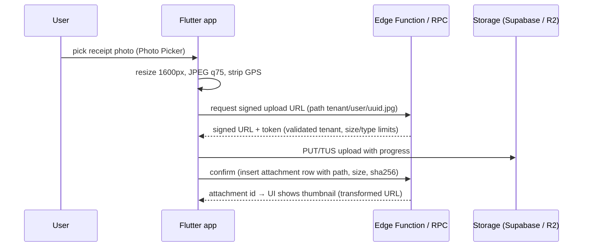

# Flutter - Camera, Image Picking & File Uploads

> [!info] Deep dive of [[Flutter]]

> [!abstract] TL;DR
> - **Pick or capture**:
>   - `image_picker` for gallery/camera with system UIs. It uses the **Android Photo Picker** and iOS **PHPicker**, so no broad storage permission is needed.
>   - `camera` only for custom in-app capture (overlays, scanning, burst).
>   - `file_picker` for PDFs and documents.
> - **Prepare**: resize/compress on device (`maxWidth`, `imageQuality`, or `flutter_image_compress`), strip EXIF GPS when not needed, and convert HEIC to JPEG/WebP.
> - **Upload**: direct to object storage with **signed upload URLs** (Supabase Storage / R2), never through your API server. Use **resumable (TUS)** for large or flaky uploads, with a progress UI and retry.
> - **Store compliance**: Google Play restricts `READ_MEDIA_IMAGES/VIDEO` to apps whose core function needs broad access. Use the photo picker instead, plus clear iOS usage strings.

## Concept
| Need | Package / API | Permission impact |
|---|---|---|
| Pick 1–N photos from gallery | `image_picker` `pickImage` / `pickMultiImage` | None on Android 13+ (Photo Picker), none on iOS 14+ (PHPicker) |
| Take a photo with system camera | `image_picker` `ImageSource.camera` | Camera usage string (iOS) |
| Custom camera UI (overlay, scan frame) | `camera` | `CAMERA` + iOS `NSCameraUsageDescription` |
| Documents (PDF, DOCX) | `file_picker` | Storage Access Framework, no broad permission |
| Document scanning (edge detect) | ML Kit document scanner plugins / native | Varies |
| Compress/resize | `image_picker` params, `flutter_image_compress` | — |
| Upload | Supabase `uploadToSignedUrl`, TUS client, S3 presigned PUT | Network only |
| Background upload | `workmanager` / background_downloader | Battery/OS limits |

## How It Works


## Practical Usage
**Pick with on-device downscaling**:
```dart
final picker = ImagePicker();
final XFile? photo = await picker.pickImage(
  source: ImageSource.gallery,
  maxWidth: 1600, maxHeight: 1600, imageQuality: 75,   // 8–12 MB phone photo → ~300–600 KB
  requestFullMetadata: false,                           // avoids extra permission on iOS, drops some EXIF
);
if (photo == null) return;                              // user cancelled
```
**Recover lost picks on Android** (activity killed while camera open, common on low-RAM phones):
```dart
Future<void> retrieveLost() async {
  final LostDataResponse r = await ImagePicker().retrieveLostData();
  if (r.isEmpty) return;
  if (r.files != null) for (final f in r.files!) await queueUpload(f);
}
// call in initState of the screen that launched the picker
```
**Extra compression and format normalization**:
```dart
final bytes = await FlutterImageCompress.compressWithFile(
  photo.path, minWidth: 1280, minHeight: 1280, quality: 70,
  format: CompressFormat.jpeg, keepExif: false,           // drops GPS and HEIC quirks
);
```
**Signed upload to Supabase Storage**:
```dart
final res = await supabase.functions.invoke('create-upload-url',
    body: {'kind': 'receipt', 'contentType': 'image/jpeg', 'size': bytes!.length});
final path = res.data['path'] as String;      // e.g. tenant_42/user_7/2026/11/uuid.jpg — decided server-side
final token = res.data['token'] as String;

await supabase.storage.from('receipts').uploadBinaryToSignedUrl(path, token, bytes,
    const FileOptions(contentType: 'image/jpeg'));
await supabase.rpc('confirm_attachment', params: {'p_path': path, 'p_kind': 'receipt'});
```
**Server side** (Edge Function: decide path, enforce limits):
```ts
if (!["image/jpeg", "image/png", "image/webp", "application/pdf"].includes(contentType) || size > 10_000_000)
  return new Response("invalid file", { status: 400 });
const path = `${tenantId}/${user.id}/${new Date().toISOString().slice(0, 7)}/${crypto.randomUUID()}.${ext}`;
const { data } = await admin.storage.from("receipts").createSignedUploadUrl(path);
return Response.json({ path, token: data!.token });
```
**Platform config**:
```xml
<!-- ios/Runner/Info.plist -->
<key>NSCameraUsageDescription</key>
<string>Take photos of receipts and delivery proofs.</string>
<key>NSPhotoLibraryUsageDescription</key>
<string>Attach photos from your library to orders.</string>
```
**Wrong way**:
```text
❌ Uploading original 12 MP photos over mobile data     → slow, costly egress/storage, failed uploads
❌ Client chooses the storage path ("tenant_99/...")      → writes into other tenants' folders
❌ READ_MEDIA_IMAGES just to pick one photo               → Play policy rejection
❌ Base64 image in a JSON POST to your API                → +33% size, server memory spikes, timeouts
```

## Patterns & Anti-patterns
| Pattern | When | Anti-pattern to avoid |
|---|---|---|
| System pickers (Photo Picker/PHPicker) | Most apps | Custom gallery with broad permissions |
| Downscale + compress on device | Photos for records/receipts | Server-side resize after uploading originals |
| Signed upload URL, server-decided path | Every upload | Public buckets with client paths |
| Confirm step writes the DB row | Consistency | DB row before upload succeeds (orphans) |
| Upload queue with retry (offline) | Field/delivery apps | Fire-and-forget uploads |
| Thumbnails via transformations/CDN | Lists | Downloading full images for list tiles |
| Strip GPS EXIF unless needed | Privacy | Leaking customers' home locations |

## Performance & Trade-offs
- **Quality vs size**: 1280–1600 px at JPEG 70–80 is fine for receipts and product photos. OCR on receipts benefits from 1600+ px with good contrast.
- **`camera` package** gives control but costs complexity (lifecycle, orientation, device quirks). Use it only when the system camera UX isn't enough.
- **Resumable (TUS)** uploads add a client dependency but are worth it above ~6 MB, or for unreliable networks ([[Supabase - Storage, Uploads & Image Transformations]]).
- **Background uploads** are constrained by iOS (limited background time) and Android battery optimizations. Persist a queue and resume on next launch ([[Flutter - Offline Storage & Sync]]).

## Tips & Reminders
> [!tip] In ZP's stack
> - **Common SME flows**: receipt claims, delivery proof photos, product listing photos, IC/document uploads for KYC. Each needs size limits, private buckets and retention rules.
> - **IC/MyKad images** are sensitive personal data under PDPA. Use a private bucket, short-lived signed URLs, access logging, and delete after verification where possible.
> - **R2 alternative**: for heavy media apps, presigned PUT to Cloudflare R2 avoids egress fees ([[Cloudflare - R2 Storage & Presigned Uploads]]).

- Show upload progress and allow cancel. Users on mobile data in rural Sarawak will thank you.
- Hash files (sha256) to dedupe repeat uploads.
- Handle HEIC from iPhones: convert, or accept and transform server-side.
- Test on a low-RAM Android device for `retrieveLostData` scenarios.

## Version Notes
| Date / version | Change relevant here |
|---|---|
| Android 13 (API 33) | Granular media permissions (`READ_MEDIA_IMAGES/VIDEO`) and Photo Picker |
| Android 14 | Partial photo access ("Select photos") |
| image_picker 1.x | Uses Android Photo Picker by default on supported devices |
| Google Play policy (2025) | Photo/video permissions limited to apps with core broad-access needs. Others must use the picker |
| iOS 14+ | PHPicker, limited library access |

> [!warning] Unverified — check before relying on this
> Current major versions of `image_picker`, `camera`, `file_picker` and the Supabase Dart method names for signed uploads (`uploadBinaryToSignedUrl`) weren't verified this run. Check pub.dev and the supabase_flutter v3 changes ([[Flutter - Supabase Integration, Auth & Realtime]]).

## Critical Issues & Gotchas
> [!danger] Play Store rejection for media permissions
> Declaring `READ_MEDIA_IMAGES`/`READ_MEDIA_VIDEO` (or legacy `READ_EXTERNAL_STORAGE`) without a qualifying core use case leads to rejection or removal under Google Play's photo/video permissions policy. Use the Photo Picker via `image_picker`, remove unused permissions (including ones merged from plugins), and audit the merged manifest before release ([[Flutter - Build, Release & Store Compliance]]).

> [!danger] Unrestricted uploads become a storage bill and a data leak
> If the client can upload any size or type to any path, attackers fill your bucket, host malware, or overwrite other tenants' files. Enforce type/size server-side, generate paths server-side, use private buckets with RLS/storage policies, and scan or validate files that staff will open (PDFs).

- **Orientation**: some Android devices store rotation in EXIF only. Compressors that drop EXIF must apply rotation first (`autoCorrectionAngle`).
- **Cancelled picker** returns `null`. Handle it without error dialogs.
- **iOS limited library**: users may grant access to selected photos only, so don't assume full access.
- **Large PDFs** from `file_picker` load into memory if you read bytes. Stream from the file path for uploads.

## Related
- [[Flutter]]
- [[Supabase - Storage, Uploads & Image Transformations]] — buckets, policies, transformations
- [[Flutter - Supabase Integration, Auth & Realtime]] — client setup and auth
- [[Flutter - Build, Release & Store Compliance]] — permissions and store review
- [[Flutter - Offline Storage & Sync]] — upload queues offline
- [[Cloudflare - R2 Storage & Presigned Uploads]] — presigned PUT alternative

## References
- https://pub.dev/packages/image_picker
- https://pub.dev/packages/camera
- https://developer.android.com/training/data-storage/shared/photopicker
- https://support.google.com/googleplay/android-developer/answer/14115180
- https://supabase.com/docs/guides/storage/uploads/resumable-uploads
