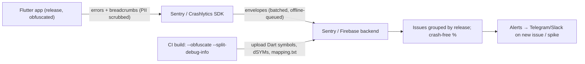

# Flutter - Crash Reporting & Analytics with Sentry & Firebase

> [!info] Deep dive of [[Flutter]]

> [!abstract] TL;DR
> You can't ship a mobile app responsibly without knowing when it crashes.
> - **Capture everything**: `FlutterError.onError` (framework errors), `PlatformDispatcher.instance.onError` (uncaught async errors), plus native crashes/ANRs. The SDKs set this up.
> - **Sentry** (`sentry_flutter`): crashes + errors + performance traces + release health, self-hostable, and good for apps that already use Sentry on Next.js.
> - **Firebase Crashlytics + Analytics**: free, tight Play/iOS integration, and pairs with FCM/Remote Config.
> - **Upload debug symbols** (obfuscated Dart `--split-debug-info`, iOS dSYMs, Android mapping/NDK). Otherwise stack traces are useless.
> - **Tag releases** (version+build) and environments, and track **crash-free users %**.
> - **Scrub PII** (phone, IC, tokens) before events leave the device.

## Concept
| Concern | Sentry | Firebase Crashlytics/Analytics |
|---|---|---|
| Dart errors + native crashes | Yes | Yes (Crashlytics) |
| ANRs (Android) | Yes | Yes |
| Performance tracing | Yes (transactions, spans) | Firebase Performance (separate) |
| Release health / crash-free users | Yes | Yes (stability metrics) |
| Product analytics | Limited | Firebase Analytics (events, audiences) |
| Self-hosting | Yes (heavy) | No |
| Cost | Free tier, paid by volume | Free |
| Pick it when… | Same tool across web + mobile, traces | Already using Firebase (FCM), budget-sensitive |

**Error sources to wire up**:

| Source | Hook |
|---|---|
| Widget build/layout errors | `FlutterError.onError` |
| Uncaught async errors | `PlatformDispatcher.instance.onError` |
| Isolate errors | `Isolate.current.addErrorListener` (if using isolates) |
| Native crashes (Kotlin/Swift/C++) | SDK native integration |
| Handled-but-important errors | `Sentry.captureException` / `FirebaseCrashlytics.recordError` |

## How It Works


## Practical Usage
**Sentry init** (`main.dart`):
```dart
Future<void> main() async {
  await SentryFlutter.init(
    (o) {
      o.dsn = const String.fromEnvironment('SENTRY_DSN');
      o.environment = const String.fromEnvironment('APP_ENV', defaultValue: 'production');
      o.release = 'my.client.app@${const String.fromEnvironment('APP_VERSION')}';
      o.tracesSampleRate = 0.1;                // 10% performance traces
      o.sendDefaultPii = false;
      o.beforeSend = (event, hint) => scrubPii(event);
      o.attachScreenshot = false;              // screenshots may contain personal data
    },
    appRunner: () => runApp(const ProviderScope(child: App())),
  );
}

SentryEvent? scrubPii(SentryEvent e) {
  final re = RegExp(r'(\+?60\d{8,10}|\d{6}-\d{2}-\d{4})');      // phones, MyKad pattern
  return e.copyWith(message: e.message == null ? null : SentryMessage(e.message!.formatted.replaceAll(re, '[redacted]')));
}
```
**Firebase Crashlytics init** (alternative):
```dart
Future<void> main() async {
  WidgetsFlutterBinding.ensureInitialized();
  await Firebase.initializeApp(options: DefaultFirebaseOptions.currentPlatform);
  FlutterError.onError = FirebaseCrashlytics.instance.recordFlutterFatalError;
  PlatformDispatcher.instance.onError = (error, stack) {
    FirebaseCrashlytics.instance.recordError(error, stack, fatal: true);
    return true;
  };
  runApp(const App());
}
```
**Attach context without PII**:
```dart
Sentry.configureScope((s) {
  s.setUser(SentryUser(id: userId));          // internal UUID only
  s.setTag('tenant', tenantId);
});
Sentry.addBreadcrumb(Breadcrumb(message: 'checkout_started', category: 'nav'));
```
**Build + symbol upload in CI**:
```bash
flutter build appbundle --release --obfuscate --split-debug-info=build/symbols \
  --dart-define=APP_VERSION=1.12.0+112 --dart-define=SENTRY_DSN=$SENTRY_DSN
dart run sentry_dart_plugin            # uploads Dart symbols, Android mappings (config in pubspec/sentry.properties)
# iOS: dSYMs uploaded via the plugin or sentry-cli after flutter build ipa
```
**Wrong way**:
```text
❌ Obfuscated release without symbol upload    → stack traces like "a.b.c" — unfixable crashes
❌ setUser(email/phone)                        → PII in third-party tool
❌ tracesSampleRate = 1.0 in production        → quota burned, battery/network overhead
❌ Swallowing errors in try/catch without reporting → silent failures users notice first
```

## Patterns & Anti-patterns
| Pattern | When | Anti-pattern to avoid |
|---|---|---|
| Both global hooks wired (framework + platform) | Every app | Only `FlutterError.onError` |
| Release = version+build, environment tags | Releases | Untagged events |
| Symbols uploaded in CI per build | Obfuscated builds | Manual uploads (forgotten) |
| PII scrubbing in `beforeSend` | Always | Relying on dashboard filters |
| Alerts on new issues + crash-free drop | Production | Checking the dashboard occasionally |
| Staged rollout watching crash-free % | Releases | 100% rollout before data ([[Flutter - Build, Release & Store Compliance]]) |
| Kill switch for crashing features | Incidents | Waiting for store review to fix ([[Flutter - Feature Flags, Remote Config & Forced Updates]]) |

## Performance & Trade-offs
- **Overhead**: crash SDKs are light. Performance tracing and screenshots add CPU/network, so sample traces at 5–20%.
- **Offline queueing**: SDKs cache events and send later, which is important for patchy mobile networks in rural areas.
- **Sentry self-hosted** needs significant resources (Kafka, ClickHouse, Postgres, Redis). SaaS is usually cheaper than your time for small volumes.
- **Firebase dependency** adds Google Play Services assumptions (Huawei devices without GMS need alternatives).

## Tips & Reminders
> [!tip] In ZP's stack
> - **One Sentry org per client**, or client-owned projects, with Next.js + Flutter in the same org: errors across web and mobile in one place, and clear ownership at handover.
> - **Retainer KPI**: crash-free users ≥ 99.5% and an ANR rate below the Play threshold. Report monthly with top issues fixed.
> - **Analytics split**: Crashlytics/Sentry for stability, PostHog/Firebase Analytics for product events. Don't mix concerns ([[Next.js - Product Analytics with PostHog & Plausible]]).

- Record handled errors for important failures (payment errors, sync failures) with context tags.
- Add breadcrumbs for navigation and key actions (no PII).
- Check Play Console Android vitals (ANR/crash thresholds affect store visibility).
- Include the crash tool in the privacy policy and data processing documentation ([[Supabase - Data Retention, PDPA & Account Deletion]]).

## Version Notes
| Date / version | Change relevant here |
|---|---|
| sentry_flutter 8–9 (2024–26) | Improved native integration, session replay for mobile (beta/GA per platform), symbol upload plugin |
| FlutterFire Crashlytics | `PlatformDispatcher.onError` pattern (Flutter 3.3+) |
| Flutter 3.50 (2026-11) | Obfuscation/split-debug-info unchanged. Re-check plugin compatibility after upgrade ([[Flutter - Migrating to 3.50 & Standalone Material Packages]]) |

> [!warning] Unverified — check before relying on this
> Current sentry_flutter major version, mobile session replay status, and `SentryEvent.copyWith` API details weren't verified this run. Check https://docs.sentry.io/platforms/dart/guides/flutter/ and FlutterFire docs.

## Critical Issues & Gotchas
> [!danger] Crash reports leaking personal data
> Error messages, breadcrumbs, request URLs and screenshots can contain phone numbers, IC numbers, addresses or auth tokens, which then sit in a third-party dashboard accessible to many people. That's a PDPA exposure. Disable default PII, scrub in `beforeSend`, avoid screenshots/replay on sensitive screens, and restrict dashboard access.

> [!danger] Releasing without symbols or release tags
> Obfuscated builds without uploaded symbols, and events without release identifiers, make crashes impossible to diagnose or attribute to a version. You can't tell if the hotfix worked. Automate symbol upload and release tagging in CI, and fail the pipeline if the upload fails.

- **Duplicate reporting** when both Sentry and Crashlytics are installed. Pick one for crashes.
- **Debug builds** sending events pollute production data. Set environment or disable in debug.
- **Huawei/AppGallery** devices without GMS: Firebase features may not work.
- **Rate limits/quotas**: a crash loop can exhaust monthly quota in hours. Set spike protection.

## Related
- [[Flutter]]
- [[Flutter - App Security, Obfuscation & Secure Storage]] — obfuscation and symbols
- [[Flutter - Build, Release & Store Compliance]] — staged rollouts and vitals
- [[Flutter - Feature Flags, Remote Config & Forced Updates]] — kill switches for crashing features
- [[Flutter - Performance & DevTools]] — performance investigation
- [[Next.js - Product Analytics with PostHog & Plausible]] — product analytics counterpart

## References
- https://docs.sentry.io/platforms/dart/guides/flutter/
- https://docs.sentry.io/platforms/dart/guides/flutter/upload-debug/
- https://firebase.google.com/docs/crashlytics/get-started?platform=flutter
- https://docs.flutter.dev/deployment/obfuscate
- https://developer.android.com/topic/performance/vitals
