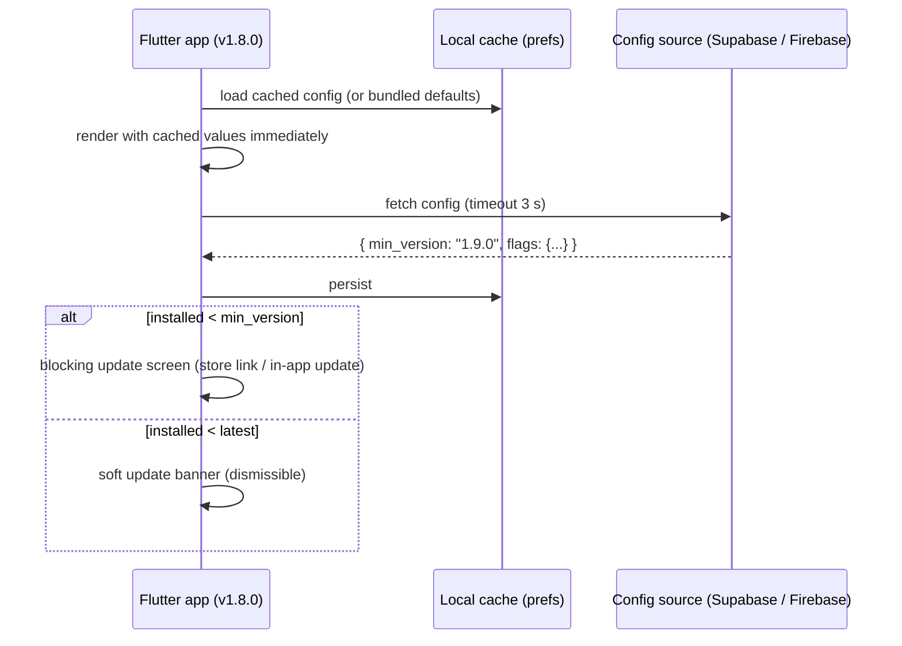

# Flutter - Feature Flags, Remote Config & Forced Updates

> [!info] Deep dive of [[Flutter]]

> [!abstract] TL;DR
> Mobile apps can't be hot-fixed like websites: users run old versions for months, and store review takes hours to days. Three controls matter:
> 1. **Remote config / feature flags**: toggle features, tune values (copy, limits, URLs) and run staged rollouts without a release. Sources: Firebase Remote Config, a Supabase `app_config` table, or a flag service.
> 2. **Kill switches**: disable a broken feature (payments, a new checkout) instantly per platform/version.
> 3. **Minimum supported version** + **forced/soft update** prompts (Play In-App Updates, App Store link).
>
> Plan these **before** v1.0, because you can't add a forced-update check to versions already in users' hands. Cache config locally with safe defaults, so the app works offline and when the config service is down.

## Concept
| Mechanism | Use | Notes |
|---|---|---|
| Feature flag (bool) | Hide/show features, gradual rollout | Default OFF for new risky features |
| Remote value | Copy, thresholds, support phone, banner text | Validate types/ranges |
| Kill switch | Disable broken flows | Checked at the feature entry point |
| Min version (per platform) | Force upgrade for breaking API changes | Compare semver with installed version |
| Soft update prompt | Nudge to newer version | Dismissible, show every N days |
| Targeting | By platform, version, country, tenant, user % | Keep rules simple |
| Code push (Shorebird) | Patch Dart code without store release | Store-policy constraints, not for native changes |

**Config sources**:

| Source | Pros | Cons | Pick it when… |
|---|---|---|---|
| Firebase Remote Config | Free, targeting, A/B, SDK caching | Google dependency, Firebase in app | Already using Firebase (FCM) |
| Supabase `app_config` table + RLS | One backend, SQL-managed, realtime updates possible | Build targeting/caching yourself | Supabase-first apps (ZP default) |
| Flag services (Unleash/Flagsmith/PostHog) | Rich targeting, audit, self-hostable options | Another service | Many flags, product teams |

## How It Works


## Practical Usage
**Supabase table** (public read via RLS, admins write):
```sql
create table public.app_config (
  platform text not null check (platform in ('android','ios','all')),
  key text not null,
  value jsonb not null,
  updated_at timestamptz default now(),
  primary key (platform, key)
);
alter table public.app_config enable row level security;
create policy "read config" on public.app_config for select to anon, authenticated using (true);
insert into public.app_config values
  ('all','min_version','"1.9.0"'), ('all','latest_version','"1.10.2"'),
  ('all','flags','{"new_checkout": false, "wa_login": true}'),
  ('android','store_url','"https://play.google.com/store/apps/details?id=my.client.app"');
```
**Config service with cache + defaults**:
```dart
class AppConfig {
  AppConfig(this.values);
  final Map<String, dynamic> values;
  static const defaults = {'min_version': '1.0.0', 'latest_version': '1.0.0', 'flags': <String, dynamic>{}};
  bool flag(String k) => (values['flags'] as Map?)?[k] == true;
  String get minVersion => values['min_version'] as String;
}

Future<AppConfig> loadConfig(SharedPreferences prefs) async {
  final cached = prefs.getString('app_config');
  var cfg = AppConfig(cached != null ? jsonDecode(cached) : AppConfig.defaults);
  try {
    final rows = await supabase.from('app_config').select('key, value')
        .inFilter('platform', ['all', Platform.isIOS ? 'ios' : 'android'])
        .timeout(const Duration(seconds: 3));
    final map = {for (final r in rows) r['key'] as String: r['value']};
    cfg = AppConfig({...AppConfig.defaults, ...map});
    await prefs.setString('app_config', jsonEncode(cfg.values));
  } catch (_) { /* keep cached/defaults */ }
  return cfg;
}
```
**Version gate**:
```dart
final info = await PackageInfo.fromPlatform();
bool isBelow(String a, String b) {
  final pa = a.split('.').map(int.parse).toList(), pb = b.split('.').map(int.parse).toList();
  for (var i = 0; i < 3; i++) { if (pa[i] != pb[i]) return pa[i] < pb[i]; }
  return false;
}
if (isBelow(info.version, cfg.minVersion)) {
  if (Platform.isAndroid) {
    final u = await InAppUpdate.checkForUpdate();
    if (u.updateAvailability == UpdateAvailability.updateAvailable) await InAppUpdate.performImmediateUpdate();
  }
  // fallback / iOS: blocking screen with store link (url_launcher)
}
```
**Kill switch at feature entry**:
```dart
if (!config.flag('new_checkout')) return const LegacyCheckoutPage();
return const NewCheckoutPage();
```
**Wrong way**:
```text
❌ No version check in v1.0                       → can't force users off a broken/insecure version later
❌ Blocking app start on config fetch              → offline users stuck on splash screen
❌ Flags evaluated only client-side for paid features → users flip them via proxy/modded app
❌ Forced update with no fallback store link       → users on sideloaded/older devices stuck forever
```

## Patterns & Anti-patterns
| Pattern | When | Anti-pattern to avoid |
|---|---|---|
| Ship min-version check + kill switch in v1.0 | Every app | Adding them after problems appear |
| Cached config + bundled defaults | Offline/slow networks | Network-dependent startup |
| Soft update first, force only for breaking/security issues | Releases | Forcing every minor update |
| Server-side enforcement for entitlements | Paid features | Client flags as security |
| Remove stale flags after full rollout | Flag hygiene | Hundreds of dead flags |
| Backward-compatible APIs for N previous app versions | Backend changes | Breaking old app versions on deploy |
| Staged rollouts in Play/App Store + flags | Risky releases | 100% rollout on day one |

## Performance & Trade-offs
- **Fetch frequency**: Firebase throttles fetches (minimum fetch interval). Supabase reads are cheap, but cache for minutes to hours, and use Realtime only if instant toggles matter ([[Supabase - Realtime, Presence & Broadcast]]).
- **Forced updates** frustrate users on limited data/storage (common on budget phones). Reserve them for breaking changes or security fixes.
- **Code push (Shorebird)** shortens fix time for Dart-only bugs, but adds a dependency and must respect store rules (no feature changes that bypass review). Native or plugin changes still need store releases.
- **Flag services** add a network dependency and SDK. Self-hosted Unleash/Flagsmith avoids vendor lock-in, at the cost of operating another service.

## Tips & Reminders
> [!tip] In ZP's stack
> - **Template for client apps**: `app_config` table + loader + version gate + kill switches in the Flutter starter. Every client app ships with them from v1.0.
> - **Backend compatibility**: Next.js/Supabase APIs must support the oldest allowed app version. Raise `min_version` before removing old endpoints/columns ([[Docker - Healthchecks, Restart Policies & Zero-Downtime Deploys]]).
> - **Incident playbook**: broken payment flow in v1.12 → flip kill switch → hotfix release → raise min_version once adoption is high.

- iOS has no in-app update API. Show a blocking screen with an App Store link (`itms-apps://` / store URL).
- Use Play staged rollouts (e.g. 10% → 50% → 100%) with crash monitoring.
- Log which flags/config version each session used, to debug user reports.
- Keep the config readable but not secret. Never put API keys in remote config.

## Version Notes
| Date / version | Change relevant here |
|---|---|
| Play Core → Play In-App Updates library | Immediate/flexible updates on Android (Flutter `in_app_update` plugin) |
| Firebase Remote Config | Real-time config listeners (2023), A/B testing |
| Shorebird (2024–25) | Code push for Flutter (Dart code patches) on iOS/Android |
| Flutter 3.47 / 3.50 (2026) | Current ([[Flutter]]) |

> [!warning] Unverified — check before relying on this
> Current plugin APIs (`in_app_update`, `upgrader`), Shorebird pricing and store-policy statements, and Firebase fetch-interval limits weren't verified this run. Check pub.dev and the official docs.

## Critical Issues & Gotchas
> [!danger] No way to retire broken or insecure versions
> Without a minimum-version mechanism shipped from the first release, a version with a security bug (exposed key, broken auth flow) or an incompatible API stays in use indefinitely. You're forced to keep legacy endpoints alive or break users without explanation. Ship the version gate and kill switches in v1.0 ([[Flutter - Build, Release & Store Compliance]]).

> [!danger] Feature flags as access control
> Client-side flags are visible and modifiable (proxy tools, modded APKs). Gating paid features or admin tools only by a remote flag lets users unlock them. Enforce entitlements server-side (RLS/RPC checks), and use flags for rollout and UX only ([[Flutter - App Security, Obfuscation & Secure Storage]]).

- **Version parsing**: build numbers vs semver (`1.10.0` > `1.9.0`). Compare numerically, not as strings.
- **Config schema changes**: old app versions must tolerate unknown/missing keys. Always merge with defaults.
- **Store review**: Apple may reject apps whose remote config hides functionality from reviewers. Don't toggle core features to evade review.
- **Time-based flags** need server time, not device time (users change clocks).

## Related
- [[Flutter]]
- [[Flutter - Build, Release & Store Compliance]] — staged rollouts and store policies
- [[Flutter - Supabase Integration, Auth & Realtime]] — config table access
- [[Flutter - State Management]] — exposing config via providers
- [[Flutter - Offline Storage & Sync]] — caching config locally
- [[Flutter - App Security, Obfuscation & Secure Storage]] — client-side tampering risks

## References
- https://firebase.google.com/docs/remote-config/get-started?platform=flutter
- https://pub.dev/packages/in_app_update
- https://pub.dev/packages/upgrader
- https://developer.android.com/guide/playcore/in-app-updates
- https://docs.shorebird.dev/
