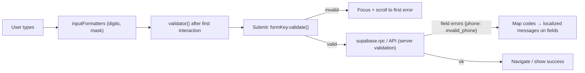

# Flutter - Forms, Validation & Input UX

> [!info] Deep dive of [[Flutter]]

> [!abstract] TL;DR
> - Use built-in **`Form` + `TextFormField`** with a `GlobalKey<FormState>` and **`AutovalidateMode.onUserInteraction`**. Put validation in **pure functions** shared with tests, and map **server-side field errors** (RPC/API codes) back onto fields.
> - **Input UX does most of the work**: the right `keyboardType`, `textInputAction` + focus traversal, **input formatters** (digits, MY phone, IC number), **`AutofillGroup` + `autofillHints`**, and scrolling to the first error.
> - The server re-validates everything, because client validation is only a convenience.
> - Reach for `reactive_forms`/`flutter_form_builder` only for large dynamic forms.

## Concept
| Piece | Role | Notes |
|---|---|---|
| `Form` + `GlobalKey<FormState>` | Groups fields, `validate()`, `save()`, `reset()` | One key per form instance |
| `TextFormField` | Field with `validator`, `onSaved`, `controller` | `validator` returns `String?` (null = valid) |
| `AutovalidateMode` | When errors show | `onUserInteraction` (after first edit), `onUnfocus` (newer Flutter), `always` (noisy) |
| `TextEditingController` / `FocusNode` | Value and focus control | Dispose them in `State.dispose` |
| `inputFormatters` | Constrain/format while typing | `FilteringTextInputFormatter.digitsOnly`, `LengthLimitingTextInputFormatter`, custom |
| `AutofillGroup` + `autofillHints` | OS password manager / SMS OTP autofill | `AutofillHints.email`, `.password`, `.oneTimeCode`, `.telephoneNumber` |
| `textInputAction` + `onFieldSubmitted` | Next/done keyboard buttons | Move focus with `FocusScope.of(context).nextFocus()` |

**Validation layers**:

| Layer | Checks | Example |
|---|---|---|
| Formatter (while typing) | Character set, length | Digits only for IC |
| Field validator (on change/submit) | Format, required, ranges | MY mobile pattern, IC checksum-ish date check |
| Form-level (on submit) | Cross-field rules | Pickup time after opening time |
| Async (debounced) | Uniqueness, availability | Username/slug taken |
| Server (authoritative) | Everything again + permissions | RPC returns `invalid_phone`, `out_of_stock` |

## How It Works


## Practical Usage
**Pure validators** (unit-testable, localized at the edge):
```dart
final _myMobile = RegExp(r'^(\+?60|0)1[0-9]{8,9}$');           // 01X-XXXXXXX(X), +60 prefix optional

String? validateMyMobile(String? v) {
  final digits = (v ?? '').replaceAll(RegExp(r'[\s-]'), '');
  if (digits.isEmpty) return 'required';
  return _myMobile.hasMatch(digits) ? null : 'invalid_phone';
}

String? validateIc(String? v) {                                  // MyKad: YYMMDD-PB-###G → 12 digits
  final d = (v ?? '').replaceAll('-', '');
  if (!RegExp(r'^\d{12}$').hasMatch(d)) return 'invalid_ic';
  final mm = int.parse(d.substring(2, 4)), dd = int.parse(d.substring(4, 6));
  if (mm < 1 || mm > 12 || dd < 1 || dd > 31) return 'invalid_ic';
  return null;
}
```
**Form with focus traversal, formatters and autofill**:
```dart
class CheckoutForm extends ConsumerStatefulWidget {                // Riverpod; plain StatefulWidget works the same
  const CheckoutForm({super.key});
  @override
  ConsumerState<CheckoutForm> createState() => _S();
}

class _S extends ConsumerState<CheckoutForm> {
  final _formKey = GlobalKey<FormState>();
  final _phone = TextEditingController();
  String? _serverPhoneError;

  @override
  void dispose() { _phone.dispose(); super.dispose(); }

  @override
  Widget build(BuildContext context) {
    final t = AppLocalizations.of(context);
    return Form(
      key: _formKey,
      autovalidateMode: AutovalidateMode.onUserInteraction,
      child: AutofillGroup(
        child: Column(children: [
          TextFormField(
            decoration: InputDecoration(labelText: t.name),
            textInputAction: TextInputAction.next,
            autofillHints: const [AutofillHints.name],
            validator: (v) => (v == null || v.trim().isEmpty) ? t.errRequired : null,
          ),
          TextFormField(
            controller: _phone,
            decoration: InputDecoration(labelText: t.phone, prefixText: '+60 ', errorText: _serverPhoneError),
            keyboardType: TextInputType.phone,
            textInputAction: TextInputAction.done,
            autofillHints: const [AutofillHints.telephoneNumber],
            inputFormatters: [FilteringTextInputFormatter.allow(RegExp(r'[0-9 ]')), LengthLimitingTextInputFormatter(12)],
            validator: (v) => switch (validateMyMobile('0$v')) { null => null, final code => t.err(code) },
            onChanged: (_) { if (_serverPhoneError != null) setState(() => _serverPhoneError = null); },
            onFieldSubmitted: (_) => _submit(),
          ),
          FilledButton(onPressed: _submit, child: Text(t.placeOrder)),
        ]),
      ),
    );
  }

  Future<void> _submit() async {
    if (!_formKey.currentState!.validate()) return;              // field errors shown, first invalid field visible
    final r = await ref.read(checkoutProvider.notifier).submit(phone: '+60${_phone.text.replaceAll(' ', '')}');
    if (r case CheckoutFailed(code: 'invalid_phone')) setState(() => _serverPhoneError = AppLocalizations.of(context).err('invalid_phone'));
  }
}
```
**Debounced async validation** (slug availability):
```dart
Timer? _debounce;
void onSlugChanged(String v) {
  _debounce?.cancel();
  _debounce = Timer(const Duration(milliseconds: 400), () async {
    final taken = await supabase.rpc('is_slug_taken', params: {'p_slug': v});
    setState(() => _slugError = taken == true ? t.errSlugTaken : null);
  });
}
```
**Wrong way**:
```dart
TextFormField(validator: (v) => v!.length < 10 ? 'Invalid' : null);    // ❌ English hardcoded, crashes on null
final c = TextEditingController();                                    // ❌ created in build(): leaks, loses text on rebuild
autovalidateMode: AutovalidateMode.always                             // ❌ errors before the user typed anything
// ❌ trusting client validation: API accepts any phone/price the app sends
```

## Patterns & Anti-patterns
| Pattern | When | Anti-pattern to avoid |
|---|---|---|
| Pure validator functions returning codes | All forms | Validation logic inline in widgets |
| Error codes → localized messages | BM/EN/ZH apps | Hardcoded English strings |
| Server field errors mapped onto fields | RPC/API validation | Generic snackbar "Something went wrong" |
| `onUserInteraction` / `onUnfocus` autovalidate | Most forms | `always` |
| Keyboard type + formatters + autofill | Phone, OTP, email, IC | Plain text keyboard for numbers |
| Disable submit while submitting, idempotency key per submit | Orders, payments | Double-tap creating two orders |
| `reactive_forms` / `flutter_form_builder` | Large, dynamic or schema-driven forms | A package for a 3-field login form |

## Performance & Trade-offs
- **Rebuild scope**: `setState` on a big form rebuilds everything. Isolate expensive sections or keep field state in controllers/providers ([[Flutter - State Management]]).
- **Formatters vs validators**: formatters prevent invalid input but can fight IME composition (Chinese/Malay predictive input) and paste. Keep them permissive (allow spaces/dashes) and normalize on submit.
- **Async validation** costs network calls. Debounce 300–500 ms, and cancel stale requests.
- **Packages**: `reactive_forms` gives model-driven forms and validators. `formz` gives lightweight typed inputs for BLoC. Both add a learning curve, and built-in `Form` covers most SME app screens.

## Tips & Reminders
> [!tip] In ZP's stack
> - **Share error codes with the backend**: Supabase RPCs return codes like `invalid_phone` and `out_of_stock`, the Flutter app maps them to `AppLocalizations`, and the Next.js web uses the same codes ([[Supabase - Database Functions, Triggers & RPC]], [[React - Forms, Actions & Optimistic UI]]).
> - **Phone numbers**: store E.164 (`+60123456789`). Display formatted. OTP fields use `AutofillHints.oneTimeCode` for SMS autofill (WhatsApp OTP needs manual entry or a copy-code button).
> - **IC numbers**: collect only when legally needed, mask in UI after entry, and never log them (PDPA).

- Wrap long forms in a scroll view, and use `Scrollable.ensureVisible` on the first invalid field's context.
- Give every field a visible label (not only a hint) for accessibility. Error text is announced by screen readers.
- Money input: accept "12.50", store integer sen, and validate ranges server-side ([[Dart - Code Generation with build_runner, freezed & json_serializable]]).
- Widget-test forms: enter text, tap submit, assert error texts and that the RPC isn't called on invalid input ([[Flutter - Testing]]).

## Version Notes
| Version | Change relevant here |
|---|---|
| Flutter 2.x | `AutofillGroup`/`autofillHints`, `AutovalidateMode` replaces `autovalidate: bool` |
| Flutter 3.x | Material 3 input decorations. `AutovalidateMode.onUnfocus` added in recent versions |
| Flutter 3.47 (2026-08) | Current stable at re-check ([[Flutter]]) |

> [!warning] Unverified — check before relying on this
> The Flutter release that introduced `AutovalidateMode.onUnfocus`, and current versions of `reactive_forms`/`flutter_form_builder`, weren't checked. The MY mobile regex covers common 01X formats but not every edge case, so validate authoritatively server-side.

## Critical Issues & Gotchas
> [!danger] Client-side validation is not security
> Anyone can call your Supabase RPC or API directly with any payload: negative quantities, other tenants' IDs, a price of RM 0. Validate and authorize on the server (RPC checks, RLS, constraints) for every field that matters, and treat the app's validation purely as UX ([[TypeScript - Runtime Validation with Zod & Type-Safe APIs]]).

> [!danger] Double submission creates duplicate orders
> Slow networks plus impatient taps send the same order twice. Disable the button while submitting, show progress, and send an idempotency key the server enforces (unique constraint), so duplicates are impossible even if the UI fails.

- **Controllers created in `build`** reset text on every rebuild and leak. Create them in `initState`/`State` fields and dispose them.
- **`GlobalKey` reuse** across two forms on screen throws errors. One key per form instance.
- **Keyboard covering fields**: ensure `Scaffold(resizeToAvoidBottomInset: true)` and scrollable content, especially on small Android phones.
- **Autofill on Android** needs the OS autofill service enabled. Test with Google Password Manager and Samsung Pass.

## Related
- [[Flutter]]
- [[Flutter - State Management]] — form state in providers/BLoC
- [[Flutter - Internationalization & Localization]] — localized error messages
- [[Flutter - Testing]] — widget tests for forms
- [[React - Forms, Actions & Optimistic UI]] — the web counterpart with shared error codes
- [[Supabase - Database Functions, Triggers & RPC]] — server-side validation and error codes

## References
- https://docs.flutter.dev/cookbook/forms/validation
- https://api.flutter.dev/flutter/widgets/Form-class.html
- https://api.flutter.dev/flutter/widgets/AutofillGroup-class.html
- https://api.flutter.dev/flutter/services/FilteringTextInputFormatter-class.html
- https://pub.dev/packages/reactive_forms
